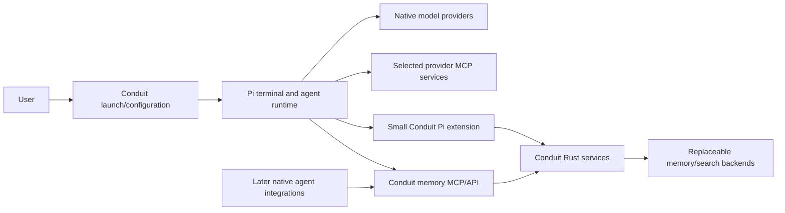

# Pi research and implications for Conduit

Research date: 2026-10-30. This is an evidence report and proposal, not a replacement
specification. The user has selected **Pi as the first frontend for the v0 experiment**.
Other recommendations below await review. No Conduit implementation or live account
experiment was performed.

For a quick review, read the recommendation below, then
[what changes](#changes-to-absorb-decisions-to-retain-choices-to-reopen) and the
[experiment sequence](#proposed-experiment-sequence). The detailed evidence is grouped
by [integration](#integration-shape-keep-the-first-frontend-native),
[accounts](#models-subscriptions-and-the-four-account-requirement),
[memory](#three-different-meanings-of-memory),
[MCP](#native-mcp-is-a-strong-fit-with-important-details),
[observability](#observability-good-inputs-still-a-conduit-attribution-problem),
[Durable/Rust](#pi-durable-chord-and-the-rust-opportunity), and
[communication](#communication-research-for-the-upcoming-redesign).

## Recommendation for the collaborator review

**Use Pi as the first complete agent integration, and make Conduit substantially
smaller.** Reuse Pi's terminal interface, execution loop, model/provider support,
native skills/packages, MCP client, and conversation storage. Concentrate Conduit on
the connections between independently configured sessions: account bindings, shared
memory, scoped access, portable checkpoints, observation, and communication.

Pi is more than a frontend. A normal Pi session runs Pi's agent loop against a selected
model provider. A Pi session using a Claude subscription is not Claude Code; one using
a ChatGPT subscription is not the Codex CLI. The model, subscription, runtime, and
frontend must remain distinct in our configuration and acceptance claims.

The strongest reason to build Conduit remains intact: none of the components inspected
provides our complete combination of independently authenticated accounts, session-specific
state, cross-runtime memory with explicit scopes, and a runtime-independent communication
contract. Pi considerably reduces the integration work; it does not make those boundaries
unnecessary.

I recommend five changes in emphasis:

1. Start with **stock Pi plus a small Conduit extension**, coordinated by the Rust core.
   Use Pi's native providers before writing provider adapters of our own.
2. Treat **native conversation state, durable execution, and shared knowledge as three
   different facilities**. Reuse each where it fits instead of unifying their storage.
3. Express integrations as **capabilities with stated coverage**, rather than assuming
   every runtime supports identical authentication, hooks, detach, or telemetry.
4. Use existing packages through native installation and explicit selection. Adopt
   mechanisms from memory/communication extensions without inheriting their global
   memory, automatic injection, or automatic wake policies.
5. Evaluate **Pi Durable as an optional execution integration**, not as Conduit's required
   database or a reason to replace the Rust core with a TypeScript framework.

The first review should settle the runtime meaning of the four-account experiment,
the Pi integration boundary, and account identity evidence. Communication redesign and
concrete YAML follow. There is no reason to reopen every settled memory/access rule.

## Evidence and version boundaries

The starting points were the supplied [documentation index][pi-index] and
[Pi documentation site](https://pi.dev/docs/latest), followed by source, upstream tests,
local pstack/jxp/agentwatch references, and representative ecosystem packages.

| Source | Inspected revision / version | Significance |
| --- | --- | --- |
| Pi development checkout | `f09d01b85e0384647fcab6779d35ab9dabe04be3`, 2026-10-29 | Main source snapshot used for detailed analysis; contains unreleased changes. |
| Pi release baseline | `v1.4.0`, `4a080252f06caf63a525d7873c5d94d3c23887e0`, release commit 2026-10-22 | The `stable` ref resolved here during research. Package version strings on main still say 1.4.0 and do not prove release equivalence. |
| Local pstack-pi | `c87e65f8ed7ee80d9dc38faeabacc103fce14bc7`, package 0.1.0 | Its real-Pi test harness targets Pi **0.85.1**. |
| Local jxp-skills | `b49a754de4cbbf595b40c05b77039e8b8b380e52` | Usage reconciliation and native workflow reference. |
| Local agentwatch | `04025a6f8e3887b8c1152ea44930e1c429b75948` | Rust communication/access reference for the later redesign. |
| earendil-works/pi-chat | `9adbd29b40ee27ff1decf0fc87cbe180b40924f5`, 0.1.0 | Alternate frontend, worker lifecycle, and tool-environment reference. |
| nicobailon/pi-messenger | `09937ed647a1b07a3b595bf75943feacb80ff123`, 0.15.2 | Local inter-agent messaging and coordination. |
| jayzeng/pi-memory | `1e276a762a666a7031459fdf7af018cc7966663e`, 0.4.2 | Markdown memory, optional qmd search, extraction/injection behavior. |
| josephkern/pi-memory | `312627ffc5a47de690b3066276009e7d651f8729`, 0.3.0 | Bounded memory loading, page representations, writeback journal. |
| desek/agent-observability | `bab5337e75adb295c67a6f73f83e6a80fc80b82e`; Pi OTEL package 0.1.1 | Exporter and event instrumentation reference; development dependency targets Pi 0.80.3. |

The release and development copies of Pi's MCP, RPC, SDK, and telemetry documentation,
`AuthStorage`, and the new OpenAI subscription OAuth implementation were compared and
are identical at these revisions. Other details, especially Durable/Chord and some
telemetry helpers, are development-snapshot findings unless stated otherwise. For
example, preserving `totalFromProvider` when combining usage was added after v1.4.0.
The [Durable changelog][durable-changelog] contains substantial unreleased contract changes.
Pin the actual experiment revision and package set; do not build against an assumed
meaning of `latest`, `main`, or a permissive peer-dependency range.

Evidence strength throughout this report:

- **Source/documented:** behavior was inspected; this is not a claim of live validation.
- **Upstream test evidence:** a relevant test exists and was read; unless listed below,
  it was not executed in this research session.
- **Locally checked:** the limited offline checks in the validation section passed.
- **Proposal:** an architectural inference or recommendation for Conduit.

## What the Pi ecosystem actually contains

| Component | Existing responsibility | Suggested Conduit relationship |
| --- | --- | --- |
| `pi-coding-agent` | Terminal UI, persistent sessions, settings/resources, extension lifecycle, native tools, CLI/RPC/SDK | First frontend **and** runtime integration. |
| `pi-ai` | Provider/model registry, streaming, subscription/API authentication, cross-provider message conversion, usage | Consume through Pi initially; avoid a duplicate provider framework. |
| `pi-agent-core` | Agent loop, tools, steering/follow-up behavior, in-memory working state | Leave execution to Pi; no need to reimplement this loop in Rust. |
| `pi-mcp` and built-in MCP extension | Native MCP clients, tool/resource exposure, HTTP OAuth | Reuse provider-native connections, with Conduit-selected configuration. |
| `pi-codemode` / tool search | Programmatic tool composition and deferred discovery | Preserve as optional native behavior; account for nested calls when observing access. |
| `pi-durable` | Persistent conversations, tasks, documents, recovery, submissions, storage adapters | Optional future runtime integration and a rich design reference. Experimental API. |
| `chord` | Typed contracts, object hosts, JSON state subscriptions, RPC links, host/process utilities | Study contract/capability patterns; do not make it Conduit's mandatory internal framework. |
| `pi-telemetry` | Explicit span/metric contracts, no-op/reference implementations, conformance support | Instrumentation reference or adapter input, not a ready-made monitoring deployment. |
| `pi-env` | Local/remote execution environments and a Rust daemon for file/process/PTY operations | Particularly relevant Rust reference; evaluate separately from sandboxing and durable supervision. |
| Native packages | Skills, extensions, prompts, themes from npm/git/local directories | Directly supports BYOS and role-selected bundles. |

The [Pi 1.0 announcement](https://earendil.com/posts/pi-1-0/) and
[Durable introduction](https://earendil.com/posts/pi-durable/) explain the split between
the human-facing coding agent and the separate durable harness. Older descriptions
of Pi as lacking MCP are obsolete. Current source has native MCP; installing an older
MCP adapter by default would duplicate or even replace that implementation.

## Integration shape: keep the first frontend native

Pi offers four different integration surfaces, not four equivalent wrappers:

| Surface | Best fit | Boundary that matters |
| --- | --- | --- |
| Native terminal plus extension | First human-facing Conduit experiment | Retains Pi UI and native commands; extension can register tools, hooks, UI, and MCP servers. |
| RPC subprocess | Rust-controlled/headless Pi, later alternate UI | JSONL stdin/stdout controls a separate process. It is an alternate mode, not an attachment API for any running TUI. |
| TypeScript SDK | Applications embedding Pi or replacing resource discovery | Strong control over sessions/settings/credentials; adds a Node/Bun integration process and UI responsibility. |
| Print / JSON mode | Bounded jobs and native subprocess subagents | One-shot invocation; JSON event success/failure must be interpreted, not inferred only from exit status. |

**Proposed v0 arrangement:** Rust owns configuration resolution and shared services.
A small Pi extension binds the running Pi session to a Conduit execution, exposes
status and lifecycle hooks, and connects to Conduit capabilities. Selected upstream
MCP services remain native Pi connections. Conduit memory remains available through
its own MCP/API contract, usable by a later Claude Code or Codex integration too.



This is a responsibility diagram, not a selected daemon topology. It preserves the
user's preference for provider-native operations rather than one renamed universal
tool namespace. Pi's extension event bus is process-local; it is not the cross-session
Conduit transport.

Do not start by embedding the entire SDK and recreating Pi's terminal. Use RPC when a
headless runtime is needed. If strict configuration loading proves impractical through
the CLI, a small SDK host with an explicit `ResourceLoader` is the next option; that is
a reasoned fallback, not a requirement to fork Pi. [SDK][sdk] · [CLI integration][cli-integration]

### Lifecycle details an adapter must preserve

- A successful RPC `prompt` response means accepted, queued, or handled. It does not
  prove the agent finished the requested work.
- `agent_end` closes a low-level run; retries, compaction, or queued work may follow.
  `agent_settled` is the useful boundary for “Pi will not continue automatically.”
- Subscribe before submitting input. Bind subscriptions again when a runtime operation
  replaces the active `AgentSession`.
- Aborting does not necessarily clear queued input. The adapter must explicitly decide
  whether cancellation also clears queues.
- Session reload/switch/fork/shutdown events have reasons. Reloading an extension must
  not accidentally close the logical Conduit session.
- RPC closes when its input pipe ends. A launcher holding that pipe is not durable
  supervision. Preserving execution after frontend detachment needs a supervisor/PTY
  owner or a deliberately bounded compatibility claim.
- RPC request IDs correlate responses; they are not Conduit's durable operation-ID
  and replay guarantee.
- RPC extension dialogs cover only part of the terminal UI contract. `hasUI` can be
  true in RPC mode without custom TUI components being available; a rich pstack widget
  cannot be assumed portable to every frontend.

These distinctions are supported by the [RPC contract][rpc],
[prompt response tests][rpc-tests], and [SDK lifecycle documentation][sdk].
They strengthen our existing lifecycle/retry rules rather than requiring new ones.

## Models, subscriptions, and the four-account requirement

### Reuse the providers, keep account bindings explicit

Pi exposes model switching, reasoning settings, scoped model lists, compatible API
endpoints, and extension-provided providers/models. Its model runtime also supports
virtual models: the selected router and the model that actually answered can differ.
Record the actual producing provider/model from response evidence, alongside the
selected configuration. A role's display name or the `PI_MODEL` shell variable is not
sufficient attribution. [Models][models] · [Environment variables][environment]

Pi supports Anthropic subscription OAuth and OpenAI ChatGPT subscription OAuth.
At the inspected release, the `openai` provider supports “Sign in with ChatGPT”;
`openai-codex` is marked legacy. An old example hardcoding the legacy provider should
not determine our new configuration. Availability in source does not prove account
eligibility, successful login, or compatibility with every subscription/workspace.
[OpenAI provider][openai-provider] · [Anthropic provider][anthropic-provider]

### A provider store is not a multi-account role registry

Pi's credential store has one credential per provider key. Two Claude accounts do
not coexist merely because two Conduit roles reference the same `auth.json`. Separate
stores/profiles, or a carefully implemented store adapter, are needed. Pi's file-backed
`AuthStorage` serializes modifications and refresh-related access; copying rotating
tokens into several independently refreshing files is not equivalent to sharing a
single account safely. [AuthStorage][auth-storage] · [Auth tests][auth-tests]

The design should distinguish:

| Object | Reuse rule |
| --- | --- |
| Role configuration | Reusable defaults and selected native sources. Contains account references, not embedded secrets. |
| Account credential store | One selected identity; reusable only through a validated native credential/refresh mechanism. |
| Native session state | Private to the Conduit session/execution lineage. Never made common merely because accounts match. |
| Shared Conduit memory | Retrieved through current effective scopes. Not implemented by sharing agent home directories. |

`PI_CODING_AGENT_DIR`, `--session-dir`, explicit session paths, and SDK-supplied
`modelRuntime`/`SessionManager` provide useful separation points. They are configuration
boundaries, not OS isolation. Some community extensions hardcode `~/.pi/agent` or use
their own environment variable; they must be checked individually.

For the first experiment, one Pi process and private profile per account/session is
the simplest candidate. Testing several sessions sharing one account is a separate
follow-up: it needs shared refresh ownership plus session-private history/configuration.
Do not solve this by repeatedly overwriting a global profile.

### Identity verification is still a real gap

Pi login support does not automatically provide Conduit's verified account identity.
The inspected new OpenAI OAuth code explicitly does not use the returned ID token to
read user profile data. Provider labels and credential presence are insufficient to
prove that two enrolled profiles represent distinct people/accounts. We need a supported
identity signal, or a clearly marked user-attested enrollment until one is available;
the latter would be a deliberate relaxation of our current verification requirement.
Do not parse tokens casually, log secrets, or silently call the profile verified.
[OpenAI OAuth implementation][openai-auth]

Also test missing/expired credentials and ambient environment behavior. Current Pi
resolution treats an existing stored credential as authoritative and does not silently
fall back after its refresh fails, but environment/explicit API-key inputs still matter
when resolving a provider. Conduit must not accidentally switch subscription work to
API billing. [Credential resolution][auth-resolution]

**Decision to bring back:** does the first four-account milestone mean four Pi sessions
using two Anthropic and two OpenAI subscription identities, followed by native
Claude Code/Codex validation? I recommend that order. It tests accounts and shared
memory sooner, but does not establish portability across different agent runtimes.

## Three different meanings of memory

| Facility | What Pi supplies | What Conduit still owns |
| --- | --- | --- |
| Working conversation | Active context, tools, compaction, model switching | Logical identity, access-aware handoff, and supported runtime transitions. |
| Persisted native history / durable execution | JSONL session trees; separately, Durable tasks/documents/recovery | Retention accounting, exact source references, execution bindings and coverage. |
| Shared knowledge | Community extensions and configurable external tools/backends | Scope-aware retrieval and writes, revisions, ownership, provenance, explicit sharing, portable checkpoints. |

### Native continuity is useful but not lossless portability

Pi persists a JSONL entry tree. Branch selection and compaction determine what goes
to the model; stored history is larger than current working context. `SessionManager`
is authoritative for reconstructed context. An in-memory message-array assignment
does not replace the persisted conversation. [Sessions][sessions] · [Session format][session-format]

Cross-provider conversion handles incompatible tool IDs and model-specific content.
At the inspected source, thinking from a different model is omitted, unsupported
images become placeholders, and orphaned tool calls can receive synthetic error results.
Those are useful compatibility transformations, not a claim that two models see
identical context. Eight local assertions checked selected transformation and usage
behaviors; they did not call either provider. [Message transformation][transform]

Keep the accepted portable checkpoint contract. Pi compaction summaries and native
exports are supporting sources, not automatically Conduit checkpoints. A Conduit
checkpoint still needs the objective, constraints, decisions, progress/evidence,
remaining work, and source links. Pi `/fork` and `/clone` can preserve native history;
they are not identical to Conduit's checkpoint-seeded fork. Map native branch operations
separately, and do not make “fresh” secretly reuse prior session history.

### Use memory packages as mechanisms, not authority models

The package survey shows several credible implementation directions:

| Reference | Useful mechanisms | Mismatch with the current Conduit contract |
| --- | --- | --- |
| jayzeng/pi-memory | Human-readable durable notes/logs, recoverable deletion, optional qmd keyword/semantic/hybrid search, health reporting | Its memory root is independent of Pi's agent-dir override; startup/injection/extraction and embedding jobs can add context/work automatically. Markdown operations are not our record-revision/ACL contract. |
| josephkern/pi-memory | Bounded loading, explicit truncation, derived page representations, resident-set budgeting, writeback journal and traces | Global/project location conventions are not session scopes. The default root is hardcoded under the user's home, and prompt injection is automatic. Its writeback journal is not proof of multi-process conflict safety. |
| Pi session custom entries | Persist extension-owned state and recover it along the active branch | Private runtime state; no cross-runtime searchable knowledge service or access policy by itself. |
| Pi Durable documents | Typed transactional updates and persistent state | Lifecycle/document scope differs from authorization; no automatic implementation of Conduit knowledge operations or cross-context sharing. |

The second memory package's README still describes a simple capped index, while its
current source also selects typed page representations under a token budget. Its 40
offline tests passed. This is a useful example of why the report follows implementation
as well as headlines. Neither test success nor a filesystem directory named `scope`
establishes Conduit access semantics. [Memory A source][memory-a] ·
[Memory B injection][memory-b-inject] · [Memory B storage][memory-b-storage] ·
[Memory B writeback][memory-b-writeback]

**Recommended absorption:** bounded excerpts, explicit full reads, source references,
clear coverage/freshness reporting, and optional future context budgets. Keep automatic
extraction, automatic classification, and prompt injection optional and deferred, as
already decided. Agent-directed writes and searches are sufficient for the first trial.

For the minimal backend, a local transactional store with lexical search is a reasonable
candidate to evaluate before adding embeddings. This is a proposal, not a database
selection. Xerj/qmd/vector or graph services can sit behind storage/search adapters
where their capabilities fit. We need a canonical record/access contract; we do not
need to invent a new search engine or make an embedding index the sole source of truth.

An adapter should report support for revision checks, immutable revision reads,
archive/purge behavior, filtering, limits, and coverage. If a backend only indexes text,
Conduit can own canonical metadata and use that backend as a search projection.
Scope enforcement must cover search output, excerpts, full reads, caches, and direct-ID
reads; a Pi prompt instruction to avoid private data is not a substitute.

## Native MCP is a strong fit, with important details

Pi's built-in MCP support includes stdio and Streamable HTTP, registration/login commands,
server configuration, dynamic extension registration, native tool calls, and resource
list/read tools. Legacy SSE is not supported at the inspected baseline. User-level
`mcp.json` and trusted project `.pi/mcp.json` are distinct sources; same-name project
entries and partial overrides have defined precedence. [MCP documentation][mcp]

Native MCP support does not imply every protocol/UI feature is implemented. Pi omits
MCP Apps resources because it does not render their UI. Validate any required prompts,
sampling, notifications, or extensions against the chosen host version instead of
assuming full protocol coverage from tool support.

This fits the accepted separation between a reusable connection definition and each
runtime's live clients. Two Pi processes can use the same server definition with
different effective tool selections and authentication bindings. That does not imply
one shared stdio process, OAuth session, client connection, or account.

Pi MCP OAuth storage keys include server name and URL. Reusing an endpoint alone does
not guarantee credential reuse; separate aliases can cause separate sign-ins. Decide
explicitly which resource account each selected connection uses. Model credentials
and MCP credentials remain different concerns.

### Exposure is not authorization

Pi offers `direct`, `deferred`, `codemode`, and `hidden` exposure. The default is codemode.
Direct exposure is the most straightforward initial candidate for preserving familiar
provider tools; compare it with deferred discovery once behavior is measured.

- Active tool declarations are not the full callable surface. Deferred/codemode tools
  can remain reachable through tool search or nested calls.
- `--tools` with only ordinary tool names does not automatically exclude MCP tools.
  Pi applies its MCP selector rules separately. Explicit exclusion/disabled servers
  and runtime validation are necessary when translating scopes.
- MCP tool names are namespaced (`mcp__server__tool`) and normalized. Preserve provider
  schemas/meaning, and record the mapping where the spelling changes.
- Resource list/read access is a separate surface; restricting tool names does not
  automatically express our per-resource operations and selectors.
- A server registered dynamically by an extension can be shadowed by file configuration.
  A third-party adapter registering `/mcp` can replace the built-in MCP extension.

The [MCP integration tests][mcp-tests] cover direct/deferred/codemode exposure, resource
tools, selectors, and tree navigation. These tests were inspected, not executed here.

### Observation can start early without overstating enforcement

Native MCP calls, including nested codemode tool calls, pass through Pi's tool hooks.
This provides an inexpensive first observation point. Record nested-parent relationships,
actual names, outcomes, durations, and coverage. Use completion events as well as
`tool_result`: blocked, invalid, or aborted calls do not all produce that result hook.

Some large results are truncated for model display and stored elsewhere; codemode can
receive fuller results. Logging only the displayed snippet is not full call capture.
Tool annotations are hints. Arbitrary extension JS, `pi.exec`, shell/user-command paths,
SDK/direct network calls, and native children are not all covered by one MCP hook.

Keep the staged design: observed MCP calls now where supported, broader interception
and enforced restrictions later. The coverage statement must distinguish what Conduit
selected, what Pi exposed, what was actually observed, and what an OS boundary enforces.
[Extension hook contracts][extensions] · [MCP source][mcp-source]

## BYOS and local pstack: reuse substantially, port deliberately

Pi loads Agent Skills `SKILL.md` bundles, advertises metadata before loading full
instructions, and supports explicit skill commands. Packages can include extensions,
skills, prompts, and themes with per-resource filters and versioned npm/git/local
sources. This already supplies much of the skills distribution machinery we originally
considered building. [Skills][skills] · [Packages][packages]

Keep Conduit out of the package-manager business. A role should select native sources
and package resources; the Pi adapter materializes those selections. A portable Markdown
skill may work across models, but Claude/Codex plugins with native hooks, tool names, or
install conventions need an actual compatibility check. Sharing a model family does
not make its runtime-specific plugins portable.

The local pstack example is especially useful for:

- Deterministic, narrow transformation of an upstream skill library, with a manifest
  and lock information, rather than ad hoc rewriting of every skill.
- Branch-aware state reconstruction from custom entries, keeping native branch semantics.
- Bounded native subprocess workers, explicit tool sets, depth limits, process-group
  cleanup, and progressive UI rendering.
- Reproducible packed-package tests using temporary profiles and loopback model fixtures.
- Active-branch usage presentation and a persistent diagnostic journal.

Do not copy its defaults blindly. Children use one-shot `--no-session` execution and
inherit environment; this is not our independent durable session/account model. Usage
helpers fall back to zero for absent fields, which is insufficient for Conduit's
unknown-versus-zero contract. Active-branch charts are not total account usage across
all branches and subagents. Its Pi 0.85.1 compatibility must be revalidated for 1.4.x.
[pstack worker source][pstack-workers] · [pstack usage export][pstack-export] ·
[pstack real-Pi harness][pstack-tests]

### Explicit loading needs testing

Pi discovers user/project packages, `.agents/skills`, and ancestor instructions.
Project trust controls many executable resources, but context files have separate
loading behavior, and project session-directory settings are resolved early. A private
agent directory alone does not suppress every ambient source. Use supported disable
flags/resource filters or a custom loader, then verify the actual loaded configuration.
[Configuration][configuration] · [CLI flags][cli]

This reinforces our existing rule: roles explicitly select native configuration sources.
It does not justify inventing a universal skill schema or a new approval ceremony.

## Observability: good inputs, still a Conduit attribution problem

Pi exposes assistant messages with usage, tool lifecycle events, session statistics,
summary/compaction usage, and extension hooks. Newer native telemetry provides explicit
span/metric contracts and instrumentation through the model runtime. These are strong
inputs for a Conduit observation adapter. They are not an automatic guarantee that
every provider call or subagent is visible. [Usage implementation][usage] ·
[Telemetry contract][telemetry] · [Model telemetry][model-telemetry]

The `pi-telemetry` package does not select an exporter or global backend. Applications
provide telemetry contexts/adapters; direct provider paths can bypass model-runtime
instrumentation. Chord's context propagation likewise does not automatically instrument
every host/network operation. Pi's `PI_TELEMETRY` install/update/provider-attribution
setting is a separate concern from capturing operational traces.

The surveyed OpenTelemetry extension demonstrates event-to-OTLP adaptation, configurable
signals, and fail-safe exporter handling. Its lifecycle assumptions and old development
dependency need revalidation; for example, flushing at `agent_end` does not make that
event a logical session-completion boundary. [OTEL extension source][otel]

For Conduit:

| Preserve | Avoid |
| --- | --- |
| Source/execution/account/native-session identifiers and actual response model | Treating configured model or provider name as verified account identity. |
| Per-response token observations and explicit available/estimated/unknown fields | Turning all normalized zero values into verified provider-reported zero. |
| Parent-child call and worker relationships | Adding a tool's rolled-up nested usage to the same nested observations again. |
| Compaction, branch-summary, tool-reported and native-child usage where available | Assuming assistant messages on the active branch represent every charged operation. |
| Provider-reported cost versus catalog estimate | Treating API-equivalent estimates as actual subscription billing. |
| Durable usage records plus optional traces | Using a lossy telemetry exporter as the only retained usage ledger. |

Nested Pi tool usage can roll up into its parent result; span-level data and session
totals may overlap. Preserve raw observations and derive totals only from a known
non-overlapping set. At the inspected main revision, `combineUsage` preserves a
provider-reported-cost flag only when both inputs carry it; that improvement is not
in v1.4.0. [Usage tests][usage-tests]

Reasoning tokens can already be included in output totals, and one-hour cache writes
are a subset of cache writes; preserve those relationships rather than adding every
field. Native MCP logs rotate and some full results live in temporary files. Conduit
must capture what it promises to retain, and report gaps outside its retention control;
the existence of a native log does not establish retain-until-purge behavior.
[Message and usage types][message-types] · [MCP logging/results][mcp]

The local jxp-skills usage collector remains valuable: it separates transcript parsing,
attribution, pricing, and presentation, and has an independent recount keyed by native
message/request identity. Adopt that reconciliation pattern. Its skill/workflow and
time-bucket conventions need not become Conduit's universal data model.

## Pi Durable, Chord, and the Rust opportunity

### Durable execution is a distinct optional backend

Pi Durable is explicitly experimental. It provides conversations, immutable entries,
typed mutable documents, durable tasks, submissions, recovery, and pluggable storage.
Its examples and tests contain more useful execution design than Conduit should try
to recreate immediately. [Durable overview][durable] · [Specification][durable-spec]

Particularly valuable ideas to absorb:

- Persist intent, perform an external effect, then persist its outcome. An interrupted
  intent may already have caused the effect; recovery must not assume otherwise.
- Deduplicate submission admission with a request ID, without claiming exactly-once
  external side effects.
- Distinguish replay-safe and unsafe tools. Recovery tests require both the stored
  and current replay policy to permit repeating a tool.
- Keep typed state, immutable history, and the model's context view separate.
- Make storage adapters pass a shared conformance suite, including publication ordering.
- Distinguish durable commits from explicitly deferred progress that a crash may lose.

Important semantic differences:

| Durable term/behavior | Conduit consequence |
| --- | --- |
| A Durable `Session` contains many conversations | It is not our one-conversation logical session. A likely mapping is Conduit session to Durable conversation plus store namespace. |
| Session/conversation/task document scope | Describes ownership/lifetime, not our resource authorization or sharing. |
| One process owns storage; no cross-process storage locking | Four independent agents must not casually open one writable store. Use a real owner/API if integrating it. |
| Submission/recovery can advance the scheduler | Respect Conduit's explicit pause/resume/restart rules before allowing progress. |
| Documents and fork rules differ by kind | They are not automatically immutable Conduit revisions with live/pinned references. |
| Watch updates can fold intermediate changes | State subscriptions are not an audit log or guaranteed delivery stream. |
| Extensions selected per conversation | A guard omitted from that selection is not enforced. Selection alone is not an OS boundary. |
| Experimental breaking changes | Pin and test; do not expose every internal type as Conduit's permanent public contract. |

Storage includes memory, SQLite, JSONL, IndexedDB, and a Cloudflare SQLite adapter in
the inspected development tree. Durability varies: JSONL has an explicit fsync option;
SQLite's stated settings distinguish process-crash recovery from host/power failure.
An available storage adapter does not by itself implement our retain-until-purge,
revision-history, access, and search requirements. [Storage contract][durable-storage] ·
[Recovery tests][durable-recovery]

**Recommendation:** keep Durable out of the minimum human-facing experiment unless
it solves a demonstrated blocker. Run a separate evaluation for unattended/recoverable
agents after the Pi bridge works. It could become one runtime plugin without making
every Conduit session a Durable task or replacing external trackers.

### Chord: contract inspiration, not an automatic dependency

Chord uses runtime schemas, principal-aware object variants, observable JSON state,
and links across processes. It offers useful ideas for capability negotiation,
snapshot-plus-update interfaces, and explicit cancellation/telemetry context.
Those mechanisms do not automatically encode Conduit's role/scope rules or provide
a Rust implementation of its TypeScript runtime. MCP remains our preferred external
capability boundary; an internal native adapter need not use MCP for every event.
[Chord overview][chord]

### pi-env: directly relevant Rust source, different lifecycle promise

`pi-env` includes a small Rust daemon for file operations, commands, watches, and PTYs,
with a framed protocol and a TypeScript `ExecutionEnv` adapter. Study its handshake,
bounded frames/output, cancellation, feature negotiation, SSH identity handling,
process cleanup, and conformance tests before writing equivalent machinery.
[Environment overview][env] · [Protocol][env-protocol]

It is an execution transport, not a sandbox or durable agent supervisor. In the release
protocol, loss of input/liveness kills remote command groups; reconnecting creates a
new daemon and old handles fail. That is useful cleanup behavior but does not satisfy
our “frontend detaches while execution continues” requirement by itself. More recent
source also documents signal handling and Windows cleanup limitations. A Rust daemon
in the ecosystem supports our language choice; it does not require us to adopt its wire
format for Conduit's entire public API.

## Isolation: retain the two-mode decision

Pi tools and extensions use the Pi process's permissions. Project trust, tool filters,
cwd, and an extension guard are different controls from an OS boundary.
[Pi security][security] · [Containerization][containerization]

Whole-process containers/sandboxes can cover the runtime and children. The documented
Gondolin integration instead routes selected tools into a VM while Pi and credentials
remain on the host. That can be useful, but other extensions/MCP paths can remain
outside the VM. Do not label a tool-only environment as our full `isolated` mode.

Nothing found requires reversing native-by-default. The experiment should display the
effective mode and covered paths. Full isolation remains an additional trial with
declared network destinations and filesystem/service negative checks. Provider auth,
catalog/update requests, MCP endpoints, and optional embedding jobs all affect the
required network surface; account enrollment and allowed destinations need explicit
experiment setup. No sandbox product has been selected or validated here.

## Communication research for the upcoming redesign

This section is evidence for the next discussion. It does not reinstate rooms, choose
an address model, or accept automatic wake.

Pi provides several separable primitives:

| Primitive | What it can do | What it does not establish |
| --- | --- | --- |
| Custom persisted entry | Retain extension metadata without necessarily sending it to the model | Durable cross-session transport or delivery acknowledgement. |
| Custom model-visible message | Deliver attributed integration content to a conversation | Human authorship, permission to expose its sources, or proof the model used it. |
| `nextTurn` delivery | Queue content for a normal future turn without waking | A durable external mailbox or permission recheck after restart. |
| Steering / follow-up | Select when a busy agent considers input | The correct policy for every communication kind. |
| `triggerTurn` | Start supported idle execution | Permission to wake paused/closed sessions or acceptable token/noise policy. |
| Process-local event bus | Coordinate extensions inside one Pi process | Multi-process or remote communication. |
| RPC / Durable submissions | Submit work and observe runtime progress | A general cross-runtime line-of-communication contract. |

Do not turn another agent's message into a fake user prompt merely because that API
is convenient. Preserve sender/source provenance and keep data delivery separate from
instructions authorized by the user. [Extension messaging APIs][extensions]

### pi-messenger

The inspected package provides local presence, inboxes, targeted messages, reply links,
file reservations, and an optional crew/task layer. These demonstrate how much UI and
coordination can live in a Pi package. Its default delivery calls `sendMessage` with
steering and `triggerTurn: true`, so it can wake recipients.

The source writes per-recipient message files and deletes them after delivery. Its
error handler also deletes a message after read/parse/delivery failure. That is a
concrete mismatch with any future Conduit guarantee of durable catch-up or reliable
acknowledgement: we must choose those guarantees explicitly, not infer them from a
working chat UI. File reservations are cooperative coordination, not an OS lock.
Its crew engine is not a reason to replace Linear with an internal tracker.
[Messenger delivery][messenger-index] · [Mailbox implementation][messenger-store]

### pi-chat

This official ecosystem package shows Discord/Telegram frontends, per-conversation
workers, persistent workspace/log conventions, tmux supervision, and Gondolin-backed
tools. Its account-wide/channel memory files are automatically added to prompts; its
worker launcher continues recent native history. Those are application choices to
adapt, not defaults for Conduit fresh/scoped sessions. Its peer dependencies still
name older Pi packages, so present-day compatibility requires testing.
[Chat integration source][chat] · [Chat environment][chat-env]

### agentwatch and the proposed “conduit” abstraction

The local Rust agentwatch remains a useful comparison: explicit project visibility,
daemon/server/MCP boundaries, replay sequence numbers, and diagnostic explanations
for unavailable agents. Compare these with Pi's input timing and mailbox behavior.
Do not port either application's topology wholesale.

For the redesign, I recommend separating five questions that the old room abstraction
combined: **addressing, authorization, retained exchange, attention, and execution**.
A request/reply line, shared topic, event subscription, or tracker conversation might
use different combinations. This is a discussion frame, not five required objects or
a new framework. Prefer the smallest common exchange contract after concrete workflows
have been tested against it.

## Changes to absorb, decisions to retain, choices to reopen

| Area | Recommendation | Status |
| --- | --- | --- |
| First frontend | Pi terminal first; Conduit remains the configuration/shared-services layer | **User-directed; reflected in current docs.** |
| First runtime | Use stock Pi's runtime/providers for the first four-account trial | Proposed; clarify this versus four native Claude Code/Codex processes. |
| Core language | Rust core with a thin TypeScript Pi extension/integration | Retain Rust; precise adapter shape proposed. |
| Model support | Reuse Pi providers and model switching before adding independent Conduit provider adapters | Proposed simplification. |
| Skills | Native packages and compatible imported skills; no Conduit skills framework | Reinforces accepted BYOS direction. |
| Shared memory | Conduit owns portable records/access; backend plugins supply persistence/search | Retain. Native session files and Durable documents are not substitutes by default. |
| Context continuity | Native resume inside Pi where compatible; portable checkpoints across runtime/scope changes | Retain; test provenance and context gaps. |
| MCP | Native upstream clients plus Conduit services, explicit effective configuration | Retain; inspect nested calls and distinguish exposure from authorization. |
| Accounts | Separate profile/store bindings; no global credential swapping | Retain; identity evidence and same-account multi-session refresh need validation. |
| Durable | Optional execution plugin/evaluation | Proposed; do not adopt its entire contract in v0. |
| Telemetry | Reuse Pi events/contracts/exporters, retain Conduit coverage and deduplication rules | Retain contract, reduce collection work. |
| Security | Native default; full isolation separately declared and validated | Retain; distinguish tool-only isolation. |
| Communication | Review primitives and failure semantics before choosing topology | Still reopened; no former room decision restored. |
| Configuration | YAML references compile to native setup; do not mirror every Pi setting | Retain; leave exact fields/version scheme for the planned review. |

The biggest simplification is organizational: Conduit does not need separate v0
projects for a model abstraction, skill manager, terminal UI, agent loop, or generic
workflow engine. It needs one good Pi adapter and a narrow cross-runtime service core.

## Proposed experiment sequence

The following is a plan to review, not a live experiment already run. It deliberately
separates model/account interoperability from runtime interoperability.

| Stage | Trial | Evidence required |
| --- | --- | --- |
| 0. Pin and inspect | Select Pi release/commit, host Node/runtime, minimal extension set; compare native loaded configuration with resolved Conduit selection | Exact versions, loaded skills/extensions/tools/config sources, visible execution mode. No ambient profile assumed. |
| 1. Local fixtures | Loopback fake model and MCP services, temporary profiles, fake account labels | Event ordering, explicit session paths, input acceptance versus completion, limits, source attribution, blocked/unknown outcomes. |
| 2. Four subscriptions | Enroll two Anthropic and two OpenAI identities; one private Pi profile/session each; run concurrently | Supported identity evidence, independent refresh/logout/restart, no API fallback, correct session/account attribution. Fake fixtures cannot prove this. |
| 3. Shared memory | Each session writes/reads permitted records through one minimal backend | Shared record retrieval; denied private search/direct-ID reads; bounded excerpts; revision conflict; archive/restore/purge; unavailable backend reported honestly. |
| 4. Continuity | Model switch within Pi, explicit account resume, fresh session, checkpoint-based fork | Distinguish native history from portable checkpoint; report transformations/gaps; never silently continue the most recent unrelated session. |
| 5. Native MCP | One selected provider connection plus a controlled test server; direct/deferred/codemode paths | Same provider operations, correct resource account, scoped configuration, nested-call visibility, partial coverage explicitly reported. |
| 6. Usage/recovery | Compaction, retry, blocked tool, child execution, interruption and detach | Non-overlapping totals, missing versus zero, no duplicate launch/replayed unsafe write, verified running/stopped/unknown state. |
| 7. Other runtimes | One native Claude Code and one native Codex integration use the same Conduit memory contract | Genuine runtime portability, compatible BYOS setup, preserved portable context. Pi-only tests do not establish this. |
| 8. Isolation | Repeat selected cases with a full-process sandbox | No cross-account state/unselected file/private-service access; declared network policy; no silent fallback; explicit restart after unrecoverable revocation. |
| Communication | Add after the “conduit” review | Chosen sender/recipient identity, access, persistence, ordering/retry, acknowledgement, attention, and lifecycle semantics. |

Use pstack's temporary-profile and bounded-loopback test pattern. Keep fixture and live
subscription results separate. Prefer a small number of decisive checks over a large
matrix whose failures cannot be attributed. A controlled non-sensitive marker in each
private/shared context can test contamination without copying real work data.

The first performance measurements should include startup/configuration overhead,
memory search latency and returned text size, extra prompt tokens from integrations,
notification-induced turns, context-switch quality, and usage reconciliation. Do not
claim a token-saving or recall improvement before measuring it.

## Validation performed and remaining uncertainty

**Performed:** source/doc comparison; shallow reference checkouts; relevant upstream
test inspection; five existing memory-extension test files (40 passing tests); two
existing pstack loopback-provider test files (5 passing tests); and eight offline
assertions against Pi's actual transformation/usage functions. These used Node 24.22.1
from the available bundled runtime. The shell's Node 21.5.0 is below Pi's declared
Node >=22.19.0 requirement and should not be the experiment runtime.

Reproduction targets:

```text
josephkern/pi-memory @ 312627f:
  node --experimental-strip-types --test --test-reporter=spec
    test/storage.test.ts test/page-table.test.ts test/residency.test.ts
    test/effectiveness.test.ts test/runtime-v2.test.ts

local pstack-pi @ c87e65f:
  node --test --test-reporter=spec
    tests/pi/provider.test.mjs tests/pi/concurrent-provider.test.mjs
```

Commands above wrap for readability; pass each group as one invocation. The eight Pi
assertions checked unsupported-image placeholders, cross-model thinking omission,
tool-ID normalization, orphan-result error synthesis, non-mutation of the source,
and provider-reported cost propagation for complete versus mixed provenance. They
were an inline research probe, not a new Conduit test suite or a live-provider test.

**Not performed:** installing Pi/plugins into user profiles, logging into subscriptions,
calling paid models, running the full Pi/Durable test suites, sending messages to other
people/agents, sandbox execution, or implementing Conduit. No package dependency install
was needed for the limited checks. The source checkouts remain outside the Conduit Git
repository in `pi-reference/` and `pi-research-sources/` beside the existing references.

The most consequential uncertainties are:

1. Reliable account identity evidence and concurrent subscription behavior.
2. Minimal native CLI configuration that excludes unintended inherited resources.
3. A supported detach/supervision strategy that preserves Pi's terminal experience.
4. Version compatibility of selected ecosystem extensions, especially pstack and OTEL.
5. Complete enough usage/provenance without double-counting nested calls.
6. Full-process isolation compatibility with subscription login and selected services.
7. Whether Durable solves a later concrete execution need better than a thin supervisor.

These are targeted adapter/experiment questions. They do not justify rebuilding Pi's
capabilities or expanding Conduit into another all-purpose agent framework.

## Source index

Links below pin the inspected development snapshot unless marked release. Local jxp
and agentwatch references remain local research inputs; this report does not reproduce
their private configuration or data. Pi/pstack and the surveyed memory/messenger
packages declare MIT licenses; pi-chat and the surveyed OTEL package declare Apache-2.0.
Check the relevant files and preserve notices before vendoring code; this research
selects no dependency and copies no implementation.

[pi-index]: https://github.com/earendil-works/pi/blob/f09d01b85e0384647fcab6779d35ab9dabe04be3/packages/coding-agent/docs/index.md
[sdk]: https://github.com/earendil-works/pi/blob/4a080252f06caf63a525d7873c5d94d3c23887e0/packages/coding-agent/docs/sdk.md
[cli-integration]: https://github.com/earendil-works/pi/blob/f09d01b85e0384647fcab6779d35ab9dabe04be3/packages/coding-agent/docs/cli-integration.md
[rpc]: https://github.com/earendil-works/pi/blob/4a080252f06caf63a525d7873c5d94d3c23887e0/packages/coding-agent/docs/rpc.md
[rpc-tests]: https://github.com/earendil-works/pi/blob/f09d01b85e0384647fcab6779d35ab9dabe04be3/packages/coding-agent/test/rpc-prompt-response-semantics.test.ts
[models]: https://github.com/earendil-works/pi/blob/f09d01b85e0384647fcab6779d35ab9dabe04be3/packages/coding-agent/docs/models.md
[environment]: https://github.com/earendil-works/pi/blob/f09d01b85e0384647fcab6779d35ab9dabe04be3/packages/coding-agent/docs/environment-variables.md
[openai-provider]: https://github.com/earendil-works/pi/blob/4a080252f06caf63a525d7873c5d94d3c23887e0/packages/ai/src/providers/openai.ts
[anthropic-provider]: https://github.com/earendil-works/pi/blob/f09d01b85e0384647fcab6779d35ab9dabe04be3/packages/ai/src/providers/anthropic.ts
[auth-storage]: https://github.com/earendil-works/pi/blob/4a080252f06caf63a525d7873c5d94d3c23887e0/packages/coding-agent/src/core/auth-storage.ts
[auth-tests]: https://github.com/earendil-works/pi/blob/f09d01b85e0384647fcab6779d35ab9dabe04be3/packages/coding-agent/test/auth-storage.test.ts
[openai-auth]: https://github.com/earendil-works/pi/blob/4a080252f06caf63a525d7873c5d94d3c23887e0/packages/ai/src/auth/oauth/openai-chatgpt.ts
[auth-resolution]: https://github.com/earendil-works/pi/blob/f09d01b85e0384647fcab6779d35ab9dabe04be3/packages/ai/src/auth/resolve.ts
[sessions]: https://github.com/earendil-works/pi/blob/f09d01b85e0384647fcab6779d35ab9dabe04be3/packages/coding-agent/docs/sessions.md
[session-format]: https://github.com/earendil-works/pi/blob/f09d01b85e0384647fcab6779d35ab9dabe04be3/packages/coding-agent/docs/session-format.md
[message-types]: https://github.com/earendil-works/pi/blob/f09d01b85e0384647fcab6779d35ab9dabe04be3/packages/coding-agent/docs/message-types.md
[transform]: https://github.com/earendil-works/pi/blob/f09d01b85e0384647fcab6779d35ab9dabe04be3/packages/ai/src/api/transform-messages.ts
[mcp]: https://github.com/earendil-works/pi/blob/4a080252f06caf63a525d7873c5d94d3c23887e0/packages/coding-agent/docs/mcp.md
[mcp-tests]: https://github.com/earendil-works/pi/blob/f09d01b85e0384647fcab6779d35ab9dabe04be3/packages/coding-agent/test/suite/agent-session-mcp.test.ts
[mcp-source]: https://github.com/earendil-works/pi/tree/f09d01b85e0384647fcab6779d35ab9dabe04be3/packages/coding-agent/src/extensions/mcp
[extensions]: https://github.com/earendil-works/pi/blob/f09d01b85e0384647fcab6779d35ab9dabe04be3/packages/coding-agent/docs/extensions.md
[skills]: https://github.com/earendil-works/pi/blob/f09d01b85e0384647fcab6779d35ab9dabe04be3/packages/coding-agent/docs/skills.md
[packages]: https://github.com/earendil-works/pi/blob/f09d01b85e0384647fcab6779d35ab9dabe04be3/packages/coding-agent/docs/packages.md
[configuration]: https://github.com/earendil-works/pi/blob/f09d01b85e0384647fcab6779d35ab9dabe04be3/packages/coding-agent/docs/configuration.md
[cli]: https://github.com/earendil-works/pi/blob/f09d01b85e0384647fcab6779d35ab9dabe04be3/packages/coding-agent/docs/cli.md
[usage]: https://github.com/earendil-works/pi/blob/f09d01b85e0384647fcab6779d35ab9dabe04be3/packages/coding-agent/src/core/usage-totals.ts
[usage-tests]: https://github.com/earendil-works/pi/blob/f09d01b85e0384647fcab6779d35ab9dabe04be3/packages/coding-agent/test/usage-totals.test.ts
[telemetry]: https://github.com/earendil-works/pi/blob/4a080252f06caf63a525d7873c5d94d3c23887e0/packages/telemetry/README.md
[model-telemetry]: https://github.com/earendil-works/pi/blob/f09d01b85e0384647fcab6779d35ab9dabe04be3/packages/ai/src/telemetry.ts
[durable]: https://github.com/earendil-works/pi/blob/f09d01b85e0384647fcab6779d35ab9dabe04be3/packages/durable/README.md
[durable-spec]: https://github.com/earendil-works/pi/blob/f09d01b85e0384647fcab6779d35ab9dabe04be3/packages/durable/docs/spec.md
[durable-storage]: https://github.com/earendil-works/pi/blob/f09d01b85e0384647fcab6779d35ab9dabe04be3/packages/durable/README.md#storage
[durable-recovery]: https://github.com/earendil-works/pi/blob/f09d01b85e0384647fcab6779d35ab9dabe04be3/packages/durable/test/harness-tools-recovery.test.ts
[durable-changelog]: https://github.com/earendil-works/pi/blob/f09d01b85e0384647fcab6779d35ab9dabe04be3/packages/durable/CHANGELOG.md
[chord]: https://github.com/earendil-works/pi/blob/f09d01b85e0384647fcab6779d35ab9dabe04be3/packages/chord/README.md
[env]: https://github.com/earendil-works/pi/blob/f09d01b85e0384647fcab6779d35ab9dabe04be3/packages/env/README.md
[env-protocol]: https://github.com/earendil-works/pi/blob/4a080252f06caf63a525d7873c5d94d3c23887e0/packages/env/docs/protocol.md
[security]: https://github.com/earendil-works/pi/blob/f09d01b85e0384647fcab6779d35ab9dabe04be3/packages/coding-agent/docs/security.md
[containerization]: https://github.com/earendil-works/pi/blob/f09d01b85e0384647fcab6779d35ab9dabe04be3/packages/coding-agent/docs/containerization.md
[pstack-workers]: https://github.com/aaalexliu/pstack-pi/blob/c87e65f8ed7ee80d9dc38faeabacc103fce14bc7/extensions/subagent/index.ts
[pstack-export]: https://github.com/aaalexliu/pstack-pi/blob/c87e65f8ed7ee80d9dc38faeabacc103fce14bc7/extensions/pstack/export-session.ts
[pstack-tests]: https://github.com/aaalexliu/pstack-pi/blob/c87e65f8ed7ee80d9dc38faeabacc103fce14bc7/tests/pi/README.md
[memory-a]: https://github.com/jayzeng/pi-memory/blob/1e276a762a666a7031459fdf7af018cc7966663e/index.ts
[memory-b-inject]: https://github.com/josephkern/pi-memory/blob/312627ffc5a47de690b3066276009e7d651f8729/src/resident-inject.ts
[memory-b-storage]: https://github.com/josephkern/pi-memory/blob/312627ffc5a47de690b3066276009e7d651f8729/src/storage.ts
[memory-b-writeback]: https://github.com/josephkern/pi-memory/blob/312627ffc5a47de690b3066276009e7d651f8729/src/writeback.ts
[otel]: https://github.com/desek/agent-observability/blob/bab5337e75adb295c67a6f73f83e6a80fc80b82e/packages/pi-opentelemetry/src/index.ts
[messenger-index]: https://github.com/nicobailon/pi-messenger/blob/09937ed647a1b07a3b595bf75943feacb80ff123/index.ts
[messenger-store]: https://github.com/nicobailon/pi-messenger/blob/09937ed647a1b07a3b595bf75943feacb80ff123/store.ts
[chat]: https://github.com/earendil-works/pi-chat/blob/9adbd29b40ee27ff1decf0fc87cbe180b40924f5/index.ts
[chat-env]: https://github.com/earendil-works/pi-chat/blob/9adbd29b40ee27ff1decf0fc87cbe180b40924f5/src/gondolin.ts
