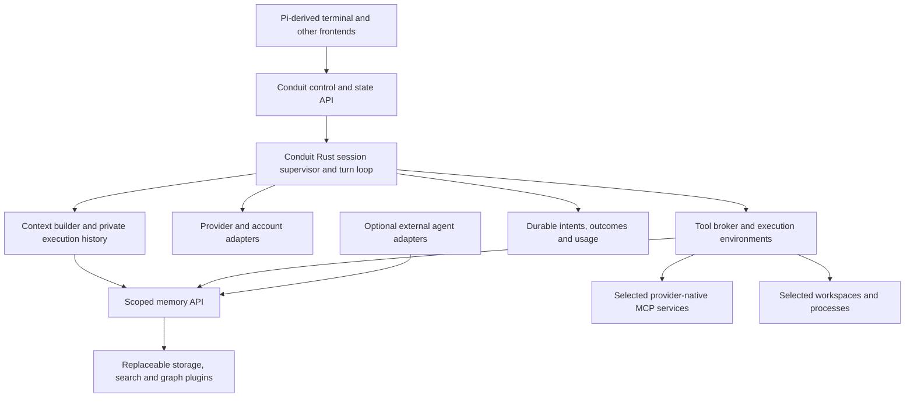

# Pi and Pi Durable: a Conduit-owned runtime

Research date: 2026-10-30. **Accepted direction: Conduit owns its runtime in Rust.
The first frontend is a custom Conduit terminal inspired by Pi. Neither Pi's agent
loop nor Pi Durable is the runtime underneath Conduit.** Specific implementation proposals below await review. No Conduit
implementation, account enrollment, or live provider experiment was performed.

For collaborator review, start with [the recommendation](#recommendation),
[frontend feasibility](#frontend-only-pi-is-feasible-but-needs-adaptation), and
[the runtime proposal](#proposed-rust-runtime). The detailed [Durable investigation](#pi-durable-in-depth)
explains the mechanisms and failure cases behind that proposal. Existing memory,
account, scope, and lifecycle contracts remain in SPEC.md and DESIGN.md.

## Recommendation

Build a small Rust runtime that owns session execution, context construction, provider
requests, tool dispatch, recovery records, and observation. Put presentation behind a
frontend contract. Use Pi's terminal components where useful, and reproduce selected
Pi/Durable behavior in Conduit rather than installing a second agent loop underneath it.

This makes Conduit's access and continuity rules part of execution itself. It also
creates real work: model streaming, tool-call assembly, cancellation, provider-specific
history conversion, compaction, authentication, and recovery now need implementations
or suitable lower-level libraries. A terminal UI does not provide those capabilities.
Start with the selected Anthropic/OpenAI workflows; do not promise Pi's provider or
extension coverage on day one.

The strongest lessons to absorb are:

1. Separate persisted history, model context, transient UI state, and shared knowledge.
2. Persist execution intent before an effect and its outcome before claiming completion.
3. Separate input acceptance, execution progress, and final settlement.
4. Give child work an explicit owner and cancellation/recovery behavior.
5. Make frontend subscriptions recoverable without equating them with an audit ledger.
6. Preserve provider-native tools while checking managed access at actual dispatch.

Conduit should improve on the reference **for our requirements**: account-bound execution,
current scope checks on retries, explicit activation, reconnectable frontend control,
and usage evidence that distinguishes unknown data from zero. This is not a claim
that Pi Durable should serve those same product requirements.

## Evidence and version boundaries

The supplied [Pi documentation index][pi-index], [Pi site](https://pi.dev/docs/latest),
and [Durable package][durable] led to source, specification, and test inspection.
The frontend/Durable follow-up fetched and inspected a newer development snapshot.

| Source | Pinned revision | Evidence boundary |
| --- | --- | --- |
| Pi frontend and Durable follow-up | `0441483926f283e42ca44eb7b4a46552e9469d6f`, Oct 30 | Current source investigation below; development code, not a release guarantee. |
| Initial Pi ecosystem investigation | `f09d01b85e0384647fcab6779d35ab9dabe04be3`, Oct 29 | Provider, MCP, ecosystem comparisons and prior offline probes. Links preserve this revision where applicable. |
| Release baseline previously inspected | `v1.4.0`, `4a080252f06caf63a525d7873c5d94d3c23887e0` | Release comparison; main's identical package version string does not make development behavior released. |
| Local pstack-pi | `c87e65f8ed7ee80d9dc38faeabacc103fce14bc7` | Its real-Pi harness targets 0.85.1; compatibility with newer Pi is unverified. |
| Local jxp-skills / agentwatch | `b49a754de4cbbf595b40c05b77039e8b8b380e52` / `04025a6f8e3887b8c1152ea44930e1c429b75948` | Usage/workflow and Rust communication references; no private configuration reproduced. |

Durable is explicitly experimental. Its [changelog][durable-changelog] contains substantial
unreleased changes, including storage publication and observation contracts. The newer
writer batches pending commits and publishes after its storage call settles; do not
combine that contract with an older callback/publication description.

“Source evidence” below means inspected code/docs, not exercised production behavior.
“Test evidence” means an upstream test was inspected unless explicitly listed as run
in [validation](#validation-and-limits). Rust designs and experiment criteria are proposals.

## Frontend-only Pi is feasible, but needs adaptation

### The stock coding-agent TUI is not an independent runtime client

`InteractiveMode` takes an `AgentSessionRuntime`, reaches its concrete `AgentSession`,
`SessionManager`, settings, auth/resource services, and extension runner, and invokes
prompting, cancellation, compaction, model selection, session switching, and forks.
It also accesses `session.agent` and native tool renderers. The main program passes the
same runtime to either interactive mode or RPC mode. This is stronger coupling than a
terminal renderer consuming a remote session API. [Interactive mode][interactive-source] ·
[Runtime host][runtime-source] · [Entry point][main-source]

Pi RPC controls **Pi's runtime** from another process. It does not make the stock TUI
connect to an arbitrary replacement backend. The SDK likewise constructs Pi runtime
services. Registering Conduit as a custom model provider would leave Pi's tool loop,
context, and lifecycle in charge, so it would not meet the requested boundary.
[RPC][rpc] · [RPC implementation][rpc-source] · [SDK][sdk]

### UI-only reuse options

| Option | What is reused | Cost and limitation |
| --- | --- | --- |
| **Pi-derived frontend using `pi-tui`** — recommended first | Terminal renderer, editor, Markdown, images, completion/keybinding primitives, and selected presentation components | Implement Conduit command routing, runtime views, dialogs, and status. It is an adapted Pi frontend, not the entire stock coding-agent UI unchanged. |
| Adapt/fork the stock coding-agent frontend | More of Pi's commands, layouts, selectors, and tool presentation | Introduce an explicit backend interface and remove direct runtime dependencies. Audit every command; maintain the adaptation or contribute the separation upstream. |

**Subsequent user clarification:** preserving the full stock UI is unnecessary. A custom
Conduit terminal is sufficient; the first option is the relevant direction, with exact
component dependencies still open. The comparison explains the tradeoff rather than
leaving UI fidelity as an unresolved decision.

The standalone [`pi-tui` package][tui] is a clean UI reuse boundary: its package does
not require the coding-agent execution loop. Assistant-message rendering and tool
renderer interfaces are useful extraction candidates, although their themes, media
helpers, and extension assumptions still require adaptation. The stock interactive
mode is over 7,000 lines at the inspected revision; replacing a constructor alone
would not complete the separation. [Assistant renderer][assistant-renderer] ·
[Tool rendering][tool-renderer]

A TypeScript terminal client using `pi-tui` is compatible with a Rust runtime. If
“native Rust” later means every shipped frontend must also be Rust, reuse would be
behavioral/visual rather than a direct dependency. That broader language requirement
has not been selected. A Rust core does not require porting terminal rendering first.

### Proposed frontend contract

The frontend submits commands and renders authoritative runtime state. It should not
hold model credentials, execute model/tool calls itself, or reconstruct authorization
from UI labels. Use capability negotiation so unsupported features remain visible.

| Surface | Proposed responsibility |
| --- | --- |
| Commands | Submit/steer/follow up, cancel, pause/resume, select supported settings, and request fresh/fork; correlate durable operations separately from transport request IDs. |
| Control | One controlling frontend, observers elsewhere; a control generation rejects stale input after transfer. Closing a view detaches rather than implicitly cancelling work. |
| State | Authorized snapshot plus ordered updates, a reconnect position, and explicit gaps. Separate durable transcript/outcomes from provisional token/progress updates. |
| Interaction | Typed requests for supported user choices and responses. Terminal widgets are presentation capabilities, not mandatory runtime objects. |
| Recovery | Reattach to a verified execution; fetching status or resubscribing must not start new work. |

MCP remains the default external shared-capability contract. Evaluate standard MCP
features first; use a small versioned runtime control/event contract where frontend
streaming, controller transfer, or attachment needs more semantics. Do not expose Pi's
internal classes as Conduit's permanent API. Exact transport/schema is a review choice.

## What to reproduce, reuse, or defer

| Pi component | What Conduit should learn or reuse | Ownership in the proposed design |
| --- | --- | --- |
| `pi-tui` / UI components | Rendering, editing, status and tool-result presentation | Optional frontend dependency; runtime remains Rust. |
| `pi-ai` | Provider capability descriptions, streaming, message conversion, usage and authentication edge cases | Conduit provider/account adapters, with lower-level libraries evaluated separately. No Pi agent loop. |
| `pi-agent-core` / coding-agent | Turn/tool loop, queued input, resource loading, compaction, session behavior | Reimplement the needed behavior under Conduit's lifecycle and scope contracts. |
| `pi-durable` | Transactional execution records, recovery, task ownership, context projections and backend conformance | Architectural/test reference; no Pi Durable runtime dependency. |
| `pi-mcp` / discovery | Provider-native tools/resources, discovery budgets, connection lifecycle | Conduit-managed MCP clients for its runtime; separate native-host adapters for external agents. |
| `pi-telemetry` | Structured spans, metrics, propagation and conformance | Conduit observations are authoritative; exporters are replaceable. |
| `pi-env` | Rust file/process/PTY service, capability negotiation and environment conformance | Execution-environment reference; not automatically a sandbox or persistent supervisor. |
| `Chord` | Typed contracts, state views, bounded subscriptions, cancellation | Borrow patterns without adopting its object-host/runtime framework. |

Model adapters and external-agent adapters are different. A Conduit-run Claude model
is not Claude Code; a Conduit-run OpenAI model is not the Codex CLI. External native
agent support can still expose shared Conduit capabilities, with its own compatibility
and observation limits. Its loop belongs to that external runtime, not to a hidden Pi
dependency. Runtime choice and frontend choice must be independent.

## Pi Durable in depth

### 1. Vocabulary and state boundaries

Durable's `Session` is a storage/mutation authority containing multiple conversations,
entries, submissions, tasks, and documents. A conversation has a transcript and active
context. A run can span several model/tool turns. A task is a recoverable execution
state machine; it is not a Linear issue. Documents hold typed mutable state with
session/conversation/task lifetimes and fork policies. [Concepts][durable] ·
[Detailed specification][durable-spec]

Conduit should map concepts deliberately:

| Durable concept | Conduit interpretation |
| --- | --- |
| Session mutation authority | Internal runtime/store owner; not automatically one public Conduit session. |
| Conversation | Closest analogue to private conversation state within a logical session. |
| Task checkpoint | Machine recovery phase and data; distinct from our agent-written portable task checkpoint. |
| Entries / context head | Retained evidence and selected model-input projection. |
| Documents | Runtime state with defined lifecycle; not automatically shared knowledge or record revisions. |
| Document “scope” | Ownership/lifetime, not Conduit access authorization. |
| Watch/view | UI state projection; not durable delivery or a complete audit stream. |

Keep shared memory and the execution store behind separate logical contracts even if
one local database initially stores both. A runtime should not need to load a user's
entire knowledge graph to reconstruct its latest turn. Indexing or replacing the
memory backend should not replace the agent loop.

### 2. Mutation ordering, commits, and publication

Durable serializes mutation callbacks, performs external model/tool work outside that
line, and commits related entries, task state, submissions, and document changes
atomically. The current writer batches admitted commits off the line. Reads touching
unpublished keys wait for publication. Committed state is adopted and observers are
notified in order; callback success alone is not durability. [Session writer][writer-source] ·
[Transaction implementation][transaction-source] · [Storage contract][durable-spec]

Important failure behavior: a backend can acknowledge a committed prefix and then
fail. Some effects can therefore be durable even when the caller receives an error.
The session fails rather than pretending the rest completed. Reopen/reconciliation
must determine the actual outcome. Optional host/telemetry observer failures also
must not be mistaken for rollback of an already committed write.

**Conduit proposal:** begin with one owner for a local execution store and simple
transaction-before-acknowledgement behavior. Keep network calls outside transactions.
Persist an outcome and the state transition it settles together. A process-owner lock
and execution generation can prevent duplicate local writers; distributed leadership
is unnecessary for the first machine-local experiment. SQLite is a candidate, not a
selected storage engine.

Do not implement dependency-gated group commit, copy-on-write document families, or
an elaborate scheduler merely to match Durable. Optimize after measuring. Bound both
queued items and bytes: Durable's admission count limit alone would not bound the size
of arbitrary tool outputs. Distinguish memory-cache eviction from permanent retention.

### 3. Submissions, queues, and activation

Durable persists submissions with queued/placed/settled outcomes, supports steering and
follow-up placement, and makes cancellation of a waiter distinct from cancellation of
work. Withdrawing an already placed submission does not retroactively unplace its
input. Context/reset boundaries can make a queued write stale. These are useful
semantics for future frontend and intersession inputs. [Submission source][submissions-source] ·
[Inbox source][inbox-source]

Two differences matter for Conduit:

- Durable's submission and wait paths call a resume function to request scheduler
  progress. Conduit's status/wait/observation operations should be passive; paused or
  closed sessions require explicit activation. Durable recovery must not become an
  accidental exception to the accepted lifecycle.
- Request IDs deduplicate per conversation and submission type. The inspected test
  intentionally submits different content under the same ID and receives the first
  submission. Conduit should bind an operation ID to an operation/payload fingerprint
  and reject mismatched reuse. The exact fingerprint and versioning need definition.

[Test evidence: submission deduplication][submissions-tests]. These are product-contract
choices, not bugs asserted against Durable's stated behavior. Separate accepted,
durable, placed in context, and completed statuses. None means “the model understood
this message.” Preserve authorship when non-human input enters a model's user-message
channel; transport roles alone do not establish human authorization.

### 4. Tool intent, replay, and uncertain effects

`ToolTask` resolves the offered tool, validates arguments, runs `beforeTool`, validates
changed arguments, and persists the final arguments plus replay policy **before**
execution. After an interruption it reruns only if both the stored and current tool
policies say replay is safe. Otherwise it returns an interrupted outcome with whatever
output was retained; it does not claim to undo the effect. [Tool task][tool-source] ·
[Recovery tests][durable-recovery]

This directly supports Conduit's accepted safe-retry contract. Consider creating a
Linear issue: the request succeeds at Linear, but the process dies before recording
its result. A durable local intent does not prevent a duplicate issue. The adapter
needs provider idempotency or outcome lookup; without it, the result remains unknown.
A timeout or absent receipt is not proof that nothing happened.

**Conduit additions:**

- Record account, execution, resource/workspace binding, actual arguments and adapter
  version with the operation. Replaying against a new account or working directory
  must not be an incidental side effect of reconfiguration.
- Check current managed permissions at every dispatch and retry. Durable's recovery
  path enters the execute phase after `beforeTool`; an initial hook alone would not
  implement Conduit's live scope changes.
- Distinguish rejected, completed-with-error, interrupted-with-unknown-effect, cancelled,
  and confirmed outcomes. Do not collapse them into one `isError` flag for recovery.
- Keep mandatory access checks in the runtime/broker path. Optional extension selection
  or UI confirmation hooks must not be able to omit them.

This does not bring comprehensive remote-operation security into v0. It establishes
where Conduit's current managed checks and later interception belong. Native-mode
shells and unmediated plugins still have their actual host privileges.

### 5. Nested tools and Code Mode

Nested tools are separately tracked tasks with stable keys and their own replay
policies. A rerunning parent can retrieve a stored child result rather than repeat the
call. Tool-call ownership propagates cancellation. However, nested result documents
retire with their parent, and a parent returning its children's usage again can cause
double-counting. A transient nested-call cache is not Conduit's retained usage or
operation ledger. [Nested calls][durable] · [Tool task source][tool-source]

Durable's Code Mode goes further: a deterministic JavaScript sandbox replays a script
using a journal of results delivered to it, virtual time, seeded randomness, and stable
call keys. The journal is written before results reach the script. Changed sandbox
fingerprints/module versions, divergence, or expired deadlines end replay. Unfinished
external calls still follow their own replay policies. This is recovery by replay,
not a captured JavaScript process image. [Code Mode source][codemode-source]

**Conduit proposal:** preserve nested call identity and parentage in the tool broker
from the beginning; defer a recoverable script VM. A future Code Mode plugin must
route every nested call through the same access/usage broker. Add explicit depth,
fan-out, output, and concurrency budgets before unrestricted nesting. Hiding a tool
from the model's advertised list must not make it available through a script backdoor.

Durable deliberately separates tools offered to a model from tools callable by other
tools. Deferred discovery is an exposure/performance mechanism, not authorization.
Use that distinction for MCP too. [Tool caller rules][durable]

### 6. Task ownership, cancellation, and recovery

The scheduler reserves work on the mutation line and runs it outside it. Tasks can
persist phases, wait for other tasks, sleep, or settle. An ordinary parent with live
owned children enters a completing state; final settlement waits for that work to
drain. Cancellation marks durable intent, signals running work, and settles children
before their owner's abort handler. Background tasks are explicit exceptions to
ordinary ownership cascades. [Task specification][durable-spec] ·
[Scheduler][scheduler-source] · [Task recovery tests][task-recovery]

Definition/version mismatches and missing extensions need observable recovery states.
Cooperative cancellation cannot forcibly terminate arbitrary in-process extension code.
Closing a host, marking a task aborted, and permanently ending a logical conversation
are different operations.

**Conduit proposal:** typed state machines for a turn, provider attempt, and tool call
first; explicit ownership for child processes/agents. Record cancellation separately
from its observed completion. Support stopping plugin worker processes where necessary.
Do not promise crash-safe continuation of arbitrary plugins or introduce general
workflow definitions, durable timers, background subagents, and hot reload in v0.

On restart, inspect pending intents and surface recoverable/unknown state. Reconnect
if a verified execution survives; explicitly resume before starting a stopped one.
Durability permits recovery; it does not authorize unattended work.

Durable also serializes built-in edit/write mutations by filesystem identity and
canonical path **within one process**. Its source explicitly excludes Bash and other
processes. This helps avoid local races but does not replace Conduit's separate
worktrees for independent concurrent writers. [File mutation queue][file-queue]

### 7. History, context, compaction, and forks

Durable derives model context from a pinned head/tail snapshot of retained entries.
It can exclude errored/aborted responses, repair missing tool results, and apply context
edits without destructively changing the raw log. Capturing source bounds before
asynchronous assembly avoids mixing unrelated concurrent appends into one request.
[Context builder][context-source]

Compaction is a task with selection, summarization, and placement boundaries. Its
source/model/options are captured; stale placement and retries are explicit concerns.
Summarization consumes tokens even if its result is never used. Durable also supports
background compaction and overflow recovery, which introduce more races than a simple
foreground boundary. [Compaction source][compaction-source] · [Specification][durable-spec]

**Conduit proposal:** maintain four distinct views:

| View | Purpose |
| --- | --- |
| Retained execution history | What was submitted, generated, attempted, and observed, with provenance and outcomes. |
| Request context | The authorized content selected for a particular model request, after compatibility transformations. |
| Frontend projection | Human-readable history and transient progress appropriate to that frontend's access. |
| Shared knowledge | Explicit records retrieved/written through scopes; not an automatically merged session scratchpad. |

Record source references/revisions and transformations with a request-context manifest,
without requiring another full text copy of every prompt. Pin source bounds; apply
current scopes when assembling and dispatching; report omitted/incompatible content.
Start compaction at a safe turn boundary if needed for long sessions. Keep background
compaction, arbitrary history editing, and sophisticated branch operations later.

Pi's provider conversion demonstrates why this matters: cross-model thinking can be
omitted, unsupported images replaced, tool IDs normalized, and missing results synthesized.
Keep original evidence separately; do not claim lossless context portability.
[Conversion source][transform]

Durable forks initialize some documents anew, including inbox/usage, while copying
others as of the fork. Its provider conversation identifier is separate state. Conduit
must bind provider conversation/cache state to the appropriate account/execution and
not carry it across an incompatible identity switch. Fresh and checkpoint-seeded fork
retain the already-agreed Conduit meanings. Machine recovery checkpoints, compaction
summaries, and portable task checkpoints are three different artifacts.
[Fork handling][forks-source] · [Provider state][provider-state]

### 8. Frontend views, backpressure, and reconnect

Durable watches coalesce updates and can replace a large backlog with the latest
snapshot. Late subscribers get current state; they do not receive every past event.
Its transcript helper retains entries, detects missing windows, and fetches history
across gaps. Monotonic IDs can have holes. [Watch contract][durable] ·
[Transcript helper][transcript-source]

Borrow bounded snapshots/deltas for presentation. Keep durable operation outcomes and
usage separately queryable so a slow or disconnected frontend cannot lose the only
record of work. A reconnect cursor needs a stream/store identity as well as a position;
expired positions should return a gap and an authorized replacement snapshot. Recheck
access before recovery reads, not only when a subscriber first connects.

A control generation and execution generation solve different problems: one rejects
commands from an old frontend controller, the other rejects stale worker completions.
Neither requires a distributed system in the first local experiment. Do not infer
reliable intersession messaging from a UI subscription API.

### 9. Usage, tracing, and retention

Durable records generation/tool usage into conversation documents as work settles,
including compaction attempts, and initializes fork usage independently. Its accounting
is a stronger reference than summing only visible messages on the current branch.
Nested usage is already attributed to the nested call and must not also be counted as
new parent spend. [Usage source][durable-usage] · [Telemetry][telemetry]

Conduit still needs account/execution/reporting-source attribution, raw observations,
known overlap relationships, and unknown-versus-zero fields. A failed request may have
incurred unreported provider usage; a missing receipt must not become observed zero.
Configured models may route to another producing model, so retain both when known.
Estimated API costs are not actual subscription charges.

Tracing is useful for timing and debugging, but exporter failure must not lose the
only durable usage record. Default diagnostics can be content-free; payload capture
needs explicit retention/access treatment. The accepted retain-until-purge policy
applies to Conduit-controlled records. Cache eviction, task-document retirement, and
external trace retention are separate concerns.

### 10. Storage backends and conformance

Durable includes memory, JSONL, SQLite and IndexedDB implementations and separates
its storage contract from the harness. It tests atomic logical batches, ordered commit
prefixes, document revisions, reopen behavior, and failures across record types.
Its storage schema includes conversations, entries, tasks, submissions, documents and
document revisions. These are execution records, not a shared knowledge product.
[Storage contract][durable-spec] · [SQLite schema][sqlite-schema] ·
[Conformance suite][storage-conformance] · [Failure tests][storage-failures]

Conduit should borrow the conformance approach: every backend must demonstrate the
operations it advertises, including failures. A search plugin may be only an index
projection over authoritative records. It need not store the runtime's task graph.
Opaque backend cursors and internal integer sequence IDs should not become permanent
cross-backend public record identifiers.

Document commit guarantees precisely: atomicity per logical transaction, what survives
process termination, acknowledgement loss, and any storage-specific power-loss limits.
One process owning a store is not cross-process coordination; multiple account sessions
must use the owner/API or a proven safe concurrency mechanism.

## Proposed Rust runtime

The following are responsibility boundaries, not selected crates or a new universal
plugin framework. Keep the first implementation local and small.

An execution resolves profile/account/access selections and workspace, admits input, builds authorized
context, streams a provider response, validates/dispatches tool calls, persists outcomes,
and advances until it settles or needs input. Provider-specific messages stay inside
adapters; Conduit's public identity, access and lifecycle rules remain independent.

| Boundary | Minimum first responsibility | Later, when justified |
| --- | --- | --- |
| Session supervisor | Logical lifecycle, execution binding, one controller, explicit restart, account separation | Remote workers, richer scheduling and migration. |
| Provider/account adapter | Selected provider streaming, capabilities, cancellation, credential ownership and identity evidence, honest usage | More providers, routing, additional auth modes. |
| Context builder | Selected instructions, permitted checkpoint/history/memory, compatibility conversion, bounded context | Background compaction, advanced branch views. |
| Tool broker | Schema validation, intent/outcome, current managed checks, cancellation, output limits and attribution | Comprehensive MCP operation enforcement and recoverable Code Mode. |
| Runtime store | Accepted input, execution state, tool outcomes, retained history and usage; inspectable pending work | Optimized batching, generalized durable workflows. |
| Memory service | Existing record/search/revision/sharing contract through replaceable backends | Optional extraction, indexing/classification enhancements. |
| Frontend adapter | Input and state presentation, controller transfer, reconnect and capability gaps | Additional frontends and richer native widgets. |

Use Rust's types for states and async task ownership; do not assume an in-memory async
task is durable. Recoverable state must be serializable and versioned. Plugins that
need another language can live behind process/protocol boundaries without owning the
agent loop. Selection of an ABI, WASM host, RPC transport, or particular async/database
library remains implementation planning.

### What changes in the design now

**Accepted by the user's correction:** Conduit owns the runtime; Pi frontend selection
is independent; Pi Durable supplies research rather than an execution dependency.
The earlier recommendation to run stock Pi with a thin Conduit extension is removed.

**Still accepted:** BYOS, replaceable memory backends, conduit-selected connections,
private session state, account separation, native-default execution with optional
isolation, portable checkpoints, safe retries, and honest usage. Here “native” means
execution on the host without Conduit's full OS sandbox; it does not mean choosing
Pi or another external agent runtime.

**Needs focused review:** the concepts/configuration relationships, which runtime
durability features gate v0, and supported subscription/account integration for
Conduit-owned execution. Native sign-in delegation remains suitable for external Claude Code/Codex
adapters; it does not automatically authenticate our own provider adapter.

## Accounts, skills, MCP, and ecosystem lessons

### Accounts and provider support

Pi has Anthropic subscription and OpenAI ChatGPT subscription authentication paths in
source. Its credential storage is keyed by provider, not by an arbitrary collection
of profile/account identities. Separate account bindings and coordinated token refresh
are necessary. A model family, provider label, or successful login is not sufficient
evidence that two configured account bindings select distinct identities.
[Providers][openai-provider] · [Anthropic][anthropic-provider] ·
[Auth storage][auth-storage] · [OpenAI authentication][openai-auth]

For Conduit, model selection, account selection, private conversation storage, and
resource-service credentials remain separate. Do not copy rotating tokens across
independently refreshing credential stores. Do not silently substitute API billing. Preserve
supported native login/refresh for external runtime adapters; evaluate supported
provider/account adapters for our own runtime, including eligibility and verifiable
identity. Pi source shows a mechanism, not authorization or a compatibility guarantee
for every account or future provider policy. The four-account experiment must test
real account separation after fixture tests.

### Bring your own skills, with explicit compatibility

Pi supports `SKILL.md` instruction bundles and npm/git/local packages containing
skills, extensions, prompts and themes. Metadata-first discovery and explicit loading
are useful patterns. Conduit should consume compatible instruction bundles without
inventing another skills language or package manager. [Skills][skills] · [Packages][packages]

A Pi extension running TypeScript against `AgentSession` is executable runtime code;
it will not work just because the frontend uses `pi-tui`. Claude/Codex native plugin
hooks likewise require a compatible runtime or a specific port. Report compatibility
at the instruction, helper/tool, extension-hook, and presentation layers. Adapters can
use native installation tooling. Conduit's accepted direction supplies resources through
Pools and Profile-selected default conduits; the resource-loading conduit contract remains
for review. Its division between Profile/model/runtime defaults and conduit-specific
activation should draw on these Pi patterns. Do not import an entire native default
profile implicitly.

The local pstack reference contributes bounded subprocess workers, process-group
cleanup, explicit tool sets, branch-aware views, version manifests, and loopback model
fixtures. Its inherited environment, one-shot `--no-session` children, and missing-usage
fallbacks are not Conduit's account/durability/usage contract. Its old Pi target also
precludes assuming current extension compatibility. [Workers][pstack-workers] ·
[Usage export][pstack-export] · [Fixture harness][pstack-tests]

### Provider-native MCP and managed access

Pi's native MCP implementation supports stdio and Streamable HTTP, direct/deferred
exposure, resources, configuration and authentication. Tool search and Code Mode can
call tools absent from the top-level advertised list; listing less is not denying
access. [MCP documentation][mcp] · [Implementation][mcp-source]

Conduit's own runtime should own its MCP clients/broker, preserving provider names,
schemas, results and workflows. A frontend need not separately register these servers.
For external agent runtimes, adapters still generate native registration from shared
connection definitions. Reusing a definition is not sharing a live client or OAuth state.
Attribute nested calls and carry session authority through every managed path. Full
upstream operation inspection remains staged; current memory access checks remain core.

### Shared-memory packages

| Reference | Absorb | Do not silently inherit |
| --- | --- | --- |
| jayzeng/pi-memory, `1e276a762a666a7031459fdf7af018cc7966663e` | Human-readable notes, search modes, health/recovery signals | Automatic extraction/injection, global roots independent of session access. |
| josephkern/pi-memory, `312627ffc5a47de690b3066276009e7d651f8729` | Bounded loading, page representations, truncation and writeback diagnostics | Ambient home-directory memory, automatic prompt injection, assumed multi-process safety. |
| Pi session entries / Durable documents | Explicit typed state and reconstruction | Treating runtime-private state as shared searchable knowledge or access policy. |

[Memory A][memory-a] · [Memory B][memory-b-inject] · [Writeback][memory-b-writeback].
A minimal transactional store with lexical search is a reasonable first experiment;
Xerj, embeddings and knowledge graphs remain replaceable backend candidates. Our
revision, scope, coverage and lifecycle contract applies regardless of search engine.

### Rust execution and isolation

`pi-env` has a Rust daemon for file operations, commands and PTYs, with framed transport,
feature negotiation, SSH deployment and environment conformance tests. It separates
where tools execute from where the Durable worker and credentials live. Those are
valuable reference boundaries for Conduit. [Environment README][env-current] ·
[Protocol][env-protocol]

Remote execution or a sandbox around selected tools is not full-process agent isolation.
Retain native-default versus explicitly isolated execution. A plugin running in the
host runtime can access more than a selected tool environment unless the architecture
actually confines it. The isolation backend and supervision/reconnection behavior
must be evaluated independently; a remote process protocol alone proves neither.

## Communication research for the upcoming redesign

The user has established conduits as the common relationship for resource access and
session communication. The [next research brief](REVIEW.md#conduit-interaction-research)
will refine their specific contracts. This investigation does not restore rooms or
choose a topology. Separate addressing, authorization, retained exchange, attention
and execution when comparing candidate conduit kinds.

Pi's queued input, steering, follow-up and next-turn delivery show useful attention
boundaries. Its process-local extension bus is not interprocess transport. Durable
submissions offer persisted input status but can activate execution; frontend watches
coalesce updates. Neither directly supplies the desired communication contract.
[Message types][message-types] · [Submissions][submissions-source]

The inspected `pi-messenger` revision
`09937ed647a1b07a3b595bf75943feacb80ff123` uses per-recipient files, targeted messaging,
presence and cooperative reservations. Delivery can wake an agent, and its error path
also deletes a message after read/parse/delivery failure. These semantics cannot be
assumed to provide durable catch-up or acknowledgement. [Delivery][messenger-index] ·
[Mailbox][messenger-store]

`pi-chat` at `9adbd29b40ee27ff1decf0fc87cbe180b40924f5` illustrates Discord/Telegram
frontends, per-conversation workers, tmux supervision and Gondolin tools. Automatic
channel/account memory injection and continuing recent history are application
policies, not Conduit defaults. It also uses Pi runtime services; it is a reference
for presentation/supervision, not a way to avoid runtime ownership. [Source][chat] ·
[Environment][chat-env]

Compare these with local Rust agentwatch's project visibility, daemon/MCP separation,
replay sequences and diagnostics. Choose communication semantics after concrete
workflows; do not make a durable task graph or a mutable shared scratchpad the default
merely because a reference offers one.

## Proposed experiment sequence

This is a design proposal, not authorization to start implementation or log into accounts.
Keep account/provider feasibility early so a polished UI does not conceal a blocker.

| Stage | Future experiment | Evidence required |
| --- | --- | --- |
| 1. UI separation | Minimal `pi-tui` client and simple CLI observer against a fake Conduit state/control service | No `pi-coding-agent`, `pi-agent-core` or `pi-durable` execution dependency; controller transfer, detach and reconnect. Stock-UI adaptation can be evaluated separately. |
| 2. Rust runtime slice | Scripted model stream, one tool, one session and persisted intent/result | The Rust loop owns provider/tool calls; accepted versus completed input, cancellation, bounded output and explicit pending recovery. |
| 3. Supported accounts | Conduit-owned provider/account adapters for two Claude and two OpenAI subscription identities | Verified identity evidence, independent refresh/logout/restart, no implicit API fallback; fixture labels do not count as verification. Resolve unsupported subscription flows explicitly. |
| 4. Scoped memory | One minimal backend used by differently scoped sessions | Search excerpts/caps/coverage, explicit reads, denied private direct-ID/search access, CAS conflict, lifecycle, direct live read-only sharing. |
| 5. Context continuity | Model/account changes, resume, fresh, checkpoint fork, compaction | Stable logical identity, permitted content only, provider-state separation, visible transformations and gaps. |
| 6. MCP and tools | Selected upstream service plus controlled fake server | Familiar schemas, resource-account attribution, current checks on nested/retried calls, honest interception coverage. |
| 7. Faults and usage | Kill at each intent/effect/result boundary; disconnect UI; fail storage and telemetry | No unsafe automatic replay or duplicate execution, unknown outcomes explicit, usage not double-counted or defaulted to zero. |
| 8. External runtimes / isolation | Native Claude Code/Codex adapters and isolated mode as separate checks | Shared-capability interoperability versus model-provider support; actual OS boundary, declared network policy and explicit restart after non-revocable access removal. |
| Communication | Add after redesign | Chosen identity, delivery, ordering, acknowledgement, attention and lifecycle semantics. |

The first usable runtime need not contain general workflow scheduling, deterministic
script replay, arbitrary hot reload, distributed storage ownership, automatic memory
extraction, or a new skills packaging system. Its failure behavior should nevertheless
be explicit before those features are added.

### Fault cases worth deriving from Durable

- Crash before tool intent: no effect may have been dispatched; after effect but before
  receipt: reconcile or show unknown, rather than automatically repeat an unsafe call.
- Same operation ID with changed arguments: reject mismatched reuse.
- Scope revocation between queueing and execution/retry: current checks govern dispatch.
- Stale worker result after replacement: retain provenance without advancing the new run.
- Storage commit followed by acknowledgement failure: inspect committed state on reopen.
- Slow/lost frontend updates: bounded memory, explicit gaps, authorized snapshot recovery.
- Paused session observed or waited upon: no new provider call.
- Parent cancellation during child work: visible cancellation intent and child cleanup;
  an uncooperative plugin cannot falsely report that it stopped.
- Compaction/child usage plus parent totals: retain all observations without overlap.
- Account switch or fresh session: no inherited credentials, provider cache or private
  history from an unrelated execution.

## Validation and limits

The follow-up inspected the newer frontend and Durable source/specification, including
writer/transaction behavior, submissions, tool recovery, nested Code Mode, task ownership,
context/compaction, views, usage, storage and failure tests. The source checkout is pinned
at the revision above. **The Durable test suite and UI/runtime replacement were not run.**
No Pi package was installed into the user's profile; no credentials or accounts changed.

Earlier offline checks remain useful but narrower evidence: 40 existing tests from
`josephkern/pi-memory`, five pstack loopback-provider tests, and eight assertions against
Pi message transformation/usage functions at the earlier revision passed using Node
24.22.1. They do not validate Durable at the newer revision or a Conduit runtime.
The shell's Node 21.5.0 is below Pi's declared Node >=22.19.0 requirement.

The largest remaining uncertainties are supported subscription authentication and
identity evidence, runtime delivery scope, and actual
isolation/extension compatibility. Recommendations above are grounded in source and
failure analysis, not performance benchmarks or a completed integration.

Pi declares MIT licensing; preserve applicable notices if extracting UI code. The
surveyed pi-chat and OTEL package declare Apache-2.0. This documentation selects no
new dependency and vendors no implementation. Keep research snapshots outside the
Conduit repository; keep active decisions in SPEC.md/DESIGN.md and proposals in REVIEW.md.

## Source index

Links pin the inspected revision. Older ecosystem/provider links retain the original
research snapshot; the Durable/frontend links use the newer follow-up snapshot.

[pi-index]: https://github.com/earendil-works/pi/blob/f09d01b85e0384647fcab6779d35ab9dabe04be3/packages/coding-agent/docs/index.md
[durable]: https://github.com/earendil-works/pi/blob/0441483926f283e42ca44eb7b4a46552e9469d6f/packages/durable/README.md
[durable-changelog]: https://github.com/earendil-works/pi/blob/0441483926f283e42ca44eb7b4a46552e9469d6f/packages/durable/CHANGELOG.md
[interactive-source]: https://github.com/earendil-works/pi/blob/0441483926f283e42ca44eb7b4a46552e9469d6f/packages/coding-agent/src/modes/interactive/interactive-mode.ts
[runtime-source]: https://github.com/earendil-works/pi/blob/0441483926f283e42ca44eb7b4a46552e9469d6f/packages/coding-agent/src/core/agent-session-runtime.ts
[main-source]: https://github.com/earendil-works/pi/blob/0441483926f283e42ca44eb7b4a46552e9469d6f/packages/coding-agent/src/main.ts
[rpc]: https://github.com/earendil-works/pi/blob/4a080252f06caf63a525d7873c5d94d3c23887e0/packages/coding-agent/docs/rpc.md
[rpc-source]: https://github.com/earendil-works/pi/blob/0441483926f283e42ca44eb7b4a46552e9469d6f/packages/coding-agent/src/modes/rpc/rpc-mode.ts
[sdk]: https://github.com/earendil-works/pi/blob/4a080252f06caf63a525d7873c5d94d3c23887e0/packages/coding-agent/docs/sdk.md
[tui]: https://github.com/earendil-works/pi/blob/0441483926f283e42ca44eb7b4a46552e9469d6f/packages/tui/README.md
[assistant-renderer]: https://github.com/earendil-works/pi/blob/0441483926f283e42ca44eb7b4a46552e9469d6f/packages/coding-agent/src/modes/interactive/components/assistant-message.ts
[tool-renderer]: https://github.com/earendil-works/pi/blob/0441483926f283e42ca44eb7b4a46552e9469d6f/packages/coding-agent/src/modes/interactive/components/tool-execution.ts
[durable-spec]: https://github.com/earendil-works/pi/blob/0441483926f283e42ca44eb7b4a46552e9469d6f/packages/durable/docs/spec.md
[writer-source]: https://github.com/earendil-works/pi/blob/0441483926f283e42ca44eb7b4a46552e9469d6f/packages/durable/src/session/writer.ts
[transaction-source]: https://github.com/earendil-works/pi/blob/0441483926f283e42ca44eb7b4a46552e9469d6f/packages/durable/src/session/transaction.ts
[submissions-source]: https://github.com/earendil-works/pi/blob/0441483926f283e42ca44eb7b4a46552e9469d6f/packages/durable/src/harness/submissions.ts
[inbox-source]: https://github.com/earendil-works/pi/blob/0441483926f283e42ca44eb7b4a46552e9469d6f/packages/durable/src/harness/inbox.ts
[submissions-tests]: https://github.com/earendil-works/pi/blob/0441483926f283e42ca44eb7b4a46552e9469d6f/packages/durable/test/harness-submissions.test.ts
[tool-source]: https://github.com/earendil-works/pi/blob/0441483926f283e42ca44eb7b4a46552e9469d6f/packages/durable/src/harness/tool.ts
[durable-recovery]: https://github.com/earendil-works/pi/blob/0441483926f283e42ca44eb7b4a46552e9469d6f/packages/durable/test/harness-tools-recovery.test.ts
[codemode-source]: https://github.com/earendil-works/pi/blob/0441483926f283e42ca44eb7b4a46552e9469d6f/packages/durable/src/codemode/codemode.ts
[scheduler-source]: https://github.com/earendil-works/pi/blob/0441483926f283e42ca44eb7b4a46552e9469d6f/packages/durable/src/harness/scheduler.ts
[task-recovery]: https://github.com/earendil-works/pi/blob/0441483926f283e42ca44eb7b4a46552e9469d6f/packages/durable/test/harness-tasks-recovery.test.ts
[file-queue]: https://github.com/earendil-works/pi/blob/0441483926f283e42ca44eb7b4a46552e9469d6f/packages/durable/src/tools/file-mutation-queue.ts
[context-source]: https://github.com/earendil-works/pi/blob/0441483926f283e42ca44eb7b4a46552e9469d6f/packages/durable/src/harness/context.ts
[compaction-source]: https://github.com/earendil-works/pi/blob/0441483926f283e42ca44eb7b4a46552e9469d6f/packages/durable/src/harness/compaction.ts
[transform]: https://github.com/earendil-works/pi/blob/f09d01b85e0384647fcab6779d35ab9dabe04be3/packages/ai/src/api/transform-messages.ts
[forks-source]: https://github.com/earendil-works/pi/blob/0441483926f283e42ca44eb7b4a46552e9469d6f/packages/durable/src/session/forks.ts
[provider-state]: https://github.com/earendil-works/pi/blob/0441483926f283e42ca44eb7b4a46552e9469d6f/packages/durable/src/harness/provider.ts
[transcript-source]: https://github.com/earendil-works/pi/blob/0441483926f283e42ca44eb7b4a46552e9469d6f/packages/durable/src/harness/transcript.ts
[durable-usage]: https://github.com/earendil-works/pi/blob/0441483926f283e42ca44eb7b4a46552e9469d6f/packages/durable/src/harness/usage.ts
[telemetry]: https://github.com/earendil-works/pi/blob/4a080252f06caf63a525d7873c5d94d3c23887e0/packages/telemetry/README.md
[sqlite-schema]: https://github.com/earendil-works/pi/blob/0441483926f283e42ca44eb7b4a46552e9469d6f/packages/durable/src/storage/sqlite/schema.ts
[storage-conformance]: https://github.com/earendil-works/pi/blob/0441483926f283e42ca44eb7b4a46552e9469d6f/packages/durable/src/testing/storage-conformance.ts
[storage-failures]: https://github.com/earendil-works/pi/blob/0441483926f283e42ca44eb7b4a46552e9469d6f/packages/durable/test/harness-storage-failure.test.ts
[openai-provider]: https://github.com/earendil-works/pi/blob/4a080252f06caf63a525d7873c5d94d3c23887e0/packages/ai/src/providers/openai.ts
[anthropic-provider]: https://github.com/earendil-works/pi/blob/f09d01b85e0384647fcab6779d35ab9dabe04be3/packages/ai/src/providers/anthropic.ts
[auth-storage]: https://github.com/earendil-works/pi/blob/4a080252f06caf63a525d7873c5d94d3c23887e0/packages/coding-agent/src/core/auth-storage.ts
[openai-auth]: https://github.com/earendil-works/pi/blob/4a080252f06caf63a525d7873c5d94d3c23887e0/packages/ai/src/auth/oauth/openai-chatgpt.ts
[skills]: https://github.com/earendil-works/pi/blob/f09d01b85e0384647fcab6779d35ab9dabe04be3/packages/coding-agent/docs/skills.md
[packages]: https://github.com/earendil-works/pi/blob/f09d01b85e0384647fcab6779d35ab9dabe04be3/packages/coding-agent/docs/packages.md
[pstack-workers]: https://github.com/aaalexliu/pstack-pi/blob/c87e65f8ed7ee80d9dc38faeabacc103fce14bc7/extensions/subagent/index.ts
[pstack-export]: https://github.com/aaalexliu/pstack-pi/blob/c87e65f8ed7ee80d9dc38faeabacc103fce14bc7/extensions/pstack/export-session.ts
[pstack-tests]: https://github.com/aaalexliu/pstack-pi/blob/c87e65f8ed7ee80d9dc38faeabacc103fce14bc7/tests/pi/README.md
[mcp]: https://github.com/earendil-works/pi/blob/4a080252f06caf63a525d7873c5d94d3c23887e0/packages/coding-agent/docs/mcp.md
[mcp-source]: https://github.com/earendil-works/pi/tree/f09d01b85e0384647fcab6779d35ab9dabe04be3/packages/coding-agent/src/extensions/mcp
[memory-a]: https://github.com/jayzeng/pi-memory/blob/1e276a762a666a7031459fdf7af018cc7966663e/index.ts
[memory-b-inject]: https://github.com/josephkern/pi-memory/blob/312627ffc5a47de690b3066276009e7d651f8729/src/resident-inject.ts
[memory-b-writeback]: https://github.com/josephkern/pi-memory/blob/312627ffc5a47de690b3066276009e7d651f8729/src/writeback.ts
[env-current]: https://github.com/earendil-works/pi/blob/0441483926f283e42ca44eb7b4a46552e9469d6f/packages/env/README.md
[env-protocol]: https://github.com/earendil-works/pi/blob/4a080252f06caf63a525d7873c5d94d3c23887e0/packages/env/docs/protocol.md
[message-types]: https://github.com/earendil-works/pi/blob/f09d01b85e0384647fcab6779d35ab9dabe04be3/packages/coding-agent/docs/message-types.md
[messenger-index]: https://github.com/nicobailon/pi-messenger/blob/09937ed647a1b07a3b595bf75943feacb80ff123/index.ts
[messenger-store]: https://github.com/nicobailon/pi-messenger/blob/09937ed647a1b07a3b595bf75943feacb80ff123/store.ts
[chat]: https://github.com/earendil-works/pi-chat/blob/9adbd29b40ee27ff1decf0fc87cbe180b40924f5/index.ts
[chat-env]: https://github.com/earendil-works/pi-chat/blob/9adbd29b40ee27ff1decf0fc87cbe180b40924f5/src/gondolin.ts
