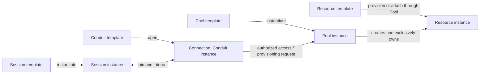

# Conduit specification

Updated: 2026-10-31. Accepted working model; implementation has not started.

## Working model

Conduit connects models, agents and capabilities through four families: **Session, Resource,
Pool and Conduit**. Each has a reusable **template** and a concrete **instance** form.
This distinction applies throughout the system; it does not require every instance to run a
process or every family to have identical lifecycle operations.

| Family | Template defines | Instance represents |
| --- | --- | --- |
| **Session** | Runtime/model/account defaults, activation instructions, required limits and default connection choices. | A durable participant with resolved settings, private context/history and executions. |
| **Resource** | A typed recipe for creating or attaching data/capabilities, with supported configuration and behavior. | A particular provisioned or attached capability with identity, backing-source information and exactly one owning Pool instance. |
| **Pool** | Resource-template selections, provisioning defaults and policies. | An ownership boundary that creates and contains its own Resource instances. |
| **Conduit** | A typed interaction contract, endpoint requirements, filters and supporting-resource requirements. | An opened **connection** with resolved endpoints, participant attachments and any shared operational state. |

Profile is the former name for a Session template, not a fifth family. Connection is the
instance term for Conduit, not a fifth family. A plugin's type schema describes valid
contracts; a template supplies reusable configuration for such a contract. Neither template
form nor instance form implies an additional general-purpose programming language.

Prefer minimal bookkeeping and one authoritative configuration for each instance. Define
Resources before Pool grouping: local paths, MCP services and hybrid database search require
different typed configuration and behavior. A shared envelope does not imply a uniform
runtime or provisioning lifecycle. The next review derives common Resource requirements from
those examples, then considers how Pools group and coordinate their declared capabilities.

This diagram shows common interactions, not a closed topology or process layout. Conduits
are the extensible interaction layer across the families; each contract specifies meaningful
endpoint roles and operations. Templates describe potential behavior; instances carry identity
and realized state. Executions, transports and participant attachments are supporting state.

## Resource ownership and creation

Every Resource instance is created through a Pool instance and belongs to exactly that Pool.
This includes attaching an existing directory/service and provisioning backing Resources for
a connection. A bare Resource-creation path must not bypass Pool ownership. Authoring or
registering a Resource template does not create a deployed Resource.

Different Pools can instantiate the same template. The resulting Resource instances are
distinct even when they intentionally attach to the same repository, vault or remote service.
Contracts must distinguish creating new backing data from attaching to existing data. Separate
registrations do not prove separate files, credentials, quotas or mutation targets.

For a local folder, one Resource instance describes the configured folder; per-Session symlinks
are preparation state. Removing one symlink preserves the Resource and backing folder, without
affecting other Sessions' views. This does not require the same consumer lifecycle for every type.

Conduits access Resources through their owning Pools. A connection that needs conversation
storage requests it from a selected Pool, then uses that Pool-owned Resource. Connections and
Sessions may use several Pools; this does not make them owners of the Resources. Cross-Pool
access follows authorized connections to the owner, not duplicate membership of one instance.

Pool ownership is not automatic access, activation or authority to destroy external data.
Selectors may help choose templates or the Pool's owned instances; their exact targets and
live behavior remain open. They cannot implicitly adopt another Pool's Resource instance.
Pool retirement, ownership transfer and orphan handling require explicit lifecycle design.
No automatic purge follows from a missing Pool reference.

## How instances work together

1. **Create a Session.** Use complete instance YAML with an explicit unique name, or materialize
   one template and creation choices. Later edits target the instance; current access limits
   are represented explicitly. V0 defers Session-template inheritance.
2. **Register Pools, then explicitly create/attach Resources.** Pool registration and Resource
   provisioning are separate effects; a frontend may combine them in one explicit action with
   separate outcomes. The Pool owns the resulting instances. Persistent creation declarations
   and their bindings are back under review pending Resource contracts; no background
   reconciler is implied.
3. **Open or join a connection explicitly.** Opening uses a Conduit template or complete
   instance configuration; joining targets an existing connection. Reusing a template name
   does not choose between these operations or imply shared clients, credentials or private context.
4. **Apply access and activation.** Connection filters narrow authorized resources and
   operations. The Session applies activation instructions in its own spec to the permitted
   inventory. Availability alone does not load instructions or content into the model.
5. **Keep lifetimes distinct.** A participant can detach while shared conversation storage
   remains. A remote operation can continue after its initiating client exits. The connection,
   its Pool-owned Resources, participant state and underlying processes need separate contracts.

Session activation, Pool provisioning and connection supervision are different responsibilities.
The first prepares a participant; the second creates/attaches owned Resources; the third
implements an interaction. Their ordering and dependency rules remain for review.

## Configuration language

**YAML is the authoring format; typed objects and explicit semantics define the language.**
The common envelope is `apiVersion`, `kind`, `form`, `metadata`, `spec`, with system-owned
`status` in inspection. Each object uses one family `kind`—Session, Resource, Pool or Conduit—
plus a top-level `form` identifying a template or instance. Validation must
distinguish both family and form; sharing a kind does not imply identical payloads or operations.

Retain the accepted registry and editing contracts in [DESIGN.md](DESIGN.md#configuration-language):

- Stable IDs survive rename; replacement objects receive new IDs. Readable references record
  resolved identity, and established explicit bindings require explicit rebind to another ID.
- Readable configuration-object references explicitly include `kind`, `form` and `name`.
  Kind/name locates the object; form checks the expected template/instance distinction.
  A wrong-form target is rejected, including in fields that already imply a form.
- Use one local registry with names unique per family across templates and instances. A Session
  template and Session instance cannot both be named `reviewer`. Templates name reusable concepts;
  instances default to the template name plus a generated unique suffix, with explicit unique
  names allowed. Exact suffix format and name constraints remain open.
- YAML registration/export is explicit. Editing a file does not update active configuration;
  changing a template is distinct from instantiation, provisioning, execution or reconciliation.
- Across all four families, create instances from complete instance YAML or from a template
  expanded into an instance draft, customized through ordinary instance fields. V0 has no
  separately declared template parameters or parameter-to-field mapping language. Edits can
  be automated through YAML/CLI/API without an interactive step. Assigning a field replaces
  its whole value, including objects/lists; editing a nested child preserves its siblings.
  Direct creation requires an
  explicit unique name; Resources still
  require Pool-mediated creation. Both paths produce the authoritative instance spec and
  obey the same validation and authority rules. Creation, provisioning and execution retain
  separate contracts. Later changes edit the instance directly; its creation template can
  change or disappear without changing the instance.
- Template-origin information is optional; no source snapshots or input/override history are
  required. Continuing Resource and authority dependencies must be explicit on the instance.
  Current-access checks, Resource data, runtime status and actual execution evidence remain
  separate from configuration.
- Instance creation and checked replacement updates materialize declared schema defaults into
  saved/exported instance specs. Template YAML preserves omissions. Fields without declared
  defaults retain their required/optional semantics.
- Typed configuration rejects unknown fields except within maps explicitly declared open by
  their schemas. Plugin contracts may define their own fields and open maps; keys and values
  still obey the applicable map contract.
- Creation and replacement require all applicable configuration schemas. If a required schema
  is unavailable, reject the write and preserve source YAML and any existing registered object.
  If schemas and required registry checks pass, register configuration despite a missing plugin
  runtime or offline configured service. Report known readiness gaps or unknown readiness;
  operations requiring unavailable dependencies remain blocked. Registration is separate from
  activation and does not relax validation, authority or Pool ownership.
- Create/update intent is explicit. Updates replace complete authored configuration and use
  separate expected-ID/configuration-version checks. Status-only changes do not invalidate edits.
- Unchanged configuration preserves its version after checks. Compare instances after default
  materialization, so omission and an equivalent explicit default produce the same stored
  value. Templates retain that authored distinction; presentation-only differences do not count.
- CLI/editor edits retain recoverable baselines; absent baselines need explicit preparation.
  Status is rejected on normal writes and omitted with system IDs/versions from reusable exports.
- Deletion is checked; registration removal, native shutdown and backing-data purge are distinct.
  Pool ownership introduces lifecycle obligations that ordinary reference behavior does not settle.

References, defaults, field values, selectors, filters, activation and provisioning require
field-specific semantics. Draft assignments do not implicitly merge objects or append lists;
there is no implicit textual substitution.
Authored intent, resolved configuration, observations and operation outcomes stay distinguishable.

## Implementation direction and retained behavior

Conduit owns its runtime in Rust, including execution, context construction, provider/tool
dispatch and recovery. The first frontend is a custom terminal inspired by Pi. Pi's runtime
and Durable are research references; external-agent adapters separately support native runtimes.
Provider adapters and native-agent adapters have different authentication and lifecycle contracts.

MCP is the preferred external capability protocol. Preserve provider-native names, schemas and
workflows. Resource-service authentication is separate from model subscriptions. Native skills
and plugins are brought through compatible ecosystems, without a new Conduit package manager.
Linear owns its tracking workflow; memory/search/graph providers remain replaceable plugins.

Native execution is the v0 default, with selectable or Session-required isolation. Four
independent accounts remain an early acceptance target: two Claude and two Codex/OpenAI
subscription identities. Actual identity, subscription compatibility and refresh/logout isolation
must be verified. No silent account or billing fallback is permitted.

Session continuity, portable checkpoints, current-access checks, memory revisions/provenance,
bounded search with coverage reporting, read-only sharing, workspace retention, safe retry and
usage attribution remain as specified in [DESIGN.md](DESIGN.md). A four-family vocabulary does
not relax these rules or make native host access fully mediated.

## Acceptance scenarios

These are intended outcomes, not completed tests. [REVIEW.md](REVIEW.md#initial-experiment)
defines the remaining selections and staged evidence.

| Interaction | Observable outcome |
| --- | --- |
| Template versus instance | References identify the intended form; registering a template does not start work. The complete instance spec remains usable after its creation template changes or disappears, subject to explicit dependencies and current authority. |
| Direct creation | Complete instance YAML can create a named instance without registering a template. Resource creation still requires an owning Pool; both paths obey the same validation and authority rules. |
| Typed Resources | Filesystem, MCP and search examples have explicit type-specific configuration, operations and consumer state. A template configures a contract; it does not define a new type. Pool grouping follows these semantics. |
| Folder preparation | Two Sessions use one folder Resource through their own symlinks. Preparing/removing a symlink creates/deletes no Resource or backing folder and does not affect the other Session's view. |
| Pool registration and provisioning | Registering a Pool does not itself provision Resources. Explicit provisioning has its own outcome, including when a frontend combines registration and provisioning. The declaration/binding representation remains under review. |
| One template, several Pools | Pools create distinct Resource instances; each has exactly one owner. A foreign Resource cannot become a local member through a label or reference. |
| Shared versus independent backing | Both explicit attachment to shared backing and provisioning independent backing are expressible; target identity and actual enforcement are reported. |
| Connection support | Opening a connection requiring storage provisions it through an identified Pool. Joining reuses the intended connection without creating a duplicate conversation. |
| Concurrent accounts | Four Sessions retain independent private state and verified account selection while accessing authorized common Resources. |
| Session activation | Instructions materialized in the Session spec prepare only permitted Resources; connection filters do not become loading instructions. |
| Context and communication | Sessions exchange permitted context through the selected contract while retaining private histories; memory retrieval reports omissions and coverage. |
| Change and failure | Stale edits conflict, unknown effects remain unknown, and retries do not mistake a repeated create request for a deliberate second instance. |
| Lifecycle | Detach, close, stop, unregister and purge have distinct outcomes; removing configuration does not silently destroy files or retained evidence. |

## Design boundary

The four families, family kinds with explicit forms, exclusive Pool ownership and Pool-only
Resource creation are settled. Review Resource templates/instances and type-specific semantics
first, then Pool grouping. Detailed addressing, lifecycle, provisioning and communication
contracts remain open. Prefer derived views over additional bookkeeping; settle the connected
choices before implementation.
Research proposals and the synthetic scenario are discussion aids, not additional requirements.
