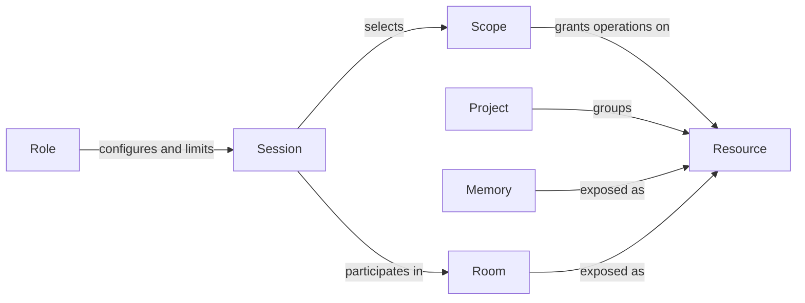

# Conduit specification

Updated: 2026-10-30 · Current design for review · Implementation has not started.

## Purpose and principles

Conduit lets users work with different models, agents, accounts, and interfaces while
sharing relevant knowledge and coordinating work. Its first acceptance scenario is
Claude and Codex collaborating in one room on the same project, on one machine.

- **Shared continuity:** Conduit owns the portable memory and communication layer;
  each agent owns its planning, execution loop, and working context.
- **Native compatibility:** preserve provider tools, schemas, and workflows. Users
  bring compatible skills and plugins into local role configurations.
- **Small, replaceable boundaries:** use MCP broadly and keep backend, runtime,
  frontend, account, and tracker choices independently replaceable.
- **Explicit access:** select resources and operations for each session within role
  limits. Making information available does not automatically load it into a model.
- **Staged control:** design for intercepting outgoing MCP calls while preserving
  native interfaces. Comprehensive interception, permission enforcement on upstream
  calls, and sandboxing follow after v0; broader sandboxing may offer tiers.

## Core concepts

These names have distinct meanings throughout the specification.

| Concept | Definition | Example |
| --- | --- | --- |
| **Role** | A reusable local configuration selecting an agent/runtime, model, account reference, native skills, and tool connections. It can declare permission limits. Model/account settings are defaults with explicit session overrides. | A reviewer using Codex with selected skills and read-only tool limits. |
| **Session** | One continuing Conduit conversation, configured from a role and using selected scopes. It is the stable participant in rooms, with at most one active primary agent. | A review conversation that later resumes using another account. |
| **Resource** | An exposed source, object, or service that can be accessed through defined operations. A resource can contain other objects. This is broader than the MCP protocol's specific resource primitive. | A folder, repository, graph, knowledge record, room, or provider service. |
| **Memory** | Durable knowledge and portable checkpoints retained for use across sessions, models, and accounts. Memory is exposed as resources and can use replaceable storage/search backends. | A saved project convention or task checkpoint. |
| **Project** | A named grouping of related resources for a body of work. It can span repositories, folders, and memory and provide convenient scope presets. Grouping alone grants no access. | An application with its repository, design notes, and related services. |
| **Scope** | A reusable selection of resources and permitted operations, with optional exclusions. A session chooses scopes within its role's limits. | Read project notes, edit one repository, and read/post in a selected room. |
| **Room** | A durable, append-only message board for collaboration around work. Sessions exchange messages and maintain independent read positions and working contexts. | Claude and Codex discussing one review task. |

A role defines configuration and limits; a scope supplies the selected access for
particular work. A project organizes resources; memory is one kind of retained
information those resources expose. A room communicates between sessions rather
than maintaining a shared editable working-memory document.

### Supporting terms

| Term | Meaning |
| --- | --- |
| **Model / agent runtime** | The model produces responses; the runtime supplies the execution loop, native tools, skills, and lifecycle. Compatibility depends on the runtime as well as the model. |
| **Account** | A separately selectable identity/credential reference, including subscription logins or API credentials. Model-provider and resource-provider accounts are distinct. |
| **Connection / plugin** | A connection is reusable local setup for a service or backend; a plugin supplies integration behavior. Roles reference connections rather than duplicating setup. |
| **Tool / skill** | A tool performs an operation; a skill provides instructions and potentially helpers in a compatible native format. A skill does not grant additional permissions. |
| **Execution / frontend** | An execution is a native agent run within a logical session. A frontend presents and controls interaction, such as Conduit's CLI/chat or Pi. |
| **Working context / checkpoint** | Working context is the information an agent currently uses. A checkpoint is an explicit portable snapshot of task state, not the agent's full native state. |
| **Task / issue / workspace** | A task is the work being pursued; an external issue tracks it in a provider such as Linear. A workspace is its local working directory or worktree. Their exact binding to rooms remains under review. |

### Example

A project groups an application repository and saved engineering notes. A Claude
implementation role and a Codex review role reference the same resource connections
but select different skills and permission limits. Each starts a separate session
with scopes appropriate to its work and joins the same room.

Claude saves a finding to shared memory and posts a reference. Codex retrieves it
if its scope permits, checks the evidence, and replies. Both keep their own working
context. The room preserves the exchange, the memory record preserves the finding,
and the repository holds the actual files. A Linear issue can track the work without
becoming the room or replacing its history. This example specifies relationships,
not particular tool names or configuration syntax.

## Expected behavior

### Configure and reuse roles

Support separate Claude subscription logins, simultaneous sessions using different
accounts, and explicit account/model changes when continuing work. Record each
execution's actual settings and session overrides. Resource credentials remain
separate from the model account.

Users can import or select skills from Superpowers, jxp-skills, personal libraries,
and other compatible sources. Initially, skills/plugins may be tied to Claude,
Codex, or another native runtime. Conduit may supply small defaults explaining its
own capabilities. A custom skill format or automatic cross-runtime conversion is
not required.

Conduit's own CLI/chat, native agent launching, and selectable frontends including
Pi are product directions. The first delivered interaction surface is still to be
selected; the core must not depend on Pi.

### Share knowledge and continue work

Memory covers tasks, projects, and personal knowledge across projects. Users and
agents write knowledge explicitly within their access; work and personal knowledge
stay separate unless shared. Available transcripts support continuity, but complete
normalized conversation history is not guaranteed.

Resume keeps the logical session and loads its applicable permitted checkpoint.
Fresh starts a new session without automatically loading prior conversation or
checkpoint content; stored records and files remain available to retrieve. Fork
creates a new session from a chosen checkpoint with an origin reference. Neither
fresh nor fork implicitly clones or deletes workspace files.

### Communicate through rooms

Messages are immutable after acceptance; corrections are follow-up posts. Conduit
retains shared room history, with independent progress for each session and optional
local copies. Reading does not consume another participant's unread messages.

By default, a brief unread notice appears on the next normal agent turn when the
integration supports it; content is retrieved as needed. Posts do not wake idle,
paused, or closed sessions or create extra model turns. Role-specific wake hooks
remain a future option.

Rooms have identities separate from tracker issues. Tracker-free operation is allowed
for initial tests; tracker linkage is an eventual requirement. Linking preserves the
room, while the provider owns issue fields and workflow. Linear is the first tracker
direction; Conduit does not require an internal ticket engine or full tracker replica.

### Control access and explain coverage

Select scopes per session, combine their grants, apply role limits, and honor explicit
exclusions. The same configured connection can serve sessions with different access.
Scope changes apply to subsequent Conduit-managed requests and must be visible.

Proceed with usable capabilities while reporting missing or unsupported access.
An unavailable restriction cannot silently become broader access. V0 guarantees must
be limited to the paths actually controlled; selecting a scope does not establish
agent-wide isolation. The [design](DESIGN.md#access-and-sharing) defines the access
contract and its staged implementation.

## Acceptance scenarios

These express observable behavior for review, not completed tests or a frozen release
checklist. The first scenario anchors v0; sequencing the others is a review decision.

| Scenario | Observable outcome |
| --- | --- |
| **Claude and Codex collaborate** | Two role sessions use one project and room. One saves knowledge and posts a reference; the other retrieves permitted content and replies. Both retain their own context and read progress. |
| **Resume across accounts or agents** | The logical session/room participant remains stable, actual execution settings are recorded, and the receiver gets the permitted checkpoint or explicit context gaps. |
| **Start fresh** | A new participant has no automatically loaded prior checkpoint/history. Existing files and stored knowledge remain intact and retrievable within scope. |
| **Independent catch-up** | One participant reads room history without advancing another's position. A restarted session can retrieve retained history; missing/expired content is reported. |
| **Access changes** | A subsequent managed retrieval or queued delivery uses current permissions. Inaccessible content is omitted without revealing restricted provenance. Already delivered native context is not claimed to be erased. |
| **Integration gaps** | Unsupported notifications, unavailable sources, unknown runtime state, and missing usage data are visible rather than reported as successful, empty, running, or zero by default. |

Success for the initial demonstration means the two agents exchange useful retained
knowledge and room messages without manually copying their full conversations, with
clear participant identity and honest access/delivery/usage coverage. Exact operations
and recovery cases must be selected in [REVIEW.md](REVIEW.md).

## Delivery scope

The first usable workflow prioritizes local collaboration, memory retrieval/writes,
rooms, role/connection configuration, native skills, and basic managed access.

Remote communication, optional wake hooks, comprehensive call interception, broader
sandbox tiers, and automated memory extraction/classification are later work.
Advanced sharing semantics guide compatible implementations but do not require the
whole feature set in v0. Storage engines, wire schemas, configuration syntax, crate
layout, and plugin packaging remain unselected.
