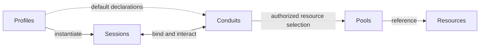

# Conduit specification

Updated: 2026-10-30. Current working model; implementation has not started.

## Working model

Conduit connects models and agents through **Profiles, Sessions, Resources, Pools,
and Conduits**. These five concepts and their interactions define the system. They
support shared knowledge, compatible tools and skills, independent accounts, portable
context, and communication without making any one provider or frontend the architecture.

**Retain YAML; define the language through typed objects and explicit semantics.**
The configuration describes a graph of these five objects. Its meaning comes from their
contracts: how references resolve, defaults compose, access narrows, activation happens,
and changes affect running Sessions. YAML supplies the authoring notation. Conduit owns
the interpretation and exposes it consistently through its CLI, APIs and frontends.

| Concept | Meaning | Boundary |
| --- | --- | --- |
| **Profile** | A reusable Session template specifying runtime/model/account defaults, execution requirements, optional permission limits, activation instructions and default Conduit references. | A template has no shared conversation or private agent history. |
| **Session** | A durable, independently identified participant created from one Profile, with resolved settings, private context/history and its own Conduit bindings. | A Session persists across supported execution, account and frontend changes. |
| **Resource** | An independently addressable object exposing data, capabilities or both through a defined contract. | Its identity/source is independent of Pool membership; kinds are extensible. |
| **Pool** | A named collection of Resource references, assembled explicitly or through label selectors. | Pools are the sole route for supplying Resources to Sessions through Conduit; membership alone grants no access or exclusive ownership. |
| **Conduit** | A typed, authorized relationship for Session access to Pool resources, communication between Sessions, or both as its contract permits. | Reusable declarations are bound per Session; a relationship does not imply one transport or delivery guarantee. |

The Session–Conduit relationship covers both access to Pools and exchanges between
Sessions. The diagram describes the conceptual model, not a process layout or wire protocol.

## How the concepts interact

1. **A Profile creates independent Sessions.** Each Session resolves one Profile plus
   explicit overrides. Behavioral default changes affect new Sessions; existing Sessions
   adopt them through explicit reconfiguration. Permission limits remain live.
2. **Profile defaults establish Conduits.** Defaults reference reusable declarations;
   each Session receives its own authenticated bindings and lifecycle. V0 defers Profile
   inheritance. Runtime/model/account bootstrap settings stay in the Profile.
3. **Pools organize Resources.** A Resource can be referenced by several Pools without
   copying content or transferring ownership. Pools may collect project resources, a skill
   package or any other useful grouping through the same extensible membership contract.
4. **Conduits govern Resource use.** Resource access, including baseline instructions,
   skills and MCP capabilities, goes through Pools. Filters narrow authorized selections
   and operations within Profile limits. The Profile supplies activation instructions;
   the Session applies them to the permitted resources. Availability alone does not load content.
5. **Conduits connect Sessions.** Sessions retain their own context while exchanging
   information under the chosen interaction contract. Addressing, delivery, attention,
   persistence and tracker associations require further design.

Activation belongs to the Profile template. Its instructions describe how the Session
prepares and uses the resources available through its Conduits. A resource-access
Conduit selects and filters resources and operations; it does not own their loading
instructions. Exact import defaults, compatibility handling and activation sequencing
remain open. Pi's loaders, packages and MCP setup inform those Profile/Session contracts.

## Supporting mechanisms

These belong to the five concepts rather than extending the core vocabulary:

| Mechanism | Place in the model |
| --- | --- |
| Models, runtimes, accounts and execution modes | Profile choices resolved and recorded for Session executions. Model and resource-service credentials remain separate. |
| Executions, private context and frontends | Session lifecycle and presentation. A frontend does not own the Session's execution state. |
| Memory, checkpoints, skills, tools, documents and workspaces | Resource contracts or content supplied through Pools. This is an illustrative, open-ended list. |
| Labels and selectors | Resource metadata and Pool membership selection; labels are optional and do not establish identity or authority. |
| Activation instructions | Profile template behavior executed by the Session against permitted resources. |
| Filters and grants | Conduit behavior constrained by Profile limits. Filters only narrow; their authoring and composition remain open. |
| Connections, plugins and protocols | Integration mechanisms implementing Resource and Conduit contracts. Reusing setup does not imply a shared live client or authentication state. |
| Tasks and external tracker issues | Work associations for Sessions, Resources and Conduits. Providers retain their own fields and workflow. |
| Usage, provenance and operational evidence | Observations of Session executions and Conduit operations, retained through the applicable Resource contracts. |

Conduit's Resource concept is broader than MCP's specific resource primitive.
A Conduit Profile is distinct from a native agent's login profile or credential directory.

## Configuration language

The language must make a Session's effective setup explainable: which Profile supplied
its defaults, which Conduits were selected, which Pools supplied each Resource, what
permissions apply, and which Profile instructions prepared or loaded it. An author should
be able to trace that result without knowing an adapter's implementation.

Profiles, Sessions, Resources, Pools and Conduits share the authoring envelope
`apiVersion`, `kind`, `metadata` and `spec`. Each kind defines its own configuration within
`spec`. Metadata has per-field ownership: naming/labels are author-editable, while identity
and version information is system-owned. Inspection adds system-owned `status` for
reported resolution and observed state. Normal authoring omits `status`; changes are
requested through configuration or operations. Normal configuration writes reject an
included `status` field; configuration-only export omits it and system-owned identity/version
values, retaining reusable object configuration. The actual version identifier,
detailed status fields and other import/export rules remain open.

Each configuration object has a system-assigned stable ID independent of its name. Renames
preserve the ID; deletion and recreation under the same name produce a different ID.
Authored references normally use `kind` and `name`; Conduit records the resolved object's
stable ID. V0 uses one local registry with names unique per kind; underlying resources may
remain local or remote. Namespaces and cross-registry references are deferred. ID encoding,
reference extensions and exact rebind operations remain for review.

Renames use normal checked updates to `metadata.name`, targeting the original ID/version.
The new name must be available for that kind. Other registry objects keep their authored
references until explicitly updated; known mismatches with resolved targets are reported and
checked reference updates are offered. Source YAML files remain unchanged; aliases and export
behavior remain open.

Established bindings from explicit references retain their resolved IDs through renames.
A deleted target becomes unavailable; a replacement using the same name requires explicit
rebinding. This preserves identity without freezing content versions or current permissions;
live selector membership remains separate.

The registry holds active configuration in v0, with explicit YAML application/export.
Editing an input file alone does not change active objects; CLI/API edits do not silently
rewrite source files. Registry storage technology and Resource-content updates remain separate.
Submissions explicitly select create or update intent: creation conflicts on an occupied
kind/name, and an update requires an existing target rather than becoming a creation.

V0 updates replace the complete authored configuration. Omitted optional fields follow
their omission/default/validation rules instead of retaining old explicit values. Object
identity is preserved; Conduit maintains system-owned fields. Partial patches are deferred.

Normal configuration updates require the expected stable ID and the configuration version
the edit was based on, rejecting mismatches. That version covers `spec` and editable
metadata; status-only changes do not invalidate edits. After authorization and ID/version
checks pass, unchanged submissions retain the version and record an unchanged operation
outcome. Stale submissions still conflict. Equality compares parsed authored values, ignoring
presentation-only formatting, comments and mapping-key order while distinguishing omission
from an explicit default. Lists follow their field-specific order rules. Clients can reconcile
and retry under current permissions. Expected ID/version are separate update-operation
inputs rather than fields in reusable object YAML. V0 CLI/editor workflows retain a recoverable
local baseline of the original configuration and ID/version so interrupted edits keep their
original checks. Direct API clients supply those preconditions themselves. Without a usable
baseline, preserve the YAML and explicitly prepare a new one against the selected target:
compare current configuration and capture its ID/version before a checked replacement.
Missing edit history cannot be reconstructed; stale baselines still require reconciliation.
Exact request fields and baseline storage/lifecycle remain open.

| Requirement | Meaning |
| --- | --- |
| Typed object graph | The five objects have explicit identities, references and contracts. New integrations extend Resource/Conduit contracts without adding a core concept for every provider. |
| One interpretation | Files, CLI/API requests and frontends use the same semantic rules. A future external generator can produce objects without gaining a separate authority or execution path. |
| Explicit composition | Defaults, membership, filters, authorized capabilities and activation have different rules. No generic deep merge defines all of them. |
| Distinct representations | Authored intent, resolved configuration, runtime observations and operation outcomes remain distinguishable. Observed readiness does not rewrite intent or prove ongoing permission. |
| Inspectable resolution | Explain effective values, their sources, unresolved references, unavailable capabilities and proposed effects. Credentials remain outside ordinary shareable configuration. |
| Layered contracts | Data shape, object relationships, allowed transitions, environmental compatibility and execution evidence answer different questions. Schema validity alone is not successful preparation or enforcement. |
| Semantic evolution | Version interpretation as well as field shape. Changes to defaults, list behavior, references or effects can require migration even when the YAML still parses. |
| Small authoring surface | Favor reusable objects and well-defined operations. An embedded template/programming language and inherited configuration chains are not prerequisites for v0. |

For example, a Resource selected through two Pools retains one identity; the two access
paths still need their own authority. A Profile's activation can only use the permitted
selection. A model override changes behavior within limits; it cannot broaden access.
Making these distinctions visible is part of the product, not an implementation detail.

Detailed metadata/spec fields, identifiers, schema dialect, YAML subset, composition syntax,
validation stages and update operations remain open. The [design](DESIGN.md#configuration-language)
sets the constraints; the [review](REVIEW.md) resolves them using concrete inputs, effective
results and failure cases. The research YAML remains an illustration, not an approved schema.

## Implementation direction

Conduit owns its runtime in **Rust**, including the execution loop, context construction,
provider/tool dispatch and recovery. The first frontend is a custom Conduit terminal
inspired by Pi. UI components may be reused; Pi's agent loop and Pi Durable remain
research references. External-agent adapters can separately connect runtimes such as
Claude Code and Codex.

Kubernetes and networking APIs inform object structure, identity and versioning; Docker
and configuration-language research inform composition, validation and effect boundaries.
These are design references. Conduit's Rust runtime interprets its own contracts; adopting
the configuration conventions does not require a Kubernetes control plane or Docker engine.

Use MCP as the preferred external capability contract while preserving provider-native
names, schemas and workflows. Native adapters cover runtime/account/lifecycle needs and
non-MCP services. The design does not require a single combined MCP endpoint. Future
mediation should inspect and attribute outgoing calls and support permission enforcement.
V0 reports the actual enforcement and observation coverage of each integration.

Users bring compatible skills and plugins through Pools and Conduits, using native
installation tooling where supported. Runtime/plugin compatibility is checked separately
from model preference. Storage/search and tracker integrations remain replaceable;
Xerj is a backend candidate and Linear is the first tracker direction. Conduit does
not require its own skill language, package manager or ticket workflow engine.

V0 requires independent account and Session state. Native host execution is the default;
isolated execution is available or required by a Profile. Required isolation cannot be
silently weakened. [DESIGN.md](DESIGN.md) defines the access, continuity, retention,
workspace, sharing and usage contracts without promising control over unmediated host paths.

## Acceptance scenarios

These are intended outcomes, not completed tests. The experiment details follow the
[review](REVIEW.md#experiment-across-the-five-concepts).

| Interaction | Observable outcome |
| --- | --- |
| **Authoring → effective configuration** | The same declared inputs and semantic versions produce an explainable static resolution. Live discoveries and access observations are distinguished. CLI, API and frontend views agree on the result. |
| **Configuration changes → effects** | Authors can distinguish a data edit, a preparation action and execution/resume. Defaults, empty selections, conflicts and version changes have documented outcomes; a valid file is not evidence that an external action succeeded. |
| **Profiles → Sessions** | Four Sessions run concurrently across two Claude and two Codex/OpenAI subscription identities. Account login/refresh/logout does not overwrite another account's state; private history remains per Session. Supported subscription access and actual identities must be verified. |
| **Profile defaults → Session bindings** | Reusing a Profile creates independent bindings. Behavioral default edits leave existing resolved settings intact until explicit reconfiguration; live limits continue to apply. |
| **Resources → Pools → Conduits** | One Resource can be reused in multiple Pools without copying it. Membership alone neither exposes it to a Session nor activates it. Selected compatible resources are supplied through the intended Conduit. |
| **Sessions → shared Resource access** | Permitted knowledge is searchable/readable across accounts. Unauthorized direct-ID reads, search results and provenance remain unavailable. Unknown coverage is distinguishable from an empty result. |
| **Sessions ↔ Conduits ↔ Sessions** | The selected communication contract enables collaboration while preserving private context and reporting delivery/execution outcomes. Its specific semantics are an open design task. |
| **Session continuity** | Resume retains identity and permitted context; fresh starts without prior conversation/checkpoint content; fork creates an independent Session from a chosen checkpoint. Controller transfer and frontend detachment preserve the logical Session. |
| **Conduit authority changes** | Subsequent managed requests use current rules. An isolated execution that cannot revoke removed access stops pending explicit restart. Unavailable restrictions never silently become broader access. |
| **Failures and evidence** | Unknown execution status does not start a duplicate. Uncertain writes are reconciled before unsafe repetition. Missing usage is not zero, and overlapping parent/subagent counts are not double-counted. |

## Design boundary

The five concepts and the typed-object language direction are settled. Their detailed
schemas, semantic rules, interaction contracts and first implementation sequence are under
review. Remaining choices must identify the object, field, operation or relationship they
refine, with an example of its resolved meaning and behavior. Memory search, account
adapters, observation and sandboxing support this model; they do not introduce parallel
organizational frameworks.

[DESIGN.md](DESIGN.md) is authoritative for accepted behavior. [REVIEW.md](REVIEW.md)
contains the language-focused review and staged work. [Configuration research](research/CONFIGURATION.md)
and [Pi research](research/PI_CONNECTORS.md) provide supporting evidence. Their unadopted
proposals are not additional requirements. Implementation begins after the configuration
contracts and initial experiment are agreed.
