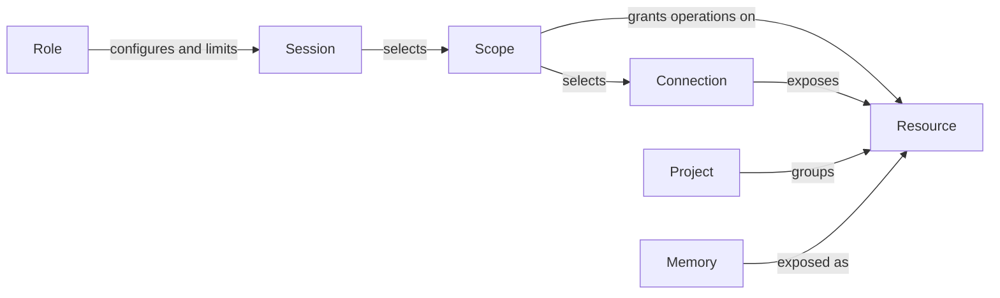

# Conduit specification

Updated: 2026-10-30 · Current design for review · Implementation has not started.

## Purpose and principles

Conduit lets users work with different models, agents, accounts, and interfaces while
sharing relevant knowledge and coordinating work. Its first acceptance scenario is
four simultaneous sessions using two distinct Codex subscription accounts and two
distinct Claude subscription accounts on one machine, with private native state and
scoped access to shared knowledge. Communication between sessions remains a core goal;
its model and acceptance criteria are [deferred for redesign](REVIEW.md#deferred-communication-redesign).

- **Shared continuity:** Conduit owns portable memory and context continuity;
  each agent owns its planning, execution loop, and working context.
- **Native compatibility:** preserve provider tools, schemas, and workflows. Users
  bring compatible skills and plugins into local role configurations.
- **Small, replaceable boundaries:** use MCP broadly and keep backend, runtime,
  frontend, account, and tracker choices independently replaceable.
- **Explicit access:** select resources and operations for each session within role
  limits. Making information available does not automatically load it into a model.
- **Staged control:** design for intercepting outgoing MCP calls while preserving
  native interfaces. V0 requires account separation and offers native execution by
  default, with isolated execution as an explicit option. Comprehensive inspection
  and enforcement of individual upstream operations can follow later.

## Core concepts

These names have distinct meanings throughout the specification.

| Concept | Definition | Example |
| --- | --- | --- |
| **Role** | A reusable local configuration selecting an agent/runtime, model, account reference, and native skills. It can declare permission limits on the access supplied by scopes. Model/account settings are defaults with explicit session overrides. | A reviewer using Codex with selected skills and read-only tool limits. |
| **Session** | One continuing Conduit conversation, configured from a role and using selected scopes, with at most one active primary agent. | A review conversation that later resumes using another account. |
| **Resource** | An exposed source, object, or service that can be accessed through defined operations. A resource can contain other objects. This is broader than the MCP protocol's specific resource primitive. | A folder, repository, graph, knowledge record, or provider service. |
| **Memory** | Durable knowledge and portable checkpoints retained for use across sessions, models, and accounts. Memory is exposed as resources and can use replaceable storage/search backends. | A saved project convention or task checkpoint. |
| **Project** | A named grouping of related resources for a body of work. It can span repositories, folders, and memory and provide convenient scope presets. Grouping alone grants no access. | An application with its repository, design notes, and related services. |
| **Scope** | A reusable selection of shared connections, resources, and permitted operations, with optional exclusions. It references connection definitions; a session chooses scopes within its role's limits. | Select a tracker connection and its permitted tools, read project notes, and update selected knowledge. |

A role defines execution configuration and limits; a scope supplies connections and
selected access for particular work. Connection definitions describe setup without
granting access. A project organizes resources; memory is one kind of retained
information those resources expose. Communication concepts will be defined after
the deferred review; they are not implicit in these resource or session definitions.

### Supporting terms

| Term | Meaning |
| --- | --- |
| **Model / agent runtime** | The model produces responses; the runtime supplies the execution loop, native tools, skills, and lifecycle. Compatibility depends on the runtime as well as the model. |
| **Account** | A separately selectable identity/credential reference, including subscription logins or API credentials. Model-provider and resource-provider accounts are distinct. |
| **Connection definition / plugin** | A connection definition is reusable local setup for a service or backend: endpoint/process, transport, and authentication references. It is distinct from a live MCP client connection. A plugin supplies integration behavior; runtime integrations prepare native setup from selected definitions. |
| **Tool / skill** | A tool performs an operation; a skill provides instructions and potentially helpers in a compatible native format. A skill does not grant additional permissions. |
| **Execution / frontend** | An execution is a native agent run within a logical session. A frontend presents and controls interaction, such as Conduit's CLI/chat. |
| **Working context / checkpoint** | Working context is the information an agent currently uses. A checkpoint is an explicit portable snapshot of task state, not the agent's full native state. |
| **Task / issue / workspace** | A task is the work being pursued; an external issue tracks it in a provider such as Linear. A task or experiment owns a workspace: its local working directory or worktree. |

### Example

A project groups an application repository and saved engineering notes. A Claude
implementation role and a Codex review role select different skills and permission
limits. Each starts a separate session with scopes appropriate to its work.
Their scopes can reference the same connections with different grants;
each runtime integration prepares the native connection setup.

Claude saves a finding to shared memory. Codex can retrieve it if its scope permits
and check the evidence. Both keep their own working context. The memory record
preserves the finding, and the repository holds the actual files. A Linear issue can
track the work through provider-native operations. This example does not prescribe
how sessions notify or address one another.

## Expected behavior

### Configure and reuse roles

V0 supports concurrent, separately authenticated Codex and Claude subscription
accounts. Login, refresh, logout, configuration, and private native history for one
account must not switch or overwrite another's state. Record each execution's actual
settings and session overrides; do not silently substitute an account or API billing.
Native runtimes own subscription sign-in and token refresh; Conduit owns account
references, profile selection, and identity verification. Resource credentials remain
separate from the model account. Account separation alone does not establish OS
isolation. Native execution is the v0 default; isolated
execution adds a boundary around the runtime and its children. Show each role's
configured mode and show/record each execution's effective mode and coverage. Never
silently downgrade a requested isolation guarantee. A role may require isolated
execution, which a launch override cannot weaken to native. Roles without that
requirement may use either mode. The isolation backend remains open;
[the design explains the rationale](DESIGN.md#why-both-modes-with-native-as-the-default).

Isolated execution allows declared network destinations by default: required runtime
model/login services, selected connection endpoints, and extra destinations explicitly
granted through scopes, within role limits and exclusions. Local/private services need
explicit access. Network reachability does not grant provider-operation permissions.

Each session has its own effective scopes and authenticated access to shared memory.
Sharing a model account does not merge scopes or grant access to another session's
private context through Conduit. Native state reuse must respect the receiving context.
Stored native history and agent-maintained private memory are
session-owned, even for sessions sharing a role/account. Resume can reuse the session's
compatible state; fresh sessions do not inherit it automatically. Reusable knowledge
is shared through scoped Conduit memory; credential reuse remains separate.

At project launch, omitted scope selection uses the project's configured defaults.
Explicit scope selection replaces those defaults; an explicit add action can extend
them. Role limits and exclusions still constrain the resulting access.

Use YAML for Conduit's local configuration, with versioned, named objects, explicit
references, and schema validation. Runtime integrations translate it into native
configuration where needed. The version identifier scheme and exact schemas remain open.

Users can import or select skills from Superpowers, jxp-skills, personal libraries,
and other compatible sources. Roles explicitly select reusable user-level native
settings, skills, and plugins; the default agent profile is not automatically inherited.
An existing setup can be selected once, preserving native formats. Shared MCP
connections remain scope-selected; authentication/history are separate, and mandatory
host/organization policies still apply. Skills/plugins may be runtime-specific.
Conduit may supply small defaults explaining its capabilities; a custom skill format
or automatic cross-runtime conversion is not required. Native ecosystem tooling owns
skill/plugin installation and updates; Conduit adapters can invoke it on request and
record available source/version information.

The first interaction surface is Conduit's CLI: select a role, project, and scopes,
then launch the agent in its native interface. Claude and Codex run as separate
sessions while Conduit supplies shared memory and scoped resources. Their native
interfaces remain the conversation surfaces; launch/configuration behavior still needs design.
Pi integration and Conduit's own chat remain goals. Pi research precedes the deferred
communication review. The core must remain independent of any one frontend.

### Share knowledge and continue work

Memory covers tasks, projects, and personal knowledge across projects. Users and
agents write knowledge explicitly within their access; work and personal knowledge
stay separate unless shared. Available transcripts support continuity, but complete
normalized conversation history is not guaranteed.

Resume keeps the logical session and loads its applicable permitted checkpoint.
Fresh starts a new session without automatically loading prior conversation or
checkpoint content; stored records and files remain available to retrieve. Fork
creates a new session from a chosen checkpoint with an origin reference. Neither
fresh nor fork implicitly clones or deletes workspace files.

### Control access and explain coverage

Select scopes per session, combine their grants, apply role limits, and honor explicit
exclusions. The same configured connection can serve sessions with different access.
Scope changes apply to subsequent Conduit-managed requests and must be visible.
If a running isolated execution cannot revoke removed access live, stop it and require
an explicit restart under current rules. Preserve the logical session identity.

Proceed with usable capabilities while reporting missing or unsupported access.
An unavailable restriction cannot silently become broader access. V0 guarantees must
be limited to the paths actually controlled; selecting a scope does not establish
agent-wide isolation. The [design](DESIGN.md#access-and-sharing) defines the access
contract and its staged implementation.

## Acceptance scenarios

These express observable behavior for review, not completed tests or a frozen release
checklist. The first scenario anchors v0; sequencing the others is a review decision.

| Scenario | Observable outcome |
| --- | --- |
| **Four accounts run concurrently** | Conduit's CLI launches two Codex and two Claude sessions simultaneously, each using a distinct subscription account, in their native interfaces. Permitted knowledge is retrievable with independent private context and scopes. Actual account selection is verified rather than inferred from role labels. |
| **Account state remains separate** | Logging in, refreshing, logging out, or restarting one account does not replace another's credentials/configuration/history. Restarted sessions retain their logical identity; usage is attributed to the producing execution and account where available. |
| **Different scopes share selected knowledge** | A shared record is available to intended sessions; a private record is denied through Conduit to sessions without access, including direct-ID reads and search. Isolated-mode OS access checks are additional acceptance cases to specify. |
| **Execution mode is explicit** | Native is the default, isolated is selectable, and the configured/effective modes are visible. A role's optional isolation requirement rejects native launch overrides. Required isolation that cannot be provided causes a clear launch failure, with no automatic fallback to native. |
| **Resume across accounts or agents** | The logical session remains stable, actual execution settings are recorded, and the resumed execution gets the permitted checkpoint or explicit context gaps. |
| **Start fresh** | A new session has no automatically loaded prior checkpoint/history. Existing files and stored knowledge remain intact and retrievable within scope. |
| **Access changes** | Managed retrieval/context loading uses current permissions. If an isolated execution cannot revoke removed access live, it stops pending explicit restart; session identity remains intact. Inaccessible content is omitted without revealing restricted provenance; already loaded native context is not claimed to be erased. |
| **Integration gaps** | Unavailable sources, unknown runtime state, and missing usage data are visible rather than reported as successful, empty, running, or zero by default. |

Success for the non-communication portion means all four agents can use permitted
shared knowledge with separate private state, clear account/session identity, and
honest access/usage coverage. The communication portion of the experiment remains
open. Exact operations and recovery cases must be selected in [REVIEW.md](REVIEW.md).

## Delivery scope

The current design prioritizes memory retrieval/writes, simultaneous account separation,
role/connection configuration, native skills, and basic managed access. Native and
isolated modes are part of the design; exact
isolation policies, compatibility coverage, and their acceptance checks remain to be selected.

Communication requirements and their delivery order are consolidated in REVIEW.md.
Comprehensive call interception and automated memory extraction/classification are later work.
Advanced sharing semantics guide compatible implementations but do not require the
whole feature set in v0. Storage engines, wire schemas, YAML field/version conventions
and file layout, crate layout, and plugin packaging remain unselected.
