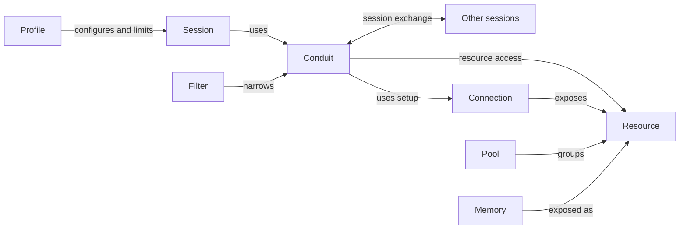

# Conduit specification

Updated: 2026-10-30 · Current design for review · Implementation has not started.

## Purpose and principles

Conduit's core is a common interaction model: **conduits are typed, authorized
relationships for both resource access and communication between sessions**. Pools,
filters, profiles, memory and runtime integrations support that model. Establishing its
contracts and their YAML representation takes priority over implementation.

The first acceptance scenario uses four simultaneous sessions across two distinct
Codex subscription accounts and two distinct Claude subscription accounts on one
machine, with private state and selected shared knowledge. Resource-access and
communication behavior will be specified together through the
[conduit research and review](REVIEW.md#conduit-interaction-research).

- **Conduits first:** resource access and session exchange use the same relationship
  concept. Specific interaction kinds and guarantees remain open; the model must support
  extensible contracts without assuming a room, one transport, or one delivery policy.
- **Runtime ownership:** Conduit owns its runtime in Rust, including execution and
  private working context, alongside portable memory and continuity. Models supply
  reasoning; frontends present interaction. External agent adapters can separately
  connect runtimes such as Claude Code and Codex.
- **Frontend independence:** the first frontend is a custom Conduit terminal inspired
  by Pi; preserving Pi's complete UI is unnecessary.
  Pi's agent runtime and Pi Durable are references for our implementation, not runtime
  dependencies.
- **Native compatibility:** preserve provider tools, schemas, and workflows. Users
  bring compatible skills and plugins into local profile configurations.
- **Small, replaceable boundaries:** use MCP broadly and keep backend, runtime,
  frontend, account, and tracker choices independently replaceable.
- **Explicit access:** select resources and operations for each session within profile
  limits. Making information available does not automatically load it into a model.
- **Staged control:** design for intercepting outgoing MCP calls while preserving
  native interfaces. V0 requires account separation and offers native execution by
  default, with isolated execution as an explicit option. Comprehensive inspection
  and enforcement of individual upstream operations can follow later.

## Core concepts

These names have distinct meanings throughout the specification.

| Concept | Definition | Example |
| --- | --- | --- |
| **Profile** | A reusable template from which any number of independent sessions can be created, selecting runtime/model/account defaults and compatible configuration. It can declare permission limits on access supplied through conduits. Model/account settings are defaults with explicit session overrides. | A reviewer using Codex with selected skills and read-only tool limits. |
| **Session** | A durable, independently identified instance created from a profile template, with its own resolved configuration, private history/context and conduit relationships. It has at most one active primary agent. | A review conversation that later resumes using another account. |
| **Resource** | An addressable object exposed through a defined contract. Resource kinds are extensible and can expose data, behavior, or both. This is broader than the MCP protocol's specific resource primitive. | A repository, knowledge collection, tool, or skill; these examples are not an exhaustive type list. |
| **Memory** | Durable knowledge and portable checkpoints retained for use across sessions, models, and accounts. Memory is exposed as resources and can use replaceable storage/search backends. | A saved project convention or task checkpoint. |
| **Pool** | A named, extensible collection of resources relevant to interacting with a domain. It replaces Conduit's former project grouping and can provide convenient access defaults. Membership alone grants no access. | An Euphony pool collecting the resources relevant to that domain across different providers. |
| **Filter** | A reusable constraint that narrows an existing selection or grant. It can restrict resources or operations but cannot grant access. Its target and composition rules belong to the conduit contract. | Restrict access to frontend-related resources and read operations. |
| **Conduit** | A typed, authorized relationship between endpoints for resource access, communication, or both as its contract permits. Filters narrow its permissions within profile limits. The common concept is fixed; endpoint forms, interaction kinds, lifecycle and delivery guarantees remain for research. | A session accessing selected pool resources, or exchanging information with another session. |

A Profile defines execution configuration and limits. It is distinct from a native
agent login profile or credential directory, which an account adapter may manage.
Conduits supply authorized access and exchange relationships; filters narrow those
permissions. A filter grants nothing on its own. This replaces the former
scope object's combination of selection and grants. Connection definitions describe
setup without granting access. A pool organizes resources; memory is one kind of retained information
those resources expose. Pool membership supports explicit resource references and label
selectors. Pool contents are not a fixed set of categories: new kinds
should not require a new pool field. A document's use for onboarding, for example,
does not establish a dedicated core resource kind or pool field. Membership, access,
and activation/context loading are separate concerns; activation rules remain open.
Profile/session and pool contracts are the immediate review priority, followed by conduit
and filter research. The shared concept does
not require every kind to expose identical operations or guarantees.

### Supporting terms

| Term | Meaning |
| --- | --- |
| **Model / agent runtime** | The model produces responses; Conduit's Rust runtime supplies its execution loop, context, tools and lifecycle. An external-agent adapter connects a separate runtime such as Claude Code. A model family alone does not establish runtime/plugin compatibility. |
| **Account** | A separately selectable identity/credential reference, including subscription logins or API credentials. Model-provider and resource-provider accounts are distinct. |
| **Connection definition / plugin** | A connection definition is reusable local setup for a service or backend: endpoint/process, transport, and authentication references. It is distinct from a live MCP client connection. A plugin supplies integration behavior; runtime integrations prepare native setup from selected definitions. |
| **Tool / skill** | A tool performs an operation; a skill provides instructions and potentially helpers in a compatible native format. A skill does not grant additional permissions. |
| **Execution / frontend** | An execution is a run within a logical session, bound to an actual runtime/model/account and effective settings. A frontend presents and controls interaction; it does not select runtime ownership implicitly. |
| **Working context / checkpoint** | Working context is the information an agent currently uses. A checkpoint is an explicit portable snapshot of task state, not the agent's full native state. |
| **Task / issue / workspace** | A task is the work being pursued; an external issue tracks it in a provider such as Linear. A task or experiment owns one or more workspaces: local working directories or worktrees to which sessions attach. |

### Example

A pool groups resources for an application domain, including its repository and knowledge.
A Claude implementation profile and a Codex review profile select different skills and permission
limits. Each starts a separate session with access appropriate to its work.
Their conduits can reference the same connections with different grants and filters;
Conduit prepares its runtime clients, or an external-agent adapter prepares native setup.

Claude saves a finding to shared memory. Codex can retrieve it if its effective access permits
and check the evidence. Both keep their own working context. The memory record
preserves the finding, and the repository holds the actual files. A Linear issue can
track the work through provider-native operations. This example does not prescribe
how sessions notify or address one another.

## Expected behavior

### Configure and reuse profiles

A Profile is a reusable template; a Session is an independent durable instance.
Each session starts from one Profile. Reuse instructions, settings and skill selections
through resource references; profile-to-profile inheritance/composition is deferred
for v0. Pool-supplied resources remain subject to access and activation rules.
Resolve and record behavioral settings when creating a session. Later edits to profile
defaults affect new sessions; existing sessions retain their resolved settings until
explicitly reconfigured. Access limits remain live, and overrides cannot weaken them.
Record configuration origins and actual execution settings. This rule does not determine
whether referenced configuration/skill contents are pinned or follow source updates;
that resource-versioning choice remains open.

V0 supports concurrent, separately authenticated Codex and Claude subscription
accounts. Login, refresh, logout, configuration, and private history for one
account must not switch or overwrite another's state. Record each execution's actual
settings and session overrides; do not silently substitute an account or API billing.
Conduit owns account references, selection, and identity verification. External native
agent adapters delegate sign-in/refresh to those runtimes. Conduit-owned execution
needs supported provider/account adapters; subscription eligibility, refresh ownership,
and identity evidence must be validated before that experiment. Pi login support alone
does not establish this compatibility. Resource credentials remain separate from the
model account. Account separation alone does not establish OS isolation.

Native execution is the v0 default; here native means running on the host without
Conduit's full OS sandbox, independently of which runtime or frontend is chosen. Isolated
execution adds a boundary around the runtime and its children. Show each profile's
configured mode and show/record each execution's effective mode and coverage. Never
silently downgrade a requested isolation guarantee. A profile may require isolated
execution, which a launch override cannot weaken to native. Profiles without that
requirement may use either mode. The isolation backend remains open;
[the design explains the rationale](DESIGN.md#why-both-modes-with-native-as-the-default).

Isolated execution allows declared network destinations by default: required runtime
model/login services, selected connection endpoints, and extra destinations explicitly
granted through conduits, within filters, profile limits and exclusions. Local/private
services need explicit access. Network reachability does not grant provider-operation permissions.

Each session has its own effective access and authenticated access to shared memory.
Sharing a model account does not merge permissions or grant access to another session's
private context through Conduit. Runtime state reuse must respect the receiving context.
Stored conversation history and agent-maintained private memory are
session-owned, even for sessions sharing a profile/account. Resume can reuse the session's
compatible state; fresh sessions do not inherit it automatically. Reusable knowledge
is shared through scoped Conduit memory; credential reuse remains separate.

At pool launch, omitted access selection uses the pool's configured defaults.
Explicit access selection replaces those defaults; an explicit add action can extend
them. Filters, profile limits and exclusions still constrain the resulting access.
The conduit/default configuration schema remains open.

Use YAML for Conduit's local configuration, with versioned, named objects, explicit
references, and schema validation. Kubernetes object structure, extensibility and
versioning, plus networking API relationships, are explicit design references. Runtime
integrations translate configuration into native forms where needed. The version
identifier scheme and exact schemas remain open.

Users can import or select skills from Superpowers, jxp-skills, personal libraries,
and other compatible sources. Pools can reference domain-relevant skill resources;
this extends availability beyond profile-only bundles without imposing a custom skill
format. How pool resources are activated alongside profile selections remains open.
Profiles explicitly select reusable user-level native
settings, skills, and plugins; the default agent profile is not automatically inherited.
An existing setup can be selected once, preserving native formats. Shared MCP
connections remain selected through conduits; authentication/history are
separate, and mandatory host/organization policies still apply. Skills/plugins may be runtime-specific.
Conduit may supply small defaults explaining its capabilities; a custom skill format
or automatic cross-runtime conversion is not required. Use existing ecosystem tooling
for selected skill/plugin installation and updates where compatible; Conduit adapters
can invoke it on request and record source/version information. An executable Pi,
Claude Code, or Codex plugin needs a compatible runtime adapter or an explicit port;
using the same model or terminal components does not make it compatible.

A custom Conduit terminal inspired by Pi is the first conversation frontend. Its CLI selects
profiles/pools/access and launches or attaches frontends. Conduit owns the execution
loop, provider requests, tool dispatch, working context, and execution observations.
Its shared-memory service remains independently usable by other agent integrations.

Pi's stock terminal is coupled to its runtime. The [research report](RESEARCH_PI.md)
supports selective reuse of `pi-tui` and presentation components in our custom terminal.
Full stock-UI compatibility is not required; exact dependencies remain open. The frontend
does not use Pi's agent loop or Pi Durable to execute Conduit sessions. Model/account adapters
and external Claude Code/Codex adapters remain distinct. Additional frontends and
Conduit's own chat remain goals.

### Work in task-owned workspaces

V0 supports attaching an existing checkout/folder or creating a Conduit-managed Git
worktree, recording which kind each workspace is. Attachment preserves existing files
and Git state; it does not authorize deletion of the directory.

For concurrent coding sessions on a Git project, independent writers use separate
task-owned worktrees by default. Sequential handoffs reuse a workspace. Shared-workspace
editing is an explicit choice, without a guarantee of automatic merging or file locking.
Worktrees belong to the task or experiment, independently of profiles and accounts;
they do not establish a security boundary.

Session closure or task completion retains workspaces until explicit cleanup. Cleanup
only unregisters an attached directory. Removing a managed worktree requires checking
that no execution is using it and no unique local work would be lost; uncertainty
preserves the worktree with an explanation.

### Share knowledge and continue work

Memory covers tasks, pools, and personal knowledge across domains. Users and
agents write knowledge explicitly within their access; work and personal knowledge
stay separate unless shared. V0 knowledge records support create, read/search,
revision-checked updates, archive/restore, and explicit purge, each governed by its
operation permissions. Available transcripts support continuity, but complete normalized
conversation history is not guaranteed.

Records and captured history under Conduit's retention control remain until explicit
purge; automatic expiry is deferred. Archive only affects ordinary retrieval. Integrations
report native-runtime or backend retention limits outside Conduit's control.

V0 cross-context sharing uses direct live read-only shares, revocable by authorized
share managers. The original keeps its owner and identity; recipients see updates
through their selected incoming shares, within their effective access.

Memory search defaults to all Conduit memory permitted by the session's effective
access, with optional narrowing by context, record kind, or classification labels.
Results contain bounded excerpts, record/revision references, and permitted provenance.
Search uses configurable defaults and caps for result count and total returned text;
agents may request different limits within those caps, and responses identify limits reached.
Agents retrieve full content through explicit reads, choosing what enters their context
under the session's current access rules. Partial searches return available results
with explicit coverage gaps; an unavailable source is never reported as “no matches.”

Resume keeps the logical session and loads its applicable permitted checkpoint.
Fresh starts a new session without automatically loading prior conversation or
checkpoint content; stored records and files remain available to retrieve. Fork
creates a new session from a chosen checkpoint with an origin reference. Neither
fresh nor fork implicitly clones or deletes workspace files.

After an unexpected interruption of an open session, reconnect to its existing execution
when the integration verifies it is still running and supports reconnection. Starting a
replacement for a stopped execution requires explicit resume. Unknown execution status
is reported without launching a duplicate; the logical session and workspace remain.

Retries of operations Conduit controls reuse an operation ID and return recorded results
when available, subject to current access. Automatic retry requires repetition to be
known safe. Uncertain writes are checked against local/provider state before reissuing;
unresolved outcomes remain explicitly unknown.

### Control access and explain coverage

Select authorized conduits per session. Apply their narrowing filters,
profile limits and explicit exclusions; filters cannot create or expand a grant. The
same configured connection can serve sessions with different effective access.
Conduit, filter and profile-limit changes apply to subsequent Conduit-managed requests
and must be visible. Detailed conduit/filter composition remains for review.
If a running isolated execution cannot revoke removed access live, stop it and require
an explicit restart under current rules. Preserve the logical session identity.

Proceed with usable capabilities while reporting missing or unsupported access.
An unavailable restriction cannot silently become broader access. V0 guarantees must
be limited to the paths actually controlled; configuring a conduit or filter does
not establish agent-wide isolation. The [design](DESIGN.md#access-and-sharing) defines the access
contract and its staged implementation.

V0 usage reporting attributes observations to their execution/account and reporting
source, distinguishing reported counts, estimates, unknown data, and observed zero.
Totals combine only observations known not to overlap; unresolved parent/subagent
figures remain separate. Missing telemetry is a visible gap, and exact cost accounting
is deferred.

## Acceptance scenarios

These express observable behavior for review, not completed tests or a frozen release
checklist. The first scenario anchors v0; sequencing the others is a review decision.

| Scenario | Observable outcome |
| --- | --- |
| **Four accounts run concurrently** | Conduit's CLI launches four sessions across two Codex/OpenAI and two Claude subscription identities, using the custom Conduit terminal and Conduit-owned execution. Permitted knowledge is retrievable with independent private context and permissions. Supported subscription access and actual identity must be verified; native Claude Code/Codex interoperability is a separate adapter check. |
| **Account state remains separate** | Logging in, refreshing, logging out, or restarting one account does not replace another's credentials/configuration/history. Restarted sessions retain their logical identity; usage is attributed to the producing execution and account where available. |
| **Different access selections share selected knowledge** | A shared record is available to intended sessions; a private record is denied through Conduit to sessions without access, including direct-ID reads and search. Isolated-mode OS access checks are additional acceptance cases to specify. |
| **Frontend independence** | The custom terminal presents a Conduit-owned execution; another frontend can observe or assume control of the same logical session. The Pi agent loop is not involved. Stock Pi UI parity is unnecessary. |
| **Execution mode is explicit** | Native is the default, isolated is selectable, and the configured/effective modes are visible. A profile's optional isolation requirement rejects native launch overrides. Required isolation that cannot be provided causes a clear launch failure, with no automatic fallback to native. |
| **Profile defaults and live limits** | Changing a profile’s behavioral defaults affects new sessions; existing sessions retain their resolved settings until explicit reconfiguration. Current access limits still constrain every session. |
| **Resume across accounts or agents** | The logical session remains stable, actual execution settings are recorded, and the resumed execution gets the permitted checkpoint or explicit context gaps. |
| **Start fresh** | A new session has no automatically loaded prior checkpoint/history. Existing files and stored knowledge remain intact and retrievable within effective access. |
| **Access changes** | Managed retrieval/context loading uses current permissions. If an isolated execution cannot revoke removed access live, it stops pending explicit restart; session identity remains intact. Inaccessible content is omitted without revealing restricted provenance; already loaded native context is not claimed to be erased. |
| **Integration gaps** | Unavailable sources, unknown runtime state, and missing usage data are visible rather than reported as successful, empty, running, or zero by default. |

Success for the non-communication portion means all four agents can use permitted
shared knowledge with separate private state, clear account/session identity, and
honest access/usage coverage. The communication portion of the experiment remains
open. Exact test operations and recovery scenarios will be selected during the
[initial experiment design](REVIEW.md#then-initial-experiment-design).

## Delivery scope

The core priority is defining conduits for resource access and communication, including
how their contracts compose with pools, filters, profiles and sessions in YAML. Deep
comparative research precedes selecting interaction kinds, transports or implementation.
A Conduit-owned runtime, shared memory, simultaneous account separation, compatible
imported skills and managed access support that core. Pi/Durable feature parity is not
a v0 requirement; runtime depth follows the interaction and configuration review.
Native and isolated modes are part of the design; exact isolation policies, compatibility
coverage, and their acceptance checks remain to be selected.

The interaction research agenda and delivery choices are consolidated in REVIEW.md.
Comprehensive call interception and automated memory extraction/classification are later work.
Advanced sharing semantics guide compatible implementations but do not require the
whole feature set in v0. Storage engines, wire schemas, YAML field/version conventions
and file layout, crate layout, and plugin packaging remain unselected.
