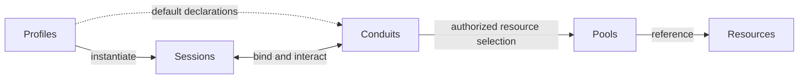

# Conduit specification

Updated: 2026-10-30. Current working model; implementation has not started.

## Working model

Conduit connects models and agents through **Profiles, Sessions, Resources, Pools,
and Conduits**. These five concepts and their interactions define the system. They
support shared knowledge, compatible tools and skills, independent accounts, portable
context, and communication without making any one provider or frontend the architecture.

| Concept | Meaning | Boundary |
| --- | --- | --- |
| **Profile** | A reusable Session template specifying runtime/model/account defaults, execution requirements, optional permission limits, activation instructions and default Conduit references. | A template has no shared conversation or private agent history. |
| **Session** | A durable, independently identified participant created from one Profile, with resolved settings, private context/history and its own Conduit bindings. | A Session persists across supported execution, account and frontend changes. |
| **Resource** | An independently addressable object exposing data, capabilities or both through a defined contract. | Its identity/source is independent of Pool membership; kinds are extensible. |
| **Pool** | A named collection of Resource references, assembled explicitly or through label selectors. | Pools are the sole route for supplying Resources to Sessions through Conduit; membership alone grants no access or exclusive ownership. |
| **Conduit** | A typed, authorized relationship for Session access to Pool resources, communication between Sessions, or both as its contract permits. | Reusable declarations are bound per Session; a relationship does not imply one transport or delivery guarantee. |

The Session–Conduit relationship covers both access to Pools and exchanges between
Sessions. The diagram describes the conceptual model, not a process layout or wire protocol.

## How the concepts interact

1. **A Profile creates independent Sessions.** Each Session resolves one Profile plus
   explicit overrides. Behavioral default changes affect new Sessions; existing Sessions
   adopt them through explicit reconfiguration. Permission limits remain live.
2. **Profile defaults establish Conduits.** Defaults reference reusable declarations;
   each Session receives its own authenticated bindings and lifecycle. V0 defers Profile
   inheritance. Runtime/model/account bootstrap settings stay in the Profile.
3. **Pools organize Resources.** A Resource can be referenced by several Pools without
   copying content or transferring ownership. Pools may collect project resources, a skill
   package or any other useful grouping through the same extensible membership contract.
4. **Conduits govern Resource use.** Resource access, including baseline instructions,
   skills and MCP capabilities, goes through Pools. Filters narrow authorized selections
   and operations within Profile limits. The Profile supplies activation instructions;
   the Session applies them to the permitted resources. Availability alone does not load content.
5. **Conduits connect Sessions.** Sessions retain their own context while exchanging
   information under the chosen interaction contract. Addressing, delivery, attention,
   persistence and tracker associations require further design.

Activation belongs to the Profile template. Its instructions describe how the Session
prepares and uses the resources available through its Conduits. A resource-access
Conduit selects and filters resources and operations; it does not own their loading
instructions. Exact import defaults, compatibility handling and activation sequencing
remain open. Pi's loaders, packages and MCP setup inform those Profile/Session contracts.

## Supporting mechanisms

These belong to the five concepts rather than extending the core vocabulary:

| Mechanism | Place in the model |
| --- | --- |
| Models, runtimes, accounts and execution modes | Profile choices resolved and recorded for Session executions. Model and resource-service credentials remain separate. |
| Executions, private context and frontends | Session lifecycle and presentation. A frontend does not own the Session's execution state. |
| Memory, checkpoints, skills, tools, documents and workspaces | Resource contracts or content supplied through Pools. This is an illustrative, open-ended list. |
| Labels and selectors | Resource metadata and Pool membership selection; labels are optional and do not establish identity or authority. |
| Activation instructions | Profile template behavior executed by the Session against permitted resources. |
| Filters and grants | Conduit behavior constrained by Profile limits. Filters only narrow; their authoring and composition remain open. |
| Connections, plugins and protocols | Integration mechanisms implementing Resource and Conduit contracts. Reusing setup does not imply a shared live client or authentication state. |
| Tasks and external tracker issues | Work associations for Sessions, Resources and Conduits. Providers retain their own fields and workflow. |
| Usage, provenance and operational evidence | Observations of Session executions and Conduit operations, retained through the applicable Resource contracts. |

Conduit's Resource concept is broader than MCP's specific resource primitive.
A Conduit Profile is distinct from a native agent's login profile or credential directory.

## Implementation direction

Conduit owns its runtime in **Rust**, including the execution loop, context construction,
provider/tool dispatch and recovery. The first frontend is a custom Conduit terminal
inspired by Pi. UI components may be reused; Pi's agent loop and Pi Durable remain
research references. External-agent adapters can separately connect runtimes such as
Claude Code and Codex.

Use YAML for named, versioned configuration with explicit references and validation.
Kubernetes object structure, versioning and networking APIs inform the design. Exact
version identifiers, schemas, file layout and precedence remain open. Authored configuration
and observed runtime state are distinct; credentials stay outside shareable configuration.

Use MCP as the preferred external capability contract while preserving provider-native
names, schemas and workflows. Native adapters cover runtime/account/lifecycle needs and
non-MCP services. The design does not require a single combined MCP endpoint. Future
mediation should inspect and attribute outgoing calls and support permission enforcement.
V0 reports the actual enforcement and observation coverage of each integration.

Users bring compatible skills and plugins through Pools and Conduits, using native
installation tooling where supported. Runtime/plugin compatibility is checked separately
from model preference. Storage/search and tracker integrations remain replaceable;
Xerj is a backend candidate and Linear is the first tracker direction. Conduit does
not require its own skill language, package manager or ticket workflow engine.

V0 requires independent account and Session state. Native host execution is the default;
isolated execution is available or required by a Profile. Required isolation cannot be
silently weakened. [DESIGN.md](DESIGN.md) defines the access, continuity, retention,
workspace, sharing and usage contracts without promising control over unmediated host paths.

## Acceptance scenarios

These are intended outcomes, not completed tests. The experiment details follow the
[review](REVIEW.md#experiment-across-the-five-concepts).

| Interaction | Observable outcome |
| --- | --- |
| **Profiles → Sessions** | Four Sessions run concurrently across two Claude and two Codex/OpenAI subscription identities. Account login/refresh/logout does not overwrite another account's state; private history remains per Session. Supported subscription access and actual identities must be verified. |
| **Profile defaults → Session bindings** | Reusing a Profile creates independent bindings. Behavioral default edits leave existing resolved settings intact until explicit reconfiguration; live limits continue to apply. |
| **Resources → Pools → Conduits** | One Resource can be reused in multiple Pools without copying it. Membership alone neither exposes it to a Session nor activates it. Selected compatible resources are supplied through the intended Conduit. |
| **Sessions → shared Resource access** | Permitted knowledge is searchable/readable across accounts. Unauthorized direct-ID reads, search results and provenance remain unavailable. Unknown coverage is distinguishable from an empty result. |
| **Sessions ↔ Conduits ↔ Sessions** | The selected communication contract enables collaboration while preserving private context and reporting delivery/execution outcomes. Its specific semantics are an open design task. |
| **Session continuity** | Resume retains identity and permitted context; fresh starts without prior conversation/checkpoint content; fork creates an independent Session from a chosen checkpoint. Controller transfer and frontend detachment preserve the logical Session. |
| **Conduit authority changes** | Subsequent managed requests use current rules. An isolated execution that cannot revoke removed access stops pending explicit restart. Unavailable restrictions never silently become broader access. |
| **Failures and evidence** | Unknown execution status does not start a duplicate. Uncertain writes are reconciled before unsafe repetition. Missing usage is not zero, and overlapping parent/subagent counts are not double-counted. |

## Design boundary

The five concepts are settled. Their detailed schemas, interaction contracts and first
implementation sequence are under review. All remaining questions must identify the
concept or relationship they refine. Memory search, account adapters, observation and
sandboxing support this model; they do not introduce parallel organizational frameworks.

[DESIGN.md](DESIGN.md) is authoritative for accepted behavior. [REVIEW.md](REVIEW.md)
contains remaining choices, research and staged work. [Pi runtime research](research/PI_RUNTIME.md)
provides evidence, not an additional specification. Implementation begins after the
configuration contracts and initial experiment are agreed.
