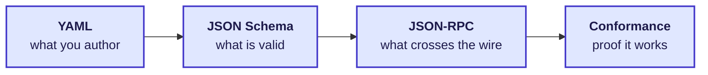

# How Conduit can become a protocol

**Status: proposal for discussion (2026-11-01).** Nothing here is accepted design.
[SPEC](../SPEC.md) and [DESIGN](../DESIGN.md) still govern.

A protocol is a spec, not a program and not a language. Conduit becomes one when someone can
read the spec, write a client in any language, and work with any conforming implementation
without talking to its authors. Today Conduit defines *meaning* (objects, access, lifecycle) but
not *what crosses the wire*. This doc lists what to keep, what to leave out, and the smallest
path to a v1.



## Keep

These parts of today's design already read like protocol rules.

| Keep | Why |
| --- | --- |
| Five families (Interface, Agent, Resource, Pool, Conduit), each as template and instance | The object model is the protocol's vocabulary |
| The envelope: `apiVersion`, `kind`, `form`, `metadata`, `spec`, with system-owned `status` | One shape for every object, on disk and on the wire |
| Stable IDs, name references, revision checks on writes | Two parties can refer to the same object safely |
| Strict YAML (no anchors, aliases, custom tags or silent conversion) | Every parser reads the same file the same way |
| Conduit filters that only narrow, checked along the whole path | The core access rule |
| Explicit actions: registering runs nothing, editing a file applies nothing | No hidden side effects to reproduce |
| Outcomes: confirmed, rejected, **uncertain** | Honest results when an effect may or may not have happened |
| Retained messages: append-only, separate read positions, no automatic wake | A first communication capability that is small and testable |
| MCP as the external face; skills stay native | Reuse what agents already speak |

## Out of scope for v1

| Leave out | Where it goes |
| --- | --- |
| Terminal, UI, dashboards, frontends | Implementations, built on top of the protocol |
| Skills system | Stays bring-your-own, in native formats |
| Plugin ABI, setup-graph step semantics, persistence, client pooling | Implementation detail; `setup` and `runtime` travel as opaque, implementation-defined fields |
| Remote and multi-machine (Sealmesh, Tailscale) | v2 transport; v1 message semantics stay compatible |
| Root agent, VM isolation tiers | Built on v1 later |
| Multi-user authority, automatic wake, structured task handoff, in-place upgrades | Already deferred in [REVIEW](../REVIEW.md#drafting-and-deferred-work) |

## What v1 needs

Four pieces, built in order. Each one uses the specs and the
[001 YAML packet](../../experiments/001-shared-access/README.md) as its source.

### 1. Schema — what is valid

Turn the envelope and the five kinds into JSON Schema under `schema/v1/`. Start from
`templates.yaml` and `instances.yaml`; whatever they need becomes required, and anything else
waits. The YAML stays the authoring format, and JSON Schema is the contract that every
implementation validates against.

### 2. Wire — what crosses it

JSON-RPC 2.0 over stdio and a local Unix socket, the same base as MCP and LSP. One handshake
and a short method list:

| Method | From the spec |
| --- | --- |
| `initialize` | Agree on protocol version and capabilities |
| `objects/register`, `objects/create`, `objects/inspect`, `objects/retire` | Templates, instances, lifecycle |
| `setup/start` | Explicit setup; registration alone runs nothing |
| `controls/apply` | Typed settings changes, checked against a revision |
| `conduits/open`, `conduits/close`, `conduits/invoke` | Filtered access |
| `messages/post`, `messages/read`, `messages/advance` | Retained messages |
| `events/subscribe` | Evidence stream for the Interface |

The YAML you author is the payload. A Conduit you wrote by hand is sent as-is:

```json
{"jsonrpc": "2.0", "id": 7, "method": "objects/register",
 "params": {"object": {"apiVersion": "conduit.local/v1", "kind": "Conduit",
   "form": "template", "metadata": {"name": "capability-route"}, "spec": {"…": "…"}}}}
```

### 3. Semantics — what happens

- **States:** a short state machine per family. Objects go `registered → setting-up → ready |
  waiting | failed → retired`; Conduits go `opening → open → ended`.
- **Errors:** a fixed set of codes: `invalid`, `not_found`, `conflict` (stale revision),
  `denied` (blocked by a filter), `not_ready` and `uncertain`.
- **Identity:** every request names its actor (the owner's Interface or an Agent). In v1 the
  local OS user owns the registry, as DESIGN already says.

### 4. Conformance — proof it works

Turn the 001 packet into test vectors: YAML in, expected responses and events out. Ship a runner
that checks any implementation against them. v1 is done when **two independent implementations**
pass. That could be the Rust reference and a small second one in another language.

## Definition of done

A client written only from this spec can:

1. register the 001 templates;
2. create and set up the Pool;
3. open a read-only Conduit for an Agent and be denied a write;
4. post and read a message with separate read positions;
5. follow all of it as events.

It does this against both implementations, with no changes.
