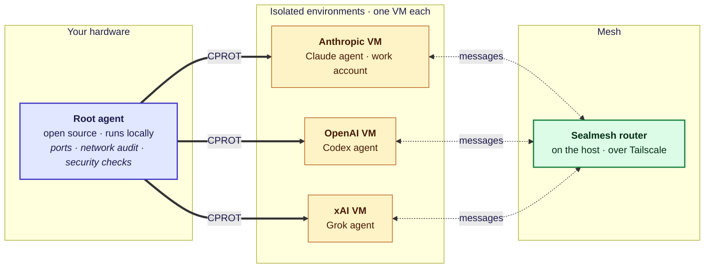

# Proposal: protocol, mesh and a local root agent

**Status: proposal for discussion (2026-11-01).** Nothing here is accepted design.
[SPEC](../SPEC.md) and [DESIGN](../DESIGN.md) still govern.

Four ideas for where Conduit goes next, and how each lines up with the design on `main`.

## The picture

| Layer | Role | Owned by |
| --- | --- | --- |
| **CPROT** (Conduit Protocol) | What each agent may reach and how it is controlled | Conduit, as a spec |
| **Mesh** | Agent-to-agent messages across environments | Sealmesh, extended |
| **Root agent** | Host-level work that never leaves your hardware | New, open source |
| **Environments** | One isolated VM per provider or context | New, maps to Conduit's isolated execution |

## 1. Conduit as a protocol, not a tool

Conduit should be a spec that anyone can implement, not a product with a bundled UI.
Frontends, terminals and dashboards become implementations, not part of the core.
Keeping skills out is right: agents bring their own in native formats.

Protocols are specs, not languages. A Rust reference implementation is fine. To be a
protocol, Conduit still needs:

- the wire boundaries (frontend ↔ Interface, runtime ↔ plugin, Agent ↔ Conduit);
- an encoding and transports (suggested: JSON-RPC over stdio/socket, like MCP and LSP);
- a message catalog, version negotiation, an error model and identity on the wire;
- a conformance suite that a second implementation can pass.

## 2. Sealmesh for agent communication

[Sealmesh](https://github.com/SealMesh/sealmesh) (v0.1.0) already ships what Conduit's first
communication capability describes: rooms, typed messages (`question`, `claim`, `handoff`,
`ack`), MCP tools for agents, reads that don't consume, and no automatic wake.

What it needs for this picture:

- **A single-host setup.** Each VM runs its own daemon, so VMs already look like separate
  machines. The router should run on the host and be reachable over Tailscale or a host-only
  network.
- **Identity outside a GitHub org.** The router authenticates by org membership today.
- **Scopes beyond repo and ticket.** Agents in different VMs only meet if they share a repo or
  ticket; a host-wide room would let them coordinate on anything.

In Conduit terms, Sealmesh is a communication Resource and the cross-machine transport that
v0 defers.

## 3. An open-source root agent

One agent on your hardware handles the work that needs the machine itself: opening and closing
ports, auditing its own network, running security checks.

- **Open source** because it is auditable and vendor-agnostic.
- **Local** because host control is never delegated to a model provider.

In Conduit terms it is an Agent granted host Resources (network, firewall) through Conduits.
The Interface stays the human's admin surface.

## 4. Agents in their own environments

Each agent runs in its own VM: one per provider, account or context (for example, one for
day-job work and one for personal projects). Credentials, files and state stay inside that
VM. This makes VMs the isolation tier DESIGN leaves open ("Exact sandbox technology and
matching rules remain open") and matches the fixed account boundary per Agent.

## Overlap with the current design

| Idea | Design on `main` | Fit |
| --- | --- | --- |
| Protocol, not tool | "Extensible protocol with a Rust runtime", but bundles Interface frontends and a possible terminal; no wire format yet | Narrow the core to the spec |
| No skills | Bring-your-own skills in native formats | **Agrees** |
| Sealmesh messaging | Retained-message capability; research cites agentwatch (Sealmesh's predecessor) at `04025a6` for rooms, catch-up and read positions | Mechanics nearly identical; differs on retention (until purge vs. 7 days) and rooms as a primitive |
| Cross-environment | Local only; remote deferred | Brought forward through Sealmesh |
| Root agent | No central agent; Agents may invoke each other's controls only with grants | New; must fit the grant model |
| One VM per environment | Native by default; isolated mode with sandbox technology undecided | VM fills the isolated tier |
| One account per agent | Fixed account/provider boundary per Agent | **Agrees** |

## Open questions

1. Which model drives the root agent? If it is a hosted model, how is "host duties stay
   local" enforced?
2. Does the root agent sit beside the Interface or absorb it?
3. Should Sealmesh's 7-day room retention or Conduit's retain-until-purge win for agent messages?
