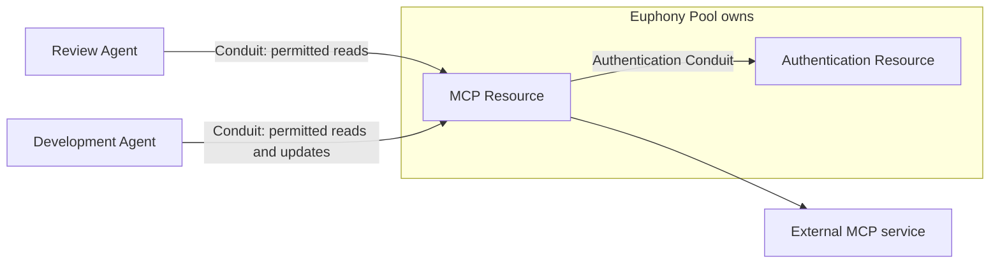

# Plugin and template authoring walkthrough

**Deferred authoring packet:** preserve these examples for the later syntax/conformance PR.
The [conceptual review](../../archive/reviews/CONCEPTUAL.md) is complete; [this packet](README.md) changes no accepted rules.

Status: authoring examples, 2026-11-02. Lightweight Conduit support with the public protocol and
extension structure prioritized over a helper library is accepted. Publishing inspectable
contracts with implementations is also accepted. Published, language-neutral contracts are authoritative;
authors may handwrite or generate them, then explicitly review and version the released definitions.
Implementations conform to those contracts. Complete templates without a mandatory primary plugin,
with compatible bindings and declared defaults, are accepted for v0. Conceptual closure is complete; detailed syntax is parked for a future PR.
MCP is accepted as the public invocation base with
a small Conduit profile. Code-optional implementation bindings and independent component access
are accepted. Authored code normally runs in supervised instance-associated helpers; trusted built-in
Rust code may remain in-process. Profile details, SDK, package syntax and exact helper grouping remain open.
Code is illustrative and has not been executed.
Graph examples use the accepted single-key binding forms, including `literal` and `reference`.
Reference payload fields remain proposed, as does reusing graph bindings for runtime inputs below. Plain
configuration and resolved values delivered to plugins do not use those authoring wrappers.
The [review](../../archive/reviews/IMPLEMENTATION.md#review-priority-plugin-and-template-authors) records the ruling and remaining
choices; [DESIGN](../../protocol/README.md) supplies the settled semantics.

The objective is an extension an ordinary author can understand and test. A template author
should be able to compose existing behavior without becoming a plugin author. A plugin author
should implement the behavior their extension adds, without rebuilding the entire Conduit host.
Real plugins should test these contracts early. Conduit can add reusable helpers as recurring
needs become clear; the initial implementation does not depend on building that library first.

For a connected publication-to-instance example, see the [history package walkthrough](PACKAGE_WALKTHROUGH.md).
It includes the package inventory, exported contracts, MCP bindings, consuming template, default
handler resolution and a later control call. It remains an illustrative design, not a runnable package.

## The pieces, before choosing an authoring API

| Piece | Concrete meaning in these examples |
| --- | --- |
| Plugin package | Published contracts with bindings to authored code, existing MCP implementations, graphs of operations or a combination. A package can contribute operations or type implementations; it is not automatically a Resource instance. |
| Operation export | A callable contribution, such as computing a digest or establishing a directory. Being available to a setup graph does not automatically expose it to Agents. |
| Resource type | The contract for a configured responsibility, such as a local directory: configuration, capabilities and applicable lifecycle/controls. Its implementation can reuse operation exports. |
| Template | Selects implementations, supplies configuration and composes setup behavior. It can reuse existing plugins without adding code. |
| Instance | Holds the resolved definition, current confirmed settings and managed runtime state. A Resource instance has a Pool owner. |

The plugin authoring question is how code reaches the callable boundary. It does not change
these object distinctions or require one process per package, operation or instance.

## 1. The same small plugin, exposed two ways

Start with a pure operation: `sha256` accepts a UTF-8 string and returns its digest. It needs no
filesystem access, login, persistent process or recovery lookup. Calling it again with identical
input produces the same result and has no external side effects. That makes the plumbing visible
without conflating it with directory ownership or uncertain writes.

Both paths need the same domain contract. This is an **illustrative contract fragment**, not
approved manifest syntax; the effect/repetition behavior described above is also part of the
contract, however its eventual representation is chosen:

```yaml
operations:
  sha256:
    inputSchema:
      type: object
      properties:
        text: {type: string}
      required: [text]
      additionalProperties: false
    outputSchema:
      type: object
      properties:
        hex: {type: string, pattern: "^[0-9a-f]{64}$"}
      required: [hex]
      additionalProperties: false
```

Rust is used to make the example tangible, not to settle supported authoring languages. The
domain function could look like this; schema serialization, dependency declarations and tests
are omitted, and this snippet has not been compiled:

```rust
use sha2::{Digest, Sha256};

pub struct Input { pub text: String }
pub struct Output { pub hex: String }

pub fn digest(input: Input) -> Output {
    Output { hex: format!("{:x}", Sha256::digest(input.text.as_bytes())) }
}
```

### A. Conduit supplies the standard protocol adapter

The author's package might contain:

```text
digest-plugin/
  contract.yaml       operation contract; exact format still pending
  Cargo.toml          implementation and helper dependencies
  src/lib.rs         digest function
  src/main.rs        registers the function with the helper runner
  tests/             domain and contract tests
```

The entry point means **register `sha256` with this contract and handler; serve using the standard
adapter**. The helper supplies protocol dispatch, conversion/validation, request correlation and
standard reporting. The author implements the digest and its declared semantics. This need not
mean loading arbitrary Rust functions into the host: one possible implementation compiles the
handler and helper into an executable plugin. That implementation choice remains open.

### B. The author supplies the protocol adapter

The package still has the contract and digest function. Its entry point instead creates an
MCP/protocol service, registers discovery and invocation handling, adapts the request to `Input`,
calls `digest`, returns the typed result and integrates the required Conduit execution context
and reporting. The author can use a standard protocol library for much of this work.

This is not necessarily much more code. The official Rust MCP SDK already supplies tool macros
and service helpers; a Conduit helper could build on that same SDK. The distinction is who
supplies and maintains the **Conduit-specific adapter**, not whether one approach uses functions
and the other hand-writes a protocol. [Rust MCP SDK](https://github.com/modelcontextprotocol/rust-sdk#tools)

An existing server with its own request routing or service lifecycle may fit B naturally. A new
small extension may benefit from A's consistent defaults. Under either approach the public
contract and conformance checks must be satisfied; an ordinary MCP tool server alone does not
prove support for Conduit's execution, identity or recovery semantics.

### What a template sees

The template need not change between A and B. For example, a setup graph could fingerprint text
returned by an earlier, authorized corpus-read step:

```yaml
fingerprint:
  operation: {plugin: text, name: sha256}
  inputs:
    text: {reference: {from: output, node: read-corpus, port: text}}
```

This is a node fragment. The enclosing template must declare the `text` implementation alias,
the `read-corpus` operation and the capability access that operation needs. The digest operation
does not acquire corpus access merely by receiving an input. Conduit resolves the exact
implementation and contract, orders the nodes, invokes the adapter and records the outcome.
No extra Resource is necessary solely to host this pure setup function. If digesting is to be
offered as a callable Resource capability, that exposure must be declared separately.

The shared authoring direction is therefore: implement the behavior, publish its contract, and
let templates bind its inputs. Initially, use only lightweight Conduit support and existing
libraries as needed. The amount of reusable adapter code can grow with experience; the public
contract must remain usable without depending on one comprehensive helper framework.

## 2. A directory Resource

### A concrete package to review

**Publication is accepted; this layout remains illustrative.** This is not a created package
or an executable implementation. A minimal filesystem contribution could
ship these files, whether assembled by hand or by a later build helper:

```text
filesystem-plugin/
  plugin.yaml                           package identity and export index
  contracts/
    local-directory.type.yaml            type/capability/runtime declarations
    directory-config.schema.json         configuration data rules
    directory-establish.operation.yaml   inputs, outputs and behavioral contract
  bin/
    filesystem-plugin                    implementation for the selected platform
```

Its source project would also contain implementation code and tests. Shipping source, building
locally or distributing platform artifacts are separate packaging choices. This diagram shows
the boundary between inspectable contracts and runnable code, not a required directory layout.
The package/export index is supporting metadata, not a sixth registered object family.

An illustrative `plugin.yaml` could index the contents like this:

```yaml
package:
  name: example.filesystem
  release: 0.1.0
implementation:
  entry: bin/filesystem-plugin
exports:
  types:
    - group: filesystem
      name: local-directory
      version: v1alpha1
      definition: contracts/local-directory.type.yaml
  operations:
    directory.establish:
      definition: contracts/directory-establish.operation.yaml
```

These are explanatory fields, not approved syntax. Exact artifact identity/digests, compatible
protocol versions and platform selection still need representation; a release label alone is
not the accepted implementation pin. One package can illustrate multiple exports without making
the package name the Resource type's logical group.

The configuration schema could contain this ordinary JSON Schema fragment:

```json
{
  "type": "object",
  "properties": {
    "path": {"type": "string", "minLength": 1},
    "establish": {"type": "string", "enum": ["create", "attach"]}
  },
  "required": ["path", "establish"],
  "additionalProperties": false
}
```

This checks shape, not the complete type contract. Instance paths must also satisfy the agreed
absolute-path rules, and access/ownership require registry and execution-context checks. The
operation contract references the configuration input, declares its directory-descriptor output
and describes create/attach, effects and recovery behavior. The type declaration connects those
contributions to its directory capability and applicable runtime/lifecycle behavior. Those files
are intentionally not expanded into a speculative full contract language here.

**Before launching plugin code**, Conduit could inspect this bundle and reject `establish: erase`,
an unknown setup export or a binding to an undeclared output port. It could validate and register
configuration even if the implementation cannot yet run on this machine. Required schemas must
be available, and registration still performs no filesystem setup.

**At execution**, Conduit still needs the exact compatible implementation, current authority and
the resolved target environment. The implementation checks the real path and performs the
declared operation. A valid schema cannot prove filesystem readiness, honest implementation,
safe recovery or future service availability. Runtime responses are checked against contracts;
conformance tests are needed for behavioral guarantees. A disagreement is reported, not treated
as permission to silently replace the bound contract.

Publishing the contracts makes validation independent of executable discovery, including before
the implementation can run on a target platform. A third-party MCP provider's changing tool
catalog is a different boundary: the MCP adapter's own contract can be published while its
upstream catalog remains dynamic.

The accepted boundary requires contract loading, validation and execution integration, not a
general SDK or generator. Contract/code drift must be tested regardless of whether authors write
or generate the descriptors. Exact file formats, field syntax, package layout and source of
truth remain for the final syntax review.

### What the template author supplies

The author wants a reusable recipe for creating a project directory. The existing filesystem
plugin supplies the directory contract and implementation. A template selects it and configures
establishment; a Pool subsequently provisions instances. A second template can attach an existing
directory using the same plugin. Neither change needs new Rust or Python code.

This uses the implementation packet's **proposed spelling**, not a published schema:

```yaml
apiVersion: conduit/v0alpha1
kind: Resource
form: template
metadata:
  name: project-directory
spec:
  type:
    group: filesystem
    name: local-directory
    version: v1alpha1
  plugins:
    filesystem:
      package: example.filesystem
      release: 0.1.0
  config:
    path: /example/euphony
    establish: create
  setup:
    nodes:
      establish:
        operation: {plugin: filesystem, name: directory.establish}
        inputs:
          configuration: {reference: {from: config}}
```

The example implementation reference is illustrative; artifact selection still resolves and
retains the exact implementation before execution. The proposed `filesystem` alias names the
selected implementation; it is not the Pool owner or a permission grant. This fragment shows setup;
complete runtime/capability bindings must also resolve under the selected type contract. A directory
need not require a dedicated long-running process.

The resulting Resource instance has one Pool owner and a concrete path in its execution
environment. An Agent-local view or symlink is preparation for authorized access, not a
second directory Resource. If another machine needs the files, it needs an appropriate remote
access/copy/mount capability; it cannot treat this path as its own local directory.

### Worked comparison: two plugins in one directory template

The [guided directory walkthrough](#guided-directory-walkthrough) below follows this recipe from
authoring through Pool provisioning, failure/retry and Agent access. It starts the complete-example
review requested after the [graph-authoring audit](../../research/language-protocol-foundations/GRAPH_AUTHORING_REVIEW.md).

**Accepted v0 model:** a template supplies a complete recipe using compatible contributions from
one or several plugins, with no mandatory primary implementation. Complete standard templates and
declared type defaults provide convenience. The named dependency map and alias-plus-export reference
pattern are accepted for setup, runtime and controls, with kind/contract checks and no primary alias.
Concrete `plugins` and `{plugin, name}` spellings below remain proposals; these fragments have not been executed.

An Euphony Pool provisions one Resource from a directory template. Setup attaches the existing
`/work/euphony` directory and then checks for `Cargo.toml` and `src`. The resulting instance exposes
its declared directory capability through authorized Conduits.

| Responsibility | Selected contribution |
| --- | --- |
| Configuration/capability meaning | The published `filesystem`, `local-directory`, `v1alpha1` type contract |
| Establishment and ongoing directory access | Exports from `example.filesystem` |
| Additional setup validation | `verify-layout` from `example.project-checks` |
| Applicable supported controls | Resolved type defaults or explicitly selected compatible handler/graph bindings |
| Supervision and authoritative outcomes | The instance's responsible service; the Resource remains Pool-owned |

The type contract need not come from the package supplying most of the code. Likewise, a runtime
driver can come from one package without making it primary over every operation or control.
Using a single package is still valid; composition does not require unnecessary decomposition.

An illustrative fragment inside `spec`, with proposed alias/export fields:

```yaml
type:
  group: filesystem
  name: local-directory
  version: v1alpha1
plugins:
  filesystem:
    package: example.filesystem
    release: 0.1.0
  checks:
    package: example.project-checks
    release: 0.1.0
config:
  path: /work/euphony
  establish: attach
setup:
  nodes:
    attach:
      operation: {plugin: filesystem, name: directory.establish}
      inputs:
        configuration: {reference: {from: config, path: ""}}
    check:
      operation: {plugin: checks, name: verify-layout}
      inputs:
        directory: {reference: {from: output, node: attach, port: directory, path: ""}}
        requiredEntries: {literal: [Cargo.toml, src]}
runtime:
  driver: {plugin: filesystem, name: directory.managed}
  inputs:
    directory: {reference: {from: output, node: attach, port: directory, path: ""}}
controls: {use: type-defaults}
```

The binding makes `check` wait for `attach`; map order does not. `requiredEntries` is an operation
input, not a new undeclared field of the directory type's configuration. The runtime driver is an
export with the appropriate driver contract, not an arbitrary setup operation. Its input identifies
the same directory. It need not spawn a daemon. Any selected default controls must resolve their
handlers to compatible retained implementations too; `use: type-defaults` is illustrative shorthand.
Release labels are selection inputs, not complete artifact-retention identities.

Registration validates without running either plugin. Explicit Pool provisioning/setup resolves
implementation selections and invokes establishment under current authority. A missing directory
fails attachment. If the later required layout check fails, setup remains incomplete, successful
attachment progress stays recorded and the directory is preserved. Retry reuses only still-valid
progress under the operations' recovery contracts. Successful setup does not continuously monitor
file layout; the template would have to declare such behavior separately.

The instance owns ongoing behavior after setup helpers finish. Closing an Agent's Conduit releases
that participation/prepared view, not the Pool's Resource or backing directory. Supported controls
invoke their resolved handlers; they do not rerun setup checks unless their graph declares it.
Changing fixed bindings or implementation selections still requires replacement in v0. A descriptor
or package alias supplies no permission and cannot replace a Resource dependency through a Conduit.

#### Guided directory walkthrough

Walkthrough date: 2026-11-03. This is a hypothetical recipe, not a performed deployment. The path,
packages and export names are examples; no directory or Resource is created by this document.
The accepted binding forms are used with candidate flat reference fields. Using them here does not
settle the flat/nested ruling, source-kind set, runtime-input encoding or package manifest syntax.
Every displayed pointer is explicit, leaving omitted-path behavior open.

**Intended outcome:** an Euphony Pool owns a directory Resource backed by an existing folder. Setup
must verify that the folder contains `Cargo.toml` and `src`. Authorized Agents can subsequently
connect to that Resource. For this recipe the layout check is required setup, not a perpetual
guarantee that the files will remain present. This is an example-specific choice, not a new
requirement for every directory Resource.

The full registry template uses the ordinary `kind: Resource`, `form: template` envelope and a
name such as `project-directory`; its `spec` is the fragment above. The selected type contract
supplies the configuration and capability obligations. Its compatible plugin contributions must
be supplied explicitly or through declared defaults before execution; a type name alone does not
select arbitrary installed code.

| What the author supplies | Role in this example |
| --- | --- |
| Filesystem package's published contracts and implementation | Establish the configured folder and provide the ongoing directory capability and lifecycle. |
| Checks package's published operation and implementation | Inspect required entries through the supported directory access contract; report findings and outcome. |
| Resource template | Select compatible contributions, initial configuration, setup wiring and runtime/control bindings. |
| Pool's explicit template entry | Make this recipe available for authorized provisioning into that Pool; listing it starts nothing. |
| Agent/Conduit definitions | Supply compatible endpoint behavior and authorized participation for subsequent Agent access. |

Neither plugin selection nor an output reference is a grant. Setup executes with its authorized
instance/operation context; the checker must support the directory's actual execution placement
and access mode. This example assumes the supported local execution context, not implicit access
to the same path on another machine.

**First, author configuration and wiring.** `spec.config` contains ordinary values. The
`configuration` binding passes its captured value to `directory.establish`. The operation receives
the following data, without graph wrappers:

```yaml
configuration:
  path: /work/euphony
  establish: attach
```

It verifies the existing folder under its contract and publishes its declared `directory` output.
Conduit validates that output before making it available. The output's actual descriptor schema is
defined by the operation/capability contract; this walkthrough does not equate it to an unrestricted
host path or invent its stable-ID encoding.


The checker receives that directory value and the ordinary list `[Cargo.toml, src]`. The literal
wrapper applies once to the complete static list. No wrapper is needed around each filename and
no separate operation is needed to construct this list. The output reference creates the ordering;
swapping node positions in the YAML would not let the checker run first. An empty pointer selects
the whole declared output. Selecting a nested member instead would use its pointer, provided the
consumer contract actually accepts that member's type and meaning.

The template also selects `directory.managed` for ongoing behavior. Its input identifies the same
directory. The required check gates successful setup/readiness for this recipe; merely having a
directory descriptor does not satisfy that check. This does not select an additional runtime-start
field or require a daemon per directory. A runtime can be instance-managed during setup under the
accepted contract, but its existence is separate from successful required preparation.

**Then, explicitly instantiate through the Pool.** The Interface selects the Pool's entry and
requests provisioning/setup. It can offer these as one deliberate action while reporting the
distinct outcomes. Registration, instance creation and setup are not the same event.

| Item | Result in this example |
| --- | --- |
| Source template | `project-directory` remains reusable. |
| Resource instance | A new object, for example `project-directory-7f3a`, owned by the selected Pool instance. |
| Instance definition | Retains the resolved setup graph, runtime/control bindings and selected implementation content. |
| Stored configuration | Includes the absolute path and explicit attachment intent; declared defaults are materialized. |
| Observed state | Records the actual attachment/check outcomes and current capability readiness separately from configuration. |
| Backing data | The existing directory and its changing files; no copy or filesystem snapshot is implied. |

Editing the template afterward changes future instances, not this instance's fixed definition.
The exact metadata/status serialization remains open. An inspection view can report the facts above;
configuration export must not turn reported readiness, access grants or live descriptors into
authorable settings. A new instance from an exported configuration still goes through its Pool and
its own establishment checks.

**Finally, connect an Agent.** An authorized Conduit connects an Agent's supported filesystem
endpoint to the Resource. Its endpoint plugins prepare the permitted exposure, such as an Agent-local
symlink. A second Agent may have its own Conduit/participation and prepared path to the same Resource.
Those links are preparation state, not new folder Resources or copied files. Closing one participation
releases that view while preserving the other Agent's access, the Resource and backing data.
A symlink alone does not enforce read-only access or isolate concurrent writers; those guarantees
require implementations and execution modes that actually support them.

**Follow failures through the same recipe.** These descriptions are outcomes for inspection, not
a proposed universal status enumeration:

| Situation | What follows |
| --- | --- |
| Required schema/export is unavailable or wiring is provably invalid | Definition/execution validation reports the gap before dispatch; selecting a name does not supply missing code. Missing runtimes remain distinct from accepting schema-valid configuration. |
| `/work/euphony` does not exist | Attach fails; no directory is silently created, and the checker has no successful prerequisite. |
| Attachment succeeds but `Cargo.toml` is missing | Required setup remains incomplete. Keep attachment evidence and the folder; report the missing entry. |
| An authorized person or operation adds the missing file, then requests retry | Continue the same invocation using only still-valid recorded progress; rerun/recover the failed check as its contract permits. Do not claim continuous checking or automatic retry. |
| Establishment returns a malformed directory descriptor | Withhold the invalid output, block its consumers and retain effect evidence. Do not infer that establishment had no effects. |
| A helper response is lost | Report the unconfirmed outcome and reconcile under its recovery contract before unsafe repetition. A pure read check can declare safe repetition; folder creation has different obligations. |
| A required file is removed after successful setup | Previous check evidence describes the earlier check. This recipe has not declared continuous layout monitoring; subsequent access/readiness follows its supported runtime contract. |

Changing `establish: attach` to `create` in a template draft changes the establishment behavior
without changing the graph wiring, if that operation's contract supports both. A fresh creation
conflicts with an existing path. An empty new folder will still fail this recipe's layout check:
creating a directory does not initialize a Rust project. That variant would need an explicit
population operation before checking, or a deliberately different check. If creation happened but its response was lost, later path existence
alone cannot prove which attempt created it; reconcile before repeating or adopting it. No automatic
backing-data deletion follows failure or retirement.

**What this case tells us about the language:** it needs no inline expression and no operation just
to assemble static data. The binding forms have a small visible cost here; the naming distinction
between a package alias/export and a graph node/output needs explanation. The remaining flat/nested
choice changes how that selector is written, not the data or dependencies. Neither result should be
generalized to authenticated MCP setup or database/migration recovery before walking those cases.
Questions about continuous rechecking, runtime gating notation and descriptor interoperability stay
in the existing review; this example does not add automatic monitoring or accept new syntax.

#### Compatibility: what must agree

Compatibility is not package-name equality or a matching JSON shape. It concerns the selected
contribution's meaning, inputs, execution context, effects and state/lifecycle obligations.

| Example | Why the apparent match is insufficient | Handling under the accepted contracts |
| --- | --- | --- |
| Directory establishment returns a path; a checker accepts a string. | A string can name another directory or a path on another host. | Bind the declared directory output, preserving its instance/backing and execution context. The checker must support that access mode; the reference supplies no authority. |
| A local checker is assigned to host B while the directory is on host A. | `/work/euphony` on B is not the backing on A. | Run the supported check in A's execution context, or select an explicit remote-access implementation/Conduit. Do not treat the local path as portable or silently copy data. |
| Two handlers both accept `limit: 20`. | One limits query result count; another limits token usage. | Match the intended operation contract and meaning, including units/effects, not just input shape or a similar tool name. |
| A setting-change handler returns a successful transport response. | It may have accepted work without confirming the setting was applied. | Keep the request pending/uncertain under its contract until application is confirmed; do not update confirmed configuration merely because invocation returned. |
| A replacement migration helper accepts the same database reference. | Its transaction, retry or private-state assumptions may differ. | Require declared support for the selected runtime/access and recovery contracts, plus integration tests. Preserve uncertain effects; matching schemas is not permission to repeat work. |

Conduit checks different facts at different times:

- **Definition validation:** required schemas/exports, graph bindings and dependencies, declared
  contract versions/support, and missing or contradictory required behavior. Reject known
  incompatibilities; do not pretend arbitrary schema implication or behavior can be proved statically.
- **Preparation/use:** actual identity, runtime compatibility, execution placement, current grants,
  required capabilities and readiness. A valid definition may still be unable to run. Required
  guarantees must be established at their declared point; uncertainty is not success.
- **Conformance/integration tests:** evidence that implementations fulfill their published behavior,
  including partial failure and recovery. Published declarations remain claims to verify. This
  model requires no central certification service or exhaustive matrix of every package pairing.

A checker that can consume an independently readable directory reference can be broadly reusable.
A handler that depends on an implementation's private live handle is less portable and must declare
that dependency. An explicit adapter may bridge contracts where semantics permit, but Conduit does
not invent one. Even two exports in the same package need correct bindings and current authority.

#### Defaults: values, behavior selections and complete recipes

Keep three existing uses of defaults distinct; this does not introduce three new object kinds:

| Default | Concrete example | What must become explicit on the instance |
| --- | --- | --- |
| Configuration value | A search type supplies an initial result limit of 10 when omitted. | The stored value 10, under its versioned configuration semantics. |
| Supported behavior | A type offers a default `set-query-limit` control, its constraints and a reusable handler binding. | The resolved control definition, selected handler implementation and configuration/confirmation contract. |
| Ready-made recipe | A published directory template already wires establishment, directory access and project checks. | The resolved graph/runtime/control bindings and selected implementations, alongside the configured path. |

The control default is already accepted: it may include an implementation. Composition without a primary does
not strip it from the type contract or force every author to rebind it. A default that names a
specific handler brings that explicit dependency; it does not make its package the implicit provider
for every other behavior. Authors can reuse the complete template, edit ordinary fields and create
instances, without a primary slot or a new composition/preset object. No template inheritance is
implied by starting from and editing a template draft.

For example, a standard directory template can already contain:

| In the reusable template | In the completed instance definition |
| --- | --- |
| Directory type/configuration, with a path chosen before creation | The explicit absolute path and attachment intent |
| Setup uses filesystem establishment, then project checks | Those resolved graph bindings with their selected implementation identities |
| Declared directory capability/runtime defaults | Concrete driver/handler bindings; a directory need not have a dedicated process |
| Applicable default controls selected within allowed constraints | The fixed resolved control surface; later requests can only change supported settings |

Expansion follows the accepted draft/default rules: first apply ordinary caller edits to
the draft, then resolve declared defaults only where allowed, validate the completed behavior and
retain the resolved configuration. An explicit incompatible handler is an error, not a reason to
silently select the standard one. A string supplied where an integer is required is invalid, not
missing. Two competing defaults require an explicit supported choice rather than installation order
or an implicit merge. Missing schemas still prevent registry writes; missing code/services remain
readiness gaps, and unresolved required implementation selections block execution.

For v0, common combinations can ship as complete templates and published type defaults. We need
not add a general-purpose system that discovers and merges installed packages' suggestions. Exact
selection/override syntax remains I7 work. The Interface should show the effective values, contracts
and selected bindings before execution; this uses the resolved definition without requiring an
additional template-history or override-provenance ledger.

Template/default changes affect later instantiations, not existing resolved definitions. Pinning
Conduit-selected artifacts does not freeze external services or current access rules; those retain
runtime checks. Replacing fixed handlers/runtime definitions still requires a new instance, while
supported controls continue to update confirmed configuration under the accepted contract.

The v0 ruling accepts this composition/default boundary. Type-default controls, instance-owned
runtime management, fixed definitions/implementations and replacement rules remain intact. The
remaining authoring choices include the dependency-map field name, exact export-reference notation, package
identity and binding details. The YAML/JSON and JSON Schema 2020-12 foundation is accepted;
its detailed profile remains open. The current review queue determines the order of these choices.

### What the plugin author supplies

Suppose directory support does not exist. The new implementation needs a typed configuration,
the establishment operation, the directory capability and any applicable lifecycle/control
behavior. The operation's domain procedure could be as small as:

```python
# Illustrative domain procedure; not a proposed Conduit SDK.
from pathlib import Path

def establish_directory(config):
    path = Path(config["path"])
    if config["establish"] == "create":
        path.mkdir(exist_ok=False)
    elif not path.is_dir():
        raise ValueError("Attachment requires an existing directory")
    return {"path": str(path)}
```

The typed contract permits only supported establishment values; the instance has already resolved
its path. This small function illustrates the domain procedure, **not a complete plugin**. It does
not itself establish path enforcement, recovery, cancellation or Pool ownership. A complete package
must identify which behavior is supplied by Conduit, the type's reusable implementation or its own
handlers. Native filesystem calls alone cannot establish a sandbox guarantee.

For example, if creation succeeded and the response was lost, finding the directory on retry
does not prove this operation created it. A recovery handler needs sufficient evidence; otherwise
the outcome remains uncertain. A helper runner cannot infer an exactly-once guarantee from `mkdir`.
These requirements should have reusable implementations where possible rather than being copied
into every author project.

### What this adds to the pure operation

| Situation | Expected behavior in this example |
| --- | --- |
| `create`, path absent | Create the directory and report the result. |
| `create`, path already present | Report a conflict; do not reinterpret creation as attachment. |
| `attach`, existing directory | Verify the target and return its descriptor without creating it. |
| `attach`, missing path | Report unavailable/missing; do not create it. |
| Directory created, reply lost | Reconcile using adequate evidence or report an uncertain outcome; do not infer ownership from existence. |

A plugin author can start with conservative recovery behavior that reports uncertainty where
evidence is insufficient; the helper must preserve that distinction. Providing a provider-specific
recovery handler is a stronger contribution, not something a wrapper can generate from the
function body. The same responsibility applies to both authoring paths.

In both cases Conduit still binds the exact implementation, establishes the caller and target,
checks the selected access path, tracks operations and retains inspectable outcomes. Plugin claims
must conform to their declared contracts; a convenient wrapper does not supply missing semantics.

## 3. A shared Linear MCP Resource

Here the underlying service already exposes a protocol. A user configuring it should normally
need templates and existing adapters, not a custom plugin implementation.

The template author composes a Pool with an authentication Resource and an MCP-access Resource.
The MCP template declares its authentication dependency; Pool composition binds it to the concrete
authentication Resource. The author specifies the service target and supported configuration,
while Agent templates select Conduits with narrower access. Concrete provider configuration is
left out here because no live connection or provider compatibility has been validated.

The conceptual invocation path is:

```text
Agent sees a permitted provider-native tool
  → selected Conduit validates the caller's complete access path
  → Pool-owned MCP Resource uses its authorized service binding
  → provider operation runs and returns its native result
  → Conduit records attributable evidence and delivers within current access
```

It does not require the Agent to call a generic `run_plugin` wrapper or expose authentication
tokens to every Agent. The existing provider MCP server does not have to implement Conduit's
instance lifecycle protocol: a Resource adapter supplies that boundary.

If a user wants to add an unsupported provider, the adapter author implements only the missing
integration behavior. Standard discovery, connection handling and common observation plumbing
should be reusable where compatible. If a native server cannot enforce a requested restriction,
the adapter must enforce it or leave that binding unavailable; it cannot quietly omit the rule.

Existing protocol servers and authored operations are compatible extension paths. A compatible
MCP implementation can fulfill a published contribution without new plugin-specific code.

### Guided authenticated MCP walkthrough

Walkthrough date: 2026-11-03. This follows the directory example using the same accepted behavior
and provisional vocabulary. Consider a Linear-style issue service for the Euphony domain. Assume
the selected integration supports the intended shared authentication and restrictions. No real
account, endpoint, tool name or provider compatibility has been tested here. Operation/output
names and the reference fragment below are illustrative, not additional syntax rulings.

**Intended outcome:** a review Agent can read permitted Euphony issues, and a development Agent
can perform permitted updates, using a shared service login. Their model/subscription accounts,
private state and Conduit identities remain separate. The service login is not their Claude/Codex
subscription. Pool membership and shared provider login do not give the two Agents identical access.



This diagram shows logical relationships, not one process or socket for each object/edge. Endpoint
plugins manage their local behavior; Conduits coordinate the relationships and their requirements.

**What is authored:** the authentication template selects supported login/refresh behavior and
credential custody. The service template selects its MCP integration, target configuration,
required authentication connection, setup graph and runtime/control behavior. The Pool offers
named entries and binds the service's declared authentication dependency to an explicitly
provisioned or selected existing authentication Resource. Agent templates select their compatible
endpoint behavior and starting Conduits; additional connections may be established explicitly.
The Conduit definitions compose the required endpoint behavior and permitted restrictions. Issued
participation grants and governing requirements supply actual authority separately.

**First, request the intended Pool composition.** Listing `auth` and `issues` entries alone starts
nothing. An Interface can explicitly request provisioning both, or provisioning the service with
an existing authentication Resource. Resolved instance IDs identify the chosen relationship; the
entry name is not an implicit singleton or an instruction to choose whichever account is logged in.
Repeated use of the declared template can establish a separate composition with different targets.

The authentication Resource's setup operation reuses a verified usable login when its contract
supports that. Otherwise it reports required human interaction. The Interface presents the selected
adapter/provider's supported enrollment or unlock flow. Login secrets remain in their supported
custody; ordinary YAML, conversations and outcome logs do not become token storage. The operation
retains its progress and continues or recovers under its declared contract after interaction.
Required service preparation waits for usable prerequisites; an independently ready directory
Resource in the same Pool can remain usable. No authored polling loop is needed in the graph.

**Then, prepare the MCP Resource through its declared dependency.** Its enclosing instance supplies
the consumer endpoint for the authentication Conduit. Pool composition supplies the concrete target;
authorized connection establishment supplies participation. A graph value or package name cannot
substitute for any of these. The service's integration operation can use the declared connection
through its supported scoped invocation context; this example does not add a new graph-reference
source kind or permit ambient account discovery.

Introduce the producer contracts before their wiring:

| Selected operation | Inputs and declared dependency | Named successful output | Responsibility |
| --- | --- | --- | --- |
| `service-auth.resolve` | Explicit service configuration; the required authorized authentication connection | `authentication`: a protected service binding | Request the correct supported identity/audience/credential arrangement from the authentication Resource, preserving that Resource's ownership. |
| `mcp.start` | Service configuration and the prepared authentication binding | `connection`: a reference to the instance-managed client | Request startup of the already-declared runtime and report a usable result only under its readiness contract. The setup helper does not take permanent ownership of the client. |
| `mcp.inspect` | Service configuration and the managed connection reference | `service`: observed service/catalog information | Establish the required compatibility/target facts the integration can actually verify. Discovery does not issue grants or permanently authorize calls. |

These are contributions selected for this MCP Resource, not newly registered Resource instances
for each operation. `service-auth.resolve` accesses the existing authentication Resource through
its Conduit; it does not implement an unrelated second login owner. Selected implementations and
their published contracts must agree on binding validity, execution context and supported behavior.

The operation names in the first column belong to the selected integration package. The graph step
names and output selectors below are separate names. This fragment uses the candidate flat layout
solely to expose value flow:

```yaml
setup:
  nodes:
    obtain-authentication:
      operation: {plugin: integration, name: service-auth.resolve}
      inputs:
        configuration: {reference: {from: config, path: ""}}
    connect:
      operation: {plugin: integration, name: mcp.start}
      inputs:
        configuration: {reference: {from: config, path: ""}}
        authentication:
          reference:
            from: output
            node: obtain-authentication
            port: authentication
            path: ""
    inspect:
      operation: {plugin: integration, name: mcp.inspect}
      inputs:
        configuration: {reference: {from: config, path: ""}}
        connection:
          reference:
            from: output
            node: connect
            port: connection
            path: ""
```

The service template must also supply its type, exact implementation selections, configuration,
declared authentication connection and ongoing runtime/control bindings. This is the setup
fragment, not a self-sufficient installable template. The runtime has already been declared by
the template when `mcp.start` requests its start; that operation does not synthesize an arbitrary
runtime definition. The required inspect step gates successful preparation in this example, while
the instance owns any started client even if the later inspection fails.

`port: authentication` selects the output declared by `service-auth.resolve`; `path: ""` selects
that complete value. Its protection and validity come from its contract and authorized handling,
not from the output's spelling. Similarly, the `connection` result points to runtime state owned by
the MCP instance; it is not the live socket copied into YAML. Output/input validation still applies.
Protected results require contract-appropriate handling and inspection; retaining progress must
not turn a secret into an ordinary trace field. Exact protected-reference serialization remains open.

Captured configuration gives all three steps a consistent setup input. It does not freeze credential
expiry, granted access or transport readiness. A recorded binding may need verification or recovery
before reuse. The operation contracts define that behavior; a matching JSON schema alone cannot
prove the binding is still usable. A later supported refresh can preserve the selected identity
without changing the graph or silently choosing a different account.

**Now connect the Agents.** Each authorized attachment receives its own recorded grant, and its
selected path applies all relevant requirements. The review Agent may discover permitted read tools;
the development Agent may discover a broader permitted set. Provider-native catalogs remain dynamic
under their integration contract. Discovery is a view; dispatch must enforce the applicable rules.
If the selected integration cannot enforce an essential workspace/operation restriction, that
restricted behavior cannot be presented as available merely because the tool name was hidden.

A native Agent's MCP adapter may register a Conduit-managed endpoint exposing the permitted provider
tools. The MCP Resource then invokes the upstream service using its supported shared binding. A
Conduit-owned Agent runtime can mediate internally. Sharing authentication does not require one
shared socket, a universal gateway or a generic replacement tool. Agent callers authenticate to
Conduit separately; the provider credential is not passed to each Agent as its Conduit identity.

For an issue update, retain the initiating Agent and chosen participation, verify current access
and the supported request/response restrictions, invoke the provider, and record the actual result
or uncertainty. The service Resource uses its own authorized authentication dependency while
preserving the caller's applicable restrictions. The provider may attribute the action to the shared
service account; Conduit must not claim per-Agent provider attribution it cannot establish. The
setup graph does not run for every tool call, and successful setup does not replace per-use checks.

**Ongoing behavior and failures:**

| Situation | Behavior under the existing contracts |
| --- | --- |
| Login needs user interaction | Retain the affected operation's progress, surface the adapter flow through the Interface and wait for usable access; unrelated eligible work can continue. |
| Custody is locked or authentication cannot be verified | Report the dependency problem; block affected work that requires the unavailable binding. Do not fall back to plaintext or another account. |
| Compatible refresh is supported for the same identity | The authentication Resource owns refresh; service clients use the supported updated binding. Cached setup output is not proof of current validity. |
| Client starts but required target/compatibility inspection fails | Keep runtime ownership and evidence; preparation remains incomplete. Inspection, explicit retry and stop follow the instance's contracts. |
| Transport drops after successful setup | Bounded reconnect on the same selected path/identity is the accepted MCP default where supported, with a manual option. It does not replay uncertain writes or rerun setup indiscriminately. |
| A write response is lost | Retain an uncertain outcome; reconcile or repeat only when the operation's recovery guarantees make that safe. Transport reconnection alone does not establish whether the write happened. |
| Current permission cannot be verified | Hold new affected managed requests; no offline grant is implied. Already-dispatched operations remain supervised and their actual outcomes retained. |
| One Agent detaches or its grant is revoked | Detachment releases its participation; revocation blocks its affected access. Preserve other participants and shared Resources. Neither proves cancellation of an already-dispatched provider effect. |
| Shared service login is revoked | Report the affected shared dependency. Agents can continue independent permitted work; renewal/replacement needs the supported explicit flow when required. |

The Interface combines authentication progress, service-client state, Conduit participation,
enforcement coverage and attributable operation outcomes. These remain owned by their responsible
services; the view must identify unknown/stale information and redact protected contents. The
authentication Resource remains distinct from the custody adapter and from the Agent's model account.

**What this tests:** setup graphs can remain finite while plugins handle provider-specific
interaction and instances manage continuing refresh/transport. The difficult contract is the
meaning, validity and permitted use of prepared results, not an additional loop or reference-string
syntax. The subsequent database case should test effects and recovery when setup changes durable
data. Still-open binding/descriptor representation, runtime-start/readiness wiring and adapter
recovery details remain in the existing review; this example does not decide them by illustration.

### Credential custody as an implementation bundle

The accepted default uses the existing package model to publish a minimal custody contract and
an OS-store implementation, initially macOS Keychain. For the shared authentication example:

| Contribution | Responsibility |
| --- | --- |
| Published custody contract | Describe typed secret-reference handling, supported storage/access behavior and interaction/recovery limits. Exact methods and schemas remain open. |
| Bundled OS implementation | Fulfill that contract through the selected platform store; report denied, locked or unavailable access without plaintext fallback. |
| Authentication Resource | Own the service identity and login/refresh behavior, using the custody implementation where Conduit retains secrets. |
| Future password-manager implementation | Fulfill the required contract through suitable code or service bindings, declaring any unsupported behavior. No specific provider support is assumed. |

For example, one authentication Resource could keep its retained service secret in Keychain and
give the shared MCP Resource a supported service binding. Agent A and Agent B use their permitted
tools; neither receives the raw credential merely by joining a Conduit. A later implementation
could use a selected password manager under the same custody boundary. Changing backends must
respect existing implementation replacement rules and explicitly handle existing references;
installing a package neither migrates secrets nor changes their owner.

The package contains contracts and implementation bindings, not account credentials. It may also
export a separate password-manager Resource type for independently exposed capabilities, but that
is not required merely to supply a custody adapter. Additional backends and final bundle syntax
are deferred. Enrollment/unlock uses the accepted Interface-guided adapter flow: an existing
authorized binding is reused; required human interaction is surfaced through the Interface while
the instance retains progress. A disconnected/unattended client cannot complete that step until
access is available, and recovery follows the operation contract. Secret values stay out of
ordinary conversations and logs.

### Code-optional MCP integrations

An existing MCP implementation can back a plugin, so a contributor can publish contracts and
bindings without writing new integration code. Independent MCP capability exposure is also accepted
with the managed/standalone boundaries below. No new YAML is proposed here; syntax is deferred.

| Contribution | What the author supplies | Where behavior runs |
| --- | --- | --- |
| Authored implementation | Contracts and implementation code. | The selected plugin execution environment. |
| Existing MCP backing | Contracts, an implementation/service reference and bindings compatible with a standard adapter. | An existing local or remote MCP service, with Conduit integration supplied by the adapter. |
| Graph composition | A typed operation contract with a graph binding its inputs/outputs to selected operations, including other graph-backed operations. | The existing graph execution machinery invokes implementations under the applicable instance and access boundaries. No separate executable merely to compose them. |
| Hybrid | Contracts, MCP bindings and code for behavior the standard adapter cannot supply. | The existing service plus the selected additional implementation. |

These are ways to fulfill contracts, not new object families or a closed taxonomy.
The published unit is **contracts plus an implementation binding**, rather than
necessarily a bundle containing a new executable. A service endpoint is not a credential, and
the package need not embed a concrete deployment or account. Templates/Pool composition can
supply those instance-specific selections as they already do for reusable dependencies.

For shared Linear access, a declaration could reuse the MCP-access adapter and reference the
provider service. Pool composition supplies the account binding; a Pool-owned Resource realizes
access; Agents attach through individually restricted Conduits. The adapter discovers and exposes
permitted native operations and correlates calls with Conduit actors and operations. It need not
require one authored Conduit operation definition for every provider tool. Where no additional
translation or behavior is needed, the contribution contains no new code. Both a locally launched
existing MCP server and an independently hosted server fit the idea; lifecycle obligations differ.

The declarations still have to describe support honestly. Standard discovery/invocation can be
reused; a contract cannot manufacture safe replay of a provider write or restricted access that
neither the adapter nor the provider can enforce. Additional behavior can be implemented when
needed, or the integration can expose its supported subset. Published contract/adapter versions
can be retained exactly; an externally operated service's code cannot be pinned by Conduit just
because its endpoint is recorded. Preserve observed compatibility and the accepted explicit
refresh/drift rules. This is a limitation of what can be guaranteed, not a demand for extra
per-call approval or a new security tier.

Independent use has two distinct meanings:

- An authored plugin or existing provider can expose ordinary MCP capabilities to clients
  outside Conduit, with only the dependencies that service actually requires. Those calls do
  not acquire Conduit-managed ownership, access, recovery or observability guarantees by name.
- A Conduit-managed Resource or other component can expose its supported capabilities/controls
  over MCP while retaining its governing authority and evidence. The Interface can aggregate
  inspection and management across those components; it need not become a single mandatory
  capability gateway. A minimal deployment still supplies whatever authority/runtime dependencies
  that component requires. Ordinary MCP connectivity itself grants no additional access.

Neither meaning requires a dedicated process per object, exposure of internal setup operations
to every client, or use of MCP inside every Rust module. The contract surface can be independently
addressable while an implementation shares an execution service. Pool-owned managed Resources
still have one owner. The first proof uses separate management and two executor processes on one machine; production deployment remains open. Shared policy, instance-owned state and no offline grants are accepted.

This direction follows MCP's independently operating local/remote servers and composable
capabilities. MCP supplies discovery/invocation; the additional Conduit semantics remain ours
to define and test. [MCP architecture](https://modelcontextprotocol.io/specification/2026-07-28/architecture)
and [tools](https://modelcontextprotocol.io/specification/2026-07-28/server/tools).

### Worked comparison: configuring search versus publishing a search capability

Consider a hypothetical existing MCP server that exposes document search. Keep its data storage outside this example;
we are discussing integration and search responsibilities, not combining all memory operations.

**Just use the service:** configure a template for the existing MCP-access type with the selected
service and authentication requirements. A Pool provisions its MCP-access Resource; an Agent
connects through a Conduit and sees the permitted provider-native search tools. No new plugin is
needed if this is the whole requirement. Endpoint/account choices are instance configuration,
not automatically a new extension contract.

**Publish a reusable search capability:** an author wants to supply a versioned search contract
that templates can depend on independently of one provider's native tool names. The
plugin publishes that contract, declares its MCP-access dependency and binds the required search
operation to a compatible provider tool. Pool composition supplies the concrete MCP Resource
through a Conduit. If ordinary bindings and the shared adapter express all needed behavior, this
plugin can contain declarations without a new executable. Its search Resource remains separate
from the MCP-access Resource, preserving their unitary responsibilities.

```text
Agent → permitted Conduit → search Resource
                              → permitted Conduit → MCP-access Resource → existing service
```

This optional search abstraction does not replace the provider-native tools for Agents that
prefer to use them directly. The names above describe responsibilities, not final syntax.
Installing the extension publishes a capability; a template configures an instance of it; Pool
instantiation creates the Resource and resolves its dependencies. Neither the package nor a
binding declaration owns credentials or bypasses the selected Conduits.

**When code is needed:** suppose the server returns several incompatible result formats, or
fulfilling the promised search contract requires provider-specific behavior beyond supported
bindings. The author supplies a small adapter implementation for that behavior. The contract
and consuming templates can stay the same where semantics are preserved. An ordinary MCP server
already implementing the required contract may be used directly through the shared adapter;
MCP compatibility alone is not proof of that semantic match.

The declared binding can supply delegation to a compatible operation while retaining typed
contracts, current access and honest outcome handling. A forwarding handler is not mandatory
when it adds no behavior. This does not rename every existing MCP Resource template as a plugin.

The conceptual distinction is: templates configure known contributions; plugins
publish reusable contributions and explain how their contracts are fulfilled. Whether the
implementation is code, an existing compatible MCP service, a graph of operations, or a combination
need not change that role.
Do not settle package/template distribution syntax or add a second object registry from this
example. Separate execution services own managed activity; concrete deployment, persistence and
production deployment details remain under review; the first one-machine process proof and v0 no-offline-grants policy are accepted.

## 4. A Resource with a persistent process

A local database needs more than a finite establishment function. Its type declares ongoing
runtime behavior; a setup graph can prepare storage, request instance-managed startup and run
initialization against it. The instance supervises the process after setup finishes. Supported
controls use their declared handlers, and observations report the actual execution and readiness.

| Concern | Template author | Plugin/driver author | Conduit runtime |
| --- | --- | --- | --- |
| Establishment | Choose configuration, dependencies and graph composition. | Implement provider-specific setup and recovery. | Validate bindings, order steps and retain valid progress. |
| Ongoing execution | Select declared runtime behavior and limits. | Supply start/inspect/stop/reconnect behavior as supported. | Assign execution custody, supervise and correlate evidence. |
| Configuration change | Select/narrow supported controls. | Establish what applies a change and proves its outcome. | Check permissions/revisions and retain confirmed versus uncertain state. |
| Connections | Declare compatible inputs and intended Conduits. | Implement supported capability/protocol behavior. | Preserve target identity, delegation and whole-path restrictions. |

An SDK can help implement these contracts; it cannot turn a one-shot script into a durable database
supervisor automatically. Conversely, the checksum or directory operation should not be forced
to implement database lifecycle hooks. Exactly which contributions are optional, generated or
provided by reusable types is part of the authoring review.

For example, the author's contributions might be `prepare_data`, a database runtime driver and
`initialize_schema`. The setup graph connects them in that order, requesting instance-managed
startup before initialization. The driver reports database-specific readiness and supports its
declared stop/recovery behavior; execution infrastructure supplies the agreed process-management
facilities. When setup finishes, the database remains under the instance's management. A helper
server ending does not itself establish that the database ended, nor does using a protocol
service make it the authority for the Resource's entire lifecycle. Those hosting choices remain
implementation choices within I1's authority boundaries and I3's helper execution default.
Distribution supports bundled plugins and explicit local installation; package syntax remains I7 work.

### Guided database and migration walkthrough

Walkthrough date: 2026-11-03. This is the third authoring example, following directory attachment
and authenticated MCP access. Assume a compatible database implementation with published startup,
migration, inspection and recovery contracts. No database has been started or migrated here, and
no named database engine's transaction behavior is assumed. All supporting names remain provisional.

The follow-up [database/cloud comparison](../../research/RUNTIME_ESTABLISHMENT.md) examines
how the startup operation addresses the declared runtime and what its readiness output promises.
It compares alternative authoring structures; its recommendation is pending, not implied by this example.

**Intended outcome:** the Euphony Pool owns a database Resource. An explicit setup request establishes
its backing, starts its declared runtime, applies a selected migration and verifies the expected
schema. Ordinary consumer access requires successful initial preparation. Supported diagnostic or
repair operations can have their own authorized availability during incomplete setup.

The Resource template selects its type and implementation contributions, explicit backing
creation/attachment intent, database settings, intended schema/migration inputs, setup graph and
ongoing runtime/control behavior. The selected driver remains fixed with the instance definition;
supported configuration changes retain their existing control/revision rules. Backing storage is
part of this database's declared lifecycle unless separately modeled as another Resource. Any
access to separately managed Resources still requires the declared authorized Conduits.

| Setup operation | Required inputs | Named successful output | What completion establishes |
| --- | --- | --- | --- |
| Prepare backing | Captured backing configuration and explicit creation/attachment intent | `storage`: a backing descriptor | The intended backing was established or verified under its contract; an existing target is not silently adopted by a fresh create. |
| Start database | Prepared backing and captured runtime settings | `database`: a reference to the instance-managed service | The declared runtime is available for the supported setup operations. This is not proof that migrations are applied. |
| Apply migration | Database reference and selected migration inputs | `migration`: confirmed application evidence | The implementation can confirm the specified change under its effect/recovery contract. A failed or uncertain outcome does not become successful evidence. |
| Verify schema | Database reference and expected schema, after required migration success | `verification`: observed schema evidence | The required schema checks passed at the reported time. This is not a permanent guarantee about all later data changes. |


**Data dependencies and ordering are different.** The verification operation needs the database
reference produced by startup, not necessarily the migration's evidence payload. Referencing startup
alone would permit verification too early. The graph must also require migration success. This
illustrates our accepted explicit prerequisite mechanism when no value is passed; mapping order
does not establish the prerequisite.

For example, this fragment uses `after` as candidate notation for that required-success gate:

```yaml
verify:
  operation: {plugin: database, name: schema.verify}
  after: [migrate]
  inputs:
    database:
      reference:
        from: output
        node: start
        port: database
        path: ""
    expectedSchema:
      reference: {from: config, path: /expectedSchema}
```

The author named the earlier nodes `start` and `migrate`; the startup operation's contract declares
the `database` output. The receiving operation's input also happens to be called `database`.
The empty pointer selects the whole output; `/expectedSchema` selects the configured expected
schema. The spelling and representation of the prerequisite remain proposals. A terminal failure
or a schema-valid failure payload cannot satisfy this example's required-success gate. This does
not select one universal outcome enum or reinterpret every ordering field as having this spelling.

**Successful setup has several separate facts.** The Pool owns one registered Resource; its
backing exists; its responsible service manages the runtime; required migration and verification
have succeeded. The finite setup invocation can finish while the database continues running.
An Agent's later Conduit uses the Resource's supported capability and current permissions. It does
not rerun initialization for every query or receive an automatically broader database credential.
Runtime readiness, schema evidence and logical consumer participation remain separately observable.

**A known migration failure does not remove the database.** If startup succeeded but migration
reports failure, keep the running database managed by default, retain the backing and the actual
effect evidence, and block verification's unmet prerequisite. Report setup as incomplete. The
plugin may establish that a failure left data unchanged, that some effects occurred, or that the
extent is unknown; the graph cannot infer rollback from the word "failed." Explicit stop and
supported diagnostic/repair operations remain distinct actions.

Independent work still follows the accepted scheduling rule. At the Pool composition level,
provisioning a workspace Resource can proceed independently of provisioning this database Resource.
A failed database migration need not prevent the workspace from becoming usable. The database's
own dependent verification remains blocked. This example does not put unrelated workspace ownership
inside the database Resource or treat the Pool composition as an atomic transaction.

**A lost response is different from a confirmed failure.** Consider this sequence:

1. Conduit dispatches the migration under a recorded operation identity.
2. The database applies a change.
3. The helper or connection fails before Conduit records a confirmed result.

The stored progress establishes that migration was dispatched and its outcome is unconfirmed. A
working connection after reconnect does not tell Conduit whether the migration happened. The
service's authority store and the database's domain effects are not assumed to share a transaction.
No additional client confirmation can manufacture that missing evidence.

On an explicit retry of the same unchanged setup invocation:

- Verify retained backing/runtime results and their current prerequisites before reusing them.
- Reconcile the migration under its own contract before repeating effects. A compatible plugin
  might use a durable migration receipt tied to the intended backing and migration content, an
  application-specific check, or a supported transaction/recovery mechanism. These are examples,
  not a mandated migration-ledger format or an automatic exactly-once guarantee.
- If adequate evidence confirms the intended migration, retain the confirmed result and allow
  verification to proceed. If safe repetition or continuation is established, perform only what
  the contract permits. If evidence is insufficient, retain uncertainty and report the gap.

Checking only that a table exists may be inadequate: it might predate the attempt or reflect only
part of the intended change. Plugins may implement conservative recovery that reports uncertainty;
graph composition cannot improve that into a guarantee the constituent implementation lacks.
Likewise, multiple Resources pointing at one backing do not gain safe concurrent migration merely
from having separate instance IDs. A database integration must state the coordination/exclusive-use
guarantees it needs and can enforce. No new universal lock service is selected here.

**Cancellation, restart and changed definitions retain their existing distinctions.** Cancelling
setup stops new ordinary steps and requests supported cancellation of active operations. It does
not prove the database stopped, a migration was undone or backing data was deleted. Already-started
runtime activity remains supervised until its lifecycle contract establishes otherwise; required
attachment cleanup still applies. Explicit Resource retirement follows its shutdown duties, with
backing-data cleanup separately authorized.

A new start of the same instance runs its setup contract and may verify work already satisfied.
It is not permission to initialize existing backing again. Retry of an incomplete invocation uses
its captured inputs and valid retained progress. Any confirmed configuration changes must be
accounted for by the established invalidation/recovery rules before old results are reused.

Changing migration implementation code or the fixed graph requires a replacement instance in v0,
not editing a recorded attempt and calling it a retry. A replacement may explicitly attach retained
backing where supported, but must first account for prior uncertain effects and required retirement
duties. Reusing the folder/database does not prove that a prior write did or did not complete.

**What the Interface should make distinguishable:**

| Fact | Example during a lost migration response |
| --- | --- |
| Resource/backing identity | The same registered database Resource and its established backing remain known. |
| Runtime | Database process confirmed running, or its current state explicitly unknown. |
| Setup progress | Backing and startup confirmed; migration dispatched with outcome unconfirmed. |
| Next dependent work | Schema verification has not run because its required prerequisite is unmet. |
| Independent work | A separately provisioned workspace may be ready. |
| Available next actions | Supported inspection, reconciliation/retry, cancellation or stop, subject to current authority. |

These are distinguishable observations, not a proposed universal lifecycle enum. State freshness
and unknowns must remain visible, and permission checks cannot be bypassed using captured setup
configuration. No offline grant or automatic retry is introduced by the recovery example.

**Assessment across the three walkthroughs:** finite graphs, explicit data bindings and ordinary
plugin operations can express the examples without authored loops or an expression language.
That is evidence about these examples, not general proof of ergonomic sufficiency. Required
ordering without data, runtime ownership from startup, output validity and domain-specific recovery
matter more than the temporary vocabulary. The exact declaration linking a setup operation to its
predeclared managed runtime, prerequisite representation, reference payload structure and protected
result representation still need the existing structural review. Merely showing candidate YAML
does not close those questions or authorize the merge checkpoint.

## 5. Where the example implementations execute

**Accepted:** endpoint templates select their plugins; endpoint instances manage implementations
and local bindings; Conduits match compatible capabilities and coordinate the relationship.
Conduit templates define relationship contracts by composing reusable typed requirements, with
a small base vocabulary and author extensions. Definitions may themselves compose existing
requirements while retaining every constituent's meaning and limits. Detailed publication,
composition and satisfaction mechanics remain under review. Supervised instance-associated helpers
are the accepted default for authored code; exact grouping, SDK API and YAML syntax remain open.
The [concept map](../../protocol/MODEL.md#authoring-concepts-beneath-the-object-families)
separates working vocabulary from the five object families; final naming stays open.

### Plugin, template, graph and instance

A plugin publishes typed behavior with an implementation binding: authored code, existing MCP
services, a graph composing operations, or a combination. It can contribute setup operations,
capability implementations, runtime behavior or supported control handlers. These are roles a contribution can fulfill, not a required export
list for every plugin or a new set of object families. The same package can contribute to several
families without combining their instances or authority.

A template selects and configures these contributions, binds dependencies, orders finite setup
steps, declares ongoing runtime behavior and exposes supported controls. An instance realizes that
recipe with its own identity, resolved definition, concrete bindings, confirmed settings and
runtime/operation evidence. A graph orders plugin operations for setup or a supported change;
it is not the ongoing process supervisor. Registration alone executes nothing.

An instance's logical boundary does not dictate its process count. Its responsible service can
host trusted handlers, run an instance-specific helper containing several plugins, supervise child
processes or attach external implementations. Code reuse does not implicitly share private state,
authentication or grants. Supported external-service association does not imply owning that service.

### Publishing a graph as a reusable operation

**Accepted:** the temporary terms and divisions in the concept map remain our working vocabulary;
final names may change. A graph can implement a typed operation contract, and a plugin can publish
that composite operation just as it publishes an operation backed by code or an MCP service. The
caller uses the declared contract; the implementation composes selected operations from other
plugins. This is a composite plugin from the author's perspective, using the existing contribution
model; exact declaration syntax remains open.

For example, an illustrative `prepare-linear-access` operation accepts an authorized authentication
binding and workspace selection, then uses a graph to validate the binding, prepare the MCP client
and inspect compatible provider capabilities. Its declared result describes the prepared access;
it need not expose every internal output or credential. A Resource setup graph can invoke this
operation as one step, while another template reuses it with different permitted inputs. Required
instance-managed services remain supervised after finite preparation completes.

The author publishes the external operation contract and graph binding instead of writing glue
code for the same sequence. Individual operations can be reused separately where exposed and
permitted. A plugin may export multiple operations, and a private setup graph need not be packaged
as a plugin. Graph composition is not necessarily one package or process per node.

The composed operation must describe its actual effects and recovery behavior. A successful login
followed by a failed connection is partial work, not an automatically rolled-back transaction.
Graph-backed operations reuse retained child progress through graph recovery by default, leaving
uncertain effects to child recovery contracts. Exact parent/child coordination remains open.
Nested composition retains v0's finite graph limit and selected implementation/access boundaries.

### Derived and authored composite results

Use an illustrative database graph: establish the database and its managed runtime, apply a
migration, then prepare consumer access. Each operation publishes its own typed outputs and
failure/effect semantics. The same graph can support a derived public result or an explicitly
constructed domain result; the following names are explanatory, not approved schema identifiers.

| Observed execution | Constituent information available for derivation | Possible authored public result |
| --- | --- | --- |
| All required steps complete | Database reference, migration evidence and usable access output. | `database-ready`, with selected references and schema information. |
| Migration reports failure after startup | Database/runtime still exists; migration reports its known effects; later access preparation has not run. | `setup-incomplete`, identifying the retained database and migration failure without presenting it as ready. |
| Migration response is lost | Startup is confirmed; migration's effects are unconfirmed; ready access has not been established. | `setup-unconfirmed`, with the known database reference and unresolved migration outcome. |
| Start fails after backing creation | Backing data is retained; no successful runtime start or later steps are claimed. | `startup-failed`, with permitted retained-resource and failure references. |

Derivation can compose declared types and failure sources. It cannot infer that a failed migration
left the old schema intact or that a timed-out operation had no effect. The Interface retains
inspectable child progress under normal evidence/access rules, even when the public result groups
several child failures into one domain result. The caller need not receive all intermediate payloads.
The existing default keeps a started runtime managed after setup failure; this table does not add
automatic retries or rollback.

**Accepted authoring default:** derive the public result contract from declared public output
bindings and constituent contracts, with explicit construction available. Both preserve relevant
effects, uncertainty and scoped evidence without publishing all intermediate values. Exact field
names and mapping syntax remain open.

**Accepted recovery default:** a published graph-backed operation reuses graph recovery without
requiring a bespoke handler merely for composition. Explicit retry of this unchanged invocation
reuses still-valid startup progress and delegates the uncertain migration effects to its recovery
contract before proceeding as that contract permits. If it cannot establish a safe continuation,
the graph cannot infer one. This does not change automatic retry policy or promise rollback.
[Detailed coordination and custom recovery hooks](CONTRACTS.md#composite-outputs-and-outcomes--proposal)
remain open.

### One Linear connection through the authoring concepts

This is a conceptual walkthrough, not final package names or graph syntax:

| Concept | In this example |
| --- | --- |
| Plugin contributions | Authentication and MCP integration contracts with code or service bindings that implement them. They may be packaged together or separately. |
| Offered capability | The MCP-access Resource supports discovery and invocation of provider-native tools through its declared integration. |
| Relationship requirements | A reusable `review-access` definition combines permitted read operations, the selected workspace and a response-size bound. Every part must have endpoint support. |
| Policy | Authoritative application of requirements, such as a workspace restriction governing the Resource across Conduit paths. Uses the same requirement definitions and supporting plugins. |
| Grant | Records the particular access actually issued to this Agent/participation; declaring `review-access` or sharing provider credentials does not issue it. |
| Callable operations | Resolve authentication, prepare a connection and inspect its catalog. Grant administration is also an ordinary protected capability operation; requirements constrain the proposed grant. Each operation need not be a separate plugin. |
| Setup graph | Orders those operations using their typed outputs and dependencies. Runtime startup, where needed during setup, remains instance-managed. |
| Templates | A Pool template assembles the auth and MCP Resource entries; Resource/Agent templates select their implementations; a Conduit template declares the relationship and restrictions. |
| Instances | The Pool owns the concrete Resources. Endpoints manage shared authentication/client state and local bindings. The Conduit retains the concrete relationship and participation. |

After setup, an Agent's native Linear tool invocation uses its selected Conduit path. Endpoint
implementations enforce applicable requirements and invoke the shared Resource's provider access.
The setup graph does not run anew for every call, and its successful completion is not permanent
authorization. Per-call work, ongoing services and connection participation retain their existing
operation and instance lifetimes. The Interface exposes their correlated state and outcomes.

The [Policy and Grant contracts](AUTHORIZATION.md) define issuance, current authority and
delegation through the same protected operations. Policy applies existing requirement contracts;
there is no separate policy rule language or mandatory policy-plugin class. A small plugin author does not need a separate IAM
server: its contract declares operations/requirement duties, while common runtime integration
supplies trusted invocation context and the selected authority checks. Endpoint enforcement and
attribution still need to be implemented wherever that plugin accepts responsibility.

This is why a plugin is not a Resource: the same implementation can serve separate Resources with
different Pool owners, workspaces and authentication. A requirement is not a setup node: its condition
may need to hold on every invocation. A Conduit is not a graph: the live relationship can outlast
its establishment procedure. Final naming should preserve these differences.

### The five families

| Family | Template selects and declares | Plugin behavior serving an instance | Boundary to preserve |
| --- | --- | --- | --- |
| Interface | Frontend integration, inspection/interaction behavior and management connections. | Present observations, collect input and invoke supported operations through Conduits. | A view of an Agent or Resource is not a second authority over its state. Management effects execute at the relevant management/target capability. |
| Agent | Native or owned runtime, account/provider boundary, activation, initial settings, supported endpoint roles, connection declarations and controls. | Prepare private state, establish the declared runtime, manage local connection bindings, handle interaction and supported setting changes. | A remote tool call remains attributed to this Agent but uses the target Resource's capability through a Conduit. |
| Resource | One capability responsibility, creation/attachment intent, dependencies, runtime and controls. | Establish a directory, maintain service access, authenticate, search, store or expose other declared behavior as appropriate to its type. | Every Resource instance has one Pool owner. A plugin package is not itself a Resource, and these examples need not be bundled into one Resource. |
| Pool | Explicit named Resource-template entries, composition bindings and supported management actions. | Coordinate explicit provisioning/reuse and child dependency binding; inspect owned Resources. | Child setup and ongoing capability state belong to the child Resource. Pool ownership does not require co-location. |
| Conduit | Endpoint roles/contracts, connection establishment, filters, transport/interaction behavior, supported changes and cleanup. | Coordinate endpoint preparation, compatible bindings and restrictions; correlate connection progress, reconnect and release participation. | Endpoint templates select the plugins; endpoint instances manage local execution/bindings. Conduits coordinate compatible capabilities and participation. |

An instance context must exist before its setup effects are dispatched, so incomplete setup has
an identity and owner for inspection/recovery. The detailed creation sequence remains open. Starting
from a template retains the resolved recipe; supported controls can update confirmed settings.
Adding a compatible Conduit uses a declared attachment mechanism, rather than silently rewriting
the endpoint's fixed graph or controls. Under endpoint-managed pairing, the endpoints retain their
plugin implementations and the Conduit retains any orchestration implementation it uses. A new
binding is not an implicit implementation upgrade. Genuine new endpoint code requires replacement
under the fixed-definition rule; new parameters or native tool catalogs can use existing contracts.

### Endpoint-selected plugins and Conduit matching

Endpoint templates select the implementations providing their connection capabilities. Instances
retain those implementations and manage local bindings. Conduits select compatible capabilities,
connection requirements and restrictions; they do not select or install new endpoint plugin code.
This is the accepted authoring arrangement, not a requirement for separate worker processes.

For example, an Agent template selects its MCP-consumer implementation and a Resource template
selects its provider implementation. Their instances can establish multiple separately attributable
bindings using those supported capabilities. Detachment releases the affected binding without
removing the endpoint's shared plugin/client or other participation. Fixed-definition changes still
require replacement; compatible new settings and native provider catalogs follow existing rules.

The rationale is clear local supervision, implementation retention and reuse of shared services.
The tradeoff is that endpoints must already support the behavior a connection requires. A genuinely
new implementation requires a revised endpoint template/new instance; a new service target need
not require new code when existing capabilities support it. Matching is about compatible behavior,
not identical packages or a closed list of named plugin pairs. Exact satisfaction checks remain open.

The Conduit remains active: its graph or orchestration implementation requests preparation,
coordinates binding, applies declared connection policy through supporting endpoints, aggregates
readiness and requests release. It owns the relationship and its observations, not a second copy
of endpoint configuration or credentials. This does not imply every data call passes through a
separate coordinator process.

Filesystem exposure is a useful minimal pair. A directory Resource's plugin validates/provides
the authorized directory capability; the Agent's filesystem-integration plugin prepares the local
view/symlink. The Conduit binds them and their constraints. On detach, the Agent-side plugin removes
that participation's view and the Resource-side plugin releases any associated binding. The folder
remains. Either side can finish setup without a continuously running process; a remote filesystem
would need an appropriate different capability, not reinterpret a remote path as local.

### A Conduit with behavior at both ends

This example illustrates the accepted endpoint-managed arrangement. Consider Agent A using the
Pool-owned Linear MCP Resource L. The Pool also owns authentication
Resource H; L already has authorized access to H through a separate Conduit. Opening C between
A and L could establish:

```text
Agent A's supported attachment surface
    ↕ client-facing MCP binding serving C's participation
    ↕ transport / filters defined by C
    ↕ resource-facing binding serving C's participation
Resource L's shared MCP capability
    ├── authorized authentication Conduit → Resource H
    └── provider calls → existing provider MCP service
```

The layers are logical responsibilities, not a required process per line or two implementations
of every filter. Existing compatible endpoint behavior can satisfy one side without deploying code.
The target side must enforce restrictions it is responsible for; client-side tool hiding alone
cannot establish server-side authorization. Exact enforcement placement is contract-specific.

The endpoint-managed ownership split is:

| Activity/state | Governing instance or contract |
| --- | --- |
| Agent-facing exposure and local binding implementation/state | Agent A's endpoint plugin; its binding records the C participation it serves. |
| Resource-facing exposure and local enforcement/binding implementation/state | Resource L's endpoint plugin; each binding retains caller and participation attribution. |
| Selected endpoints, connection policy and logical participation | C; local bindings must satisfy this relationship's current restrictions and endpoint limits. |
| Shared provider client and MCP capability | Resource L, usable by other authorized Conduits. |
| Provider identity/credential lifecycle | Resource H under its own capability and access rules. |
| Agent private context and runtime settings | Agent A; supported changes use its controls and revision rules. |
| A provider operation | L executes the capability with caller A and path C recorded; current permission and effect/recovery rules apply. |

Thus a request can have an initiating Agent, a Conduit carrying it and a target Resource executing
it. The Conduit is active implementation, not a passive link, but it does not become the authority
for every effect it transports. Each endpoint service reports its own effects; C records correlated
connection progress. No second writable copy of endpoint configuration or atomic distributed setup
is implied. The Interface assembles the observations with their known freshness and gaps.

A Conduit targeting a Pool can select or compose access to its permitted Resource capabilities.
That grouping does not require a Pool process to relay every call or move Resource execution into
the Pool. Explicit provisioning remains distinct from selecting an already deployed Resource.

On detachment, C requests that the endpoints release the participation's local bindings and any
helpers exclusive to them; endpoints retain responsibility for execution and reporting. Other
participants and independently shared Resource clients remain. The last logical consumer/peer
ends C under the accepted lifecycle rule. A lost transport is not detachment; an uncertain cleanup
or in-flight provider write must be reconciled rather than declared undone. Exact helper custody
and cleanup acknowledgement remain review choices.

### Other connections test the same distinction

| Example | Connection-specific behavior | Independently retained behavior/data |
| --- | --- | --- |
| Directory exposure to an Agent | Prepare the permitted local view/symlink and release that attachment on detach. | The directory Resource and backing files. A symlink itself does not enforce filesystem permissions in native mode. |
| Agent-to-Agent retained messages | Establish each participant's post/read binding and supported next-turn notice integration. | Pool-owned message history and independent reader state; posting does not wake a model automatically. |
| Interface changes an Agent's model | Carry the authorized typed control request and its response/progress. | The Agent's handler applies the change within its fixed provider/account boundary and records confirmed configuration. |
| Search Resource reads storage | Establish the search-to-storage capability path and restrictions. | Separate Resource responsibilities, backing data and supported search/index lifecycle. |

### Composable Conduit contracts

**Accepted direction:** compose reusable typed requirements, with a small base set and author-defined
extensions. Each versioned definition owns its meaning, parameters and applicability independently
of any implementation; multiple endpoint plugins can support it. Plugins publish supported versions,
endpoint roles and known limitations for pre-establishment matching, followed by applicable runtime
verification. Requirement contracts declare when guarantees must hold and relevant endpoint-role
duties; established Conduits record responsible selected implementations for Interface inspection.
Detailed declaration syntax, matching and evaluation remain proposed in
[CONTRACTS](CONTRACTS.md#composable-relationship-requirements--proposed-contract). A Conduit template
states relationship requirements; endpoint-selected plugins supply capabilities that satisfy them;
a Conduit instance binds concrete endpoints and retains current state/evidence. Requirements are
reusable contract material, not another family or an executable instance per rule.

For example, a read-only MCP relationship can combine compatible consumer/provider behavior,
permitted native operations, a provider-aware target restriction and bounded returned content.
The same endpoint plugins can support another Conduit with different allowed targets or limits.
They implement the reusable requirement meanings, not a list of user-authored template names.
Native MCP discovery remains dynamic; this does not require copying every provider tool schema
into the Conduit definition or replacing familiar tool names with a generic wrapper.

| Author task | What is authored | What need not change |
| --- | --- | --- |
| Restrict an existing relationship | Compose known requirements with values and selected endpoints in a Conduit template. | Plugin code and core dispatch, where selected endpoints already support the constraints. |
| Package a reusable specialization | Accepted: a requirement definition composes existing requirements with explicit references and chosen parameters. Every constituent keeps its meaning and limits. | No new executable when endpoints support every part. Exact packaging/composition syntax remains open. |
| Introduce new behavior | Publish its requirement meaning, parameter schema and implementation support/checking/enforcement where needed. Select supporting plugins in endpoint templates. | The five families and generic core dispatch; publication alone does not add code to existing instances. |

**Concrete extension example:** a fake deployment service accepts a typed region argument. An
external author adds an allowed-region requirement, including the region-list schema, its precise
meaning and endpoint implementation support. The Conduit permits a chosen region; the endpoint
checks the actual dispatch parameters before the fake provider effect. Unsupported endpoints
cannot claim fulfillment, and another request cannot bypass the rule by reusing setup-time proof.
This is a proposed synthetic example, not a claim about AWS CLI interception or real cloud support.

The example separates authorship into three jobs: the requirement author defines what must hold;
the endpoint implementation author supplies support; the Conduit author composes that requirement
with others. One person/package can do all three, or a second endpoint author can implement the
same allowed-region contract without redefining it. Each implementation publishes its supported
versions/roles and known limits; for example, direct deployments may be supported while a separate
operation that indirectly chooses a region is not. This declaration is inspectable before setup;
current login and enforcement still need runtime verification. Definitions and implementations can
ship together while static validation remains possible without executing code. Requirements do not
instruct the runtime to download code, provision a missing capability or widen authority.

Filesystem access illustrates a different composition: a directory capability, consumer-local-view
support and applicable placement/cleanup requirements. Authentication is a runtime fact; a path or
symlink is not proof of enforced read-only access. Requirement declarations must describe the
actual guarantee rather than infer it from a label. Retained messaging can add delivery/history
obligations backed by a Pool-owned Resource; these are not implied by a transport connection.

The proposal complements existing graphs: requirements describe obligations and restrictions;
graphs call declared endpoint operations to establish prerequisites; instances manage ongoing
behavior. A satisfied parameter schema does not prove behavioral correctness, authorization or
recovery. Plugin tests and runtime evidence remain necessary where the requirement calls for them.

Requirement composition keeps individual enforcement, with optional known-conflict or combined-effect
checks. No general solver or merge algorithm is required from custom authors. Default graph recovery
and declared fulfillment duties are also accepted. The combined proof of composed operations and
requirements in the existing synthetic fixture is accepted; it does not select a permanent core
catalog or authorize implementation start. I3 and I4 are conceptually complete, including the
minimal public persistence contract and bundled SQLite implementation loaded as a service runtime
dependency. I5 accepts OS custody through replaceable implementation bundles and Interface-guided
adapter enrollment/unlock. I6 settles the initial observation package and capture policy; I7 syntax
is next. Detailed evaluation interfaces, custom recovery hooks and syntax remain open.

The accepted execution default runs locally authored code in supervised helper processes
associated with the served instance, retaining supervision/state in its responsible service.
Helpers can contain ordinary plugin crashes and support language-neutral implementations; an
instance-specific runner can host multiple compatible handlers. Trusted built-in code can remain
in-process. Helper startup and protocol plumbing are the tradeoff for separating authored code
from the executor memory space.
Existing MCP services keep their own supervision. None of these choices automatically
supplies an OS sandbox, process-per-instance rule or exactly-once effects. A worker crash after
creating a directory can leave an uncertain result; a database setup helper ending must not orphan
the database's instance-managed supervision. Exact process grouping, helper packaging and transport
remain open, with lightweight author support and MCP as the public contract.

## 6. Accepted direction and remaining boundaries

Our existing design already distinguishes code, typed contracts, templates, graphs and instances.
The accepted implementation priority is the public protocol and extension structure, with
extremely lightweight support from Conduit. Most integration behavior should be authored as
plugins early so it tests that structure and speeds development. A broad helper library is not
the prerequisite; additions can follow demonstrated repetition and difficulty.

Both examples may already look like small handlers when built with good libraries. A minimal
adapter is useful where it removes incidental work, but effects, recovery and lifecycle behavior
remain explicit plugin obligations when applicable. Publication of inspectable contracts with
implementation bindings and MCP as the public invocation base are accepted. Existing-MCP
bindings, graph-backed operation composition and independent component use join those boundaries.
Management/execution separation, shared policy with instance-owned state and no offline grants are also accepted;
the first proof uses separate management and two executor processes on one machine. I2 accepts
native Claude/Codex adapters before the owned Rust model/tool loop, with macOS-first native
integration/account validation and a portable core. I3 now accepts endpoint-selected plugins;
supervised instance-associated helpers are the default for locally authored code. Detailed
fulfillment evidence, connection cleanup and helper grouping remain open. Distribution starts with
bundled first-party plugins and explicitly installed local packages; declarations binding an
existing MCP service need no new executable. A marketplace and automatic dependency resolution
across languages are deferred. Installation does not instantiate, authenticate or grant access.
Package, contract and template syntax is deferred to I7; these boundaries impose no new server framework.

The first experiment should prove both a new plugin contribution and a template-only composition
without modifying core dispatch. Record the author-written files, generated artifacts and actual
diagnostics. Performance work can follow that demonstration; a fast built-in-only demo would not
prove Conduit's extension protocol.
