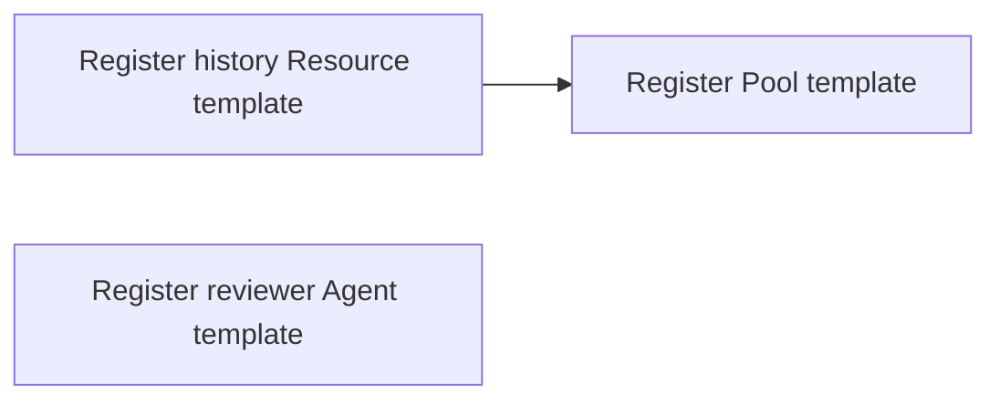

# Complete package walkthrough: retained message history

Status: **illustrative package design for authoring review**, 2026-11-03. Package-local scope,
explicit dependency bindings, one explicit package entry document and a template's named dependency
map with alias-plus-export references are accepted. Concrete field names and file layout remain open.
[Conceptual closure](../../archive/reviews/CONCEPTUAL.md) is complete.
This follows the accepted [design](../../protocol/README.md) and reuses the history Resource from
[Experiment 001](../../../experiments/001-shared-access/README.md). It is a complete walkthrough
of publication, implementation binding, template use and instance behavior, not an installable
package. No worker binary, SDK, public schema release or runtime test is supplied here.

All filenames, manifest fields, export names and binding spellings below are proposals. The
`storage/message-history` grouping shown as separate fields is the existing fixture choice,
not a new ruling on the permanent Resource catalog. Package code may be replaced by supported
MCP bindings or graph implementations; this example uses authored code to make the boundary clear.

## 1. What this package contributes

`example.history` supplies one implementation of a retained-message Resource. A Pool owns each
Resource instance; messages and independent reader positions belong to that Resource's backing.
It exposes post, bounded read, advance-reader and inspect through authorized Conduits. It does
not own Agents, wake them, create a tracker, or grant access by installation.

The example has three different exports used by the template:

| Export | Kind | Responsibility |
| --- | --- | --- |
| `history.establish` | Setup operation | Create the requested backing or explicitly attach an existing one; return its descriptor. |
| `history.managed` | Runtime driver | Maintain the instance's message capability and implement its lifecycle/inspection behavior. |
| `history.set-read-limit` | Control-handler operation | Apply a supported change to the default bounded-read setting and report confirmation or uncertainty. |

One package supplies all three for convenience. None is a primary implementation. Another
compatible contribution could supply an export through an explicitly revised template. Mere
agreement on input shapes would not prove compatibility with the backing, runtime or recovery.

## 2. The published package

A package has one explicit entry document declaring its public exports and dependencies. A small
package can inline its contracts, graphs, templates and bindings there; any executable remains an
implementation artifact. A larger package can reference separate package-local definition files.
Either form may be handwritten or generated and inspected without executing plugin code. A file's
presence alone does not export its contents, and provider-native catalogs remain dynamic.

The following multi-file release illustrates the second form; `plugin.yaml` is a proposed filename:

```text
example-history/
  plugin.yaml                 entry document: identity, exports, dependencies and definition references
  contracts.yaml              type, operation, runtime and capability definitions
  schemas.json                shared data schemas referenced by those definitions
  templates/
    shared-history.yaml       a ready-made Resource template
  bin/
    history-worker            eventual platform-specific MCP worker artifact
```

These are an inventory of the proposed release, not files claimed to exist in this repository.
The source project would separately contain the implementation and conformance tests. The release
retains the package identity, release and content digest under the accepted artifact rule. That
digest covers the published contracts, schemas, templates and any bundled worker; the same rule
applies if the package has no executable. A package name and `0.1.0` alone do not supply exact
content identity. The hashing/bundle format is still open. Installation does not run setup.

The package explicitly declares included files/directories, with directory and pattern rules
available. In this example, declarations, schemas, `templates/` and any bundled `bin/` contents
could form the selected artifact; unrelated logs and scratch files remain outside it and its
digest. This illustrates the accepted inclusion boundary, not final manifest syntax or a rule
that every package uses these directory names. One explicit source directory bounds capture,
including symlink targets. A link to a shared helper outside that directory reports an error;
stage the helper inside, choose a wider source directory with explicit inclusion rules, or use
a separate package dependency. Resource paths/runtime access remain separate. Descriptor handling
and internal symlink representation remain open.

### Local development and instance replacement

The accepted development workflow starts in edit mode and distinguishes direct source tests from
managed execution. A draft version field does not itself publish or preserve a release:

1. Edit the history implementation/contracts and run handler tests against the working directory.
2. Explicitly run a managed test or start. Tooling may validate and capture the selected package
   contents automatically, retaining an immutable artifact and its digest before execution.
3. Start a history Resource using implementation A. Editing the source to B leaves the running
   Resource's code/contracts unchanged; that does not make A a permanently installable release.
4. To adopt B, explicitly retire the affected Resource and create a replacement from the edited
   source. Running A and B side by side is an optional comparison, not ordinary iteration's requirement.
5. Reestablish intended connections through supported operations. Reuse of backing history requires
   the Resource's explicit attachment and lifecycle contract; replacement does not copy data or
   transfer grants implicitly. The Interface reports any incomplete retirement or establishment.

Once no live activity or unfinished recovery needs A, retirement can release its private executable
contents without purging outcome evidence. Future recreation of A is not guaranteed: a recorded digest or
exported configuration does not supply missing code. A restart/recovery request with unavailable
selected code reports that gap rather than substituting B.

To preserve a chosen implementation, explicitly version and publish it. For example, publish
`example.history` version `0.1.0` as fixed package contents through a public or private distribution
source, then continue editing. New instances can select that release and verify its digest while
development uses the edited source. Publishing those changes requires a new version, such as `0.1.1`;
the existing release is unchanged. Retiring its instances does not remove the release. These version
labels are examples, not a prescribed format. A Git commit or test capture alone does not publish
a usable package. A declaration-only package may need only released source; this compiled worker
example must also supply its executable artifact or an explicitly supported build arrangement.
No build mechanism is selected here. Conduit resolves and verifies the package without necessarily
providing the hosting/publishing system. A separate local-only release facility is unselected.
Future runtime compatibility and exact reproduction of external services/data remain outside this
content-preservation boundary.

This does not require manual archive assembly, public publication or a selectable multi-build catalog
for each local edit. A development helper could combine retirement and replacement. Development/release
commands and exact inclusion syntax remain unselected. Captured package contents exclude credentials
and Resource data and do not freeze the host environment. Storage and cleanup mechanics remain open. The lifecycle
behavior is accepted design, not an implemented CLI demonstration.

### Illustrative descriptor

An illustrative `plugin.yaml`:

```yaml
package:
  name: example.history
  release: 0.1.0
contracts: contracts.yaml
types:
  history: {contract: history}
endpoints:
  worker:
    transport: stdio
    command: bin/history-worker
exports:
  history.establish:
    kind: operation
    contract: establish
    binding: {endpoint: worker, tool: history_establish}
  history.managed:
    kind: driver
    contract: managed
    binding:
      endpoint: worker
      lifecycle:
        start: history_start
        inspect: history_inspect
        stop: history_stop
      capability:
        post: history_post
        read: history_read
        advance-reader: history_advance_reader
        inspect: history_inspect
  history.set-read-limit:
    kind: operation
    contract: set-read-limit
    binding: {endpoint: worker, tool: history_set_read_limit}
templates:
  shared-history: templates/shared-history.yaml
```

All public export names in this package must be unique across contribution kinds. Although this
illustrative layout puts templates in a separate section, its public `shared-history` name cannot
also name an operation or driver export. Moving the definition to a separate file does not avoid
that collision. References still check the expected kind and contract; this rule does not select
the final field layout or change internal contract names.

`worker` is package-local endpoint configuration. It is not a template plugin alias or another
object instance. Under the accepted [scope rule](../../protocol/MODEL.md#package-scope-and-public-bindings),
an unrelated `worker` alias in an importing template cannot change this internal reference.
The executor supervises the selected helper as instance-associated activity;
this manifest does not require one process per export, package or Resource. The driver export
represents a lifecycle/capability contract, not a single ordinary MCP tool invocation. Its adapter
uses the named methods as appropriate. Exact lifecycle wire/profile details remain open.

### Re-exporting through a starter package

An Euphony starter package can declare this history package as a dependency and explicitly re-export
its public `shared-history` template as `conversation-history`. The selection is conceptually:

```text
Euphony starter package: conversation-history
  → declared history dependency: shared-history
  → original Resource template and its defining scope
```

No copied template or wrapper operation is required. Internal references still resolve in their
original scope, and resolved dependency identities remain retained. The new export name does not
change the template's contract or confer permission to instantiate it or access history. Ordinary
export-name uniqueness and kind/contract checks remain in force. This illustrates accepted re-export
semantics without selecting manifest fields or reference notation.

## 3. What the published contracts must say

The following is the full contract inventory for the example. Tables express semantics without
pretending every field has a settled serialization. Typed fields would be published in the schema
bundle; prose guarantees also remain part of the authoritative contract.

| Definition in `contracts.yaml` | Inputs/configuration | Outputs and guarantees |
| --- | --- | --- |
| Resource type `history` | Identity `{group: storage, name: message-history, version: v0alpha1}`; configuration below. | Requires retained-message capability, declared runtime handling and coherent lifecycle behavior. Offers the default `set-read-limit` control. |
| Operation `establish` | Typed configuration; trusted instance/operation context accompanies invocation. | A `store` descriptor identifying the backing and its owning instance/execution context. Create must not silently adopt an existing backing; attach must not silently create one. |
| Driver `managed` | The prepared `store` descriptor and the instance's current confirmed configuration. | Owns ongoing access, readiness and availability reporting under the responsible service. Start/inspect/stop must identify the same backing and actual runtime state. Stopping does not purge content. |
| Operation `set-read-limit` | `{limit: integer 1..100}`; trusted target and expected configuration revision. | Confirmation sufficient for the instance authority to commit the changed `readLimit`, or an explicit failure/pending/uncertain outcome. Transport success alone is not application. |
| Capability `retained-messages` | Versioned communication contract below. | Append-only shared history, independent readers, bounded retrieval and scoped inspection. Data visibility and current authority are checked separately from schema validity. |

The store descriptor is an opaque, typed runtime result. It is not a path assumed portable between
hosts, a secret, a permission grant or a live handle copied into authored YAML. Its validity and
placement are checked before use. The worker cannot supply a caller-chosen target identity as proof
of authority; trusted invocation context comes from the responsible service/authorized connection.

For example, `schemas.json` could include these data definitions under the accepted JSON Schema
2020-12 foundation. YAML is an equivalent authoring representation. The detailed schema profile
and final organization remain under review; this fragment illustrates proposed data rules.

```json
{
  "$defs": {
    "configuration": {
      "type": "object",
      "additionalProperties": false,
      "required": ["establish", "backingKey"],
      "properties": {
        "establish": {"type": "string", "enum": ["create", "attach"]},
        "backingKey": {"type": "string", "minLength": 1},
        "readLimit": {"type": "integer", "minimum": 1, "maximum": 100, "default": 20}
      }
    },
    "setReadLimitInput": {
      "type": "object",
      "additionalProperties": false,
      "required": ["limit"],
      "properties": {
        "limit": {"type": "integer", "minimum": 1, "maximum": 100}
      }
    }
  }
}
```

The contracts reference those definitions; Conduit's declared default-materialization behavior
fills an omitted `readLimit` before an instance executes. Schema parsing itself is not setup and
does not establish that the backing exists.
For this example, `readLimit` is the default page size, and an explicitly requested count must
remain within the capability's 1–100 range and any narrower applicable restrictions. This gives
the illustrative control a precise effect; it does not settle every Resource's pagination policy.

Standard `title` and `description` annotations can document the `limit` field. A frontend may also
want a slider grouped under search settings. The accepted custom-metadata mechanism is a dedicated
namespaced map; the following extension block illustrates its shape without choosing its keyword
or namespace syntax:

```yaml
annotations:
  example.ui:
    widget: slider
    group: Search settings
```

Another frontend can use a numeric input. In either case, the schema still validates the 1–100
range, grants/requirements govern who may invoke the control, and the handler contract governs
application and confirmation. Custom descriptive annotations do not implement those guarantees.
Unknown schema keywords outside the extension mechanism still report errors. Detailed annotation
value schemas remain open.

The capability's remaining typed methods have these meanings; exact wire fields stay open:

| Method | Request and result | Required behavior |
| --- | --- | --- |
| `post` | Message text plus optional reply/recipient hints; returns retained message identity and position. | Use the authenticated actor and operation identity, not a client-supplied author. Confirm only retained writes; reconcile uncertain outcomes before unsafe repetition. |
| `read` | Optional position and bounded requested count; returns entries, continuation position and coverage/limit information. | Apply current access and the configured/default caps. Returning content is not proof that the Agent read or acted on it. |
| `advance-reader` | A valid position for the caller's reader; returns confirmed reader position. | Advance that reader under the contract; do not advance another Agent merely because both share service authentication. |
| `inspect` | Supported inspection selection; returns scoped state, freshness and uncertainty. | Report known state without promising every intermediate event or exposing restricted content. |

A message entry needs its stable identity, source position, retained content, authenticated
attribution and applicable reply/recipient references. A cursor is scoped to its source and reader
context, not authority. Final message/cursor/outcome schemas are not selected by this walkthrough.

For every operation, the release also declares its supported completion, cancellation, interaction,
output-validity and recovery behavior. For this example: no interactive provider login is needed;
there is no promised rollback; a lost mutation response requires outcome reconciliation or an
explicit uncertain result. The Resource's domain store and the executor's authority store do not
share an assumed transaction. Persisted domain operation evidence must support the recovery the
implementation claims. Method bodies and conformance tests still have to prove that behavior.

## 4. Default control declaration and its binding

The history type offers a default control:

```yaml
controls:
  set-read-limit:
    inputSchema: schemas.json#/$defs/setReadLimitInput
    defaultHandler: {export: history.set-read-limit}
    changes: [[readLimit]]
    revision: required
    concurrency: exclusive
```

This is proposed package-level notation. `defaultHandler.export` refers to an export in the exact
package supplying this default declaration. It does not search the consuming template for an alias
named `history`. That lexical meaning is a proposed scoping rule exposed by this example, not an
accepted final field format. A cross-package default would need an explicit dependency reference.

During expansion, the selected default must become an exact retained handler binding. A template
can use its own alias `messages`; the resolved handler can then refer to
`{plugin: messages, name: history.set-read-limit}` when that alias selects the same implementation.
Two aliases or multiple selected versions must not create an arbitrary match. Exact rebinding and
nested-definition scope rules remain for review. No package is made primary by supplying a default.

## 5. The template an author or user works with

`templates/shared-history.yaml` could contain this recipe. The common API identifier and the
precise alias/export syntax are proposed; the example follows the accepted five-family envelope.

```yaml
apiVersion: conduit/v0alpha1
kind: Resource
form: template
metadata:
  name: shared-history
spec:
  type: {group: storage, name: message-history, version: v0alpha1}
  plugins:
    messages:
      package: example.history
      release: 0.1.0
  config:
    establish: create
    backingKey: euphony-exchange
    readLimit: 20
  setup:
    nodes:
      establish:
        operation: {plugin: messages, name: history.establish}
        inputs:
          configuration: {from: config}
  runtime:
    driver: {plugin: messages, name: history.managed}
    inputs:
      store: {from: output, node: establish, port: store}
  controls: {use: type-defaults}
  conduits: {}
```

The Pool offers this template as an explicit named Resource entry. Merely listing it provisions
nothing. Authorized provisioning creates a Pool-owned Resource and explicitly requests setup.
The empty outbound `conduits` declaration does not authorize incoming consumers; those establish
their own authorized connections to the history capability.

A user normally edits `backingKey` and supported initial settings. For reuse of an existing backing,
attachment intent must be explicit. The user need not rewrite the graph or manufacture a handler.
The example passes configuration to establishment and its output to the managed runtime. V0 graph
inputs use literals and typed references; a calculated setup input would come from another plugin
operation rather than an inline expression. The displayed reference notation remains illustrative.
If establishment is implemented by a reusable graph, the explicit `configuration` input supplies
the values that graph may read from the caller. It cannot implicitly read other fields from the
enclosing Resource's configuration. A narrower reusable operation could instead declare a `limit`
input: this template could pass its captured `readLimit`, while another template uses a differently
named setting. Selecting that field within the captured configuration uses the accepted JSON Pointer
`/readLimit`; selecting `/backingKey` instead retrieves the backing key. The source selector and
surrounding reference fields remain illustrative, and strings in history content are not interpreted
as pointers. Scoped invocation context and authorized Resource access retain their own contracts.
An authored graph can also assemble a message object from a literal title and an earlier step's
body output, or assemble list items explicitly, without another plugin merely to build the structure.
This is explicit assembly, not automatic merging or string interpolation; constructor syntax remains open.
Graph checking catches provable wiring/type errors early, while each step validates its resolved
inputs before dispatch. A broader producer schema does not alone forbid a binding when actual
values can satisfy the receiving contract; invalid actual values block the receiving step without
undoing earlier effects. This does not weaken the exact-contract-version rule for imported implementations.
Validate declared outputs against their producer's contract before downstream use as well. If
`history.establish` creates its store but returns an invalid descriptor, withhold that output and
record the contract error without treating the store as absent or blindly repeating creation.
Preserve effect evidence and uncertainty for supported recovery; downstream input checks still apply
to valid published outputs.
Reference recognition is confined to designated graph binding positions. A history message may
contain an example of reference notation as literal content; neither posting nor reading that
content causes the graph engine to interpret it as instructions or additional dependencies.
Package installation, template registration, Resource creation, setup and consumer connection are
distinct effects even if an Interface offers an explicit action combining some of them.

### Registering related templates together

The accepted batch boundary lets an author submit the history Resource template and an Agent
template together through individual checked registry writes. If history registration succeeds but
the Agent name conflicts, history remains registered and the Interface reports both outcomes. Each
entry still requires explicit create/update intent and any applicable update preconditions.

Before writing either template, Conduit parses the complete batch and validates both against their
required schemas. If the Agent template has an unknown field, neither template is registered.
Passing this check does not reserve the Agent's name: a later write conflict can still produce the
partial outcome above, with current authority and revision checks at each write.

Add a complete supplied Pool template referring to the history template, with an explicit
registration prerequisite:



History and Reviewer are independently eligible; Pool waits for History. File position does not
establish order, and the Pool's ordinary Resource reference does not itself create the graph edge.
All three definitions and graph structure are validated before writes; the Pool definition is
supplied up front, not generated from History's result. If History fails, Pool remains blocked
while Reviewer may proceed. Shared graph cancellation and valid-progress recovery rules apply,
without rollback or blind replay. Concurrency remains subject to current checks and execution limits.

This registers definitions; it does not instantiate the Pool, create a history Resource or launch
an Agent. Neither the package descriptor nor a batch implies an atomic deployment. Concrete batch
notation remains unselected.

Each registration batch permits one write per target object. Two updates to the `reviewer` template's
stable ID must be combined into one replacement or submitted separately; adding an ordering edge
does not make the duplicate valid. Two creates using the same kind/name are also rejected before
any writes.

The template remains reusable: after registering `reviewer` once, explicit instance-creation
and launch operations can establish `reviewer-7f3a`, `reviewer-9c2b` and more Agents. Each instance
has its own identity, private state and lifecycle. Those operations create distinct objects rather
than repeatedly writing the template; registration does not implicitly launch any of them.

## 6. Follow the names through one invocation

| Name | Scope | Resolution |
| --- | --- | --- |
| `example.history` | Published package identity | Selects declarations and implementation bindings; release/artifact resolution records exact identity. |
| `messages` | This template's `spec.plugins` map | Resolves to that selected implementation. A different template may call the same package `chat`. |
| `history.establish` | Export in the selected package | Resolves to operation contract `establish` and the named worker binding. |
| `worker` | Package endpoint declaration | Selects the supported MCP connection/launch binding; not a Resource identity. |
| `history_establish` | Tool in that implementation's MCP interface | Receives validated inputs and trusted managed invocation context. |

Thus the setup reference follows:

```text
{plugin: messages, name: history.establish}
  → template selection: example.history at its retained identity
  → published operation contract + binding
  → worker's history_establish invocation under current authority
  → validated result and authoritative operation evidence
```

The `name` in `{plugin, name}` is a package export name, not necessarily an MCP tool name.
In this proposal, the same reference shape selects the driver or control handler, but the expected export kind and
execution contract differ. A worker endpoint need not be exposed directly to Agents. Public
capability/control calls still pass through authorized Conduits and the target's coordination rules.
The Interface presents outcomes; it does not become the only process that may issue requests.

## 7. The resulting instance and a later control call

The instance retains its own ID, Pool ownership, resolved setup/runtime definitions, explicit
configuration and exact selected contributions. The resolved control includes its input schema,
constraints, revision/concurrency rules and handler. Observed readiness, store outputs and retained
progress belong to system state/evidence, not declarations pretending an effect already happened.

For example, an authorized Interface or Agent requests `set-read-limit` with `limit: 15` and the
configuration revision it inspected. The target checks current authority/restrictions and serializes
application under the control contract. It invokes the retained `history.set-read-limit` handler.
The handler confirms application, then the responsible service records confirmed configuration and
its revision. If the response is lost, the request remains uncertain until reconciliation; do not
silently claim either 20 or 15 is the current effective runtime value. Independently exposed
managed endpoints must preserve these checks. Direct unmanaged worker use carries only that
implementation's own guarantees; a similarly named tool is not a managed authorization path.

The instance then exports confirmed `readLimit: 15`; the template still starts new instances at
20. Replacing fixed definitions or selected implementations requires a replacement instance in v0.
Stop does not purge message history; closing one consumer's Conduit does not delete the Resource.

## 8. What remains open after this example

Package-local scope and explicit dependency bindings are accepted. Templates select implementations
in one named map and use alias-plus-export references for setup, runtime and controls, with no primary
alias and kind/contract checks at each use. `spec.plugins` and `{plugin, name}` remain proposed spellings.
This example does not ratify the entire manifest or every contract field at once.
The accepted uniform reference pattern applies to template/resolved-instance implementation references;
it need not force package-local defaults, endpoint names or native MCP tool names into that same
namespace. Package-internal references retain their defining scope; callers replace only
explicitly exposed dependencies. Such dependencies may now declare default implementation bindings:
the history validator can use its declared standard implementation unless the caller explicitly
selects a compatible replacement. An invalid replacement reports an error rather than falling back.
The resolved selection is retained on the instance; this does not install packages or grant access.
V0 imports require an export's explicit support for the requested contract identity and exact version,
alongside existing compatibility checks. Two different validator releases may satisfy the same
contract version; an export supporting only a different version does not automatically qualify.
Cross-version mappings are deferred, without an obligation to maintain older implementations.
Exact resolution and default-binding syntax remain part of the authoring review.

It exposes concrete follow-up work: package identity/artifact selection, contract schema layout,
default-binding representation, nested graph naming details, and how driver/lifecycle and
managed invocation metadata use the Conduit MCP profile. These should be resolved against this
same package, not by adding a new fictional example for each field. A complete runtime implementation
also requires the worker, publication tooling and conformance fixtures; none has started here.
