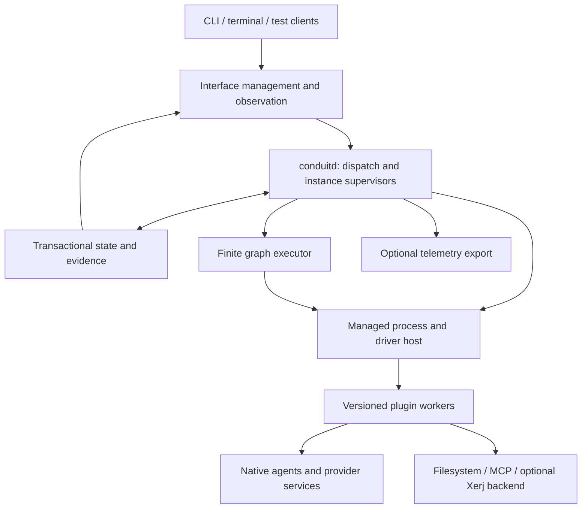

# Proposed runtime architecture

Status: implementation proposal, 2026-11-01. See [review](REVIEW.md) for pending choices and
[contracts](CONTRACTS.md) for proposed representations. Accepted semantics remain in
[DESIGN](../../DESIGN.md).

## 1. System boundaries

The protocol still has five families: Interface, Agent, Resource, Pool and Conduit. Every family
has template and instance forms. An implementation module, operation, worker, graph node,
transport, attachment or database table does not add a family.

| Family | Runtime ownership | Durable representation | What it does not imply |
| --- | --- | --- | --- |
| Interface | Frontend attachments, control/inspection connections and user attribution | Definition, settings, connection state and attributable operations | One process per UI, or frontend ownership of active work |
| Agent | Primary execution, private state, activation and supported controls | Fixed definition, stored settings, executions and available context/evidence | Shared private history because an account is shared |
| Resource | Its configured capability, backing association and managed driver | Definition, owning Pool, backing association and operation evidence | One process/database per Resource |
| Pool | Resource ownership and permitted provisioning composition | Named available templates, owned instance IDs and composition outcomes | Automatic deployment of listed templates |
| Conduit | Live logical participation, routes and applicable restrictions | Fixed definition, supported settings, attachments and lifecycle evidence | Ownership of durable conversation content or provider credentials |

The system Pool owns the management Resource through which the Interface exposes registry and
runtime management. The physical implementation of the control database is not another user-facing
Resource automatically created for every table. A plugin's private checkpoint is implementation
state; a separately exposed storage/search/authentication capability is a Pool-owned Resource.

## 2. Processes and local deployment

**Recommendation, I1:** run one persistent `conduitd` host per local registry. The `conduit` CLI
and terminal are clients. Normal CLI startup may launch the host on demand; the frontend then
attaches to the retained default Interface. Its exit does not stop the host or its instances.
An explicit host stop is separate from closing a frontend or pausing an Agent.

The host owns its registry lock and all writes to its control store. A second host must refuse
ownership rather than race to reconcile the same instances. Use an OS-held lock, a registry ID
and a host-generation ID. A stale PID file is diagnostic evidence, not the ownership lock.

Proposed local management transport is MCP over a private local byte stream, exposed to native
MCP clients by a stdio bridge. The Rust SDK supports custom async read/write transports as well
as standard stdio and HTTP. This does not claim Unix sockets are a standard MCP transport.
Provider-facing HTTP remains a separate client concern. A loopback HTTP frontend adapter can
follow if a frontend actually needs it. [MCP transport API][rmcp-transport]

The local connection authenticates an Interface attachment or delegated actor. Owner bootstrap
material is distinct from Agent connection material. OS ownership can establish the initializing
human context, but normal managed Agent calls do not acquire administrator authority merely
because they share that UID. Native agents still have their actual host privileges: a same-user
process may be able to read local credentials outside mediation. This is not an OS sandbox claim.

### Bootstrap and repair

On first explicit initialization, the host creates the registry identity, minimal system objects,
local owner binding and selected management implementation together where possible. Bootstrap
records incomplete external initialization and can inspect its own partial state. It requires
no application Pool, model login or search service.

Later starts reuse those IDs and definitions. Missing system objects, unknown schema versions
or incompatible management code produce an explicit repair condition, not default recreation.
A local owner recovery command can inspect and repair the registered management path without
depending on that broken path. Repair uses checked operations, reports its changes and preserves
backing data; it is not an alternate general bypass for rewriting instance definitions.

### Host and worker loss

Frontend disconnection, worker failure and host failure are different events. Workers are
replaceable implementation processes, not the owners of logical instances. A worker protocol
disconnect invalidates its live handles. Its owner records uncertainty and retains unresolved
operations; it does not infer that every external effect stopped.

For the initial worker contract, request managed child shutdown on loss of the owning host
connection and report end when it can be proved. Do not promise survival/reconnection of arbitrary
native PTYs across a host crash. An adapter that can verify and reconnect an existing execution
may do so; otherwise the Agent remains stopped or unknown and needs explicit reconciliation/resume.
**I1** asks whether crash-surviving native executions must be a first-version requirement.

Use process groups where supported and retain handles until reaping completes. `kill_on_drop`
is only a fallback: Tokio documents that dropping a child normally does not terminate it, and
sending a kill does not by itself establish all cleanup. A PID alone can be reused and cannot
prove identity on recovery. [Tokio process contract][tokio-process]

Explicit host shutdown first stops new effect admission, then requests supported driver shutdown,
drains bounded in-flight work and records confirmed ends or remaining uncertainty before closing
the store. Preserve credentials, backing data and retained outcomes. A shutdown deadline is not
proof that every remote effect ended. Restart inspection can expose the final shutdown record even
when its requesting frontend lost the connection before receiving acknowledgement.

## 3. Runtime services and ownership

Keep these services inside the host initially, with explicit ports for tests and workers:

| Service | Responsibilities and constraints |
| --- | --- |
| Registry/configuration | Checked template edits, instance registration, naming, schema/default resolution and stable references. No provider effects inside registry transactions. |
| Instance supervisor | Own executions/drivers and generations; apply family lifecycle checks; expose independent preparation/runtime/connection observations. |
| Graph executor | Validate finite dependency graphs, schedule ready steps, retain progress and decide whether recorded results remain usable. |
| Invocation coordinator | Deduplicate operations, reserve target conflict domains, recheck revisions/authority at dispatch and retain confirmed/uncertain outcomes. |
| Route/access service | Resolve one complete authorized path, enforce supported filters, manage participation and record delegation. |
| Plugin host | Resolve exact implementations, start/stop workers, validate protocol/schema compatibility and translate worker failures. |
| Evidence service | Commit attributable outcomes; expose permitted snapshots/catch-up and optional diagnostics export. |
| Artifact/credential services | Supply verified implementation artifacts and protected credential references through narrowly defined host facilities. |

There is no giant mutex around a model turn or a service call. Use bounded message queues and
short state transitions. A per-instance coordinator owns its in-memory execution state; the
store owns durable truth. Cross-instance operations use explicit coordination, not arbitrary
shared mutable structures or plugins reaching into another supervisor.

Readiness is composed from observed facts. A Resource can be registered, partly prepared,
running and waiting for authentication at the same time. Represent those facets separately,
with typed plugin detail. Core bookkeeping may use internal enums; do not impose one closed
domain lifecycle enum on every plugin or the external protocol.

## 4. Persistence and transactions

**Recommendation, I4:** SQLite is the authoritative local control store, accessed through
`rusqlite` on a dedicated store thread with a bounded queue. The async host never blocks a Tokio
worker on a database operation. Permit bounded read connections only if consistent snapshots
and connection configuration are tested; start with one owner rather than a generic ORM.

Use WAL, foreign-key enforcement and explicit transactions. Default to `synchronous=FULL` for
committed control/effect evidence; `NORMAL` can lose recent committed transactions on power loss.
This is a durability configuration choice, not a promise against faulty storage hardware.
[SQLite synchronization][sqlite-sync] · [rusqlite][rusqlite]

### Logical data layout

The following are proposed table responsibilities, not finalized SQL or new object kinds.

| Record/table | Essential content and invariants |
| --- | --- |
| `registry_meta` | Registry ID, storage schema version, initialization state and active host-generation evidence. |
| `objects` | ID, family, form, unique current name, current spec and configuration revision. Unique family/name across forms. Store one authoritative spec; extracted columns are indexes, not competing configuration maps. |
| `bindings` | Owner, declaration location, authored reference and resolved stable target ID. Rename does not replace target identity. Deletion leaves an unavailable binding. |
| `implementation_bindings` | Exact package/artifact/schema identities selected for an instance; requested-but-unresolved dependencies remain visibly unresolved. |
| `executions` | Instance, generation, driver, actual settings, private-state location and observed lifecycle. At most one active primary execution per Agent. |
| `operations` / `attempts` | Logical operation identity, actor, target, request fingerprint, expected revision, selected path, effect evidence and attempts. Retained uncertainty survives host restart. |
| `graph_progress` | Instance/start generation, node, resolved input fingerprint, implementation, outputs/validity and completion/wait evidence. |
| `participation` / `grants` | Consumer, Conduit, component participation, delegated rights and current withdrawal state. No grant from a template reference alone. |
| `events` | Ordered committed evidence with actor/target/path correlation and content references. Append-only except explicit purge treatment. |
| `resource_state` | Namespaced private runtime/Resource state supplied by a restricted storage API; never arbitrary SQL access for workers. |
| `payloads` | Metadata/references for retained content, with ownership, sensitivity, digest and purge state. Credentials use protected custody instead. |

The SQLite file may physically contain data for several Pool-owned Resources without collapsing
their logical ownership/access. A separately deployed database or Xerj service remains a Resource
backend accessed through its configured Conduits. Search indexes are rebuildable views, not the
authority for operation completion or access grants.

### Commit discipline

Admission commits the operation identity and recoverable dispatch inputs before effects begin.
The host checks authority again immediately before dispatch. It does not hold a write transaction
while waiting for a provider. When a handler confirms a configuration change, update `spec.config`,
its revision and the operation/evidence rows in one local transaction. Publish afterward.

Local commit cannot be atomic with an arbitrary upstream write. A provider success followed by a
lost reply remains uncertain until its recovery contract establishes the result. A store failure
before intent commit means no dispatch; a store failure after dispatch requires preserving
uncertainty and stopping further affected mutations. An observer/export failure cannot reverse
an already committed outcome. This adapts Pi's separation of durable mutation and publication.
[Pi writer][pi-writer]

For large retained payloads, stage and sync immutable content before committing its reference.
Handle abandoned staging files as explicit cleanup candidates; never automatically purge Resource
data. A backup includes both the consistent database snapshot and referenced payloads/artifacts.
Use SQLite's backup facilities rather than copying a live database file without coordinating its
WAL. Restore into a stopped registry, validate it and explicitly reconcile external executions;
restoring records does not recreate their side effects. [SQLite backup][sqlite-backup]

### Recovery

On host start, acquire exclusive ownership, verify storage/schema and load retained objects.
Mark stale live observations unknown until checked. Examine incomplete operations and execution
generations. Recovery can read and reconcile; repeating effects still needs current authority and
an explicit safe-retry contract. A stopped Agent does not automatically receive a new turn.

Workers cannot simply return success for another attempt: results carry the operation, attempt,
instance generation and selected implementation. A delayed result is retained as evidence but
cannot overwrite a newer confirmed configuration. Do not serialize a live handle and treat it
as usable after reboot; reacquire or verify its instance-owned backing and authority.

## 5. Graph and runtime execution

Compilation produces a finite DAG of typed operation bindings. Validate cycles, missing ports,
unbound required dependencies and implementation availability before dispatch. Separate
schema-valid registration from runtime readiness: known schemas may register while code or an
external service is missing. Schema acquisition itself is explicit and does not run plugins.

Each explicit instance start gets a new start generation. Its graph can verify that establishment
is already satisfied; it must not blindly repeat a create operation. An explicit retry of an
incomplete start uses the same progress lineage and only reuses results whose inputs, implementation,
backing and current prerequisites remain valid. Changed confirmed configuration invalidates
affected results under declared read sets, conservatively all relevant steps when unknown.

A node requesting runtime startup goes through the instance supervisor. The process/client is
owned before the node receives a usable runtime handle. Subsequent migration/initialization nodes
can use that handle. Successful node completion never transfers lifetime ownership to the graph.

Graph failure blocks dependent steps and records partial progress. Independent work already
accepted follows its contract; retain managed runtimes and successful attachments by default.
Explicit cancellation requests cooperative stop, reports unresolved effects and performs only
declared cleanup. There is no inferred rollback or reverse-topological deletion of backing data.

Human-interaction waits release worker compute and retain a recoverable interaction reference.
If a plugin cannot recover a challenge, recovery reports that fact and requests a supported new
interaction; it does not claim continuation of arbitrary suspended code. New attempts and browser
responses are bound to the correct instance/account/operation and cannot complete a later login.

## 6. Invocation, concurrency and controls

The common path is: authenticate actor → resolve target/path → validate contract → reserve
coordination domain → check current revision/authority → persist dispatch intent → invoke →
record outcome → deliver within current read authority.

Default configuration-control coordination is one applying change per target. A plugin may
declare safe conflict domains, but cannot release the target merely because its response was lost.
An unresolved change holds the affected domain until inspected or otherwise reconciled. Independent
capability use may continue. Queue-versus-busy behavior is contract-defined; queue admission does
not reserve a revision or permissions for later execution.

`spec.config` changes only after confirmation. Pending/uncertain requests are separate records.
A handler reports the applied configuration changes and evidence; the host verifies allowed paths,
constraints, revision and generation before committing. Plugins cannot rewrite setup graphs,
control definitions or implementation bindings through a configuration result.

No-op controls still perform their declared checks/effects. If they confirm unchanged stored
settings, the proposed default preserves the configuration revision and records the outcome.
A plugin can report external work even where configuration is unchanged. Reconciliation may
establish an external change despite caller withdrawal; recording reality is separate from
authorizing a new effect or releasing its content to the former caller.

## 7. Conduits and shared service access

Maintain logical participation independently from transport clients. A composite Conduit tracks
each consumer's component participation. Removing one consumer releases only its participation;
the last logical consumer/peer ends the flow. A later connection creates a new Conduit ID while
explicitly reusing permitted Pool-owned Resources.

Each invocation selects one complete path. The evaluator intersects current actor/target limits,
the attachment's delegated rights, composite/component filters and provider capability support.
It never combines operation rights from one route with target rights from another. Ambiguity
requires deliberate selection; a failed route does not silently choose a different account.

Serialize the final authority check with local dispatch admission so a restriction change has a
defined ordering against a new request. Once a request has been sent upstream, later withdrawal
cannot promise to undo it; use supported cancellation, record its actual outcome and recheck
permissions before delivering retained content or starting another effect.

Filters are typed contracts with inspectable parameters. Provider adapters implement semantic
checks where the meaning of native arguments matters. If the implementation can enforce only
tool names, it cannot claim workspace-level filtering. Unsupported requested restrictions leave
that binding unavailable. Full interception of unmediated native actions remains outside v0.

### Shared authentication

An authentication Resource owns refresh and selected service identity. A service Resource obtains
a provider-appropriate binding through a Conduit. Clients may be pooled by target, identity,
audience, implementation and relevant isolation context; matching URLs alone never merge access.
Coordinate refresh per binding and prevent competing workers from rotating the same credentials.

Store secrets outside ordinary specs/events. **I5** recommends an OS-backed credential store for
Conduit-owned service credentials, with explicit test/in-memory alternatives. Native Agent
authentication remains owned by its native adapter/runtime. Do not copy rotating credentials
into every Agent private directory or infer subscription eligibility from a successful API call.
The current Rust Keyring documentation distinguishes simple convenience APIs from applications
that select specific stores, so choose the store adapter explicitly rather than assuming an older
generic keyring API. [Credential-store guidance][keyring]

### Native MCP exposure

An Agent sees provider-native tool names/schemas through its prepared provider-specific endpoint.
The endpoint authenticates Conduit participation, not the upstream provider token. The host routes
to the Resource's client and shared service identity. Credential refresh is service-runtime work,
not a new Agent login or a reason to broaden that Agent's grants.

Catalogs are captured for preparation and explicit refresh. Known incompatible drift blocks
affected calls; no network catalog fetch is required for every invocation. Route identity and
catalog evidence stay attributable. Standard MCP compatibility is negotiated per peer; an upstream
server echoing a version string does not prove support for every feature.

## 8. Agent execution and context

Two drivers share the same Agent lifecycle and control/evidence contracts:

1. A **native driver** launches/attaches the external agent, prepares private configuration and
   MCP connections, and reports verified identity, capabilities and telemetry gaps.
2. An **owned-loop driver** constructs permitted context, calls a model-provider adapter, handles
   streaming/tool requests, invokes through Conduits and persists available history/usage.

The native driver never pretends to own hidden model work. The owned-loop driver never treats
ordinary provider HTTP compatibility as proof of subscription-account compatibility. Both keep
the selected runtime/account/provider boundary fixed and expose supported mutable settings through
controls. Actual applied model settings belong to execution evidence as well as stored config.

Before each owned-loop model request, assemble explicit user input, current private context,
activated instructions/skills and selected permitted Resource content within budgets. Log content
references and capture coverage. Provider adapters own wire conversion and streaming semantics;
the core owns tool authorization, effect handling and attribution. An interrupted generation does
not silently restart billable model work. BYO skills retain their compatible native formats.

Agent process/model buffers, retained transcripts, portable task checkpoints and shared memory are
different stores with different provenance. Resume/fresh/fork keep the accepted meanings. Shared
context is read through a Resource, not implemented by merging private Agent histories. No Interface
reconnection triggers context injection or model work by itself.

**I2** selects delivery order. The custom terminal must remain a thin Interface attachment even
if native adapters are validated before the owned-loop driver.

## 9. Retained communication

Implement the first communication capability as a Pool-owned history Resource with an append
operation, bounded read and explicit reader-progress operation. A stable logical message ID and
append deduplication key prevent safe retries from creating duplicate messages when the storage
contract supports it. Per-history sequence order is commit order, not a global wall-clock order.

Each consumer keeps its own read position. Reading content and advancing a cursor are separate
operations; neither proves understanding or work acceptance. A page reports a resumable cursor
and limits. Purged or withheld history is reported without exposing restricted details. Replays
and catch-up recheck current recipient authority.

Unread notices are lightweight next-turn observations. They do not wake an idle Agent or start a
review job. Conversation history persists after a flow ends; new access uses a new authorized
Conduit. Linear/Jira are ordinary integration Resources, not dependencies of communication.

## 10. Interface and observability

Every managed effect is inspectable from the same Interface that can control it. A useful
operation view shows actor, target, path, implementation, start/attempt identity, relevant revisions,
confirmed effect, outstanding uncertainty, available diagnostics and supported next actions.
Sensitive details require their own access; even an inspectable operation need not reveal all
upstream payloads.

Use three distinct streams:

| Stream | Delivery/retention behavior |
| --- | --- |
| Committed operation/domain evidence | Durable local record; no successful managed outcome acknowledged before its required commit. |
| Live observations | Snapshot plus cursor/generation, with freshness/coverage; dropping intermediate observations cannot erase an operation result. |
| Diagnostic traces/metrics | Bounded, optionally sampled/exported; explicit exporter failures and dropped-observation counts where known. |

The Interface subscribes to committed events and can catch up after disconnect. To avoid the
snapshot/subscribe race, return a snapshot with its high-water cursor, then deliver later events.
If the cursor is purged or unavailable, return a scoped gap and require a new snapshot. Slow
clients do not block commits; close or limit their stream with a recoverable cursor.

Rust `tracing` spans correlate work and exporters can use OpenTelemetry. Neither is the operation
journal: the OpenTelemetry SDK deliberately allows bounded queues and dropping spans under
pressure. Do not use an exporter acknowledgement as evidence that a configuration was applied.
[OpenTelemetry SDK][otel]

**I6** settles payload defaults. Irrespective of that choice, persist required recovery inputs or
report that recovery cannot replay them; keep credentials out of logs; distinguish missing usage
from zero and overlapping parent/subagent totals. The Interface must expose actual coverage.

## 11. Resource limits and failure policy

Use configurable limits at registry parsing, graph scheduling, per-instance queues, worker
concurrency, output size, content capture and observation delivery. Initial numbers are engineering
defaults measured by the spike, not permanent protocol constants. Reject excessive inputs before
effects; store oversized legitimate outputs by reference where their contract supports it.

| Failure | Host response |
| --- | --- |
| Invalid config / missing schema | Reject write, preserve current object and source file. |
| Missing code / unavailable dependency | Retain valid registration; report unready operations. |
| Required preparation failure | Block that consumer's preparation; retain successful partial work. |
| Dependency lost after readiness | Continue independent work; mark affected operations unavailable. |
| Worker panic / timeout | Record failure or uncertainty according to evidence; do not infer rollback. |
| Store unavailable before dispatch | Do not admit new effects that cannot be recorded. |
| Exporter/frontend loss | Preserve managed work and committed evidence. |
| Authority withdrawn | Block subsequent managed dispatch/delivery; stop isolated execution if revocation cannot be enforced live. |
| Unknown execution identity | Preserve records; do not launch a duplicate or delete the Agent. |

The [organization and milestone plan](ORGANIZATION.md) makes these cases executable before live
providers. The architecture is not considered implemented when a happy-path CLI demo works.

[rmcp-transport]: https://docs.rs/rmcp/latest/rmcp/transport/index.html
[tokio-process]: https://docs.rs/tokio/latest/tokio/process/
[sqlite-sync]: https://sqlite.org/pragma.html#pragma_synchronous
[rusqlite]: https://docs.rs/rusqlite/latest/rusqlite/
[sqlite-backup]: https://sqlite.org/backup.html
[pi-writer]: https://github.com/earendil-works/pi/blob/2c8d1feb147f6b3d97e855da803bfe7b19f3c403/packages/durable/src/session/writer.ts
[keyring]: https://docs.rs/keyring/latest/keyring/
[otel]: https://opentelemetry.io/docs/specs/otel/trace/sdk/
