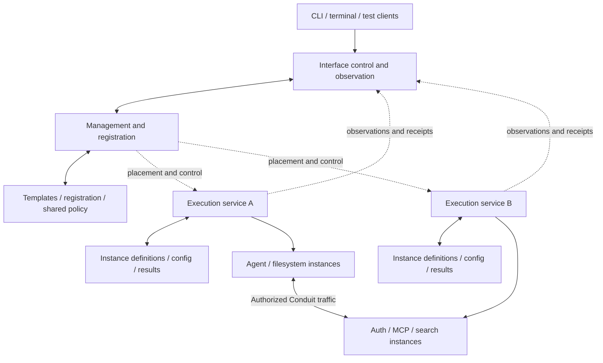

# Proposed runtime architecture

Status: implementation proposal, 2026-11-01. I1's management/execution separation and shared
policy with instance-owned state are accepted; v0 has no offline grants. See [review](REVIEW.md)
for pending choices and [contracts](CONTRACTS.md) for proposed representations. Accepted semantics remain in
[DESIGN](../../DESIGN.md).

## 1. System boundaries

The protocol still has five families: Interface, Agent, Resource, Pool and Conduit. Every family
has template and instance forms. An implementation module, operation, worker, graph node,
transport, attachment or database table does not add a family.

| Family | Runtime ownership | Durable representation | What it does not imply |
| --- | --- | --- | --- |
| Interface | Frontend attachments, control/inspection connections and user attribution | Definition, settings, connection state and attributable operations | One process per UI, or frontend ownership of active work |
| Agent | Primary execution, private state, activation and supported controls | Fixed definition, stored settings, executions and available context/evidence | Shared private history because an account is shared |
| Resource | Its configured capability, backing association and managed driver | Definition, owning Pool, backing association and operation evidence | One process/database per Resource |
| Pool | Resource ownership and permitted provisioning composition | Named available templates, owned instance IDs and composition outcomes | Automatic deployment, co-location or one daemon per Pool |
| Conduit | Live logical participation, routes and applicable restrictions | Fixed definition, supported settings, attachments and lifecycle evidence | Ownership of durable conversation content or provider credentials |

The system Pool owns system management for registry/creation and a dedicated access-management
Resource for grants/governing requirements, reached through the Interface's Conduits. A table does
not automatically become a Resource. Whether authority storage
itself stays internal, uses a bootstrap-loaded plugin or becomes an explicitly Pool-owned Resource
is under I4 review. A plugin's private checkpoint is implementation state; a separately exposed
storage/search/authentication capability is a Pool-owned Resource. Logical ownership, storage
implementation and physical deployment are distinct choices.

Plugins publish contracts with bindings to authored code, existing MCP implementations, graphs
of selected operations, or a combination. Graph-backed exports reuse operation invocation and graph
execution; they do not require a new object family or a worker merely for composition. Exact nested
execution/recovery interfaces remain open. A declarative integration may reuse a shared adapter. Package
installation, Resource instantiation, provider deployment and client connection are distinct
actions. A configured external service remains externally operated unless explicit management
capabilities and authority establish otherwise.

Supported component capabilities can be exposed over MCP independently of the aggregate Interface.
They retain required authority, ownership and evidence services; standard client access does not
expose every internal setup/driver export. Standalone implementation use outside the managed model
has its own declared dependencies/guarantees. This adds no process or registry per object.

### Interface as system director

**Accepted first-launch boundary:** Conduit can start the root Interface from a locally available
definition before registry services exist. Its declared graph directs establishment of the system
Pool, system management and access-management Resources, and their management connections. The
runtime supplies initial owner recognition and minimum loading/persistence support. This keeps
foundational orchestration in the same template/plugin model rather than a separate runtime setup
procedure. The root remains an Interface, not a sixth family or a bootstrap-only object.

Its template declares dependencies, graph, runtime behavior and supported controls. Continuing
administration and observability use the existing Interface role. No implicit autonomous loop,
continuous reconciliation, application restart or extra model work follows. Frontends attach to
the Interface; it can retain supported work independently of an open CLI/TUI.

Management and execution services retain their accepted authority. The Interface directs work;
current authority permits it; target contracts and responsible services determine the actual
operation and confirmed outcome. First-grant establishment and unavailable-path repair remain
under review. A directive does not itself confer access.

| Question | Responsibility | Concrete example |
| --- | --- | --- |
| What work should be coordinated? | The Interface's declared directive, graphs and runtime behavior. | Establish the system's dependencies at startup; expose administration; report failures and support explicit repair. |
| What operations exist? | Selected plugins and the target's fixed capability/control contracts. | A database Resource offers start/inspect; its contract determines recovery and whether a live setting can change. |
| Who may request an operation? | The authenticated actor and current grants/restrictions on its Conduit path. | The owner-operated root has broad v0 administration; an Agent uses explicitly delegated access. Naming an instance root or adding a directive does not create a grant. |
| Who performs and confirms a change? | The target instance's designated service and implementation. | Its service admits a revision-checked change, supervises the handler and records confirmed configuration or uncertainty. |
| Who owns objects and presents evidence? | Pools own Resources; each service owns its assigned facts; the Interface coordinates and presents source-attributed results. | Starting a Resource does not transfer it into the Interface or create a second authoritative copy of its state. |

The root Interface can hold system-wide administrative permission and direct policy changes.
Management services exposed through the system Pool's system management and dedicated access-management
Resources retain shared registry and governing-binding/grant facts and enforce applicable rules.
The latter Resource manages access state; the former handles registry/templates and creation.
This is an implementation of the authority boundary,
not a second human decision maker. Executors remain authoritative for their assigned instances'
confirmed configuration and operation results. The Interface retains its own configuration and
management-workflow progress. Administrative permission does not bypass fixed definitions,
revision checks or the requirement to establish an actual outcome.

**Accepted: independent policy.** Shared policy is independent of any particular Interface,
with multiple authorized Interfaces able to administer it and broad default root administration.
The [cloud IAM comparison](../../research/CLOUD_AUTHORITY.md#9-interface-administration-and-independent-policy)
provides the rationale. The root's active management responsibilities do not require ownership of
the policy it administers. This settles logical authority, not policy representation, storage or
the earliest startup sequence.

#### Root authority lifecycle comparison

Consider root Interface R1, an Euphony Interface E, Agents A/B, and shared policy P. P is a logical
label for the existing shared authority, not a newly accepted object type.

| Event | Accepted consequence |
| --- | --- |
| R1 establishes a Pool and delegates access to A | Pools retain Resource ownership; the recorded grant follows A's participation and current restrictions. |
| R1's frontend closes or its runtime stops | This alone does not revoke A's grant or prevent E from using another authorized path. |
| R1 is replaced by R2 after changing its fixed definition | R2 establishes verified administrative access. Policy ownership and existing grants do not transfer or reset. Old workflow effects still need ordinary recovery. |
| R1 and E update the same policy | The authoritative service coordinates checked changes; Interface observations are not separate writable policy authorities. |
| Current permission cannot be verified | Hold new affected managed requests under the no-offline-grants rule; retain supervision and already-dispatched outcomes. |
| A detaches, its grant is withdrawn or a governed target is deleted | The corresponding participation/grant/target lifecycle contract applies. Independence from an administrator does not preserve every grant through every deletion. |

Replacing an Interface is different from replacing the principal or recipient named in a grant.
A reused readable name does not restore an old identity or authority. Historical attribution stays
intact. The Euphony-only administrator example illustrates later differentiated Interface access;
it does not narrow today's broad owner-operated v0 administration.

#### Policy as authoritative requirement application

Policy and Grant are now explicitly part of the protocol concepts beneath the five families,
covering Agents and Interfaces. Policy is the authoritative application of reusable requirements;
grants record particular issued authority. Grant administration and governing-binding changes are
ordinary protected capability operations, with grants permitting them and requirements bounding
their proposed effects. The same requirement composition/support machinery applies without a
separate policy language or mandatory evaluator process. Endpoint-selected plugins implement
operations and enforcement, while Conduits retain relationships and participation.

The [authorization contracts](AUTHORIZATION.md) develop this accepted model and remaining details,
backed by [primary-source research](../../research/AUTHORIZATION.md). They distinguish governing
requirement bindings and grants, actor/principal/provider identities, decision inputs/results,
and actual endpoint enforcement. They also apply to Resource-to-Resource calls and capabilities
on all five families; a protected target need not be a Resource. Governing bindings remain independent
authoritative state even though they no longer require a separate policy-rule structure.

**Accepted placement:** the system Pool owns a dedicated access-management Resource exposing
grant and governing-requirement administration/inspection. The existing system management Resource
retains registry/template and instance-creation responsibilities. Both may be hosted by the same
management service and storage implementation; one capability manages many records. This preserves
unitary responsibilities without a separate process/database per Resource or a central proxy for
every requirement check. Endpoint implementations retain their enforcement duties. Exact startup,
schemas and storage remain unruled. Authorization records do not inherit ordinary knowledge-sharing
semantics.
Publishing a policy or installing a plugin cannot confer authority.

Ordinary managed access now requires a recorded grant on its selected participation, including
the root's broad management access. Policy governs issuance/current use without a grantless
alternative; authorized connection setup can establish one grant for many requests. Grant
administration now checks current administrator authority, while issued grants remain independent
of issuer provenance, permissions and grant ancestry. Any authorized administrator can revoke them;
recipient participation/Conduit end also ends access. Bounded issuance operations may supply
mandatory use restrictions and compose caller-added restrictions, returning the complete issued
grant. They preserve intent and refuse explicit broadening; issuance-only checks do not become
live issuer dependencies. Exact schemas/type-specific validation remain authoring work. Next settle
initial establishment/repair and foundational persistence/engine selection. The trusted authority and first
owner grant still need an explicit startup/repair contract; a Resource wrapper alone does not
resolve that dependency.

**Responsibility does not imply continuous enforcement of desired state.** In this example, a
directive to establish a Pool can be satisfied by an explicit setup operation. Repair/restart loops
must be declared by the runtime contract. Closing the frontend detaches it. Stopping the Interface
or losing its management connection does not implicitly delete its created Resources or stop all
independent work. Existing outage/admission rules and explicit shutdown contracts still apply.
Other authorized actors do not acquire ownership of an unavailable service merely by observing it.

The root Interface is distinguished by its foundational system-management responsibility and
owner association; it remains an Interface template/instance. The earlier broad v0 Interface access
is not being narrowed by this proposal, and permissions among multiple Interfaces remain deferred.
Later Interfaces could have different responsibilities using the same contracts. No automatic
priority for user commands over delegated Agent commands is introduced; existing target coordination
still handles concurrent requests. This remains one local ownership model, not a federation design.

Management and execution services remain implementation roles that may each serve many objects.
The root Interface can direct those services without all of them sharing a process or all provider
traffic passing through the root. A service losing contact with it must still distinguish missing
observations, unavailable current policy and confirmed process termination.

#### First-launch contract

The root Interface's locally available definition can be loaded before normal registry/access
services. Its graph owns foundational orchestration; the runtime supplies trusted owner recognition,
loading and minimum initial persistence. Exact loader fields, progress storage and storage engine
remain open. Registry state cannot be the only source needed to establish that same registry.

The initial graph must establish Pool ownership, capability instances and verified management
connections using their contracts. No arbitrary plugin may claim root authority. Later startup
reuses retained identities/configuration rather than repeating a fresh installation. An unavailable
existing authority/store is not evidence of an uninitialized system.

#### First authority and grant establishment — proposed

Both approaches below retain the accepted root-directed graph. They differ in how its first
foundational operations are authorized before normal access-management services are ready:

| Approach | Before normal management grants are usable | Consequence |
| --- | --- | --- |
| Explicit owner-authorized initialization | The runtime recognizes an explicitly requested initialization for the verified local owner and authorizes the selected root's foundational setup under that initial trust context. Once access management is ready, establish normal participation grants and use normal managed paths. | Breaks the first-grant dependency without requiring the access-management service to authorize its own creation. Needs an explicit initialization boundary, recorded progress and transition to ordinary authority. |
| Record ordinary grants before setup | Initial runtime support records the root's first normal grant/participation and evaluates it from locally available authoritative state before the graph starts. | Uses ordinary grant semantics from the first step, but requires initial grant targets/state and evaluation before their Resource services are ready. It must later retain one authority for those same records. |

Recommend explicit owner-authorized initialization for the first implementation. This is permission
for foundational establishment under the selected root definition, not an ordinary application
access path, a new object family or a global grant-check bypass. Its availability must be tied to
explicit initialization and recorded setup state; completion must not leave it available for later
ordinary requests. The root's broad v0 owner administration continues through recorded management
grants once those services are established.

Interrupted setup would use retained identities/progress and the verified owner context; the exact
resume/repair contract remains to be settled. Do not silently treat partial or inaccessible state
as a fresh installation, erase data, or reopen initialization authority merely because management
is unavailable. Ordinary Agents retain the no-offline-grants rule. Broad owner repair remains
available as agreed, but its path when normal services fail still needs an explicit contract.

This is a proposal, not an accepted authorization exception. Exact owner recognition, first-grant
records, persistence and the transition between initial and normal authority remain subsequent
contract/implementation details. The alternative remains open for ruling.

**Establishment walkthrough:** the local runtime loads the explicitly selected root
Interface definition and verifies its owner context. The Interface's establishment graph then
establishes the system Pool, its system management and access-management Resources, and any selected
storage dependencies in the supported order,
opens the management connections, and makes observation/control available to attached frontends.
On subsequent starts, its recovery operations reuse retained object identities, settings and grants;
missing or inconsistent state is reported for explicit repair. Resource creation still proceeds
through its Pool. Normal running-instance changes use Conduits and supported controls, and fixed
definition changes still require replacement. This describes the accepted orchestration boundary;
it is not final YAML or approval of a particular first-authority mechanism or storage plugin.

The first load and earliest durable progress still need an implementation home. A root Interface
cannot load the only copy of its definition from a store reachable only after that same definition
runs. Its initial definition and sufficient identity/recovery material must therefore be available
before those dependencies. That can be part of the Interface runtime's declared local persistence
and loader contract rather than another public object family or separate user-authored bootstrap
workflow. Where this material is authoritative, how partial establishment is recorded, and how it
agrees with later registry state remain explicit design questions. No second writable copy of live
configuration, implicit fresh initialization or offline Agent grant should be inferred.

The same Interface role would handle repair during ordinary use: if a storage connection fails,
it can expose available diagnostics, request supported reconnection or run an explicit repair
operation. It must show when authoritative state cannot be inspected or changed. Broad administrative
permission does not fabricate missing state or prove that an external action succeeded. Stopping
its frontend differs from stopping its runtime or a management service; the existing outage rules
still govern new admissions and independent executors' already-dispatched work.

**Review direction:** assess this active Interface role first, then settle how its foundational
persistence is represented and loaded. Administrative scope, ownership of domain data and durable
state authority stay distinguishable. This is a proposal under [I4](REVIEW.md#i4--local-transactional-authority),
not an accepted storage-engine choice or change to every Interface's configuration.

### Instance execution boundary

Endpoint implementation selection and management are accepted. Locally authored plugin code
normally runs in supervised helpers associated with the served instance; trusted built-in Rust
code may remain in the executor process. Exact process grouping remains open.
Setup, supported changes and ongoing managed behavior run in the context of the instance whose
contract owns that activity. This context carries identity, retained implementation/definition,
private state references, applicable authority, lifecycle supervision and attributable outcomes.
It is not itself a sixth family, a mandatory process/container or an OS sandbox.

| Boundary | Meaning and remaining implementation choices |
| --- | --- |
| Definition and state | The instance's fixed setup/control definitions and confirmed settings govern its behavior; its designated service retains authoritative state. |
| Execution | Plugin handlers and managed processes serve that instance. Endpoint templates select connection plugins; their instances manage execution and local bindings. An execution service supplies hosting and supervision and can host multiple instances. |
| Authority | An instance context is not an automatic grant. The caller, target, selected Conduit path and current restrictions govern each admitted operation. |
| Physical placement | Authored code normally uses supervised instance-associated helpers; trusted built-in Rust handlers may run in-process. A runner can host compatible handlers without requiring a process per plugin, invocation or instance. Existing MCP services retain supervision; graph composition alone needs no helper. This is not an OS sandbox. |

For example, a directory Resource's setup handler runs for that Resource; an Agent's runtime
setup runs for the Agent. When the Agent invokes a shared MCP Resource, the Resource handles the
provider call with caller attribution and Conduit restrictions. Its separately owned authentication
dependency remains another Resource accessed through its own authorized connection. Calling an
operation does not transfer its implementation or credentials into the caller's boundary.

A Pool composition step can coordinate child Resource creation while each child's setup belongs
to that child. Conduits actively establish connections using plugins at either or both endpoints.
**Accepted:** endpoint templates select their plugins and endpoint instances manage them. Conduits
match compatible capabilities/roles and coordinate restrictions and participation rather than
providing endpoint-local implementation fragments. Each endpoint owns its local binding state;
the Conduit retains relationship state and correlated establishment/cleanup outcomes. Endpoint
ownership does not make a detached binding permanent. See the
[authoring boundary](AUTHORING.md#endpoint-selected-plugins-and-conduit-matching).

For example, the Agent's MCP integration manages its local bridge/binding; a Resource's endpoint
plugin manages the provider-facing binding and shared client. A target configuration change still
goes through its control contract and designated state authority. Conduit orchestration does not
become the owner of endpoint code, credentials or confirmed configuration. Compatible roles need
not use identical plugin packages or require separate processes. Exact pairing/admission remains open.

Keep the initiating actor, owning instance/activity, Conduit participation and physical execution
location distinguishable. These are attribution relationships, not new object families or
additional author-created manifests. A Conduit can coordinate work at several execution services
while retaining one designated authority for its own state. Endpoint services own their local
effects/results; the Conduit records correlated progress, not a second writable endpoint config.
Partial establishment must remain visible; no atomic transaction across endpoints is assumed.

The implementation must establish an identifiable, supervised instance context before dispatching
its setup; a record with incomplete setup need not have an ongoing process. Exact registration/start
sequencing, helper grouping, cancellation and cleanup mechanics remain open. The
[family-by-family walkthrough](AUTHORING.md#5-where-the-example-implementations-execute) supplies
the proposed template/instance mapping and lifecycle examples.

The helper default preserves this instance execution boundary. Sharing implementation code need
not share private state or credentials. Neither a separate helper nor an instance-specific
runner becomes the sole authority for instance state simply because it executes plugin code.

## 2. Management and execution placement

**Accepted execution custody:** separate execution services supervise Conduit-managed Agents
and Resources. Management coordinates configuration/control; the Interface presents the system.
Each executor can host many instances. The first experiment runs management and two independent
executor processes on one machine, with controlled failures of their connections. External MCP
services retain their own supervision. Pool ownership does not determine placement, and no
process-per-object rule follows. Conduit endpoints carry authorized capability traffic; neither
the Interface nor management must be a global relay. The [distributed-runtime research](../../research/DISTRIBUTED_RUNTIME.md)
and [cloud authority comparison](../../research/CLOUD_AUTHORITY.md) inform the remaining choices.

Management/execution separation and the shared-policy/instance-state authority split are
accepted. The diagram illustrates executors hosting active instance authorities; management can
host passive ones. These services are implementation roles, not a sixth family, a service per
object or a placement rule tied to Pool ownership. Concrete process/storage placement, replication,
federation and transport remain open beyond that first proof. Two-machine validation precedes
claims of remote support. External providers retain their own infrastructure.

Management owns templates, registration/naming and shared access policy. One designated service
owns each instance's resolved definition, confirmed configuration/revision and operation records.
The Interface/registry can aggregate observations, but cached copies are not independently writable
configuration. Short-lived workers implement behavior without becoming the state authority.
Resource backends retain their domain data. V0 grants no offline admission rights.

If the first registry authority uses a local store, it needs an OS-held lock, registry ID and
authority generation. A second writer must not race it. Executors need separate verified identities
and generation checks; a PID/address alone is insufficient. A local lock does not establish remote
exclusive execution, and a generation blocks obsolete requests only where the receiver enforces it.

One candidate local management transport is MCP over a private byte stream, exposed to native MCP
clients by a stdio bridge. The Rust SDK supports custom async read/write transports and standard
stdio/HTTP; this does not claim Unix sockets are a standard MCP transport. The independent-executor
spike must exercise serialized service boundaries. Peer authentication, route establishment and
authority freshness need explicit contracts before remote support is claimed. [MCP transports][rmcp-transport]

The management connection authenticates an Interface attachment or delegated actor. Owner
bootstrap material differs from Agent connection material. OS ownership can establish the
initializing human context, but a shared UID does not itself grant managed Agent authority.
Native processes retain their actual host privileges; a private channel is not an OS sandbox.

### Bootstrap and repair

First explicit initialization establishes the registry identity, minimal system objects, local
owner binding and management implementation, recording partial external outcomes. It needs no
application Pool, model login or search service. Later starts reuse those identities and settings;
missing objects or incompatible management code require explicit repair, not default recreation.

Local owner recovery can inspect/repair a broken management path without depending on that path.
It uses checked operations, preserves backing data and cannot bypass fixed instance definitions.
Independent executor enrollment and reconnect must reuse assigned identities rather than repeating
registry bootstrap. Their detailed enrollment, failure-validation and storage contracts remain implementation work.

### Management, execution and worker loss

Frontend disconnection, management loss, executor failure, plugin failure and a broken capability
route are separate events. A disconnected channel makes its handles unusable through that channel;
it does not prove that the backing process ended. Preserve unresolved operations and distinguish
local evidence from what another service has confirmed.

The accepted v0 rule retains supervision and outcomes of already-dispatched work while management
is unavailable, within admitted contracts and existing stop/revocation rules. New managed requests
wait or report unavailable when current permission cannot be established. Work with verifiable
permission can continue. There are no offline grants; process survival is not authority for new
effects. An executor failure still requires separate recovery evidence.

An adapter that verifies an existing execution may reconnect. Otherwise report ended or unknown;
do not launch a duplicate or a new model turn. Temporary unreachability is not logical detachment,
so it does not by itself end a Conduit. Execution survival, output draining, authority checks and
recoverable evidence all need testing; process survival alone is insufficient.

Use process groups where supported and retain handles until reaping completes. Tokio documents
that dropping a child normally does not terminate it; sending a kill does not establish all cleanup.
A PID can be reused and cannot alone prove recovery identity. [Tokio process contract][tokio-process]

Stopping management must be distinguishable from stopping an executor or the entire deployment.
Explicit executor shutdown stops new admission, requests supported driver shutdown, drains bounded
work and records confirmed ends or uncertainty. Preserve credentials, backing data and outcomes.
A shutdown deadline does not prove all remote effects ended. Management restart reconciles with
surviving executors rather than treating its last observation as current truth.

## 3. Runtime services and ownership

Keep these responsibilities explicit, with ports for tests, executors and workers. Execution
supervision is separate from management; service grouping implements the accepted authority split.
Below, “host” means the responsible
management or execution service, with transaction boundaries limited to its own authority:

| Service | Responsibilities and constraints |
| --- | --- |
| Registry/configuration | Shared templates, registration/naming and policy; schema/default resolution and stable references. Route instance configuration reads/changes to their designated authority; label aggregate observations. No provider effects inside registry transactions. |
| Instance supervisor/state authority | Retain the assigned instance's resolved definition, confirmed configuration/revision and operation results; supervise its executions/drivers and generations; apply lifecycle checks and expose preparation/runtime/connection observations. One service can host many instances. |
| Graph executor | Validate finite dependency graphs, schedule ready steps and retain progress. Supply default recovery for graph-backed operations: explicit retry reuses still-valid child results and delegates uncertain effects to child recovery contracts. Detailed nested coordination remains open. |
| Invocation coordinator | Deduplicate operations, reserve target conflict domains, recheck revisions/authority at dispatch and retain confirmed/uncertain outcomes. |
| Route/access service | Establish complete authorized paths; enforce filters at mediating endpoints; manage participation/delegation without requiring a global payload relay. |
| Plugin integration | Resolve retained contract/binding/adapter identities; start/stop owned workers or attach existing services; validate compatibility and report worker/service failures distinctly. |
| Evidence service | Retain outcomes at their authoritative source; expose snapshots/catch-up and aggregate for the Interface with freshness/gaps. |
| Artifact/credential services | Supply verified implementation artifacts and protected credential references through narrowly defined host facilities. |

There is no giant mutex around a model turn or a service call. Use bounded message queues and
short state transitions. A per-instance coordinator owns its in-memory execution state; the
responsible store owns its durable facts. Cross-instance operations use explicit coordination, not arbitrary
shared mutable structures or plugins reaching into another supervisor.

Readiness is composed from observed facts. A Resource can be registered, partly prepared,
running and waiting for authentication at the same time. Represent those facets separately,
with typed plugin detail. Core bookkeeping may use internal enums; do not impose one closed
domain lifecycle enum on every plugin or the external protocol.

## 4. Persistence and transactions

**Candidate, I4:** SQLite can implement a local authority store, accessed through
`rusqlite` on a dedicated store thread with a bounded queue. The async host never blocks a Tokio
worker on a database operation. Permit bounded read connections only if consistent snapshots
and connection configuration are tested; start with one owner rather than a generic ORM.

Use WAL, foreign-key enforcement and explicit transactions. Default to `synchronous=FULL` for
committed control/effect evidence; `NORMAL` can lose recent committed transactions on power loss.
This is a durability configuration choice, not a promise against faulty storage hardware.
[SQLite synchronization][sqlite-sync] · [rusqlite][rusqlite]

Independent executors need durable execution/outcome evidence that survives management loss.
Assign one authority to each fact and distinguish remote reports from authoritative state. Do not
share SQLite over a network or independently edit replicated copies of `spec.config`. The tables
below describe logical facts, not one required global database.
Under the accepted shared-policy/instance-state split, management's inventory of an instance is a
projection of its owner's state. Current reads/exports and revision checks must distinguish that
projection from the authoritative record. Registration, naming and lifecycle changes that cross
those owners still require coordination; do not weaken the existing ID/version checks.

### Logical data layout

The following are proposed table responsibilities, not finalized SQL or new object kinds.

| Record/table | Essential content and invariants |
| --- | --- |
| `registry_meta` | Registry ID, storage schema version, initialization state and active host-generation evidence. |
| `objects` | ID, family, form, unique current name, current spec and configuration revision. Unique family/name across forms. Store one authoritative spec; extracted columns are indexes, not competing configuration maps. |
| `bindings` | Owner, declaration location, authored reference and resolved stable target ID. Rename does not replace target identity. Deletion leaves an unavailable binding. |
| `implementation_bindings` | Exact package/artifact/schema identities selected for an instance; requested-but-unresolved dependencies remain visibly unresolved. |
| `executions` | Instance, generation, driver, actual settings, private-state location and observed lifecycle. At most one active primary execution per Agent. |
| `operations` / `attempts` | Logical operation identity, actor, target, request fingerprint, expected revision, selected path, effect evidence and attempts. Retained uncertainty survives host restart. |
| `graph_progress` | Instance/start generation, node, resolved input fingerprint, implementation, outputs/validity and completion/wait evidence. |
| `participation` / `grants` | Consumer, Conduit, component participation, delegated rights and current withdrawal state. No grant from a template reference alone. |
| `events` | Ordered committed evidence with actor/target/path correlation and content references. Append-only except explicit purge treatment. |
| `resource_state` | Namespaced private runtime/Resource state supplied by a restricted storage API; never arbitrary SQL access for workers. |
| `payloads` | Metadata/references for retained content, with ownership, sensitivity, digest and purge state. Credentials use protected custody instead. |

The SQLite file may physically contain data for several Pool-owned Resources without collapsing
their logical ownership/access. A separately deployed database or Xerj service remains a Resource
backend accessed through its configured Conduits. Search indexes are rebuildable views, not the
authority for operation completion or access grants.

### Commit discipline

Admission commits the operation identity and recoverable dispatch inputs before effects begin.
The responsible service checks authority again immediately before dispatch. It does not hold a
write transaction while waiting for a provider. Once a handler confirms application, the instance
state authority records the confirmed `spec.config`, its revision and the operation result. The
proposed local-store implementation commits these together, then publishes observations. Management
receives a projection; its receipt is not a second canonical configuration commit.

Registration, renames, retirement and other operations spanning shared management and instance
authorities still need checked coordination. No transaction across those stores is assumed. I4
must establish durable local commits and recovery mechanics within the accepted authority split.

Local commit cannot be atomic with an arbitrary upstream write. A provider success followed by a
lost reply remains uncertain until its recovery contract establishes the result. A store failure
before intent commit means no dispatch; a store failure after dispatch requires preserving
uncertainty and stopping further affected mutations. An observer/export failure cannot reverse
an already committed outcome. This adapts Pi's separation of durable mutation and publication.
[Pi writer][pi-writer]

For large retained payloads, stage and sync immutable content before committing its reference.
Handle abandoned staging files as explicit cleanup candidates; never automatically purge Resource
data. A backup includes both the consistent database snapshot and referenced payloads/artifacts.
Use SQLite's backup facilities rather than copying a live database file without coordinating its
WAL. Restore into a stopped registry, validate it and explicitly reconcile external executions;
restoring records does not recreate their side effects. [SQLite backup][sqlite-backup]

### Recovery

On authority/executor start, acquire its relevant ownership, verify storage/schema and load
retained objects and assignments.
Mark stale live observations unknown until checked. Examine incomplete operations and execution
generations. Recovery can read and reconcile; repeating effects still needs current authority and
an explicit safe-retry contract. A stopped Agent does not automatically receive a new turn.

Workers cannot simply return success for another attempt: results carry the operation, attempt,
instance generation and selected implementation. A delayed result is retained as evidence but
cannot overwrite a newer confirmed configuration. Do not serialize a live handle and treat it
as usable after reboot; reacquire or verify its instance-owned backing and authority.

### Worked storage and recovery examples

I4 remains open. These examples illustrate the proposed SQLite implementation of already accepted
ownership and recovery rules; they do not select new automatic retry, failover or backup policies.

| Storage | Authoritative facts in the proposed first experiment | What it does not establish |
| --- | --- | --- |
| Management database | Templates, registration/naming, shared access policy and routing to instance authorities. | An executor's latest configuration or whether a remote effect succeeded. Aggregated observations remain projections. |
| Executor A / executor B databases | Each service's assigned instance definitions, confirmed configuration/revisions, implementation bindings, graph progress and operation outcomes. | Another executor's current state or permission to admit new work while the governing authority is unreachable. |
| Resource backend | Its domain data: files, message history, database rows or search index, according to the Resource contract. | Conduit's instance identity, access policy or setup progress merely because it stores searchable content. |

One authority service can store many instances; this is not one database per object. The Interface
queries the responsible sources and marks stale or missing observations. Plugin contracts supply
behavior and recovery evidence; they do not require authors to read or write the internal SQL tables.

**1. A control succeeds, but its reply is lost.** A search Resource has confirmed query limit 10
at revision R7. An authorized caller requests 15 through a Conduit. Its executor records operation
O and the expected revision before dispatch; the handler then applies the change. Once application
is confirmed, the proposed local transaction records limit 15, revision R8 and O's outcome together,
with committed observation evidence. If the response to the Interface is lost afterward, reconnect
can retrieve O and R8 under current access without applying the control again. A stale management
view of R7 cannot overwrite R8. SQLite supplies an atomic local transaction, subject to the tested
durability configuration; Conduit still implements operation identity, validation and reconciliation.
[SQLite atomic commit](https://sqlite.org/atomiccommit.html)

**2. Setup changes a database, then the executor crashes before recording success.** A Pool owns
a database Resource. Its setup graph starts the instance-managed database, then runs migration M.
The database commits M, but the executor loses the result before committing completion locally.
After restart, retained intent identifies an operation whose effect may have happened; intent
alone proves neither dispatch nor failure. Current process identity/readiness must be verified;
a stored runtime handle is not proof the service is alive. On explicit recovery/retry, the selected plugin checks the database's migration history and
identity under its recovery contract. Sufficient evidence can confirm the outcome; insufficient
evidence leaves it uncertain. Reuse valid setup progress and do not blindly start a second database
or repeat M. The executor's SQLite transaction cannot include an arbitrary external database write.

A provider-native creation call has the same ambiguity. Where the actual provider operation offers
an idempotency token, reuse of the same token can support recovery within that provider's scope and
retention guarantees. A Conduit operation ID alone does not make an upstream operation idempotent;
MCP transport support alone does not establish that guarantee either. AWS's retry discussion shows
why a missing reply and an existing resource are insufficient to infer the original request's outcome.
[AWS idempotent API guidance](https://aws.amazon.com/builders-library/making-retries-safe-with-idempotent-APIs/)

**3. Management goes offline while executors remain alive.** Executor A can retain the result of
an already-dispatched migration in its own store. Executor B retains its independently supervised
activity and outcomes. New protected requests whose current permission cannot be verified wait or
report unavailable, even if old policy remains cached. When management returns, it refreshes its
projections from the authorities; delivering results still checks current access. Local persistence
makes retained progress possible without changing the no-offline-grants rule. If executor A also
crashes, its retained records help reconciliation but do not prove that its child processes survived.
Neither management nor executor B silently takes over A's instances or launches duplicates.

**4. The knowledge backend is unavailable, or a disk is lost.** If Xerj is offline while the
responsible executor is reachable, the Interface can inspect that Resource's retained configuration,
setup progress and known availability; a query still reports the backend gap. Conduit cannot recover
lost source documents merely from operation records. Likewise, SQLite surviving a process restart
is different from surviving loss of the disk containing it. Backups/replication, Resource-data
retention and external-state reconciliation are separate mechanisms. Restoring an older authority
backup cannot establish that later provider effects never occurred or that old permissions are still
current. Report and reconcile missing evidence; do not silently rebuild identity from search results.

### Storage boundary under review

The current exploration places initial establishment and continuing system administration in the
[Interface role](#interface-as-system-director). The storage arrangements below
can implement that role; they need not introduce a separate user-facing bootstrap component.

I4 has not selected an engine or extension boundary. The earlier SQLite-versus-storage-plugin
question combined independent choices. SQLite can back an internal adapter, a published plugin
or a Pool-owned storage Resource. Conversely, a service could use another engine internally
without exposing a general storage plugin API. The accepted authority split stays unchanged:
management owns shared registration/policy; one designated service owns each instance's state.
A backend implements persistence guarantees without becoming a second writer of object semantics.

Separate four questions:

- **Meaning:** which instance/service owns a fact and may confirm its transition? Already defined
  for core configuration, policy and operation outcomes; domain data follows its Resource contract.
- **Storage contract:** which reads, conditional writes, atomic groups and recovery guarantees must
  the persistence implementation supply? This can be internal or a published extension contract.
- **Engine and deployment:** SQLite, another local engine or a service; one service can store many
  instances, and physical sharing need not merge logical authority or Pool ownership.
- **Lifecycle:** what starts the storage dependency, how it is inspected, and how it is repaired
  when its own registry/connection records cannot be read? This is the bootstrap question.

For a shared history Resource, the messages and reader positions are domain data governed by its
capability. The executor's record that the Resource exists, its confirmed settings and its setup
progress are runtime state. A plugin can also have private recovery information, such as a remote
subscription cursor: where that is stored must be declared by its lifecycle/recovery contract,
not assumed to survive in helper memory. A cursor used as recovery evidence is different from a
rebuildable cache. No second canonical copy of message content or provider data is required merely
for runtime tracking; references and sufficient recovery evidence can connect the two. Captured
payloads and retention still follow their accepted contracts and pending I6 policy.

Consider a directory Resource. Its backing files remain on disk. Conduit retains its stable ID,
Pool owner, fixed definition, configured path and lifecycle evidence. The filesystem plugin supplies
operation outcomes and any supported reconciliation. Moving Conduit's metadata to another backend
does not copy the directory or change who may expose it through a Conduit. Likewise, a state-store
plugin should not decide whether an Agent may issue a new provider request; the responsible runtime
still checks the access path and current policy.

Three arrangements help expose the tradeoffs; none is accepted. They can also be combined: a
published plugin can implement a Pool-owned Resource whose initial loading uses bootstrap:

| Boundary | Example | Main tradeoff |
| --- | --- | --- |
| Internal authority-storage adapter | The executor calls a private storage interface implemented with SQLite. The management Resource exposes supported inspection/controls, not raw SQL. | Smallest initial dependency surface; outside authors cannot replace it through the public plugin contract yet. |
| Published storage contract with bootstrap loading | A retained plugin implements the required persistence operations; startup can load/connect it from an explicit configuration independent of the store being opened. | Extensible without ordinary instance setup recursion, but requires precise storage semantics and a special startup/repair contract. It can be local or remote; MCP alone supplies none of those persistence guarantees. |
| Pool-owned storage Resource used by authority services | A system Pool owns a state-store Resource, and services use selected Conduit paths to it. It is visible in the same object model as application storage. | Greatest model uniformity; requires an acyclic bootstrap path plus explicit rules for stopping, disconnecting, upgrading or deleting a dependency holding live system state. |

The third boundary is possible, but the naive sequence is circular: read the registry to find the
storage Resource; read its Conduit/grants to connect; use that connection to read the registry.
A possible bootstrap sequence is to load a small explicit descriptor identifying the existing
store and required implementation before ordinary registry operations, open and verify that store,
then recover its system-Pool/Resource/Conduit representations. A descriptor might identify endpoint,
artifact and credential references; exact contents and authority verification remain undecided.
It must not become a second writable copy of all configuration or a cache granting offline access.
A failed store open cannot silently create an empty registry, replace identities or restore defaults.
This builds on the accepted minimal bootstrap, but its storage dependency contract is a new choice.

A storage capability being visible through the Interface does not by itself settle its startup
mechanism. The second boundary could later expose a Pool-owned management/inspection representation;
the third still needs some startup mechanism outside the dependency cycle. Representation, runtime
ownership and initial loading should be reviewed separately rather than treating visibility as proof
that every ordinary lifecycle operation is safe or available.

Kubernetes provides two relevant reference points: the API server and etcd have separate roles,
and kubelet-managed static Pods can start from local manifests independently of API-managed Pod
creation. Those are examples of separating persistence and bootstrap, not a proposal to import
Kubernetes scheduling or restart rules. [Components](https://kubernetes.io/docs/concepts/overview/components/) ·
[Static Pod configuration](https://kubernetes.io/docs/tasks/configure-pod-container/static-pod/)
The etcd transaction API also demonstrates that conditional multi-record commits need not be an
SQL-shaped public interface. Its semantics would still need checking against Conduit's requirements;
this is not selection of etcd. [etcd transactions](https://etcd.io/docs/v3.6/learning/api/#transaction)

Any backend must preserve checked revisions, atomic updates of related local facts, durable
operation identity/outcomes and explicit unavailable/unknown states. The responsible service
retains transition logic, caller attribution and authority checks; plugins do not write arbitrary
rows in another service's store. An external store adds reachability/authentication concerns and
recovery when a commit reply is lost. A backend contract must define how to reconcile a possibly committed
write; it cannot infer failure from a missing reply. Choosing an engine does not make external
provider effects atomic or supply replication, automatic failover or a backup policy.

**Review recommendation:** settle the intended extension/lifecycle boundary before selecting its
first engine. An explicit persistence contract could fit Conduit's extension goals even if the
first implementation uses SQLite; whether that contract is private or published, and whether it
is an ordinary Resource dependency, remains open. See [I4](REVIEW.md#i4--local-transactional-authority).

## 5. Graph and runtime execution

Compilation produces a finite DAG of typed operation bindings. Validate cycles, missing ports,
unbound required dependencies and implementation availability before dispatch. Separate
schema-valid registration from runtime readiness: known schemas may register while code or an
external service is missing. Schema acquisition itself is explicit and does not run plugins.
For an MCP-backed node, dispatch still uses the selected contract and authorized dependency path.
The common adapter can invoke a compatible existing operation; metadata alone cannot substitute
for unimplemented conversion, filtering or recovery. No arbitrary transformation language is implied.

Each explicit instance start gets a new start generation. Its graph can verify that establishment
is already satisfied; it must not blindly repeat a create operation. An explicit retry of an
incomplete start uses the same progress lineage and only reuses results whose inputs, implementation,
backing and current prerequisites remain valid. Changed confirmed configuration invalidates
affected results under declared read sets, conservatively all relevant steps when unknown.

A node requesting runtime startup goes through the instance supervisor. The process/client is
owned before the node receives a usable runtime handle. Subsequent migration/initialization nodes
can use that handle. Successful node completion never transfers lifetime ownership to the graph.

Graph failure blocks dependent steps and records partial progress. Independent work already
accepted follows its contract; retain managed runtimes and successful attachments by default.
Explicit cancellation requests cooperative stop, reports unresolved effects and performs only
declared cleanup. There is no inferred rollback or reverse-topological deletion of backing data.

Human-interaction waits release worker compute and retain a recoverable interaction reference.
If a plugin cannot recover a challenge, recovery reports that fact and requests a supported new
interaction; it does not claim continuation of arbitrary suspended code. New attempts and browser
responses are bound to the correct instance/account/operation and cannot complete a later login.

## 6. Invocation, concurrency and controls

The common path is: authenticate actor → resolve target/path → validate contract → reserve
coordination domain → check current revision/authority → persist dispatch intent → invoke →
record outcome → deliver within current read authority.

Default configuration-control coordination is one applying change per target. A plugin may
declare safe conflict domains, but cannot release the target merely because its response was lost.
An unresolved change holds the affected domain until inspected or otherwise reconciled. Independent
capability use may continue. Queue-versus-busy behavior is contract-defined; queue admission does
not reserve a revision or permissions for later execution.

`spec.config` changes only after confirmation. Pending/uncertain requests are separate records.
A handler reports the applied configuration changes and evidence; the host verifies allowed paths,
constraints, revision and generation before committing. Plugins cannot rewrite setup graphs,
control definitions or implementation bindings through a configuration result.

No-op controls still perform their declared checks/effects. If they confirm unchanged stored
settings, the proposed default preserves the configuration revision and records the outcome.
A plugin can report external work even where configuration is unchanged. Reconciliation may
establish an external change despite caller withdrawal; recording reality is separate from
authorizing a new effect or releasing its content to the former caller.

## 7. Conduits and shared service access

Maintain logical participation independently from transport clients. A composite Conduit tracks
each consumer's component participation. Removing one consumer releases only its participation;
the last logical consumer/peer ends the flow. A later connection creates a new Conduit ID while
explicitly reusing permitted Pool-owned Resources.

Each invocation selects one complete path. The evaluator intersects current actor/target limits,
the attachment's delegated rights, composite/component filters and provider capability support.
It never combines operation rights from one route with target rights from another. Ambiguity
requires deliberate selection; a failed route does not silently choose a different account.

Within each authority domain, serialize the final check with dispatch admission so a restriction
change has a defined ordering against a new request. Once a request has been sent upstream, later withdrawal
cannot promise to undo it; use supported cancellation, record its actual outcome and recheck
permissions before delivering retained content or starting another effect.

Across independently operating endpoints, enforce the accepted no-offline-grants rule: cached
permission cannot substitute for current authorization. Block new managed dispatch when permission
cannot be established; result delivery also rechecks access. Loss of a management connection is
distinct from verified withdrawal and does not itself erase retained outcomes. Exact verification
mechanics remain implementation work; bounded offline delegation is deferred.

Filters are typed contracts with inspectable parameters. Provider adapters implement semantic
checks where the meaning of native arguments matters. If the implementation can enforce only
tool names, it cannot claim workspace-level filtering. Unsupported requested restrictions leave
that binding unavailable. Full interception of unmediated native actions remains outside v0.

### Requirement resolution and enforcement — proposed

To implement the accepted composable-requirements model, this proposal adds interpretation work
to the existing contract catalog, binding coordinator and endpoint dispatch paths. It introduces
no sixth service/object family; the specific runtime interfaces and algorithms remain proposed.
Definitions are reusable across implementations; plugins publish support declarations for checking
before establishment, followed by applicable runtime verification. A Rust implementation can keep
versioned definitions and typed parameter validation separate from selected endpoint support. The
detailed matching contract remains under review. Custom meanings must not require adding a Rust
enum variant or provider-name branch to core dispatch. Individual enforcement and optional
contract-specific composition checks are accepted; a general solver or merge algorithm is not a
prerequisite for extension support. Exact internal interfaces remain open.

Separate static definition/parameter checks, endpoint binding establishment and runtime checks.
Accepted requirement contracts specify fulfillment timing and applicable endpoint-role duties.
The established Conduit records the responsible selected implementations for Interface inspection;
this is system-owned connection/evidence state, not a new authored plan. Exact binding/evidence
representation remains under review. Endpoint instances remain responsible for their local
enforcement/effects, while the Conduit's authority retains relationship state and the Interface correlates observations. A cached match is not an
offline grant. Readiness losses affect the dependent capability under existing failure rules.

Observability should explain which requirement/version applies, which endpoint supports it and
why an action is unavailable, without claiming validation proved all runtime behavior. Detailed
payload capture remains I6; no new full-input logging default is introduced. The proposal does
not select an expression engine, extra worker processes or an OS sandbox. See the
[contract proposal](CONTRACTS.md#composable-relationship-requirements--proposed-contract).

### Shared authentication

An authentication Resource owns refresh and selected service identity. A service Resource obtains
a provider-appropriate binding through a Conduit. Clients may be pooled by target, identity,
audience, implementation and relevant isolation context; matching URLs alone never merge access.
Coordinate refresh per binding and prevent competing workers from rotating the same credentials.

Store secrets outside ordinary specs/events. **I5** recommends an OS-backed credential store for
Conduit-owned service credentials, with explicit test/in-memory alternatives. Native Agent
authentication remains owned by its native adapter/runtime. Do not copy rotating credentials
into every Agent private directory or infer subscription eligibility from a successful API call.
The current Rust Keyring documentation distinguishes simple convenience APIs from applications
that select specific stores, so choose the store adapter explicitly rather than assuming an older
generic keyring API. [Credential-store guidance][keyring]

### Native MCP exposure

An Agent sees provider-native tool names/schemas through its prepared provider-specific endpoint.
The endpoint authenticates Conduit participation, not the upstream provider token. The selected
Conduit path reaches the Resource's client and shared service identity, possibly across a network. Credential refresh is service-runtime work,
not a new Agent login or a reason to broaden that Agent's grants.

Catalogs are captured for preparation and explicit refresh. Known incompatible drift blocks
affected calls; no network catalog fetch is required for every invocation. Route identity and
catalog evidence stay attributable. Standard MCP compatibility is negotiated per peer; an upstream
server echoing a version string does not prove support for every feature.

The same managed capability can be used by another ordinary MCP client through an authorized
attachment. Client setup must establish its acting identity and selected path; request parameters
cannot self-assign authority. An Interface frontend need not relay the call. The responsible
component records attributable outcomes for later Interface inspection. Exact enrollment and
production authority deployment remain implementation work alongside I5, not a new permission model.

Stopping a managed client binding to an external server releases that binding; it does not kill
the server or erase its data. A server started under Conduit's custody follows its declared
managed lifecycle. Tests must distinguish an unavailable remote service, a dead owned worker and
a disconnected client without inferring ownership or safe replay from the transport failure.

## 8. Agent execution and context

Two drivers share the same Agent lifecycle and control/evidence contracts:

1. A **native driver** launches/attaches the external agent, prepares private configuration and
   MCP connections, and reports verified identity, capabilities and telemetry gaps.
2. An **owned-loop driver** constructs permitted context, calls a model-provider adapter, handles
   streaming/tool requests, invokes through Conduits and persists available history/usage.

The native driver never pretends to own hidden model work. The owned-loop driver never treats
ordinary provider HTTP compatibility as proof of subscription-account compatibility. Both keep
the selected runtime/account/provider boundary fixed and expose supported mutable settings through
controls. Actual applied model settings belong to execution evidence as well as stored config.

Before each owned-loop model request, assemble explicit user input, current private context,
activated instructions/skills and selected permitted Resource content within budgets. Log content
references and capture coverage. Provider adapters own wire conversion and streaming semantics;
the core owns tool authorization, effect handling and attribution. An interrupted generation does
not silently restart billable model work. BYO skills retain their compatible native formats.

Agent process/model buffers, retained transcripts, portable task checkpoints and shared memory are
different stores with different provenance. Resume/fresh/fork keep the accepted meanings. Shared
context is read through a Resource, not implemented by merging private Agent histories. No Interface
reconnection triggers context injection or model work by itself.

**Accepted I2 delivery order:** validate native Claude/Codex adapters after the synthetic runtime
proof, then build the owned Rust model/tool loop. Native integration/account validation starts
on macOS; the Rust core stays portable with OS-specific adapters. Other platforms require their
own evidence. The custom terminal remains a thin Interface attachment throughout; native success is not evidence that the
owned-loop driver or every provider/account combination already works.

## 9. Retained communication

Implement the first communication capability as a Pool-owned history Resource with an append
operation, bounded read and explicit reader-progress operation. A stable logical message ID and
append deduplication key prevent safe retries from creating duplicate messages when the storage
contract supports it. Per-history sequence order is commit order, not a global wall-clock order.

Each consumer keeps its own read position. Reading content and advancing a cursor are separate
operations; neither proves understanding or work acceptance. A page reports a resumable cursor
and limits. Purged or withheld history is reported without exposing restricted details. Replays
and catch-up recheck current recipient authority.

Unread notices are lightweight next-turn observations. They do not wake an idle Agent or start a
review job. Conversation history persists after a flow ends; new access uses a new authorized
Conduit. Linear/Jira are ordinary integration Resources, not dependencies of communication.

## 10. Interface and observability

Every managed effect is inspectable from the same Interface that can control it. A useful
operation view shows actor, target, path, implementation, start/attempt identity, relevant revisions,
confirmed effect, outstanding uncertainty, available diagnostics and supported next actions.
Sensitive details require their own access; even an inspectable operation need not reveal all
upstream payloads.

Use three distinct streams:

| Stream | Delivery/retention behavior |
| --- | --- |
| Committed operation/domain evidence | Durable local record; no successful managed outcome acknowledged before its required commit. |
| Live observations | Snapshot plus cursor/generation, with freshness/coverage; dropping intermediate observations cannot erase an operation result. |
| Diagnostic traces/metrics | Bounded, optionally sampled/exported; explicit exporter failures and dropped-observation counts where known. |

The Interface subscribes to committed events and can catch up after disconnect. Independent
sources need source/generation cursors and freshness; do not invent a global order from wall clocks.
The following snapshot/cursor discipline applies within a source; a combined view exposes gaps.
To avoid the snapshot/subscribe race, return a snapshot with its high-water cursor, then deliver
later events.
If the cursor is purged or unavailable, return a scoped gap and require a new snapshot. Slow
clients do not block commits; close or limit their stream with a recoverable cursor.

Rust `tracing` spans correlate work and exporters can use OpenTelemetry. Neither is the operation
journal: the OpenTelemetry SDK deliberately allows bounded queues and dropping spans under
pressure. Do not use an exporter acknowledgement as evidence that a configuration was applied.
[OpenTelemetry SDK][otel]

**I6** settles payload defaults. Irrespective of that choice, persist required recovery inputs or
report that recovery cannot replay them; keep credentials out of logs; distinguish missing usage
from zero and overlapping parent/subagent totals. The Interface must expose actual coverage.

## 11. Resource limits and failure policy

Use configurable limits at registry parsing, graph scheduling, per-instance queues, worker
concurrency, output size, content capture and observation delivery. Initial numbers are engineering
defaults measured by the spike, not permanent protocol constants. Reject excessive inputs before
effects; store oversized legitimate outputs by reference where their contract supports it.

| Failure | Responsible service response |
| --- | --- |
| Invalid config / missing schema | Reject write, preserve current object and source file. |
| Missing code / unavailable dependency | Retain valid registration; report unready operations. |
| Required preparation failure | Block that consumer's preparation; retain successful partial work. |
| Dependency lost after readiness | Continue independent work; mark affected operations unavailable. |
| Worker panic / timeout | Record failure or uncertainty according to evidence; do not infer rollback. |
| Store unavailable before dispatch | Do not admit new effects that cannot be recorded. |
| Exporter/frontend loss | Preserve managed work and committed evidence. |
| Authority withdrawn | Block subsequent managed dispatch/delivery; stop isolated execution if revocation cannot be enforced live. |
| Unknown execution identity | Preserve records; do not launch a duplicate or delete the Agent. |

The [organization and milestone plan](ORGANIZATION.md) makes these cases executable before live
providers. The architecture is not considered implemented when a happy-path CLI demo works.

[rmcp-transport]: https://docs.rs/rmcp/latest/rmcp/transport/index.html
[tokio-process]: https://docs.rs/tokio/latest/tokio/process/
[sqlite-sync]: https://sqlite.org/pragma.html#pragma_synchronous
[rusqlite]: https://docs.rs/rusqlite/latest/rusqlite/
[sqlite-backup]: https://sqlite.org/backup.html
[pi-writer]: https://github.com/earendil-works/pi/blob/2c8d1feb147f6b3d97e855da803bfe7b19f3c403/packages/durable/src/session/writer.ts
[keyring]: https://docs.rs/keyring/latest/keyring/
[otel]: https://opentelemetry.io/docs/specs/otel/trace/sdk/
