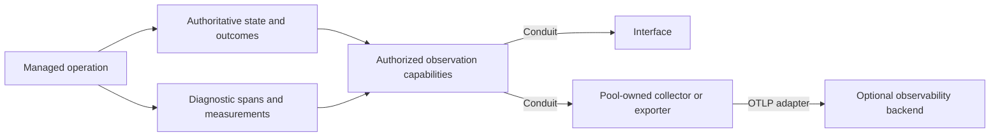

# Observability for Conduit's first distributed runtime

Research date: **2026-11-02**. Baseline: `f8a9973` on the implementation branch.
This report compares primary cloud/platform documentation and distributed tracing research.
The initial debugging package and capture policy were subsequently **accepted in
[I6](../archive/reviews/IMPLEMENTATION.md#i6--what-observability-captures-by-default)**:
correlated diagnostics, a small health set, optional OpenTelemetry export and explicit bounded
synthetic-fixture capture, independent of required authoritative evidence. Other backend, library,
wire and testing recommendations below remain proposals; I7 settles concrete contracts and syntax.
No backend was installed, no cloud account was connected, and no runtime benchmark was performed.

The recommendation is a **small local debugging package with detailed operation correlation,
structured diagnostics, a few health measurements, and optional OpenTelemetry export**. Preserve
Conduit's required authoritative outcomes independently. Use an existing backend when a trace
viewer is useful; do not build a general telemetry database or require a cloud platform first.

## 1. What cloud and distributed observability actually does

A distributed action crosses services, processes, queues and external systems. Each component
sees only its part. Useful observability makes those views navigable together, rather than merely
collecting many unrelated log lines. OpenTelemetry describes tracing as following a request across
services and correlating its spans with other signals. [Observability primer][otel-primer]

| Signal | Question it helps answer | Conduit example |
| --- | --- | --- |
| Structured event/log | What happened, with what context? | A setup step needs human interaction; a plugin exited; an access check refused a request. |
| Trace and spans | Which related operations ran, and where was time spent? | Interface request → management → executor → plugin → external capability. |
| Metric | How much, how often, how slow, how saturated? | Queue depth, failed attempts, operation durations, process memory. |
| Profile | Where did execution consume CPU or allocate memory? | A later investigation of an executor hot path, beyond knowing that CPU is high. |
| Authoritative operation record | What does the responsible service know about the effect and recovery? | A change was committed, remains pending, or has an uncertain external outcome. |

The last row is Conduit's existing state/recovery contract. It may be exposed as evidence, but
ordinary telemetry does not supply that guarantee. A successful span export proves neither that
a provider mutation happened nor that Conduit committed its result.

Google SRE recommends starting with latency, traffic, errors and saturation, and distinguishing
user-visible symptoms from internal causes. For Conduit, successful setup, usable connections and
retrievable outcomes are more meaningful health indicators than CPU alone. An authentication wait
should be visible without being misclassified as a slow database or a crashed worker.
[SRE monitoring chapter][sre-monitoring]

Dapper's 2010 research emphasizes low overhead and instrumentation in common libraries, allowing
broad coverage without bespoke application instrumentation everywhere. **Our inference:** instrument
Conduit's common dispatch, graph, persistence and connector boundaries first; then let plugin
contracts supply domain-specific observations. [Dapper][dapper]

## 2. Platform comparison

This compares architectural patterns and documented interfaces, not pricing, throughput or a
verified claim that every vendor feature works with every Rust/OTLP integration.

| Platform | Relevant documented pattern | What Conduit should borrow |
| --- | --- | --- |
| AWS CloudWatch + CloudTrail | CloudWatch accepts OpenTelemetry logs, metrics and traces; CloudTrail separately records account activity and distinguishes management/data events. | Correlate performance and activity, but give them explicit coverage and independent semantics. [CloudWatch][aws-otel], [CloudTrail][cloudtrail] |
| Google Cloud Observability | Logging, Monitoring, Trace and Error Reporting are connected services; audit logs distinguish administrative activity from data access. | Unified navigation across specialized signals, with capture configuration visible. [Overview][gcp-observability], [audit logs][gcp-audit] |
| Azure Monitor / Application Insights | A common analysis surface combines telemetry. Activity logs describe control-plane actions; Resource logs describe operations within services. | Distinguish management outcomes from workload diagnostics; their collection is not automatically identical. [Data platform][azure-platform], [activity log][azure-activity] |
| Grafana's ecosystem | The development LGTM image bundles Collector, Grafana, Loki, Mimir and Tempo. | An optional local trace/log/metric viewer can be supplied by an existing system. This particular image is documented for development/demo/testing. [LGTM][grafana-lgtm] |
| Datadog | OpenTelemetry deployment options differ by SDK and collection path; the compatibility matrix is feature-specific. | Keep backend support declarations explicit; accepting OTLP does not establish full feature parity. [Compatibility][datadog-compat] |
| Honeycomb | Rich events support investigation by attributes with many distinct values; its analysis workflow narrows anomalies through successive queries. | Make operation/instance/plugin IDs searchable in event views, with a direct path to a failing invocation. [Cardinality][honeycomb-cardinality], [analysis loop][honeycomb-analysis] |
| OpenTelemetry Collector | Receivers, processors and exporters compose signal pipelines; unsupported signal combinations are rejected. | This is a useful precedent for small, composable observation implementations with published contracts. It is not itself a storage/query platform. [Architecture][collector-architecture] |

Cloud defaults are selective. AWS trails distinguish management capture from optional data-event
capture; Google Cloud separates always-written administrative audit categories from data-access
configuration; Azure Resource logs require diagnostic settings. These distinctions do not map
one-to-one onto Conduit, but they undermine the assumption that robust observability requires
retaining every application payload. [CloudTrail][cloudtrail], [Google audit logs][gcp-audit],
[Azure Resource logs][azure-resource-logs]

These external platforms do not become Conduit's state authority. Their retention, ingestion
and query semantics remain backend properties, not substitutes for our lifecycle contracts.

## 3. Correlation is the most important early investment

### Identity and causality

Propose attaching enough context to answer: which experiment run, service/executor, instance,
execution generation, graph node, plugin implementation, logical operation, attempt and selected
Conduit path produced this observation? Include actual configuration revision where relevant.
These are candidate semantic fields, not finalized YAML keys or a requirement to populate every
field on every signal.

Keep three identities distinct:

- **Logical operation ID:** durable identity used to inspect/reconcile work across retries.
- **Attempt ID:** a particular dispatch or recovery attempt.
- **Trace/span context:** diagnostic relationships within and across those attempts.

One failed transport can leave a logical operation unresolved. A later inspection/reconciliation
can have another trace, linked to the same operation. Do not force an Agent's entire lifetime or
a multi-day human wait into one permanently open span. Retain the operation/wait state and connect
its later diagnostic segments.

W3C Trace Context supplies standard trace propagation. Reuse it where supported, keeping trace
context separate from grants and actor authentication. A supplied trace ID is not proof of caller
identity. For distributed display, retain per-source ordering/generation and observed freshness;
wall-clock sorting alone is not a causal order. [W3C Trace Context][w3c-trace]

### MCP needs message-level propagation

The pinned OpenTelemetry MCP convention describes injecting trace context into request `_meta`,
because an HTTP stream can carry several logical messages. MCP SEP-414 documents the propagation
convention but is now a finalized historical record; exact protocol support must be checked against
the selected MCP version and client. Do not invent a Conduit-specific propagation format before
checking this existing mechanism. Unsupported upstream instrumentation should leave a visible
boundary, not fabricated remote spans. [Pinned MCP conventions][genai-mcp], [SEP-414][mcp-tracing]

### Searchable detail is different from metric dimensions

Operation IDs belong in events/traces. They should not automatically become dimensions on every
counter or histogram: each distinct metric label combination produces another time series in
Prometheus-style systems. Keep aggregate metrics dimensioned by bounded categories such as
operation class, implementation, outcome or service, then drill into individual evidence.
[Prometheus instrumentation][prom-instrumentation], [metric naming][prom-naming]

Telemetry attributes/metric labels here are not a proposal to restore registry labels or label-driven
Pool membership. Likewise, an OpenTelemetry “Resource” describes a telemetry source; it is not
necessarily a Conduit Resource instance. One executor process may host several Conduit instances.

## 4. Initial package

The package should let us debug the existing synthetic experiment before adding a dashboard or
comprehensive infrastructure monitoring. I6 accepts this package boundary and capture policy,
without making the candidate observations below a closed vocabulary of states or metric kinds.

| Include initially | Useful observations | Debugging value |
| --- | --- | --- |
| Authoritative activity projection | Lifecycle and control outcomes, configuration revisions, access decisions, operation/attempt identities, incomplete or uncertain work, permitted recovery references. | Distinguish actual committed state from a request merely being accepted or a response being lost. |
| Correlated diagnostic spans | Common dispatch, graph steps, dependency preparation, plugin calls, provider boundaries, persistence and reconnect/reconciliation attempts. | Locate the failing stage and time spent without reading interleaved logs from three processes. |
| Structured errors and bounded helper diagnostics | Error category, cause chain when available, implementation identity, process exit/signal, node identity, permitted diagnostic output and capture status. | Make a small author's plugin diagnosable without custom core instrumentation. |
| Small service-health set | Request/attempt counts, durations, queue depth/age, active/waiting work, helper exits, reconnects, persistence failures and exporter backlog/drops. | Detect stalls, leaks in pending work, retry storms and broken observation paths. |
| Interface inspection | Instance state, operation timeline, dependency/path view, correlated logs, coverage and next supported actions. | Keep investigation and control together as already agreed. |
| Export boundary | A versioned observation adapter capable of forwarding appropriate signals in OTLP, with explicit export status. | Validate portability and optionally use an existing viewer. |

Prefer a few histograms/counters/gauges over a large catalog. Measure queue waiting separately from
active plugin execution and human interaction. Count logical operations separately from attempts;
a retried operation is not automatically two user successes. Metrics derived from sampled traces
must not be presented as complete traffic or usage totals.

**CPU and memory:** a small optional process collector is reasonable when available through a
portable implementation. Report the actual process/service measurement; do not distribute a shared
executor's CPU among hosted instances without evidence. Deep profiling, eBPF and OS-wide process
inspection can wait. RSS/CPU measurements alone will not explain a required dependency blocked on
access, so they should not delay operation correlation.

**Tokens:** the synthetic experiment needs no model calls. When native Agent adapters arrive,
consume the usage they can actually report, preserving account/model/execution and reported versus
estimated/unknown values. Keep parent/subagent overlap rules. Cost estimation and a promise of
complete native-runtime visibility remain separate work.

**Watch the observers:** track exporter errors, queue saturation, dropped/truncated observations and
freshness. A silent telemetry failure can otherwise look like an idle system. The Collector itself
exposes internal telemetry for this purpose. [Collector internal telemetry][collector-internal]

## 5. Capture, sampling and retention

My recommendation is more useful for development than either unstructured minimal logs or an
unbounded dump of everything:

| Data | Proposed first behavior |
| --- | --- |
| Required operation/state/recovery evidence | Never intentionally sample it. Persist under the accepted local commit contract; a failure to meet that contract must not be hidden as successful completion. |
| Managed operation traces in Experiment 002 | Record all instrumented operation traces at source initially, with bounded diagnostic buffering and explicit loss reporting. This is an intent, not a guarantee against crashes or unavailable external telemetry. |
| Synthetic fixture inputs/outputs | Enable bounded structured capture explicitly in the experiment's observation configuration. Use fake credential references and known fixture data; make partial/truncated capture visible. |
| Real prompts, tool arguments/results, documents and helper output | Use a declared capture policy. Keep sensitive/bulky content in appropriately scoped content storage with references where useful; do not copy it into every span. |
| Credentials | Never include raw values in ordinary traces/logs, even in a debug mode. |
| Repeated metrics/debug events | Bound volume and report sampling/drop behavior; keep this separate from authoritative outcomes. |

Message/history Resources retain their own content and lifecycle contracts. Choosing a smaller
telemetry payload does not disable that history or make an exporter its canonical memory store.

OpenTelemetry's sampling guidance explicitly allows avoiding sampling at low volume. Head sampling
cannot know that a later step will fail; tail sampling can consider later evidence but adds buffering
and operational complexity. For our small controlled proof, start without probabilistic trace
sampling and evaluate overhead before introducing a tail-sampling service. This does not mandate
recording every internal function or every model token. [Sampling][otel-sampling]

The current GenAI conventions recommend content capture as an explicit choice, and describe both
inline capture and externally stored content references. This supports a detailed synthetic debug
configuration alongside a smaller general default. It does not prevent the user from deliberately
enabling fuller real-workload capture under its declared access/recording policy.
[Pinned GenAI content guidance][genai-spans]

Capture limits and retention are different. Existing Conduit retention-until-explicit-purge remains
unchanged for retained records. This proposal does not introduce automatic expiry, silently delete
old evidence to satisfy a quota, or promise infinite disk capacity. At a storage limit, distinguish
optional capture loss from a failure to durably commit required operation state.

## 6. How it fits the object and plugin model

The drawing distinguishes evidence ownership from diagnostic delivery; it does not require all
components to be separate processes. Basic Interface inspection works without the optional branch.

- A plugin publishes observation contracts and implementations alongside its existing exports.
- An instance owns its selected producer behavior. A separately deployed collector/exporter is a
  Resource owned by a Pool. We do not register another Resource for every span or metric sample.
- Conduits authorize the path and apply declared restrictions. Observation permission is not
  permission to control the target or expose hidden account/Resource details.
- The Interface presents current state and evidence, including the producer's supported metrics,
  rather than assuming every instance supports a global CPU/token schema.
- Additional observers use existing capabilities and new attachments where possible. Replacing
  fixed instrumentation or plugin code still follows the accepted instance-replacement rules.

**Proposed implementation boundary:** use MCP for Conduit discovery/inspection/control contracts,
with ordinary telemetry adapters speaking OTLP to existing backends. Do not turn every metric sample
into a model-facing tool invocation. Exact carriers and bulk-delivery schemas remain I7 work; this
is compatible with keeping provider-native integrations behind Conduit's authorization paths.

Collector processors are a useful implementation building block, but sampling/redaction processors
are not automatically security enforcement. Required access guarantees must hold before protected
content crosses its authorized boundary. No backend credential or trace metadata creates a grant.

## 7. Rust and backend selection

Use Rust `tracing` for internal structured events/spans and selected OpenTelemetry bridges/exporters
for interoperability. Its documentation specifically explains why thread-interleaved async logs
need causal context; it also warns against holding a span-entry guard across `await`. This is a
concrete instrumentation pitfall to test when implementation starts. [Rust tracing][rust-tracing]

Do not assume one bridge exports every signal. The inspected `tracing-opentelemetry` documentation
routes spans to OpenTelemetry and directs log export to a separate appender. Pin a compatible
crate set when implementing and verify its actual signal support. The OTel status page currently
reports Rust traces as Beta and metrics/logs as Stable; individual bridge documentation has its
own caveats. None of those badges demonstrates Conduit's recovery or delivery guarantees.
[Bridge][rust-otel], [SDK status][otel-status]

The GenAI/MCP conventions moved to a dedicated repository and remain marked Development in the
inspected source. This report pins them at `16f3130892e2e02fa3f0eef72c0e6b554ff08e5c`. Keep their mapping
inside a versioned adapter; do not freeze Conduit's durable operation schema to unversioned upstream
field names. [GenAI repository][genai-root]

**Backend recommendation:** require local Interface inspection first. Offer the Grafana LGTM
container as an optional development viewer once export works; it provides correlated signal tools
without us implementing them. Keep a direct debug export available for simple failure inspection.
A hosted Datadog/Honeycomb/cloud destination is a later selectable implementation, not a required
account or deployment. We have not benchmarked these options or selected a production backend.
[Development LGTM][grafana-lgtm]

The Collector's persistent exporter queue can improve restart behavior, but documented loss cases
include full queues, exhausted retries and storage failure. Also, a blocking processor can affect
other pipelines sharing a receiver. Bound optional delivery separately from authoritative commits,
and test the chosen pipeline rather than assuming process separation guarantees independence.
[Resiliency][collector-resilience], [pipeline architecture][collector-architecture]

## 8. Concrete debugging walkthrough and experiment checks

Suppose the Interface asks a Resource to apply its supported query-limit control:

1. The request has operation `O`; authorization and path selection are attributable.
2. Executor E begins attempt `A`, invokes the selected plugin and retains the result/configuration
   revision according to the control contract.
3. The reply is lost. The Interface displays an unresolved response; it does not declare failure
   of the effect or infer a different current value from the missing span.
4. A later inspect/reconcile operation reaches E and finds the committed outcome. Its diagnostic
   segment links to `O`, and the Interface can show the completed change without repeating it.
5. If E had crashed after the provider acted but before recording the outcome, inspection instead
   shows uncertainty and the plugin's supported reconciliation route. Telemetry cannot manufacture
   the missing evidence.

The useful display is the operation timeline, graph/path, exact implementation, confirmed revision,
uncertainty and recovery action. A CPU chart or a wall of raw request text cannot replace that view.

For the already planned experiment failures, evaluate these proposed observability expectations:

| Existing scenario | Evidence the initial package should let us inspect |
| --- | --- |
| Plugin failure after partial setup | Failed node and attempt; retained successful work; managed runtime state; bounded diagnostic output. |
| Management outage | Executor supervision and retained outcomes; new requests waiting when current permissions cannot be established. |
| Lost mutation response | Logical operation versus transport attempt; committed or uncertain outcome; no blind repeat. |
| Two consumers share a service | Distinct caller/path identities, shared provider identity, separate outcomes without mixed grants. |
| Observer/exporter disconnect | Local outcomes still inspectable; backlog/drop/freshness status; supported catch-up or an explicit gap. |
| Frontend reconnect | Same retained evidence and current source freshness, not a new independent authority. |

These refine debugging expectations for existing scenarios. Adding metric providers, load tests,
new fault cases or extra backends requires its own implementation plan; nothing ran in this research.

## 9. What this changes in the review

The accepted extension model already fits these findings. No new object family, centralized runtime,
mandatory dashboard, automatic telemetry retention expiry or universal metric enum is needed.

I6 now accepts the package choice: **required durable evidence, detailed correlated operation
diagnostics, a small health set, and explicit content-capture settings—with bounded synthetic capture
enabled for the experiment**. Actual metric names, field placement, limits, export schemas and
plugin aliases should be exercised together in I7 rather than becoming another long conceptual
questionnaire. This acceptance does not select a backend or every implementation recommendation
in this research report.

This also complements the existing [Pi telemetry findings](PI_CONNECTORS.md#observation-and-durable-execution)
and [Rust runtime research](RUST_RUNTIME.md); their pinned observations are historical evidence,
not newly executed compatibility tests. The independent evidence/diagnostics boundary remains.

[otel-primer]: https://opentelemetry.io/docs/concepts/observability-primer/
[sre-monitoring]: https://sre.google/sre-book/monitoring-distributed-systems/
[dapper]: https://research.google/pubs/dapper-a-large-scale-distributed-systems-tracing-infrastructure/
[aws-otel]: https://docs.aws.amazon.com/AmazonCloudWatch/latest/monitoring/CloudWatch-OpenTelemetry-Sections.html
[cloudtrail]: https://docs.aws.amazon.com/awscloudtrail/latest/userguide/cloudtrail-events.html
[gcp-observability]: https://docs.cloud.google.com/stackdriver/docs/observability
[gcp-audit]: https://docs.cloud.google.com/logging/docs/audit
[azure-platform]: https://learn.microsoft.com/en-us/azure/azure-monitor/fundamentals/data-platform
[azure-activity]: https://learn.microsoft.com/en-us/azure/azure-monitor/fundamentals/activity-log
[azure-resource-logs]: https://learn.microsoft.com/en-us/azure/azure-monitor/platform/resource-logs
[grafana-lgtm]: https://grafana.com/docs/opentelemetry/docker-lgtm/
[datadog-compat]: https://docs.datadoghq.com/opentelemetry/compatibility/
[honeycomb-cardinality]: https://docs.honeycomb.io/get-started/observability/concepts/high-cardinality
[honeycomb-analysis]: https://docs.honeycomb.io/get-started/honeycomb/core-analysis-loop
[collector-architecture]: https://opentelemetry.io/docs/collector/architecture/
[collector-resilience]: https://opentelemetry.io/docs/collector/resiliency/
[collector-internal]: https://opentelemetry.io/docs/collector/internal-telemetry/
[w3c-trace]: https://www.w3.org/TR/trace-context/
[mcp-tracing]: https://modelcontextprotocol.io/seps/414-request-meta
[prom-instrumentation]: https://prometheus.io/docs/practices/instrumentation/
[prom-naming]: https://prometheus.io/docs/practices/naming/
[otel-sampling]: https://opentelemetry.io/docs/concepts/sampling/
[rust-tracing]: https://docs.rs/tracing/0.1.44/tracing/
[rust-otel]: https://docs.rs/tracing-opentelemetry/0.34.0/tracing_opentelemetry/
[otel-status]: https://opentelemetry.io/status/
[genai-root]: https://github.com/open-telemetry/semantic-conventions-genai/blob/16f3130892e2e02fa3f0eef72c0e6b554ff08e5c/docs/gen-ai/README.md
[genai-mcp]: https://github.com/open-telemetry/semantic-conventions-genai/blob/16f3130892e2e02fa3f0eef72c0e6b554ff08e5c/docs/gen-ai/mcp.md
[genai-spans]: https://github.com/open-telemetry/semantic-conventions-genai/blob/16f3130892e2e02fa3f0eef72c0e6b554ff08e5c/docs/gen-ai/gen-ai-spans.md
