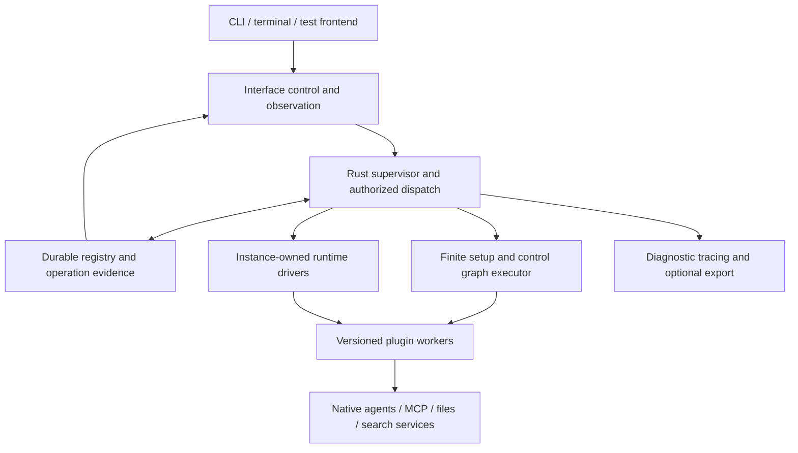

# Rust runtime and plugin architecture

Research date: 2026-11-01. This report proposes implementation choices for the accepted
[specification](../SPEC.md), using Xerj and Pi as source references. It does not select new
dependencies or change the five-family model. The proposed
[runtime experiment](../../experiments/002-runtime-plugins/README.md) separates hypotheses from
validation. No runtime implementation or live provider tests were performed for this report.

The subsequent [implementation proposal](../proposals/implementation-v0/README.md) specifies
processes, storage, contracts, crate boundaries and milestones in detail, with a grouped pending
review. It builds on this report without treating recommendations as accepted choices.

**Deployment follow-up:** [DISTRIBUTED_RUNTIME](DISTRIBUTED_RUNTIME.md) revisits the process,
authority and lifetime arrangement after the user explicitly kept I1 open. The supervisor/store
mechanisms below do not imply one host must own all execution. Pool Resources can eventually
occupy different systems and Conduits can cross a network; exact topology remains under review.

**Accepted extension follow-up:** the design now permits published contracts backed by authored
code, existing MCP services or both, plus independently accessible component capabilities. The
worker recommendations below apply where Conduit supplies executable code, not to every plugin.
See [current contracts](../DESIGN.md#plugins-and-independently-accessible-mcp-components) and the
[revised experiment](../../experiments/002-runtime-plugins/README.md). Source findings remain
research evidence; this update reports no new runtime tests or provider validation.

## Recommendation

Start with a Conduit-owned Rust supervisor built on Tokio, a small durable local control store,
and versioned plugin workers. Use Rust traits internally and MCP for compatible external
capabilities. Keep a Wasm extension lane possible without making it the foundation of v0.

The important division is between responsibilities, not programming languages:

| Layer | Conduit owns | Implementation can supply |
| --- | --- | --- |
| Protocol | Object identity, ownership, configuration, capabilities and connection semantics | Versioned type/capability schemas |
| Supervisor | Instance lifecycle, execution ownership, scheduling, evidence and current authority checks | Managed runtime drivers and environment adapters |
| Setup/control graph | Finite dependencies, typed bindings, valid-progress recovery | Finite operations and supported control handlers |
| Capability access | Selected Conduit path, filters, caller attribution and delegation | Native MCP clients, filesystem operations, provider calls and search |
| Interface | A shared control/inspection surface backed by retained evidence | CLI, terminal, test clients and observability exporters |

This keeps the agreed design intact: instances own ongoing activity; graphs establish or change
them through declared operations; Resources remain Pool-owned; Conduits carry access rather than
becoming a second workflow engine. A Rust runtime does not require every extension or frontend
to be written in Rust.

## Evidence boundaries

| Source | Snapshot and inspection |
| --- | --- |
| Xerj | `63b6aef5e66e14df12a18929caf704e550e2c4f5`; workspace manifests, transform traits/pipeline, MCP initialization/proxy and shutdown code. |
| Pi baseline | `0441483926f283e42ca44eb7b4a46552e9469d6f`; retained by the earlier [connector](PI_CONNECTORS.md) and [runtime](PI_RUNTIME.md) reports. |
| Pi follow-up | `2c8d1feb147f6b3d97e855da803bfe7b19f3c403`; fetched main without changing the baseline checkout. Selected source comparison, not a complete re-audit. |
| Rust ecosystem | Primary documentation retrieved on the research date; release pages can change. No compatibility or performance claims from executing these libraries. |

The selected Pi provider registry, Durable writer/tool implementation, Rust environment daemon,
MCP source and telemetry interface are unchanged between those two pins. Scheduler, generation
hooks and Chord host code have changes; the newer Chord citation below is explicitly a newer
snapshot. Existing research links remain pinned rather than being silently relabeled current.

## What Xerj actually contributes

### A useful backend, not Conduit's execution model

Xerj separates its API, coordinating engine, storage, full-text search, vector search and other
responsibilities into Rust crates. Its workspace uses Tokio as well as Rayon. This is useful
evidence for separating asynchronous service coordination from compute-heavy indexing, not a
reason to embed its entire engine in Conduit. [Architecture][xerj-architecture] ·
[Workspace manifest][xerj-cargo]

**Recommendation:** expose Xerj through a backend plugin. A Pool can own storage, search and
MCP-access Resources with distinct contracts while their implementation shares one Xerj
deployment. Unitary Resources do not require a process or database per Resource. Search results
still need Conduit's permitted coverage, bounded excerpts and provenance behavior. Xerj's index
should not become the authority for Conduit registry revisions or uncertain operation outcomes.

### Three meanings of “plugin” must not be confused

At this pin, `xerj-wasm` implements native Rust transformation traits and a pipeline. Its manifest
does not include a Wasm engine; its source describes a future Wasmtime backend. This is **not
evidence of an implemented Wasm plugin host**, despite the crate name and broader architecture
description. [Manifest][xerj-wasm-manifest] · [Trait implementation][xerj-transform]

The pipeline executes ordered transformation stages synchronously. Its timeout configuration is
not enforced by that processing loop. It is a useful small-operation interface, not a resumable
setup DAG, process supervisor or proof of preemptible plugins. [Pipeline source][xerj-pipeline]

Separately, Xerj's Claude plugin packages an MCP registration that runs `xerj mcp`, which proxies
to an already-running engine. That agent integration package is different from the internal
transformation interface and from the future Conduit implementation-plugin contract.
[Agent plugin README][xerj-agent-plugin] · [MCP proxy source][xerj-mcp]

**Absorb:** small responsibility boundaries, typed errors distinguishing invalid configuration
from unsupported execution, and an integration adapter around an independent service.
**Do not infer:** sandboxing, binary extension loading, durable graph execution, or arbitrary
third-party plugin support from the word “plugin.”

### Lifecycle and compatibility lessons

Xerj's shutdown code explicitly separates draining work from releasing service resources. A
client-visible connection failure is not sufficient evidence that cleanup finished. Conduit
likewise needs confirmed process/end states before deletion or backing-resource cleanup.
[Shutdown implementation][xerj-shutdown]

The inspected MCP initialization defaults to `2025-06-18` when no version is supplied and echoes
the supplied version otherwise. Echoing a modern version is not a conformance test for that
version's features. Its proxy also supports ambient URL/authentication discovery; Conduit should
bind an explicit service identity instead of inheriting whichever account a working directory
or environment happens to discover. These are integration checks, not reasons to reject Xerj.
[Initialization and configuration][xerj-mcp]

## What to absorb from Pi

| Source boundary | Useful mechanism | Conduit translation |
| --- | --- | --- |
| `pi-ai` | Provider implementations and model catalog are separate concerns. | Separate provider-wire adapters, account access and model selection; a model name is not authentication. |
| Durable | Persistent intent and conservative replay decisions. | Journal effects before dispatch; recover known progress without blindly repeating a write. |
| `pi-env` | Rust process/filesystem service with explicit framing and cancellation. | A versioned host/worker boundary can serve multiple frontend/agent ecosystems. |
| `pi-mcp` | MCP integration is separable from provider generation. | Preserve native tools through a dedicated client/broker boundary. |
| `pi-telemetry` | Adapter-neutral spans, links and propagation data. | Correlate work across workers and Interfaces without requiring one exporter. |
| Chord | Managed native lifetimes, references and principal-specific remote views. | Separate logical participation from sockets, and actor identity from shared service identity. |

Sources: [provider registry][pi-providers], [Durable tool execution][pi-tool],
[environment manifest][pi-env-cargo], [framing][pi-frame], [telemetry contracts][pi-telemetry],
[newer Chord host examples][pi-chord]. The existing [connector report](PI_CONNECTORS.md) contains
the broader MCP/provider inventory; do not treat this table as a fresh test of all connectors.

Durable records the final tool arguments and replay policy before execution. Recovery reruns an
interrupted call only when both its saved and currently resolved policies allow safe replay.
Otherwise it reports interruption and possible partial execution. Its writer also separates
commit ordering from publication. These are more valuable to Conduit than copying Pi's complete
conversation scheduler. [Tool recovery][pi-tool] · [Writer][pi-writer]

The Rust environment daemon uses threads and standard process APIs rather than Tokio. Rust
helpers need not share one executor. Its process cleanup is tied to its connection model;
Conduit must preserve our different rule that frontend detachment does not itself stop an Agent.
[Environment implementation][pi-exec]

We should reproduce these boundaries and failure cases in Rust, not depend on Pi's runtime.
Provider adapters can be added incrementally behind one contract; Conduit need not port every
Pi provider before proving a synthetic runtime and the native-agent integration path. A protocol
shape compatible with one provider does not establish another provider's authentication,
streaming, tool-call, context or usage semantics.

## Rust runtime choices

An async executor schedules live work. An actor library organizes that work. A durable engine
records how work survives interruption. These solve different problems.

| Candidate | Fit and tradeoff | Proposed treatment |
| --- | --- | --- |
| Tokio + explicit instance supervisors | Async I/O, task ownership and broad integration support; Conduit must implement durable outcomes and lifecycle policy. | Preferred base. Keep the host small and queues bounded. |
| Ractor | Actor messaging and supervision can organize per-instance state; these do not by themselves provide durable effects or permission-aware recovery. | Optional implementation aid after a spike, not protocol vocabulary. |
| smol | A smaller async-executor ecosystem; selection would need integration testing with MCP/HTTP libraries used here. | Viable alternative, no demonstrated benefit for this first stack. |
| Glommio | Linux/io_uring and thread-per-core emphasis. | Poor fit for a first experiment on this macOS workstation; reassess only for a specialized backend. |
| Restate | Durable service/object/workflow handlers with journaling and a separate runtime boundary. | Study recovery semantics; do not add a mandatory workflow service to the first local host. |
| Temporal Rust/Core | Workflow infrastructure with a Rust SDK/Core and service/client boundary. | A future integration option if distributed orchestration becomes necessary. |

Primary references: [Tokio shutdown][tokio-shutdown], [Ractor][ractor], [smol][smol],
[Glommio][glommio], [Restate Rust SDK][restate], [Temporal SDK repository][temporal]. The ranking
is an architectural recommendation, not a benchmark or a claim that alternatives cannot work.

Tokio cancellation is cooperative. In particular, a started `spawn_blocking` task cannot be
aborted like an ordinary pending async task. Use bounded CPU work and a killable process for
code that needs a stronger termination boundary. Dropping a future or timing out a request does
not prove an external operation stopped. [Blocking-task contract][tokio-blocking]

Supervision policy must remain operation-specific: reconnecting a transport may be automatic;
replaying an uncertain deployment or starting a replacement Agent turn may not. An actor
framework's restart convenience must not change those accepted behaviors.

## Plugin execution choices

| Boundary | Strength | Limitation | Fit |
| --- | --- | --- | --- |
| Statically linked Rust traits | Simple typed calls; suitable for trusted core mechanisms. | Shares failure/privilege domain; host upgrades can replace code unless exact implementations remain available. | Internal boundary. |
| Native dynamic library | Can retain native performance and load separately. | Raw Rust ABI is not stable; safe ownership/versioning needs an explicit FFI design. A crash remains in the host. | Defer. |
| Versioned executable worker | Any implementation language; separate crashes, process control and artifact retention. | IPC, launch/packaging cost and explicit child-process handling. It is not an OS sandbox by itself. | Preferred public extension path to test. |
| Existing MCP service/process | Familiar discovery, schemas, calls and authentication patterns. | Ordinary MCP servers do not necessarily implement Conduit setup/recovery or instance-driver contracts. | Reuse directly for capabilities; add adapters only for missing lifecycle semantics. |
| Wasmtime Component Model | Typed WIT imports/exports and explicit host capabilities. | Host calls, process/PTY access and provider libraries need deliberate adaptation; durability is still Conduit's job. | Optional constrained plugin lane. |
| Extism | A packaged Wasm plugin SDK, host functions and value conversion. | Its API is a different contract from adopting WIT components directly; Conduit lifecycle still needs definition. | Compare with Wasmtime on one small extension before selecting either. |

The [Rust reference][rust-abi] makes no stability guarantee for the Rust ABI. A C ABI or
[abi_stable][abi-stable] can support a designed native boundary, but neither removes the need to
handle ownership and host-process failure. This is why a raw `libloading`-style trait interface
should not become our initial public plugin protocol.

[WIT][wit] describes typed interfaces and worlds, including resource handles. A WIT “resource”
is an interface/lifetime construct, not a sixth Conduit family or a replacement for Pool ownership.
[Wasmtime][wasmtime] offers embedding and execution controls; its fuel/epoch mechanisms do not
interrupt a blocking host call. Host I/O needs its own cancellation and deadlines.
[Interruption limits][wasmtime-config]

[Extism's Rust SDK][extism] provides plugin loading, host functions, cancellation handles and
typed wrappers. It is worth a small comparison for filters or transformations, but there is no
source evidence here that it can replace the instance supervisor. Neither Wasm option isolates
a native Claude/Codex subprocess merely because its launcher is a Wasm plugin.

## Proposed plugin contract

Use one versioned contract surface with optional exports rather than one mandatory giant trait.
A small filesystem operation need not implement a model provider or long-running service.

| Export or declaration | What it means |
| --- | --- |
| Identity and schemas | Exact implementation identity; supported type, capability and operation contracts; typed inputs/outputs. |
| Finite operation | Execute a setup step or control handler; return declared results or a recoverable interaction/progress reference. |
| Managed runtime driver | Start, inspect, reconnect and stop declared ongoing behavior under an instance owner. |
| Capability handlers | Serve operations such as native MCP discovery/calls, search, storage or filesystem access. |
| Filter implementation | Validate and enforce the typed restrictions it supports; unsupported restrictions cannot be discarded. |
| Recovery support | State whether/how an interrupted effect can be inspected, safely retried or left uncertain. |

These are candidate implementation roles, not finalized method names or a closed result enum.
Domain results remain extensible, as agreed. Package schema versions, plugin protocol versions,
exact code artifacts and remote provider versions are distinct.

The host supplies the owner, caller, selected path and invocation identity from trusted dispatch
state. An Agent-supplied JSON argument claiming another principal is not authority. Plugins
receive scoped access handles instead of a general registry/database connection. Ordinary
service consumers do not receive the shared account's raw token.

### MCP first, without pretending it supplies durability

The official Rust `rmcp` SDK supplies client/server and stdio/HTTP transports. Its current README
claims support for the design's `2026-07-28` MCP revision and describes negotiation of newer
features. Validate that claim against the exact release selected for the spike and each peer;
the SDK's feature list is not a test result for Pi, Xerj or native agents.
[Rust SDK][rmcp] · [Protocol support documentation][rmcp-readme]

Expose native provider operations with their schemas and names where supported. Conduit's
mediation associates a call with its permitted Resource, caller and Conduit path before dispatch.
A provider-named endpoint can front shared Pool access; mediation need not turn every tool into
a generic `conduit.invoke` call.

For plugin workers, test whether ordinary tools/resources plus negotiated progress, interaction
and task facilities can carry the needed contract. Add a documented Conduit lifecycle profile
only where necessary. Keep operation identity and retained outcomes independent of a particular
MCP request ID or transport session. A reconnect must not imply replaying an effect.

### Exact code retention needs a deployment design

Our accepted rule pins the plugin implementation used by an instance. Compiling every plugin
into the newest host binary and then restarting old instances would violate that rule if their
previous implementation disappeared.

**Proposed solution:** resolve a versioned worker artifact, retain it while bound instances need
it, and store its exact identity with those instances. A first-party worker can initially be
another mode of the distributed Conduit executable; it need not be a separately developed
project. Keep its versioned executable available when the supervisor is upgraded. A digest
verifies bytes, not publisher trust; acquisition/trust policy remains separate.

If required code is unavailable, report that condition rather than substituting a newer
implementation. Replacement instances can use the new release and explicitly reuse backing
data. Internal in-process implementations remain possible if the host can actually supply the
bound version. This is a consequence of existing pinning, not a new package-manager requirement.

## Runtime structure and concrete paths

These are implementation modules, not new registered object families. The management surface
still belongs to the system Pool's Resource and the default Interface connects through its
management Conduit. One process may host several logical instances; one logical instance may
own several managed tasks/processes.

**Local directory:** a Pool provisions or attaches a directory Resource using a finite plugin
operation. Agent preparation projects the permitted directory into its environment. Removing
that projection does not delete the Resource or backing directory. A native symlink alone does
not enforce write restrictions; the selected execution environment determines enforceability.

**Shared Linear:** a Pool owns an authentication Resource and MCP-access Resource. Setup obtains
an authentication binding and requests the instance-managed client. Different Agents use
different authorized Conduit attachments to that client. Record caller and service identity
separately. Client reuse must respect provider session semantics; shared authentication does not
require sharing one transport connection. Refresh and reconnect remain runtime work.

**Xerj search:** provision or attach the backend explicitly, then establish storage/search/MCP
capabilities as selected. Index construction is a recorded effect; search is ongoing capability
use. Retrieval omissions and backend failure remain visible. Conduit authority is enforced before
query execution or exposure, rather than assuming every caller may query the entire index.

**Database setup:** the graph requests instance-owned service startup, waits for supported
readiness and invokes migration. Migration failure leaves the instance managed and setup
incomplete. Explicit retry inspects saved progress and external state; it does not create a new
database because the plugin lost a reply.

## Persistence, recovery and observation

SQLite is a reasonable first candidate for authoritative local registry/configuration revisions,
operation records and consumption positions. WAL mode permits concurrent readers and a writer,
but still has one writer at a time; keep transactions short and external calls outside them.
Choose and test synchronization/checkpoint settings against the promised durability rather than
assuming any SQLite connection configuration is sufficient. [SQLite WAL][sqlite]

Use a small recorded sequence around effects:

1. Check current authority and applicable revision, then persist the accepted invocation and
   resolved implementation/path before external dispatch.
2. Execute without holding the registry write transaction. Record waits/progress as appropriate.
3. Commit confirmed effects and configuration changes together where the local store permits.
   Publish committed evidence to observers afterward.
4. After interruption, distinguish a known result from unknown execution. Reconcile through
   the contract; retry only when safe. Recheck current authority before any new effect.

This does not make a remote write and local commit atomic. An external success followed by a
lost response must remain uncertain unless provider idempotency or inspection establishes it.
Use attempt/generation identity to prevent a delayed worker result from overwriting newer
confirmed state. Saved handles describe prior work; deserialize-and-trust is not a recovery
strategy for process IDs, credentials or live connections.

For observability, Rust [tracing][tracing] supplies structured spans/events and subscriber hooks.
Pi's [telemetry contract][pi-telemetry] illustrates separating propagation from exporters. Keep
these diagnostics correlated with, but distinct from, committed operation evidence. Trace
sampling or a disconnected exporter must not decide whether the Interface can recover an
operation's outcome. Slow observation clients need bounded delivery and catch-up, not an
unbounded queue in an Agent's execution path.

## Next implementation experiment

The [second experiment](../../experiments/002-runtime-plugins/README.md) proposes a local fake
service, one Rust worker and a minimal supervisor to test artifact pinning, cancellation,
effect uncertainty, graph recovery and Interface catch-up before involving credentials.

It should answer three engineering questions with evidence:

- Can MCP carry the worker's typed invocation/inspection needs cleanly, with a small lifecycle
  profile rather than a second general RPC framework?
- Can the host retain exact implementations and recover instance-owned work without introducing
  automatic Agent execution or replaying uncertain effects?
- Does process overhead justify any additional in-process or Wasm path for the selected v0 work?

No evidence currently requires changing the accepted five families, graph/runtime split, shared
authentication model or replacement policy. Runtime selection, worker packaging and persistence
remain recommendations until this experiment establishes their behavior and cost.

## Validation record

Performed: read-only source inspection, exact-commit comparisons, primary-document research and
documentation/link checks. Reference repositories remain outside the Conduit repository. The
Pi baseline checkout was preserved. No source builds, benchmark runs, dependency installation,
Xerj server startup, real authentication or provider calls were performed. Existing Pi test
results remain historical evidence in their original report.

The report verifies implementation mechanisms, not whole-project correctness. In particular,
MCP version negotiation, process supervision, credential sharing and all recovery claims need
the synthetic and later live acceptance tests. Library versions shown by current documentation
are observations, not a Cargo dependency selection.

[xerj-architecture]: https://github.com/xerj-org/xerj/blob/63b6aef5e66e14df12a18929caf704e550e2c4f5/docs/ARCHITECTURE.md
[xerj-cargo]: https://github.com/xerj-org/xerj/blob/63b6aef5e66e14df12a18929caf704e550e2c4f5/engine/Cargo.toml
[xerj-wasm-manifest]: https://github.com/xerj-org/xerj/blob/63b6aef5e66e14df12a18929caf704e550e2c4f5/engine/crates/xerj-wasm/Cargo.toml
[xerj-transform]: https://github.com/xerj-org/xerj/blob/63b6aef5e66e14df12a18929caf704e550e2c4f5/engine/crates/xerj-wasm/src/lib.rs
[xerj-pipeline]: https://github.com/xerj-org/xerj/blob/63b6aef5e66e14df12a18929caf704e550e2c4f5/engine/crates/xerj-wasm/src/pipeline.rs
[xerj-agent-plugin]: https://github.com/xerj-org/xerj/blob/63b6aef5e66e14df12a18929caf704e550e2c4f5/plugins/xerj/README.md
[xerj-mcp]: https://github.com/xerj-org/xerj/blob/63b6aef5e66e14df12a18929caf704e550e2c4f5/engine/crates/xerj-mcp/src/lib.rs
[xerj-shutdown]: https://github.com/xerj-org/xerj/blob/63b6aef5e66e14df12a18929caf704e550e2c4f5/engine/crates/xerj-server/src/main.rs
[pi-providers]: https://github.com/earendil-works/pi/blob/2c8d1feb147f6b3d97e855da803bfe7b19f3c403/packages/ai/src/providers/all.ts
[pi-tool]: https://github.com/earendil-works/pi/blob/2c8d1feb147f6b3d97e855da803bfe7b19f3c403/packages/durable/src/harness/tool.ts
[pi-writer]: https://github.com/earendil-works/pi/blob/2c8d1feb147f6b3d97e855da803bfe7b19f3c403/packages/durable/src/session/writer.ts
[pi-env-cargo]: https://github.com/earendil-works/pi/blob/2c8d1feb147f6b3d97e855da803bfe7b19f3c403/packages/env/daemon/Cargo.toml
[pi-frame]: https://github.com/earendil-works/pi/blob/2c8d1feb147f6b3d97e855da803bfe7b19f3c403/packages/env/daemon/src/frame.rs
[pi-exec]: https://github.com/earendil-works/pi/blob/2c8d1feb147f6b3d97e855da803bfe7b19f3c403/packages/env/daemon/src/exec.rs
[pi-telemetry]: https://github.com/earendil-works/pi/blob/2c8d1feb147f6b3d97e855da803bfe7b19f3c403/packages/telemetry/src/index.ts
[pi-chord]: https://github.com/earendil-works/pi/blob/2c8d1feb147f6b3d97e855da803bfe7b19f3c403/packages/chord/src/next/host/README.md
[tokio-shutdown]: https://tokio.rs/tokio/topics/shutdown
[tokio-blocking]: https://docs.rs/tokio/latest/tokio/task/fn.spawn_blocking.html
[ractor]: https://docs.rs/ractor/latest/ractor/
[smol]: https://docs.rs/smol/latest/smol/fn.spawn.html
[glommio]: https://github.com/DataDog/glommio
[restate]: https://docs.rs/restate-sdk/latest/restate_sdk/
[temporal]: https://github.com/temporalio/sdk-rust
[rust-abi]: https://doc.rust-lang.org/reference/items/external-blocks.html#abi
[abi-stable]: https://docs.rs/abi_stable/latest/abi_stable/
[wit]: https://component-model.bytecodealliance.org/design/wit.html
[wasmtime]: https://docs.wasmtime.dev/api/wasmtime/
[wasmtime-config]: https://docs.wasmtime.dev/api/wasmtime/struct.Config.html
[extism]: https://docs.rs/extism/latest/extism/
[rmcp]: https://docs.rs/rmcp/latest/rmcp/
[rmcp-readme]: https://github.com/modelcontextprotocol/rust-sdk
[sqlite]: https://sqlite.org/wal.html
[tracing]: https://docs.rs/tracing/latest/tracing/
