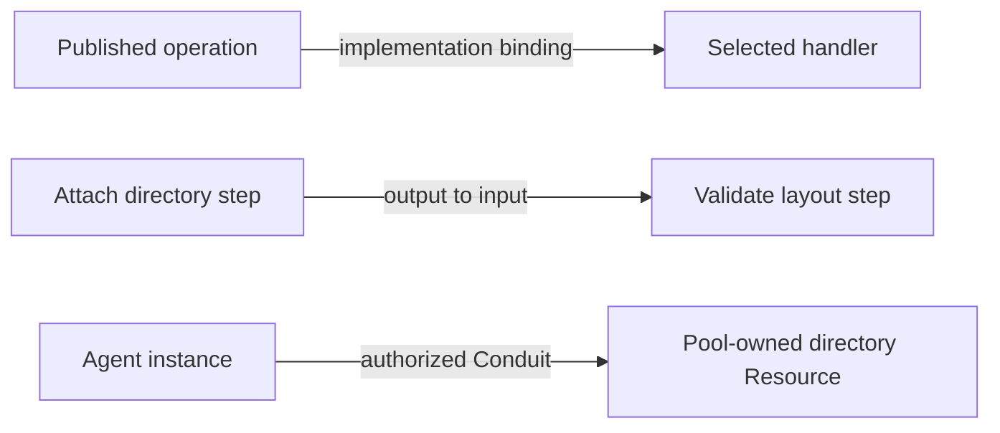

# Worked comparisons for the authoring review

> Not binding. This research predates the specification in [`spec/`](../../../spec/README.md); where it says accepted, current, SPEC.md or DESIGN.md, it means the documents as they stood before 2026-11-05.

Research examples, 2026-11-02. These apply the accepted model without selecting Conduit field
names. Arrows and tables below are explanatory notation. The two native-language fragments are
original illustrations of source-system mechanisms, not runnable Conduit configuration or tested
implementations. Read the [synthesis](README.md) for findings and [sources](SOURCES.md) for evidence.

## Three kinds of connection

Consider a directory Resource, a validation plugin and an Agent receiving directory access:



All three are connections in ordinary language, but their semantics differ:

| Relationship | Question it answers | What it cannot imply |
| --- | --- | --- |
| Contract/implementation binding | Which retained contribution implements this operation? | Installation or code selection does not grant access to a folder/account. |
| Graph value/dependency binding | Which produced value/prerequisite must be available before this step? | Knowing a Resource ID does not authorize use of that Resource. |
| Live Conduit participation | Which actor may use which endpoint capabilities, under which restrictions? | Opening access does not replace the instance's fixed graph or control definitions. |

**Research inference:** use distinct typed binding positions even if all three eventually use
similar-looking references. This follows from WIT's import/export boundary, CWL's data links and
Conduit's own grant rules. It does not require three new standalone configuration documents.

## Case 1: one Resource, several contributions

An Euphony Pool provisions a local-directory Resource. Its template selects attachment of
`/work/euphony`, adds a layout check, and offers directory access. Later an Agent's Conduit
prepares that directory's permitted local exposure.

| Element | Responsibility | Possible contribution |
| --- | --- | --- |
| Directory type contract | Configuration and required lifecycle/capability behavior. | A published filesystem contract. |
| Establishment binding | Verify the configured existing directory and report the backing identity/evidence. | A filesystem plugin operation. |
| Additional setup step | Check that expected project files exist. | A separately authored checks plugin. |
| Runtime capability binding | Serve supported directory operations/access under the instance. | A compatible filesystem contribution. |
| Consumer preparation | Create the Agent-local symlink or supported exposure. | Endpoint plugin behavior establishing the Conduit. |

There is no need to call the filesystem package “primary.” What matters is whether all required
behavior has a selected compatible implementation. The checks plugin does not acquire ownership
of the Resource because it contributes a step. The Agent-local symlink is preparation state;
removing it does not delete the Resource or backing directory.

Two establishment choices remain materially different:

- **Attach:** the named directory must already exist; absence fails rather than creating it.
- **Create:** creation is explicitly requested by the template's resolved configuration; an
  existing path conflicts rather than being silently adopted.

A helper that creates a directory and crashes before reporting success needs reconciliation
against that attempt's evidence. Merely observing that a directory now exists does not prove the
attempt created it. This applies even if the API call itself is idempotent at the filesystem level:
ownership and collision semantics remain part of the operation contract.

### Package scope

Suppose a published package defines a composite called `prepare-directory`. Internally it names
a filesystem dependency `fs`. A consuming template imports that package as `workspace` and
also has an unrelated local alias named `fs`.

| Candidate rule | Consequence |
| --- | --- |
| Resolve every name in the caller | The composite may accidentally invoke the caller's unrelated `fs`. Package reuse changes behavior with surrounding names. |
| Resolve internal names in the defining package; bind explicit imports | The composite keeps its meaning. Replacing a configurable dependency is a visible, checked binding. |
| Copy all dependencies into the caller and rename automatically | Can work as a compilation strategy, but expansion must preserve lexical identity and report collisions; textual rewriting alone is insufficient. |

**Recommendation for discussion:** lexical resolution with explicit imports and deliberate public
exports. This does not select `spec.plugins`, a required alias spelling, a registry namespace,
automatic dependency installation or a particular package archive format.
OpenTofu's [module-local provider names](https://opentofu.org/docs/v1.11/language/providers/requirements/)
and WIT's [package/name resolution](https://github.com/WebAssembly/component-model/blob/fed10b0b823b82553dd8363f16a640816f5eac65/design/mvp/WIT.md#name-resolution)
provide concrete precedents, with different runtime semantics.

## Case 2: portable composition and a small public surface

A history Resource needs establishment, append/read behavior and a supported read-limit control.
Its setup can compose storage preparation and validation. Authors should be able to reuse that
composition without exposing credential references or every diagnostic intermediate as public data.

WIT illustrates a compact required capability:

```wit
package research:history@0.1.0;

interface history {
    record entry {
        sequence: u64,
        text: string,
    }
    read: func(after: u64, limit: u32) -> list<entry>;
}

world reader {
    import history;
}
```

This describes a typed interface and an import, not a history implementation. It does not specify
retention, cursor semantics, bounds beyond the integer type, Pool ownership, current permission
checks or recovery. Conduit must publish those meanings alongside data contracts. Using the word
`world` or WIT's package punctuation is not proposed for Conduit.
[WIT interfaces/worlds](https://component-model.bytecodealliance.org/design/wit.html)

CWL illustrates a different part of the problem: ports and data dependencies. This fragment has
unprovided tool documents and is deliberately not an executable package:

```yaml
cwlVersion: v1.2
class: Workflow
inputs:
  directory: string
outputs:
  report:
    type: string
    outputSource: inspect/report
steps:
  attach:
    run: attach.cwl
    in:
      path: directory
    out: [directory]
  inspect:
    run: inspect.cwl
    in:
      directory: attach/directory
    out: [report]
```

The useful mechanism is that `inspect` waits on the output it needs, and only `report` is
published by the enclosing workflow. A string path in this illustration is ordinary data;
it would not carry Conduit authority or represent a verified live handle.
[CWL workflow/step ports](https://www.commonwl.org/v1.2/Workflow.html)

For our composite, the public output could be an established backing reference plus a layout
report. If validation fails after storage creation, a domain failure may summarize the problem,
but must retain the creation effect and its evidence for recovery. Deriving a public contract
from declared ports should not expose private outputs or erase uncertain child effects.

### Compatibility is directional

Suppose a public operation promises to accept limits from 1 to 100:

- A handler that only accepts 1 to 50 cannot fulfill it for all valid callers.
- A template may explicitly narrow its offered control to 1–50 where the accepted model permits.
- A handler returning arbitrary strings cannot satisfy a result promised to contain a verified
  history reference simply because the reference serializes as a string.
- Matching parameter/result schemas does not prove identical retention, side-effect or recovery
  behavior. Those are contract obligations and conformance evidence.

**Open drafting seam:** how much compatibility can the first linker prove, what identities it
requires, and what it reports when only runtime validation is possible. Avoid promising general
schema implication or behavioral verification from ordinary structural validation.

## Case 3: setup completes effects before its overall result

A database Resource's resolved template contains setup bindings and a declared managed database
runtime. The graph requests instance-managed startup, then migration. The instance supervises the
database from startup; the migration plugin does not become its permanent owner.

```text
obtain authorized dependency access
        ↓
request managed database startup → verified endpoint
                                      ↓
                                apply migration
                                      ↓
                              publish setup result
```

| Observation | What we can conclude | Correct continuation under existing decisions |
| --- | --- | --- |
| Database process started; readiness not yet established | A process exists. The endpoint may not be usable. | Wait/check according to the runtime contract; do not dispatch migration merely because a PID exists. |
| Database ready; migration rejects input | Runtime is usable, setup is incomplete. | Retain the managed runtime; inspect, explicitly retry or stop. |
| Database committed migration; response lost | The outcome is not known from the lost response. | Reconcile using the migration contract/native evidence; do not blindly replay. |
| Migration result recorded; manager restarts | There may be valid completed progress. | Reuse it only after required validity/prerequisite checks; current permission still matters. |
| Authority unavailable before a new protected step | Supervision/progress can remain, but authorization is unresolved. | Hold the affected new request; no offline grant is inferred. |

Compose provides a useful distinction among started, healthy and completed startup dependencies;
it does not supply Conduit's recovery or grant model.
[Compose startup conditions](https://docs.docker.com/compose/how-tos/startup-order/)

The same issue appears in controls. A request to change two settings is not automatically atomic:

| Step | Recorded knowledge |
| --- | --- |
| Last confirmed limit is 10 | Known configuration at its confirmed revision. |
| Request 15 accepted and handler begins | Outstanding request; acceptance alone is not application. |
| Provider changes limit; connection drops | Application is uncertain. Do not label 10 as verified current runtime state. |
| Reconciliation confirms 15 | Commit the supported confirmed configuration/revision and complete the request. |
| Another side effect remains unresolved | Preserve that uncertainty even if the limit can be confirmed. |

YANG's targeted actions and NMDA's operational view are helpful references, but our chosen
last-confirmed map remains different from a generic desired-state datastore.
[YANG](https://www.rfc-editor.org/rfc/rfc7950.html#section-7.15) ·
[NMDA](https://www.rfc-editor.org/rfc/rfc8342.html#section-5.3)

**Open drafting seam:** what the handler must report for partial confirmation, how public results
point to underlying effects, and which state/revision changes are safe to commit together locally.
There is no automatic transaction across external systems.

## Case 4: one shared MCP service, two different actors

An Euphony Pool owns authentication and Linear-access Resources. The access Resource uses its
authorized dependency connection to authentication. Agents A and B use separate Conduit
participations; they can share provider credentials without sharing their Conduit authority.

| Layer | Agent A | Agent B |
| --- | --- | --- |
| Provider integration | Same selected Linear MCP adapter/service. | Same adapter/service. |
| Provider authentication | Pool-managed service identity. | Same identity where authorized. |
| Managed participation grant | Read permitted Euphony items. | Update permitted Demo items. |
| Effective invocation | Every applicable Euphony/read restriction on A's route must pass. | Every applicable Demo/update restriction on B's route must pass. |

Neither actor receives `update Euphony` by combining these paths. The invocation preserves the
authenticated caller while the Resource uses its dependency authority. Filtering tool discovery
helps explain available tools, but request/result enforcement remains necessary for argument- or
content-dependent restrictions. A generic MCP proxy cannot promise a workspace restriction when
it cannot reliably interpret the operation's target or returned content.

An Agent can still see familiar provider tool names. The selected managed path resolves the
target, provider identity and enforcement duties. A transport credential, a client-supplied actor
field and a Conduit grant are different things. The wire profile must prevent caller-controlled
metadata from being mistaken for verified authority.
[MCP authorization](https://modelcontextprotocol.io/specification/2026-07-28/basic/authorization) ·
[tool catalog behavior](https://modelcontextprotocol.io/specification/2026-07-28/server/tools)

Conduit should record the managed operation independently of a JSON-RPC request ID. Reconnecting
or polling a negotiated MCP task can transport information about that operation; it does not
make an uncertain mutation safe to repeat. If an adapter only supports an older MCP revision,
its compatibility needs explicit evidence rather than a claim based on the name “MCP.”

## Case 5: composed requirements are not composed settings

Take a read path with an outer result limit of 20 and an inner limit of 10. Both hold when the
delivered result is at most 10. A diagnostic may explain that effective bound without synthesizing
a new permission or replacing either requirement.

Now add a workspace restriction that applies before dispatch and a redaction requirement that
applies before result delivery. A schema intersection can validate their parameter objects;
it cannot perform either duty or prove that the chosen plugins do so.

| Composition | Useful rule | Incorrect shortcut |
| --- | --- | --- |
| Ordinary draft field assignment | Replace the assigned value; edit children deliberately. | Deep-merge every mapping/list. |
| Typed schema constraints | Check that the value satisfies all applicable constraints. | Treat the later schema as an override. |
| Requirement composition | Enforce every constituent at its declared boundary. | Let a nested requirement override an outer restriction. |
| Operation graph | Bind inputs/outputs and coordinate effects/recovery. | Assume all effects form one atomic operation. |
| Multiple authorized routes | Use one eligible complete path, selecting explicitly when ambiguous. | Combine one path's operations with another path's targets. |

CUE is useful for constraint intersection; CWL usefully exposes the danger of borrowing a
different system's precedence rules. Neither supplies runtime enforcement for Conduit.
[CUE specification](https://cuelang.org/docs/reference/spec/) ·
[CWL requirements/hints](https://www.commonwl.org/v1.2/Workflow.html#Requirements_and_hints)

**Open drafting seam:** represent these different compositions so authors cannot accidentally ask
for one while getting another. This is more important than choosing `requirements` versus another
temporary field name.

## Case 6: observation is not a delivery or effect guarantee

A history Resource retains a message. Its append operation returns a confirmed sequence, while
an observation adapter later exports an event about that append. A disconnected observer can
miss the event without losing the authoritative message. An Agent's read position advances under
the history capability's contract, not merely because an event reached the Interface.

AsyncAPI can describe messages/channels and CloudEvents can label an exported event. Neither
automatically implements append-only history, per-reader positions, catch-up or operation
reconciliation. Keep the authoritative Resource and operation records distinct from optional
observation transport. This also prevents a dropped telemetry event from being interpreted as
proof that a write did not happen.
[AsyncAPI 3.0.0](https://www.asyncapi.com/docs/reference/specification/v3.0.0) ·
[CloudEvents 1.0.2](https://github.com/cloudevents/spec/blob/v1.0.2/cloudevents/spec.md)

## Turn these comparisons into a small conformance slice

These are proposed fixtures within [Experiment 002](https://github.com/shrav-k/conduit/blob/e271d1c711c9baa799c8d3e55708aedbd9be7fd1/experiments/002-runtime-plugins/README.md)'s
accepted authoring/composition scope. They do not add new milestones or claim execution evidence.

| Candidate fixture | What a conforming implementation must make distinguishable |
| --- | --- |
| Rename a caller's plugin alias | Package-local references retain meaning; explicitly imported bindings remain traceable. |
| Bind the wrong export kind or incompatible input | Rejection/diagnosis rather than a guessed conversion or handler fallback. |
| Register schema-valid configuration while service is offline | Configuration validity versus runtime readiness. |
| Unknown required semantic contract | Unsupported enforcement is not silently treated as metadata. |
| Attach a missing directory / create at an existing path | The two explicit intents produce different outcomes. |
| Complete a step without its promised public output | Effect evidence versus valid operation/composite output. |
| Lose a migration response after its external effect | Uncertainty and reconciliation rather than duplicate dispatch. |
| Fail a later setup step | Valid earlier work and supervised runtime remain inspectable. |
| Invoke one shared service as two consumers | Caller restrictions survive shared authentication. |
| Attempt to combine permissions from two routes | No cross-path target/operation expansion. |
| Lose authority before the next protected action | Affected request waits, without an offline grant or dropped supervision. |
| Apply a control with stale configuration revision | Conflict is distinct from provider failure. |
| Disconnect an observation client | Missing events do not erase messages or operation outcomes. |

The first independent plugin/client should exercise a representative subset end to end. Do not
require every comparison platform, a new solver, a second runtime or a deployment system merely
to test these public boundaries.
