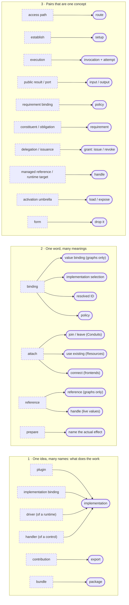

# Simplification pass

Status: reviewer feedback on the [candidates](CANDIDATES.md), 2026-11-05. Nothing here is adopted;
rulings still go through the [vocabulary map](../../VOCABULARY.md#review-and-migration-procedure).
This proposes fewer names for the same accepted behavior. It does not merge any behavior.

The candidate list keeps several words for one idea, and reuses one word for several ideas. Three
patterns cover most of it. Solid boxes are the words to keep; dashed boxes are the ones to drop.

With pattern 1 applied, the plugin-versus-implementation question in [V05](../../protocol/MODEL.md#v05)
mostly goes away. "Plugin" can stay as a casual word for "a package with implementations," but not as
a separate primitive.

## Keep these separate

These look repetitive, but each pair behaves differently when something fails:

- **provision / start / stop / unregister / purge:** creating isn't starting; stopping isn't deleting data.
- **contract version / configuration revision / package release:** meaning versus concurrency versus publication.
- **contract vs schema:** valid data isn't correct behavior.
- **capability vs grant:** offering something isn't permission to use it.
- **snapshot / feed / cursor:** current state, the change stream, and your position in it.
- **invocation context vs metadata:** trusted facts versus caller claims. Merging them is a security bug.

Open question: fold **retire** into **stop** only if the spec says stop always carries retire's
cleanup duties.
