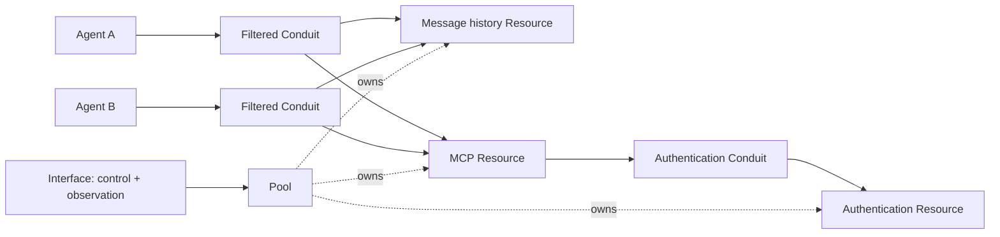

# 001 — Shared access, communication and Interface observation

**Status: protocol walkthrough and static fixtures only.** No plugins, runtime, accounts or service
connections were started. YAML parses as data; it is not executable Conduit configuration yet.
The field names and fixture contracts are a coherent proposal against the
[accepted design](../../docs/DESIGN.md), not new rulings hidden in examples.

Files:

- [templates.yaml](templates.yaml): eight template definitions spanning all five families.
- [instances.yaml](instances.yaml): two complete resolved instance examples, including an expanded
  control definition; no status, credentials or grants are embedded.
- [CONTRACTS.md](CONTRACTS.md): proposed field meanings, plugin/type contracts and bootstrap boundary.

`conduit.local/v0alpha1`, type/capability identifiers, plugin bindings and the precise graph fields
are draft notation. The imaginary `fixture.core` package and `example.invalid` endpoint ensure this
packet makes no claims about real-provider behavior. Paths and account names are placeholders.
A root YAML stream is a convenient document collection, not an atomic multi-object apply operation.



The Interface also inspects Agents, Conduits and their activity; the diagram abbreviates those
observation paths. Resource ownership does not mean the Pool relays every request.

## 1. Start from the Interface

The local-owner Interface observes and controls the same system. Its normal management connection
reaches a Pool-owned management Resource. The initial bootstrap establishes those objects before
normal operations can use them; the packet does not invent a recursive bootstrap procedure.

Opening CLI, terminal and test frontends attaches to this one Interface. They inspect common local
evidence rather than keeping separate per-frontend logs. No frontend needs to remain open for
managed components to retain evidence.

Register the Conduit, Resource and Pool templates first. Register the Agent template after its
concrete Resource targets exist in step 2; the Interface template references the seeded management
Resource. Registration requires the necessary schemas even if the implementation is unavailable. Registration neither logs into a service,
creates a directory nor starts an Agent. Missing code is a readiness gap, not a parsing success.

## 2. Offer Resources, then explicitly establish selected ones

The Pool template's entries are its available provisioning choices:

```yaml
config:
  entries:
    checkout:
      templateRef: {kind: Resource, form: template, name: project-directory}
    auth:
      templateRef: {kind: Resource, form: template, name: service-authentication}
    issues:
      templateRef: {kind: Resource, form: template, name: issue-service}
    exchange:
      templateRef: {kind: Resource, form: template, name: conversation-history}
```

Create `project-pool-0001` from `project-pool`, then explicitly start its setup. The template already
contains the setup recipe. Its `pool.compose` step selects four entries and binds the MCP Resource's
authentication dependency to that composition's authentication Resource. It does not require a
separate authored operation manifest or ordering for every Resource.

```yaml
items:
  auth:
    provision: {entry: auth}
  issues:
    provision: {entry: issues}
    bind:
      authentication: {item: auth}
```

The full graph also selects checkout and exchange. It resolves these results:

| Selected item | Resource instance | Owner | Result |
| --- | --- | --- | --- |
| checkout | `project-directory-0001` | `project-pool-0001` | Attach `/example/euphony`; absence fails without creating it. |
| auth | `service-authentication-0001` | `project-pool-0001` | Establish shared service identity `team-service`. |
| issues | `issue-service-0001` | `project-pool-0001` | Open its authentication Conduit, then prepare native MCP access. |
| exchange | `conversation-history-0001` | `project-pool-0001` | Create the retained message history. |

The table shows example generated names; actual suffixes and stable IDs are allocated by the
registry. Composition uses returned bindings, not predicted names. Populate the Agent creation
draft with the actual returned Resource references before registering or using that declaration. The resolved MCP
instance binds authentication to that Resource's ID. A later rename does not retarget it.

If the same authentication Resource already exists, edit the creation draft to use it explicitly:

```yaml
items:
  auth:
    existing: {kind: Resource, form: instance, name: service-authentication-0001}
  issues:
    provision: {entry: issues, name: issue-service-0002}
    bind:
      authentication: {item: auth}
```

This fragment replaces the entire `items` value if assigned as a whole; it does not implicitly
merge with the previous map. Merely offering `auth` does not choose a singleton, and an unqualified
retry must not create a second login. Reuse is an explicit instance selection; a new registration
around existing backing is a different attach operation.

The Interface can inspect a ready checkout while authentication waits and issues remain unready.
A provision failure keeps successful work for valid retry. Adding another available entry does
not deploy it. Removing an entry does not retire its existing Resources.

## 3. Instantiate independent Agents and attach access

Create two drafts from `collaborator`, editing ordinary fields before creation:

| Draft edit | Agent A | Agent B |
| --- | --- | --- |
| `metadata.name` | `collaborator-0001` | `collaborator-0002` |
| `spec.config.account` | `agent-account-a` | `agent-account-b` |
| Private state | Separate per-instance | Separate per-instance |
| Starting access | Checkout, issues, exchange | Checkout, issues, exchange |

The account change occurs before instantiation; it is not an in-place account switch. Both Agents
use the existing application Resources. Starting connections come from the Agent template, not
Pool defaults. The owner explicitly delegates the declared subset when establishing each attachment.
The YAML describes requested access and restrictions, not an issued grant.

The issue connection preserves native provider operations while restricting use:

```yaml
issues:
  required: false
  capability: {group: integration, name: mcp-access, version: v0alpha1}
  open:
    templateRef: {kind: Conduit, form: template, name: capability-route}
    config:
      target: {kind: Resource, form: instance, name: issue-service-0001}
      filters:
        - type: {group: access, name: operations, version: v0alpha1}
          config: {allow: [discover, invoke]}
        - type: {group: integration, name: fixture-issue-access, version: v0alpha1}
          config: {workspace: euphony, actions: [read]}
```

The enclosing Agent supplies the consumer, and its required capability is bound into the opened
Conduit's configuration. It receives permitted native tools, not the service token. A later real
Linear adapter must demonstrate the same mapping; this fixture does not validate it.

Agent login and connection preparation can proceed independently. Activation waits for both
outputs because its graph binds them. Required checkout/history failures block preparation;
optional issues failure permits other work and remains visible. A prepared symlink is not a
new Resource and does not establish OS-level isolation or read-only enforcement in native mode.

## 4. Inspect a resolved instance

[instances.yaml](instances.yaml) shows the history Resource with a concrete Pool owner, exact
implementation selection, retained graph/runtime definition and expanded control. Its configuration
starts with `readLimit: 20`. The route example names Agent A and the history Resource explicitly.

Inspection adds system metadata and observations. This fragment is **not authorable YAML**:

```yaml
metadata:
  name: conversation-history-0001
  id: resource-example-1
  configRevision: r1
status:
  setup:
    complete: true
  runtime:
    available: true
  observation:
    source: fixture-runtime
    coverage: synthetic
```

These status names are illustrative, not a common lifecycle enum. A boolean snapshot has a source
and observation context; an old snapshot is not proof of current availability. Real evidence needs
recorded time/revision and retention semantics. Export omits status and system IDs/versions, keeps
confirmed settings and reports uncertainty separately. Reimport needs a new instance identity;
`establish: create` cannot silently attach to the original backing key.

## 5. Change one setting through a control

The Interface opens an authorized management Conduit to the history Resource and invokes its
`set-read-limit` tool with `limit: 15`. The client carries inspected revision `r1` as protocol
precondition metadata, not another author-maintained YAML file. The selected handler validates
current authority, input bounds and revision, applies serially and confirms application.

| Step | Stored config | Interface evidence |
| --- | --- | --- |
| Before invocation | `readLimit: 20` at `r1` | Inspected baseline and available control. |
| Request accepted/pending | Still `20` at `r1` | Target, actor, operation, selected route, requested 15; not yet applied. |
| Handler confirms | `15` at `r2` | Applied result correlated to the request. Export now contains 15. |
| Competing request based on `r1` | Still `15` at `r2` | Conflict; caller can reread/reconsider. |
| Request for 200 | Unchanged | Typed range failure; no silent clamping. |

For a lost response, the last confirmed value stays recorded but the actual setting is marked
uncertain. Inspection/reconciliation establishes what happened before unsafe repetition. A plugin
can return its own structured progress/details; the protocol does not impose a closed list of
business states. Changing this control's handler or bounds requires a new instance, even for the
unrestricted Interface. Removing a Conduit does not edit the definition.

## 6. Communicate and observe the same activity

Both Agents explicitly participate in the retained-message capability on the same Resource,
possibly through separate Conduit instances. Sharing history does not require sharing a socket
or joining one universal room object. The Resource owns messages and independent reader state;
the Conduits carry access.

1. A posts a finding. The retained result proves storage, not B's understanding or job acceptance.
2. B remains idle. No model turn starts. On its next normal turn, a supported adapter supplies a
   short unread notice; B explicitly reads a bounded range.
3. B advances its own reader position. A's position is unchanged. The exact acknowledgement/cursor
   wire shape is a draft detail; no content access is inferred from the cursor alone.
4. B disconnects and later catches up under current authority. Posting retries use recorded
   operation identity; a lost response must not create duplicate messages.
5. Access is withdrawn before delivery/read. New managed content is withheld without erasing
   already-delivered private context. A's authorized access can continue.
6. A flow's last consumer detaches. That Conduit ends; the Resource retains history. A later
   connection gets a new ID and checks current access. It does not claim the old flow survived.

At every step, the same Interface exposes actor identity, Resource/Conduit identities, operation
outcomes and available usage. It also shows coverage gaps: the system may prove a read response
was delivered without proving model comprehension. Observation continues without frontend clients.
An exporter can fail without losing committed local outcomes. No external tracker/dashboard is
required; a custom tracking Resource could later consume permitted evidence.

## Acceptance plan

These are expected outcomes, not executed runtime tests.

| Stage | Test | Required evidence |
| --- | --- | --- |
| Static | Parse objects, check refs/graph edges and fixture consistency. | Valid syntax, no duplicate keys/unknown fixture fields, correct forms, no hidden status or credentials. |
| Synthetic setup | Pause authentication; fail MCP preparation. | Checkout usable, Pool incomplete, successful progress retained, honest required/optional status. |
| Synthetic controls | Stale revision, out-of-range value, lost response. | No stale overwrite/clamp/blind replay; confirmed versus uncertain state visible. |
| Synthetic messages | Independent readers, offline catch-up, lost post response. | Bounded results, no shared cursor, retry-safe storage, no automatic wake. |
| Synthetic access | Narrow/revoke one path; expose two eligible routes. | Current checks, no combined permission leakage or silent account failover. |
| Synthetic observation | Disconnect frontend, drop observer/exporter. | Retained local evidence, explicit gaps, other work continues where permitted. |
| Lifecycle | Partial retirement, last detach, backing reuse. | Pool kept while it owns Resources; ended flows get new IDs; no automatic data deletion. |
| Native compatibility | Two Claude and two Codex accounts. | Verified identities, separate private state/refresh/logout, shared service access, measured native tool/usage coverage. |

The native stage requires an implemented adapter and explicitly initiated account enrollment.
No account, provider or filesystem behavior is established by the static fixtures.

## Review the language as a whole

This packet tests one spelling of the agreed model. The next useful review is whether the
following relationships are readable together:

- `entries` offers templates; the setup graph selects explicit provisioning or existing use.
- `conduits` declares required capabilities and selected targets; Pool binding fills reusable
  Resource dependencies, and the enclosing object supplies its identity.
- `setup` prepares; `runtime` owns continuing behavior; `controls` defines supported changes.
- Inspection combines definition and observations without making observations authorable.

Implementation selection, common API names, capability negotiation, management bootstrap/repair
and full status/event schemas still need engineering definitions. The exact types/keys proposed
here are not automatically approved. No new top-level family or change to settled behavior is
needed by this example. If a concrete counterexample requires one, bring that behavior back to
review rather than silently extending the fixture.

## Validation record — 2026-10-31

Completed during documentation cleanup:

- Parsed 10 YAML documents: eight templates and two resolved instance examples. Rejected duplicate
  keys, aliases/anchors, explicit tags and merge keys in those fixture files; found none.
- Checked common fixture fields, type/implementation selections, 16 references against the
  documented scenario, graph input/output bindings and three implied setup dependencies. Graphs
  were acyclic; shown instance graphs/runtimes matched their templates and controls were resolved.
- Parsed all 15 YAML code fences across the documentation as syntax, including source-system
  examples. Source examples are not asserted to conform to Conduit's strict profile.
- Checked local Markdown targets/anchors and all 103 retained pinned Pi source paths; none missing.

These were static data/consistency checks using Ruby Psych and temporary validation scripts,
not a Conduit schema compiler, runtime or strict YAML 1.2 conformance suite. In particular, these
checks do not prove provider compatibility, authorization enforcement, recovery, account isolation
or actual message/observation delivery. The acceptance-plan runtime stages remain unexecuted.
