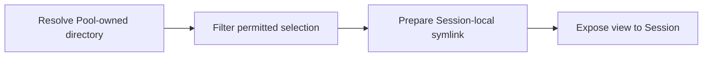

# Conduits as composable operational graphs

Updated: 2026-10-31. Branch: `research/conduits-as-graphs`.
**Working direction for this branch. Conduits retain template/instance forms. Setup and live
activity may coexist; their composition boundaries, detailed contracts and YAML remain proposals.**
No implementation, authentication, provisioning or live experiment has been performed.

## Direction and preserved baseline

Session, Pool and Resource templates supply typed configuration and select the Conduits needed
to establish their instances. Conduits express the operational graph: plugin actions, ordering,
inputs/outputs, filtering, authentication and continuing interactions. A Conduit may compose
other Conduits. The caller supplies configuration through the template, without assembling a
separate operation-request recipe. This is the direction requested for investigation.

The prior design and research remain on `main` at
[`c013f0a`](https://github.com/shrav-k/conduit/tree/c013f0a20c0c579f511aea84fdc6804b66417b96).
[SPEC.md](../SPEC.md) and [DESIGN.md](../DESIGN.md) retain that baseline; this report identifies
proposed changes instead of silently treating them as settled contracts. The prior
[lifecycle comparison](ESTABLISHMENT.md#the-distinction-between-plugin-stages-and-authored-stage-graphs)
considered optional composition inside establishment configuration. This inquiry instead gives
that orchestration a consistent home in the Conduit family.

## Responsibilities in the proposed model

| Element | Responsibility |
| --- | --- |
| Session/Resource/Pool template | Describe the intended instance, its configuration, and the selected Conduit entry points with the values/references they need. |
| Conduit template | The reusable graph definition: typed inputs, plugin operations or child Conduits, dependencies and named outputs. A graph is its content, not a replacement for the template form. |
| Conduit instance | A particular invocation with resolved inputs, progress, outcomes and any continuing attachments. It need not run a dedicated process. |
| Session/Resource/Pool instance | Retain ongoing configuration, identity and observed state. Successful setup does not require retaining a live copy of its source template. |
| Plugin | Implement versioned operations with declared inputs, outputs, effects and recovery behavior. It may implement several Resource types and operations. |
| Engine | Validate and schedule the graph, enforce managed authority and Pool ownership, record outcomes, handle interaction waits and coordinate supported recovery. |

Resource type contracts and operation contracts are related but different. The local-directory
Resource contract describes the resulting capability. Directory-create, directory-attach and
Session-symlink operations describe actions. Multiple actions can support one Resource type;
an action can also prepare access without creating a Resource. Neither nodes nor plugin packages
become a fifth family. Logical operation group/name/version should stay independent of package
installation/version, as already chosen for Resource types.

**Interpretation of “all logic”:** the authored orchestration can live in Conduits, including
choices, sequencing and composition. Plugins still contain the code implementing filesystem,
Git, authentication and protocol operations. A graph should not need to reproduce HTTP parsing
or OS calls. Agent reasoning and native tool loops remain runtime behavior unless an explicit
Conduit operation invokes them; graph scheduling alone does not create model turns.

## What the reference systems contribute

These are architectural lessons, not proposed dependencies. Evidence was checked against
primary documentation on 2026-10-31; the Conduit implications are our own design proposals.

| Reference | Evidence and implication |
| --- | --- |
| [Docker BuildKit](https://docs.docker.com/build/buildkit/) | A frontend lowers an authoring format into LLB, a dependency graph; independent build work can run concurrently. Borrow the separation between authoring, validated graph and executor. Conduit's YAML need not expose its internal scheduler representation. |
| [Docker multi-stage builds](https://docs.docker.com/build/building/multi-stage/) | Named stages provide reusable artifact dependencies; selected targets need only their dependencies. Borrow stable node names and explicit outputs. Conduit effects need explicit required roots: an authentication check or notification must not disappear merely because no value consumes its output. |
| [Compose startup ordering](https://docs.docker.com/compose/how-tos/startup-order/) | Running, healthy and completed-successfully are different dependency conditions. Borrow distinct ready/completed conditions; a ready message subscription should not need to terminate before a consumer can use it. |
| [Docker build secrets](https://docs.docker.com/build/building/secrets/) | Secret and SSH mounts have a different delivery/lifetime contract from ordinary build arguments. Borrow protected credential handles and explicit consumption; graph output display must not expose token bytes. |
| [Kubernetes init containers](https://kubernetes.io/docs/concepts/workloads/pods/init-containers/) | Regular init containers finish before application containers start; their status is observable separately. Borrow the distinction between completed setup and ongoing activity, without importing automatic restarts or one container per node. |
| [Argo DAGs](https://argo-workflows.readthedocs.io/en/latest/walk-through/dag/) and [suspension](https://argo-workflows.readthedocs.io/en/latest/walk-through/suspending/) | Dependency graphs can invoke nested templates; explicit suspension is supported. Borrow composition and waiting as inspectable execution states. An authentication wait is not itself a new mandatory approval requirement. |
| [Temporal activities](https://docs.temporal.io/activity-definition) | External effects can repeat when a result is lost; operation granularity and idempotency matter. A graph journal alone cannot provide exactly-once remote effects. Retain Conduit's safe retry/reconciliation rules. |
| [Node-RED core nodes](https://nodered.org/docs/user-guide/nodes) | Nodes transform messages and route them according to rules. Borrow filtering/routing as composable operations for continuing flows, with Conduit's own typed, authority and recovery contracts. |

Do not copy BuildKit's caching and pruning rules wholesale. A graph/configuration hash is useful
for identifying an invocation's effective definition; it does not prove a login is still valid,
a directory remains unchanged or a deployment can be skipped. Prior results, reusable immutable
artifacts and current readiness are different concepts.

The earlier [configuration-language research](CONFIGURATION.md) still supports typed YAML,
explicit defaults/references and inspection of effective configuration. This proposal adds
execution semantics; changing the serialization language would not define them for us.

## Template reuse and concrete examples

A template needs a selected establishment procedure, but **it does not need its own unique
Conduit definition**. Several Session templates can reference `native-session-setup`; many
directory templates can reference `attach-directory`. A different account, path or selection
usually changes the supplied configuration. A genuinely different procedure may justify a
composed Conduit template. No automatic one-to-one template/graph pairing is proposed.

| Session template | Selected setup Conduit template | Values that differ |
| --- | --- | --- |
| `euphony-engineer` | `native-session-setup` | Work account, selected Pool, activation settings. |
| `personal-engineer` | `native-session-setup` | Personal account and different permitted connections. |
| `euphony-reviewer` | `native-session-setup` | Account/runtime settings and narrower connection selections. |

Sharing requires compatible input/output and runtime contracts. A generic native-session graph
can dispatch through a selected supported adapter; it cannot assume Claude and Codex have
identical authentication mechanics. Adapters implement those differences.

The proposal remains **one entry Conduit per action**, with reusable graph composition inside
it. This is not one Conduit per object or per lifetime. A Session can have an establishment
entry point and several ongoing Conduit declarations. Those declarations configure requested
connections; they do not repeat the setup graph's ordering rules. A reusable setup operation
can prepare the declarations and respect their required/optional contracts.

The examples below are illustrative YAML, not validated contracts or runnable configurations.
The API version, action fields, operation names and binding syntax remain proposed. Account
values denote configured native account references, not secrets or newly introduced registry
object kinds. Referenced Pools/Resources and compatible schemas must exist or resolve before
use. Current authority is supplied by the engine, not granted by these references.

### Session template: settings plus reusable procedures

```yaml
apiVersion: example/v0alpha1
kind: Session
form: template
metadata:
  name: euphony-engineer
spec:
  runtime:
    adapter: claude-code
    account: euphony-claude-1
  activation:
    filesystem:
      exposure: symlink
      directory: workspace
  establishment:
    conduit: {kind: Conduit, form: template, name: native-session-setup}
  conduits:
    workspace:
      conduit: {kind: Conduit, form: template, name: pool-directory-access}
      inputs:
        pool: {kind: Pool, form: instance, name: euphony}
        select:
          labels: {area: repositories}
      required: true
```

Here the setup graph's contract accepts the typed Session configuration as its subject. It
reads declared runtime, activation and connection fields; there is no need to hand-map every
field to a duplicate input of the same name. The actual subject identity is the Session being
established, not the Session template. An independently reusable access graph receives explicit
inputs such as its Pool and selection. Exact subject/input conventions still need a ruling.

The setup graph could prepare private state, invoke the selected native adapter's authentication
procedure, verify identity, prepare the declared workspace access and report Session readiness.
The access graph resolves matching Pool-owned directories, narrows the permitted selection and
prepares Session-local projections according to activation settings. It does not create those
Resource instances or choose a new account implicitly. Model execution starts only through the
selected execution action; preparing a Session does not itself require a model turn.

`personal-engineer` could use the exact same two Conduit templates with different settings.
A Session can also open/join further Conduits later. Changing settings does not require forking
the library graphs; adding a new procedure can use an explicitly composed graph.

### Resource template: reuse one directory-attachment graph

```yaml
apiVersion: example/v0alpha1
kind: Resource
form: template
metadata:
  name: euphony-repository
spec:
  type: {group: filesystem, name: local-directory, version: v1alpha1}
  config:
    path: /work/euphony
  establishment:
    conduit: {kind: Conduit, form: template, name: attach-directory}
    inputs:
      path: {from: subject, field: [spec, config, path]}
---
apiVersion: example/v0alpha1
kind: Conduit
form: template
metadata:
  name: attach-directory
spec:
  inputs:
    path: {type: absolute-host-path}
  nodes:
    attach:
      operation: {group: filesystem, name: directory-attach, version: v1alpha1}
      inputs:
        path: {from: input, name: path}
  outputs:
    backing: {from: node, name: attach, output: directory}
```

A Pool-mediated invocation attaches the existing directory and establishes the Resource using
verified results. The engine checks Pool ownership and the Resource transition contract. The
attach operation fails if the directory is missing; it does not create it. The finite Conduit
invocation completes while the Resource and backing directory remain.

Another Resource template can select this graph with another path. Selecting a `create-directory`
graph instead would declare fresh-creation intent. That graph would use a directory-create
operation with the accepted existing-target conflict rule. Create/attach must have one
unambiguous source in the authored setup; this graph-selection encoding is still a proposal.
A lost create result still requires same-attempt reconciliation rather than silently switching
to attachment.

The Conduit itself retains both forms. This YAML shows a **Conduit template**. Running it creates
a **Conduit instance** with a distinct ID/name, actual bindings, progress and results. A one-node
graph can be supplied by a standard library; users need not hand-author a wrapper for every
basic operation. Default procedure discovery or inline graph sugar would be separate choices.

### What exists after one Session is prepared

The following names are illustrative, and the split of setup/access invocations is a recommendation
under discussion rather than a newly accepted mandatory lifecycle:

| Object | Role and current condition |
| --- | --- |
| Session template `euphony-engineer` | Reusable configuration; unchanged by instantiation. |
| Session instance `euphony-engineer-a7f2` | Durable participant, prepared with its own private state. |
| Conduit template `native-session-setup` | Reusable setup graph. |
| Conduit instance `native-session-setup-b91c` | Finite invocation; completes after preparation has succeeded and continuing attachments have a defined lifetime. |
| Conduit template `pool-directory-access` | Reusable selection/filtering/projection graph. |
| Conduit instance `pool-directory-access-c12e` | Attached to the Session; retains any continuing access/projection state. |
| Resource instance `euphony-repository-r4d8` | Owned by Pool `euphony`; persists independently of Session setup and access invocations. |

A second Session gets its own setup and access invocations unless it explicitly joins a supported
shared Conduit. That does not imply duplicating the underlying folder Resource, nor sharing
credentials or private context. A filter's rules belong in the Conduit definition/configuration;
its actual endpoint bindings and any live processing state belong to the Conduit instance.
A pure filter need not have a persistent process or register another object of its own.

### Definition format is independent of runtime identity

Conduit template/instance forms survive whether a graph is written in YAML, generated by code
or authored in a future graph editor. The reusable graph has a typed contract and a stable
registry identity; an invocation has its own identity and observed state. An instance need not
be a hand-maintained file, and a template is not a running filter.

YAML remains the current authoring surface; alternate graph languages are not selected by this
example. If another authoring format is added, it must produce a graph whose contracts and
referenced versions Conduit can validate and inspect. Arbitrary code does not automatically
become resumable because it is called a graph. Registry representation/source packaging remain
open without adding another conceptual family.

Named graph inputs and typed output bindings are an explicit extension under review to the
previous decision to avoid a generic parameter/mapping DSL. Prefer passing a supported typed
subject where appropriate and explicit bindings where composition crosses contracts. Start with
literals and field/output references, not arbitrary expressions or implicit host interpolation.

## Composition and four concrete cases

### A directory exposed to a Session

The directory Resource is established through its Pool. A Session's access graph then performs:



The symlink operation consumes the permitted directory handle and the Session's activation
settings, including its local destination. It returns a projection handle with release behavior.
The Session remains the place that selects activation behavior; a Conduit executes that selection.
Two Sessions get independent projections of the same Resource. Releasing one projection does
not unregister the Resource or delete backing files. A symlink does not enforce read-only or
subpath isolation; report what native/isolated execution actually enforces.

### A reusable workspace setup

A Pool can establish a git-worktree Resource through a graph that performs a native worktree
operation, calls a selected initialization Conduit, then validates the result. Template fields
supply repository access, base, destination and initialization choices.

```yaml
# Fragment of a Conduit template; selected inputs come from its input contract.
nodes:
  worktree:
    operation: {group: filesystem, name: worktree-create, version: v1alpha1}
    inputs:
      repository: {from: input, name: repository}
      destination: {from: input, name: destination}
      base: {from: input, name: base}
  initialize:
    conduit: {kind: Conduit, form: template, name: seed-project}
    inputs:
      destination: {from: node, name: worktree, output: directory}
      source: {from: input, name: seed}
  verify:
    operation: {group: example, name: workspace-check, version: v1alpha1}
    after:
      - {node: initialize, condition: completed}
    inputs:
      directory: {from: node, name: worktree, output: directory}
outputs:
  backing: {from: node, name: worktree, output: directory}
```

Input references establish data dependencies. `after` supplies a prerequisite without adding a
fake data input: verification waits for initialization even though its directory came from the
worktree node. Success requires the declared required work, including `verify`; it cannot mean
only that the `backing` output is available. Repository/seed handles come through authorized
Conduits, not unrestricted strings that bypass Pool access.

Git safety and uncertain-effect recovery belong to the worktree operation contract. If seeding
fails, the worktree remains a known partial result. Cancellation releases transient attachments;
it does not automatically erase created work. The graph orchestrates registration/provisioning
through the Pool. It does not become the owner of the worktree or create a Resource for each node.

### Subscription and service authentication

A Session establishment graph can compose private-state preparation, supported account login,
identity verification and capability preparation. An authentication operation can return a
structured browser/device/unlock wait; the engine preserves its correlation and resumes only
when the integration verifies completion. A graph declaration of an account is not login proof.
Preparing a Session and starting model execution remain separate effects.

A password-manager access graph can resolve the Pool-owned service, authenticate the selected
participant, narrow permitted items and expose a protected credential/client handle. A Linear
MCP setup can consume that handle if the supported integrations require it. Native subscription
identity, service identity and private Session state remain distinct. Graph reuse does not imply
credential or client reuse. Exact provider support still needs the planned experiments.

A login operation may internally handle protocol exchanges. Authors can compose authentication,
verification and subsequent operations without spelling out browser callbacks or token parsing.
The operation must expose meaningful waits/failures and recovery boundaries; a single opaque
“run script” step would hide the contract we are trying to establish.

### Indexing and communication

Corpus access, database establishment, embedding batches, indexing and query exposure can be
composed. Storage and search remain separate Pool-owned Resources with connected capabilities.
Persist batch progress and distinguish an existing database from a searchable corpus. An expired
credential or changed input revision must not silently reuse a stale success result.

A communication graph could compose receive, filter, route, persist and deliver operations.
Durable shared content lives in a Pool-owned communication/storage Resource; graph execution
state does not substitute for that store. The ordering of persistence and delivery determines
what a successful send promises, so it is part of the communication contract still to design.
No room-only topology, automatic wake behavior or message-delivery guarantee is selected here.

## Graph semantics that matter before exact YAML

### Dependencies, values and continuing outputs

Recommend distinguishing three relationships without maintaining three copies of the graph:

- **Value dependency:** a typed output supplies an input. Completion of the producing operation
  makes an ordinary value available; a live endpoint may instead become available on readiness.
- **Condition dependency:** a node explicitly waits for another node's required state when no
  value carries that relationship. Completion and readiness are distinct conditions.
- **Continuing flow:** a typed live handle or subscription carries later interactions. It has
  current availability, release behavior and, where applicable, delivery/backpressure rules.

The engine derives scheduling from these declarations. YAML key order is not execution order.
Independent work can run concurrently within constraints; shared-account refresh and shared
backing targets can require serialization despite independent values. A bootstrap dependency
cycle must be diagnosed. Bidirectional communication between ready peers is not itself an
invalid startup cycle. General looping/control expressions need separate design.

Start with named/versioned operations, child graph calls, typed references, explicit condition
gates and supported interaction/failure states. Add branches or iteration when a concrete case
requires them; a plugin can initially expose a bounded batch operation. Do not confuse that
implementation choice with a permanent limit on what Conduits can express.

### Filtering is an operation; authority remains a contract

Filters can select Resources, records, tools or messages and transform permitted views. They
can appear at different stages or be reusable child Conduits. For example, select a subset of
repositories before preparing views, or route only addressed messages before delivery.

An optional filter node is not the sole source of permission enforcement. Omitting it cannot
grant access the invocation lacks. Managed read/write/invoke/deliver operations still check
current authority at their boundary; filters narrow what is already allowed. Cached selections
or outputs do not freeze permission. Native agents' access outside mediation retains the
existing native-versus-isolated limitations; this graph proposal does not implement a sandbox.

### Invocation and ownership

A Pool must be the authorized owner when a graph establishes a Resource. A Pool graph can ask
the engine to instantiate a Resource template, which invokes that template's establishment
Conduit. The Resource's own graph returns backing results for that pending subject rather than
recursively asking to instantiate itself. Pending subject identity and exact registration timing
need a contract; readiness is not a prerequisite for having an identity or for an engine-run
setup graph. An agent is not required to exist before its login graph can run.

Child invocations start separately unless explicitly joining an existing supported live Conduit.
Reusing a template name never means shared authentication or execution. Shared state stays in
Pool-owned Resources. A parent-child relationship governs progress/cancellation of invocations,
not ownership of every Resource they touch.

### Setup and access have distinguishable lifetimes

Conduits retain template and instance forms. The earlier ruling permits setup and continuing
activity within a graph; it does **not** require Session construction and every ongoing access
flow to share a single invocation. The current discussion is how to compose those lifetimes
without conflating a reusable graph definition with a running connection.

An access Conduit can naturally authenticate, establish a connection, become ready and continue
filtering traffic until its consumer detaches. A directory-attachment Conduit can finish after
returning verified backing information. Both are instances of the same Conduit family; these
behaviors need not become new fixed families or a universal `mode` enum.

**Recommendation under review:** let a finite Session-setup Conduit compose and attach separately
identified access Conduit instances, then complete. Required access must be ready before setup
succeeds. Continuing access belongs to an explicit Session/consumer lifetime, so completing
setup does not cancel it. A successful attachment must establish that lifetime explicitly;
merely returning a child handle cannot implicitly detach it from its parent.

An alternative is a single supervising invocation containing completed setup nodes and retained
live operations. It avoids a child-lifetime handoff but couples recovery and cleanup to the
larger invocation. Both are compatible with reusable graph definitions. Evaluate them with
independent filter changes, expired login, setup failure and Session closure before making one
the mandatory organization. Do not silently implement one based on the broad mixed-activity ruling.

This also refines the original “last consumer leaves” rule. An authorized finite setup invocation
can run before a Session consumer is ready; its initiating lifecycle action provides its purpose.
A browser wait does not mean the invocation is abandoned. Live access later follows its explicit
attachments. Readiness loss, stop versus completion, parent cancellation before/after attachment,
and abandoned-setup detection still need a precise contract. Existing required/optional behavior
and retained partial success remain relevant.

Completion never automatically destroys created instances or backing data. A live filter need
not have a dedicated OS process. Stopping an invocation, canceling an operation, releasing a
client and purging a Resource are different effects.

### Recovery and edits

Keep confirmed outputs and enough effective graph/input/handler identity to continue incomplete
work. Pin the relevant graph definition for an invocation; an edit must not silently change its
remaining procedure. This is execution evidence, not mandatory source-template history for every
completed instance. A full resolved graph snapshot versus a retained revision is still open.

Replay known results where appropriate; reconcile uncertain external effects before retrying.
A node's contract declares what can be retried, resumed or released. Authentication and mutable
service reads cannot inherit artifact-cache semantics. Cancellation may leave partial external
work; reverse dependency order alone does not justify destructive rollback. Existing explicit
resume rules for stopped model executions still apply.

## Next rulings and evidence

Discuss these bundles, using the same examples throughout:

Setup and ongoing connections may coexist; template/instance forms remain. The current question
is how those capabilities compose across invocations. Continue with:

1. **Template-to-graph contract:** one root per lifecycle entry point, typed input/output bindings,
   selection of create/attach, and how verified outputs populate instance spec/status. Preserve
   one-off authoring and avoid duplicate setup fields.
2. **Operation and composition contract:** what plugins export, how child graphs behave, required
   work and output gates, current authorization, and recovery/cancellation of partial effects.
3. **Detailed lifetime:** finite construction plus separately attached access invocations versus
   one supervising invocation; readiness changes, required-connection failures, parent/child
   release and consumer departure. Distinguish reusable definitions from runtime state throughout.

Before implementation, test the model on an existing folder, new folder, remote filesystem,
managed worktree, account login, password-manager access, index build and a two-Session exchange.
Add failure cases for a lost create result, wrong account, expired wait, graph edit during setup,
lost access before delivery, partial child failure and the final consumer leaving. These are
contract probes, not requests to perform live operations.
