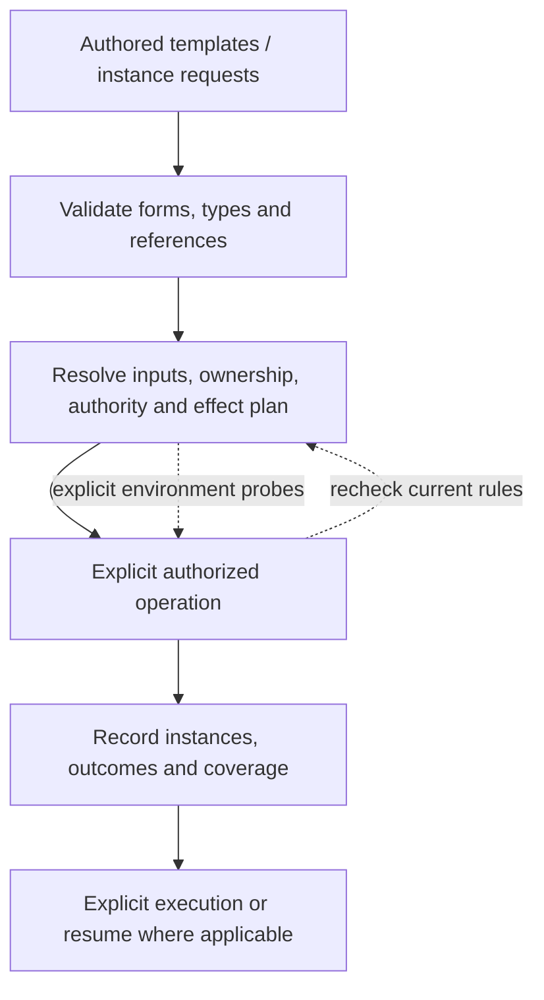

# Configuration languages, templates and instances

Updated 2026-10-31. **Research evidence and proposed schema, not an executable specification.**
Current contracts live in [SPEC.md](../SPEC.md) and [DESIGN.md](../DESIGN.md). The five families
are Interface, Agent, Resource, Pool and Conduit. Templates specify both complete establishment
and permitted instance-configuration changes. Pools own Resources and normally establish shared
service authentication; Conduits narrow each caller's access to those capabilities.

This report retains Kubernetes/Docker research, language comparisons, papers and prior offline
probes. Historical fixtures and quoted source terminology do not define the current protocol.
The new synthesis below revisits the evidence specifically for template-defined controls.

## Template-defined changes: research synthesis

Rechecked primary documentation on 2026-10-31 and the local Pi source snapshot
`0441483926f283e42ca44eb7b4a46552e9469d6f`. These mechanisms inform Conduit; none supplies its
complete control protocol or proves current provider support.

| Evidence | Implication for the proposed contract |
| --- | --- |
| [Kubernetes transition rules](https://kubernetes.io/docs/tasks/extend-kubernetes/custom-resources/custom-resource-definitions/#transition-rules) can compare old/new values and prohibit a transition between otherwise valid states. | Declare value constraints and transition conditions separately. A valid new setting alone cannot establish that applying it now is supported. Do not import all of Kubernetes reconciliation or CEL by analogy. |
| [Kubernetes spec/status](https://kubernetes.io/docs/concepts/overview/working-with-objects/#object-spec-and-status) distinguishes intended configuration from system-reported state. | A requested configuration change and confirmed runtime application need distinct evidence. This does not choose a universal Conduit desired-state controller or storage layout. |
| [Docker container update](https://docs.docker.com/reference/cli/docker/container/update/) changes selected running-container settings, including resource limits and restart policy, with documented restrictions. | The image/container analogy is compatible with bounded runtime controls; it does not imply that every instance setting is either fixed or freely replaceable. |
| [JSON Schema annotations](https://json-schema.org/understanding-json-schema/reference/annotations) describe fields; defaults are not inserted by validation, and read/write annotations do not themselves implement application behavior. | A `mutable`/`readOnly` flag is not the protocol. Controls need executable behavior, validation and observed results; choose a supported schema dialect deliberately. |
| [CUE constraints](https://cuelang.org/docs/tour/basics/constraints/) compose restrictions through unification and detect incompatible values. | Intersect type support, template limits and Conduit restrictions. This is constraint composition, not a last-writer-wins settings merge, and does not select CUE as a dependency. |
| [Pi RPC commands](https://github.com/earendil-works/pi/blob/0441483926f283e42ca44eb7b4a46552e9469d6f/packages/coding-agent/docs/rpc-commands.md) expose named setting operations and runtime-dependent available choices. Its [RPC contract](https://github.com/earendil-works/pi/blob/0441483926f283e42ca44eb7b4a46552e9469d6f/packages/coding-agent/docs/rpc.md) distinguishes command responses from continuing execution/events. | Use discoverable controls with typed requests and honest outcomes, without baking Pi's model/queue behavior into every family or requiring its runtime. |
| [Pi Durable evidence](PI_RUNTIME.md#2-mutation-ordering-commits-and-publication) separates external effects, commit and publication; the [submission review](PI_RUNTIME.md#3-submissions-queues-and-activation) separates acknowledgement and later work. | Preserve operation identity and requested/applied/unknown distinctions. Reconnection is not evidence that an uncertain setting change failed or is safe to repeat. |

Our [configuration papers](#research-papers-and-their-limits) also argue for meaningful constraints,
diagnostics and avoiding excessive options. The inference is a small discoverable control contract,
not every plugin implementation detail exposed as a configurable field.

### A bounded control example

This **partial illustrative Resource-template fragment** tests the division of responsibilities;
`controls`, `operation` and `constraints` below are proposed notation, not accepted fields.
The selected search type would supply the integer input schema, related setting, implementation
and result contract for `set-query-limit`. The template narrows its range. Setup/runtime and Pool
creation declarations are omitted here; this is not a complete executable template.

```yaml
spec:
  type: {group: search, name: collection, version: v1alpha1}
  config:
    queryLimit: 10
  controls:
    set-query-limit:
      operation: set-query-limit
      constraints:
        limit: {minimum: 1, maximum: 100}
```

Suppose a particular Conduit additionally limits this control's `limit` input to at most 20:

| Request through that Conduit | Expected contract outcome |
| --- | --- |
| Set the limit to 15 | Within the declared ranges; proceed only if currently authorized and the target can apply the transition. Report application from runtime evidence. |
| Set the limit to 80 | Template-valid but Conduit-restricted. Reject/report the violated constraint; do not silently clamp to 20. |
| Change an unrelated database location | This control exposes no such change. A separate declared operation or replacement path would be needed. |
| Response is lost after a request | Preserve uncertainty and reconcile the operation/actual state; retry only under the operation's safe-repetition contract. |

This example changes default search configuration. Passing a smaller limit to one search query
is a per-call input, not necessarily a persistent configuration update. Writing a knowledge record
is a content operation. The protocol may carry all three without confusing their state effects.

The template-defined control declaration is not caller authorization. A management Interface may
see the object while a particular interaction still requires an authorized Conduit. Current checks
remain necessary after static validation. Model-specific dynamic choices, filesystem rebinding,
and filtering changes on a Conduit need the same semantic distinctions but different handlers.

**Questions this example leaves open:** exact control-selection notation;
field bindings and cross-field/transition predicate language;
plugin application behavior; handler versus composed change graph; version checks;
contract-version compatibility and storage of pending/applied settings. These are grouped in
[REVIEW.md](../REVIEW.md), rather than decided by this fragment.

**Accepted:** use named typed controls as the normal interaction contract for
configuration changes. In the sketch, a caller invokes `set-query-limit` with `limit: 15` through
an authorized Conduit. Its declared handler validates/applies the change; the result and observed
state establish what happened. A frontend can render this as editing a query-limit field. Shared
type contracts can supply the input schema and handler rather than copying them into every template.

A control can represent a coordinated change to several settings and expose its transition and
application behavior directly. This does not promise atomic updates or make ordinary provider
content operations configuration changes. Exact field bindings, default-selection notation and handler
notation remain open; no separate user-authored operation manifest is required.

### Selecting the exposed controls

**Accepted:** templates normally reuse the selected type's declared default controls, including
their schemas and handlers. A template can narrow those defaults or explicitly select other
supported controls. The effective instance surface remains inspectable and retained independently
of later plugin updates; adding a control to an implementation does not silently expose it on an
existing instance.

For example, a search type can supply a query-limit control while a template restricts its range.
The template need not restate the complete input/output schemas or handler. This reuses a declared
public control surface, not every internal plugin operation. Actual caller authority and Conduit
filters remain additional requirements. Dynamic native provider tool catalogs remain separate:
discovering a newly available provider tool does not redefine an instance's configuration controls.
Exact selection/default notation and contract-version compatibility remain open; v0 instance
control definitions stay fixed as described below.

### Application requirements and outcomes

**Accepted direction:** expose named controls through MCP tools with typed inputs, explanatory
content and extensible plugin-specific results. Reuse supported standard interaction/observation
mechanisms where applicable. Plugins own domain behavior; Conduit retains authority and outcome
evidence. MCP message types do not require an exhaustive Conduit domain lifecycle enum. The
evidence below informs concrete mappings; it does not select every optional feature for v0.

#### MCP evidence and mapping

Checked the official 2026-07-28 specification and current Tasks extension documentation on
2026-10-31. These are protocol facts plus design inferences, not verified support in any native
Agent or an implementation commitment to every optional feature.

| MCP mechanism and source | Fact relevant to this design | Proposed Conduit use |
| --- | --- | --- |
| [Tools](https://modelcontextprotocol.io/specification/2026-07-28/server/tools) | `tools/list`/`tools/call` expose named tools with input schemas; results can include text and `structuredContent`, validated against an optional `outputSchema`. | Expose named controls with plugin-defined schemas and explanatory results, retaining native provider contracts. |
| [Base protocol](https://modelcontextprotocol.io/specification/2026-07-28/basic) | This revision standardizes result discriminators and per-request metadata; extensions add recognized result types through advertised capabilities. Cross-request state uses explicit identifiers. | Reuse MCP's envelope; keep domain details in declared plugin payloads, and link requests to Conduit evidence/identity separately. |
| [Progress](https://modelcontextprotocol.io/specification/2026-07-28/basic/patterns/progress) | Optional notifications correlate to a requested progress token and can include a message. | Report ongoing work when supported; progress is not proof that a configuration change took effect. |
| [Multi-round-trip requests](https://modelcontextprotocol.io/specification/2026-07-28/basic/patterns/mrtr) | This revision uses `input_required`, input requests/responses and optional opaque continuation state for supported client-input mechanisms. | Support standard continuations when appropriate without inventing a universal domain workflow. Older protocol versions differ. |
| [Elicitation](https://modelcontextprotocol.io/specification/2026-07-28/client/elicitation) | Supports user-input forms and URL-based interaction, subject to client capabilities; secrets must not be collected by form mode. | Use for genuine human input or interactive authentication where supported. Agent decisions can normally proceed through ordinary tool exchanges instead. |
| [Resources](https://modelcontextprotocol.io/specification/2026-07-28/server/resources) | URI-addressed content is readable; supported updates use subscription notifications in this revision. | Expose permitted instance observations/artifacts for retrieval. An MCP resource is a protocol view, not necessarily another Pool-owned Resource instance. |
| [Tasks extension](https://modelcontextprotocol.io/extensions/tasks/overview) | A separately negotiated extension supplies durable task handles, polling/input/cancellation and its own status vocabulary. | Consider it for long-running changes. Do not require it of every client or equate task status with a plugin's application state. It adds no Conduit object family. |

#### Accepted communication boundary

Use standard MCP interactions carrying extensible, typed plugin contracts. A database
plugin can explain migration prerequisites; an authentication plugin can describe an unlock flow;
a filesystem plugin can report a conflicting path. Adding one such behavior should not require
editing a global Conduit list of application modes. Each plugin still defines its inputs, output
schema and documented meaning; openness does not mean silently accepting malformed configuration.

Generic Interfaces can render tool descriptions, explanatory content and structured results.
Agents can interpret a result and select a supported next tool call. Specialized automation/UI
can understand a plugin's richer schema. A generic frontend cannot infer every plugin-specific
recovery procedure from a universal state label. Keep the existing shared invariants: attributable
requests, current authority, recorded evidence, and no claim of application without evidence.

Illustrative exchange, using invented tools and a plugin-specific response schema:

1. The Agent invokes `set_query_limit` for `search-7f3a`, requesting 15.
2. This hypothetical backend cannot apply the change live. It reports that no change was made,
   the observed value remains 10, and its supported retry can explicitly include restart.
3. The Agent can invoke the same advertised control with that option when permitted, or leave
   the instance unchanged. No human prompt is inherently required by this pattern.

Example **MCP tool-result fragment**, not a complete JSON-RPC exchange or an accepted Conduit schema:

```json
{
  "resultType": "complete",
  "isError": true,
  "content": [{
    "type": "text",
    "text": "No change made. This backend needs a restart to apply the query limit. The active limit remains 10."
  }],
  "structuredContent": {
    "observedLimit": 10,
    "suggestedCall": {
      "name": "set_query_limit",
      "arguments": {"resource": "search-7f3a", "limit": 15, "restart": true}
    }
  }
}
```

`resultType`, `content`, `structuredContent` and `isError` belong to the cited MCP version.
`observedLimit`, `suggestedCall`, tool/argument names and the restart option are invented plugin
fields, not MCP-standard continuation fields or a requirement for all controls. Here the tool
request has finished with an actionable error; the requested setting has not been applied.
For a genuinely ongoing operation, use a supported long-running mechanism or explicit operation
handle instead of implying that returning a response proves completion of its effects.

A suggested call is result data, not permission or an instruction to bypass the caller's policy.
The Agent must use an actually exposed tool/schema and its permitted Conduit. JSON-RPC request IDs
are wire correlation, not Conduit's retry/idempotency guarantee; retain explicit operation evidence
where the integration can provide it. Optional MCP features and version mappings need adapter tests.
Unchanged principles include separate model accounts, shared Pool authentication, preserved native
provider tools, no mandatory combined gateway and no MCP server requirement for every internal
Rust component. Exact mappings, fallback behavior, restart policy and storage fields remain open;
confirmed settings and outstanding requests follow the accepted rule below.

### Requested and applied configuration

**Accepted:** retain confirmed applied settings as instance configuration;
keep outstanding requests and uncertain outcomes in the existing operation evidence. Plugins
establish what proves application, including any partial effects. This adds no global workflow enum
or separately authored operation document.

For the query-limit example, a confirmed value of 10 remains the last confirmed setting while an
Agent requests 15. A handler confirming application advances the stored setting to 15. If the
response is lost and application cannot be established, inspection shows the last confirmed value
and the unresolved outcome; it must not assert that 10 is still active. Reconciliation can establish
the actual result without blindly repeating the change. This does not settle exact spec/status
fields, retention representation, atomicity or restart policy.

This fits the explicit-control model: accepting a request alone does not replace confirmed
configuration or establish a universal desired-state reconciliation loop. Creation settings are
still required to establish an instance; their presence does not mean they have been applied.
Provider-specific workflows remain extensible.

### Concurrent configuration controls

**Accepted:** apply configuration changes one at a time per target instance
by default; allow safe parallel application when its type/plugin contract declares support.
Coordination belongs at the target, so separate authorized Conduits do not create independent
permission to run conflicting changes simultaneously.

For example, Agent A requests a search limit of 15 while Agent B requests 20 through a different
Conduit. Under this default, their handlers do not apply those changes concurrently. A
type could instead allow changes to independent settings in parallel. Ordinary searches and data
operations are not automatically serialized by this configuration-control rule.

Queueing versus rejection remains plugin-defined. Exact admission, conflict domains and treatment
of uncertain in-flight effects remain to be defined. Ordering alone does not establish whether a
request was based on stale settings, guarantee atomic native effects, or cover mutations outside
actual mediation. The accepted state check below complements ordering; external coordination
still needs its own supported contract.

### Stale configuration requests

**Accepted:** require an expected configuration revision by default on named
configuration controls, checked at application; allow a control contract to explicitly declare
safe semantics that do not require that precondition. This concerns instance configuration changes,
not every provider tool call or Resource-content operation.

For example, A and B inspect revision R with query limit 10. A changes it to 15 and confirmation
advances the revision. B's later request to set 20 still names R, so it reports a conflict instead
of silently overwriting A's decision. B can inspect the newer state and deliberately reconcile
before submitting again. Merely substituting the latest revision is not reconciliation.

Inspection/clients can carry revisions without a new authored operation manifest or mandatory
human approval. The target must coordinate the check with application, not only test it at
discovery or enqueue time. Exact revision scope, MCP mapping, safe-parallel checks and treatment
of unobservable external changes remain open; a local revision cannot prove unseen provider state.

### Instance definitions and permitted settings

**Accepted:** keep each instance's resolved setup graph and control definitions
fixed in v0. Existing controls can change their permitted settings; changing the graph, control
schema/constraints or handler binding requires a new instance from a revised definition. An
existing type's declared dynamic choices and provider catalogs do not become fixed snapshots.

For example, a search Resource's query-limit control permits 1–100. Setting it to 15 is an ordinary
configuration change. Replacing the handler or expanding its declared range to 200 changes the
control definition and would require a new instance. A Conduit can still narrow the permitted
range for a caller; current authority and attachments remain live under their own contracts.

In-place upgrades of retained definitions are deferred in v0. They would require migration,
in-flight-work and recovery rules. This does not choose plugin binary pinning or compatible
implementation-update policy, or authorize automatic data/permission migration and connection
rebinding when an instance is replaced.

## Recommendation and reading guide

Use **YAML/JSON as an authoring surface over a typed, versioned graph of the five families and their template/instance forms**.
Conduit's actual language is the meaning of those objects: references, defaults, composition,
constraints, transitions and effects. YAML alone defines none of that. Keep a small core;
extend Resource and Conduit contracts through explicit plugin schemas. Do not embed a new
general-purpose template, inheritance or programming language in v0.

External generators could later emit the same canonical objects. CUE, Dhall, Nickel or
Jsonnet would then be authoring choices, not alternate authority or runtime paths. The CLI,
MCP surface and frontends should consume the same validated model and expose why each
binding, setting and preparation action was selected.

For collaborator review, read [language qualities](#what-makes-a-good-configuration-language),
[composition](#composition-needs-several-operators), and
[validation and effects](#validation-and-effects-are-separate-contracts), then inspect the
[template/instance proposal](#proposed-template-and-instance-forms). The comparisons and
[papers](#research-papers-and-their-limits) explain the reasoning. Beyond the accepted
envelope and principles, detailed fields, versions and new behaviors remain recommendations.

## What makes a good configuration language

A representative configuration should reveal the system's relationships without making
the reader reconstruct them from scripts or implied defaults. For Conduit, that means
being able to trace Interface authoring → template → instance → Conduit → Pool/Resource access,
and Agent-to-Agent interaction, without confusing ownership, authority and activation.

| Quality | Concrete requirement to consider for Conduit |
| --- | --- |
| Domain fidelity | The five families have template and instance forms. A Pool instance owns/provisions Resources; connections implement interactions; Agent-spec instructions determine activation. |
| Predictable evaluation | Given the same declared inputs and versions, static resolution produces the same result. Live discovery and authorization observations are recorded separately. |
| Explicit dependencies | References resolve to identifiable objects and versions. Relative paths have a known base; credentials and environment inputs are deliberate. |
| Controlled expressiveness | Reusable objects and selectors cover common cases. Arbitrary conditionals, scripts and inheritance chains need demonstrated use cases before becoming core syntax. |
| Clear composition | Each field declares replacement, set membership or ordered behavior. Permission constraints are not merged like ordinary settings. |
| Useful types | An account reference, byte limit, token budget, duration and operation name are distinct domains, even if some serialize as strings or integers. |
| Inspectability | Show authored value, resolved value, source, applicable limits, unsupported capabilities and the next proposed effects. |
| Helpful errors | Report the object, source location, field path, violated rule and a plausible repair. Preserve multiple independent errors in one report. |
| Evolution | Defaults, interpretation and merge behavior are versioned alongside field shape. Old files do not silently acquire new meaning. |
| Tool parity | Editors, CLI, APIs, agents and frontends use shared schemas and semantic checks. A valid-looking model-generated file has no special trust. |

These are proposed design criteria, not a claim that one notation guarantees them. A short
file can conceal a complicated resolution process; a longer explicit graph can be easier to
inspect. Judge the result by the user's ability to explain and change an Agent's effective
configuration, not just line count.

## What to borrow

| Source | Useful mechanism | Proposed Conduit adaptation |
| --- | --- | --- |
| [Kubernetes objects](https://kubernetes.io/docs/concepts/overview/working-with-objects/) | Versioned kinds, metadata, desired `spec`, observed `status`. | One envelope across Interface, Agent, Resource, Pool and Conduit templates/instances. YAML authoring and API/CLI inspection represent the same objects. |
| [API conventions](https://github.com/kubernetes/community/blob/master/contributors/devel/sig-architecture/api-conventions.md) | Stable UID, opaque concurrency version, desired-state generation and status conditions. | Separate durable identity, configuration changes and observed preparation/execution. Never treat a file path as identity. |
| [Labels/selectors](https://kubernetes.io/docs/concepts/overview/working-with-objects/labels/) | Optional metadata and composable set selection; empty-selector behavior is defined by its use. | References/selectors may select templates or owned Resource instances. They never adopt foreign instances or grant access; connection filters narrow authorized candidates. |
| [CRD versioning](https://kubernetes.io/docs/tasks/extend-kubernetes/custom-resources/custom-resource-definition-versioning/) | API versions can differ from storage versions, with explicit conversion/migration. | Version public schemas separately from storage, plugin releases and provider protocols. Start with one supported authoring version. |
| [CRD validation](https://kubernetes.io/docs/tasks/extend-kubernetes/custom-resources/custom-resource-definitions/) | Structural schemas and extension subtrees. | Validate core fields strictly; give plugin configuration a named, versioned schema. Prefer a visible typo error to silently pruning unknown configuration. |
| [Gateway API ReferenceGrant](https://gateway-api.sigs.k8s.io/reference/api-types/referencegrant/) | A reference alone does not establish cross-boundary authority; owner approval and runtime reevaluation are separate. | Conduit declarations request relationships; authorized establishment supplies grants. Filters never manufacture permission. No extra top-level Grant concept is necessary to learn this distinction. |
| [Compose include](https://docs.docker.com/reference/compose-file/include/) | Modular files retain a source directory for relative paths. | Explicit configuration roots, source-relative paths and duplicate-identity errors. Avoid discovery determined by the launching terminal's directory. |
| [Compose merge](https://docs.docker.com/reference/compose-file/merge/) | Merge behavior is field-specific, with important sequence exceptions. | Define replacement/addition explicitly; do not inherit a generic YAML deep-merge algorithm for permission lists. |
| [Terraform provider aliases](https://developer.hashicorp.com/terraform/language/block/provider) | Multiple configurations can use the same provider implementation. | Distinct local account/endpoint bindings reuse connector code; avoid implicit provider/account fallback. |
| [Terraform state](https://developer.hashicorp.com/terraform/language/state/purpose) | Configuration addresses and actual object identity need a mapping. | Imported/discovered Resources record native identifiers and management status. Removing a declaration is not permission to delete the external object. |
| [JSON Schema](https://json-schema.org/understanding-json-schema/reference/object) | Required fields, closed objects and extensible structured subtrees. | Publish schemas for editors and validation; cross-object authority/compatibility still requires semantic validation. |

Kubernetes uses controllers to repair desired-state drift, including replacing failed
workloads. Conduit must preserve its explicit-resume rule for stopped executions. Applying
configuration can resolve bindings or show a preparation plan without starting model work.
Likewise, [owner references](https://kubernetes.io/docs/concepts/overview/working-with-objects/owners-dependents/)
distinguish lifecycle ownership from selection. Conduit now has exclusive Pool ownership,
but must define owner retirement and retention explicitly rather than inherit Kubernetes
cascading deletion. Ordinary reference selection still does not assign ownership.

Full server-side field ownership, admission webhooks, Kubernetes namespaces/RBAC, Helm,
Terraform planning engines and a configuration programming language are unnecessary v0
dependencies. Start with explicit objects, validation, resolution and inspection.

## Establishment in configuration

The current direction puts setup choices in templates and uses an explicit lifecycle trigger to
realize them. A caller should not assemble a separate operation manifest to complete what the
Resource configuration failed to express. This changes templates from mere copies of instance
settings into establishment descriptions. The selected type still owns the behavioral contract;
its adapter implements the effects. The [directory example](RESOURCES.md#template-establishment-and-instance-state)
shows the proposed transition and remaining instance-field choices.

Three references clarify the design without prescribing one system to copy:

| Reference | Verified mechanism | Conduit implication |
| --- | --- | --- |
| [Compose volumes](https://docs.docker.com/reference/compose-file/volumes/) | `external: true` is declared in configuration; Compose expects the volume to exist and errors if it does not. Ordinary named volumes have different creation/reuse behavior. | Establish-versus-attach policy can be typed configuration. Preserve Conduit's stricter fresh-create conflict rule rather than adopting Compose's create-if-missing behavior. |
| [Docker container create](https://docs.docker.com/reference/cli/docker/container/create/) | Creates a container without starting it; start is a separate supported action. | Comprehensive setup configuration does not require parsing/registration to start execution. A simple lifecycle trigger can select when effects happen. |
| [Kubernetes objects](https://kubernetes.io/docs/concepts/overview/working-with-objects/) and [Deployments](https://kubernetes.io/docs/concepts/workloads/controllers/deployment/) | Objects distinguish desired spec from observed status. A Deployment contains a Pod template and controllers manage replicas/rollouts. | Keep instance configuration and observations separate. Do not infer continuous reconciliation, live template propagation or automatic agent restart from adopting a template. |

These are architectural inferences, not identical lifecycles: Compose service declarations,
Docker image builds and Kubernetes Pod templates are different mechanisms. A Dockerfile builds
an image; it is not a universal description of every runtime integration.
[Dockerfile overview](https://docs.docker.com/build/concepts/dockerfile/)

**Proposed next contract:** each Resource type defines template configuration, instance
configuration and observed-state schemas plus the transition rules connecting them. Some fields
may be shared, some consumed only during establishment, and some generated by the adapter.
Conduit validates the declarations, resolves explicit dependencies, authorizes effects and records
results. A template does not need a handwritten field-mapping program or shell script to use this
contract. For instance, local-directory's create/attach choice need not remain an ongoing command
on a successfully established directory; exactly where that intent is retained remains open.

The authentication/indexing cases require multi-stage execution, typed outputs, ordering,
interaction waits and recovery. Templates compose typed plugin operations through inline or
referenced graphs; instances manage ongoing runtime state. [Establishment research](ESTABLISHMENT.md)
provides the failure cases behind that boundary. Shared service authentication is normally
established through Pool-owned capabilities, independently of each consumer attachment. YAML can encode that contract; a different parser would not supply
its semantics. General user-authored loops, scripts or replayable programs remain alternatives
to evaluate against demonstrated composition needs, not implied requirements or permanently
prohibited extensions. Do not treat a static settings schema as the complete lifecycle contract.

Keep the existing small operational guarantees: outcome evidence and idempotent/safe retry where
supported are runtime concerns, not another document users must maintain. No template snapshots,
override ledger, permanent declarative controller or per-step registered object is implied. Direct
instance import, incomplete establishment recovery and changing creation-only fields must be
reviewed together so the exported configuration makes only promises it can actually support.

## Kubernetes: an API model with configuration semantics

The most useful Kubernetes idea is that configuration is a representation of API objects,
with desired and observed state kept distinct. Its object conventions give identity,
concurrency and change tracking separate roles. A successful write is not proof that a
controller has achieved the requested result. This maps well to an Agent whose configuration
is valid while authentication or Resource preparation is still unavailable.
[Objects](https://kubernetes.io/docs/concepts/overview/working-with-objects/) ·
[API conventions](https://github.com/kubernetes/community/blob/master/contributors/devel/sig-architecture/api-conventions.md)

### Schema includes topology, defaults and transitions

Custom-resource structural schemas constrain shape and govern unknown-field pruning;
selected subtrees can preserve unknown data. Kubernetes defaulting and nullable fields
interact, and read-time defaults need not have been stored. CEL validation can compare new
and old values for transition rules; expression cost and collection sizes matter. These
are application semantics beyond YAML parsing. Kubernetes' OpenAPI schema support should
not be treated as interchangeable with every JSON Schema dialect.
[Custom-resource definitions](https://kubernetes.io/docs/tasks/extend-kubernetes/custom-resources/custom-resource-definitions/)

For Conduit, reject unknown core fields rather than pruning a misspelled limit. Reserve
explicit schema-bearing plugin payloads for extension. Validate both a new object and its
proposed transition: an allowed final value does not necessarily make every live transition
safe. Keep conditions requiring current credentials or OS enforcement out of claims made
by an offline schema check.

### Concurrent editing is not ordinary overlay merging

Server-side apply tracks field managers and conflicts. Schema topology distinguishes
atomic collections, sets and maps keyed by selected fields; it also controls granular
versus atomic maps. Changing topology can change update ownership. Omitting a previously
managed field can relinquish or remove it. Field management is an editing mechanism, not
an authorization identity, and other update mechanisms have different conflict behavior.
[Server-side apply](https://kubernetes.io/docs/reference/using-api/server-side-apply/)

Conduit does not need that entire engine for v0. Whole-object revision checks plus explicit
Agent overrides are easier to explain. If multiple controllers eventually manage different
parts of an object, adopt field ownership deliberately, with a migration story. Merely naming
list entries does not establish whether updating one entry replaces or merges the list.

Kustomize is a separate configuration transformation layer. Our local probe merged a
built-in Deployment's environment entries by name, but replaced a custom Session template list in the earlier fixture when
no corresponding schema was supplied. This is evidence about the tested transformations,
not Kubernetes server acceptance or authorization.
[Kustomize](https://kubernetes.io/docs/tasks/manage-kubernetes-objects/kustomization/)

### Versions and dry runs have precise boundaries

Custom-resource served versions, storage versions, conversion and stored-object migration
are separate concerns. Changing the version label alone does not migrate meaning.
Conduit should initially support one authoring version while recording enough identity
and source information to add explicit migrations later.
[Versioning](https://kubernetes.io/docs/tasks/extend-kubernetes/custom-resources/custom-resource-definition-versioning/)

Kubernetes server dry runs execute validation and relevant admission/merge processing
without persisting the result; they require authorization and compatible admission behavior.
They are not an offline parse. Conduit should name its checks by what they actually do,
instead of using one ambiguous “dry run” for parsing, account probes and package installation.
[API dry runs](https://kubernetes.io/docs/reference/using-api/api-concepts/)

## Docker: several languages for different effects

The active [template YAML comparison](CONSTRUCTION.md#template-yaml-and-compose-inspired-composition)
revisits Compose for reusable configuration, graph-source organization and resolved instance views.
It preserves the agreed graph-on-each-start behavior; it does not add Docker's build phase.

Docker is not one configuration language. A [Dockerfile](https://docs.docker.com/build/concepts/dockerfile/)
describes an image build, including instructions that execute commands. Compose describes
an application model. [Bake](https://docs.docker.com/build/bake/) supplies build targets and
groups using HCL, JSON or Compose input. Their shared ecosystem does not make their
evaluation or effects interchangeable.

This is useful for Conduit: declaring a Resource, preparing its native package and invoking
it are different operations. An Agent template can describe preparation without turning ordinary
configuration loading into an implicit build or agent execution.

### Compose is accessible because it provides a domain model

Compose's familiar YAML still has substantial semantics:

| Mechanism | Behavior and implication |
| --- | --- |
| [Merging](https://docs.docker.com/reference/compose-file/merge/) | Mappings combine and many sequences append. Commands have replacement behavior; volumes and ports have distinct uniqueness keys. Explicit reset/override tags change the result. Conduit needs field-specific rules, especially for access and activation. |
| [Interpolation](https://docs.docker.com/reference/compose-file/interpolation/) | Substitution occurs per file before merging. Unset variables can warn and become empty; required forms fail. This makes the input environment part of meaning. Prefer declared inputs over implicit host-environment expansion. |
| [Fragments](https://docs.docker.com/reference/compose-file/fragments/) | YAML anchors offer document-local reuse; they are resolved before interpolation. They do not define stable cross-file object references or package identities. |
| [Extensions](https://docs.docker.com/reference/compose-file/extension/) | The `x-` convention reserves ignored fields. Conduit needs a distinction between inert annotations and executable plugin configuration that requires a known schema. |
| [Version field](https://docs.docker.com/reference/compose-file/version-and-name/) | Compose's old top-level version is now informational/obsolete; it does not pin an older schema interpretation. Conduit's proposed `apiVersion` must have a stronger, explicit contract. |
| [Canonical rendering](https://docs.docker.com/reference/cli/docker/compose/config/) | The CLI exposes a resolved application model. Conduit should likewise make effective configuration inspectable, with sensitive values protected. |
| [Startup order](https://docs.docker.com/compose/how-tos/startup-order/) | Started dependencies are not necessarily ready; health/completion conditions are distinct. Resource declaration, preparation and usability need separate status. |

Build-time `ARG` and image/runtime `ENV` also have different lifetimes; neither is a suitable
secret store. Conduit should keep credential references outside ordinary parameter merging
and label when a value is consumed: at resolution, preparation or execution.
[Build variables](https://docs.docker.com/build/building/variables/)

### A concrete documentation and implementation mismatch

The inspected [Compose include documentation](https://docs.docker.com/reference/compose-file/include/)
says conflicting names are not merged. Installed **Compose 5.1.0** instead merged a root
service override with an included service in our fixture: the root image won and the
included volume survived. Its [dependency declaration](https://github.com/docker/compose/blob/v5.1.0/go.mod)
pins compose-go 2.10.1, whose [include implementation](https://github.com/compose-spec/compose-go/blob/v2.10.1/loader/include.go#L176)
calls the merge routine for that collision. This conclusion is limited to that version and
case; it does not establish all include-conflict behavior across releases.

Synthetic reproduction:

```yaml
# module/compose.yaml
services:
  worker:
    image: fixture.invalid/never-pulled:one
    volumes: ["./data:/data"]
```

```yaml
# compose.yaml
include: [./module/compose.yaml]
services:
  worker:
    image: fixture.invalid/never-pulled:two
```

Rendering with `docker compose -f compose.yaml config --format json` on the tested version
produced image `:two` and the module-relative volume. No container was started. The lesson
for Conduit is to maintain executable semantic fixtures alongside prose and schemas:
field shape can remain unchanged while merge behavior changes the resulting system.

### Offline observations

Thirteen checks passed against installed **Compose 5.1.0**, **kubectl 1.34.1** and its
**Kustomize 5.7.1**. They used synthetic temporary files, a minimal environment, an empty
Docker configuration directory and an absent kubeconfig. Only local configuration rendering
ran; no daemon operation, image pull, cluster request, login or model call occurred.

| Checks | Observed result |
| --- | --- |
| 1–3: Compose overlays | DNS appended; command replaced; unchanged environment keys survived; volume target collisions replaced sources while distinct published ports coexisted. |
| 4: Explicit tags | `!reset` cleared ports and `!override` replaced DNS. |
| 5–6: Interpolation | Missing value warned and became empty; a required value failed rendering. |
| 7: Cross-file anchor | An alias in another file could not resolve the first file's anchor. |
| 8–9: Include | Module-relative paths were preserved; the root service override merged as described above. |
| 10–11: Validation/version | A misspelled service field was rejected; an `x-` field was accepted and legacy `version` warned. |
| 12–13: Kustomize | Built-in named environment entries merged; a custom list without supplied schema replaced as a whole. |

These fixtures establish local behavior only. Kubernetes documentation was read as current
on 2026-10-30; no matching server was tested. The other languages below were investigated
through their primary documentation, not executed or benchmarked.

## Alternative languages and contract systems

The useful comparison is what each system contributes to authoring, validation and evaluation,
not which has the nicest syntax. None is selected as a dependency by this research.

| System | Mechanism worth understanding | Fit and limitation for Conduit |
| --- | --- | --- |
| [CUE](https://cuelang.org/docs/reference/spec/) | Values and constraints share a model; unification combines constraints, is commutative/associative/idempotent, and detects contradictions. Defaults involve alternatives rather than arbitrary last-writer precedence. | Strong inspiration for narrowing filters and typed validation; possible external authoring/schema tooling. Constraint intersection is not the same operation as Agent override or activation sequencing. |
| [Dhall](https://docs.dhall-lang.org/discussions/Safety-guarantees.html) | Typed, total configuration functions and semantic integrity checks for imports. Imports can involve files, environment or network; termination does not guarantee cheap evaluation or successful I/O. | Useful model for reproducibility, typed composition and pinned dependencies. Could generate canonical objects; does not replace live access checks or runtime readiness. |
| [Nickel contracts](https://nickel-lang.org/user-manual/contracts/) and [merging](https://nickel-lang.org/user-manual/merging/) | Composable configurations with runtime contracts, delayed checks and priority-aware merging. Diagnostics can identify the source of a contract violation. The merging guide itself carries a version caveat. | Good lessons for source-aware errors and defaults. Deferred validation means successful construction alone may not check every field; whole-output validation needs an explicit boundary. |
| [Jsonnet](https://jsonnet.org/ref/language.html) | Functional generation and object composition, with lazy evaluation and explicit external inputs. Its documentation recommends top-level arguments over globally coupled external variables for libraries. | Useful optional generator for repeated objects. Functions and inheritance should not become required knowledge for understanding a resolved Conduit Agent. |
| [CEL](https://cel.dev/overview/cel-overview) | An expression environment with declared variables/functions and separate parsing, checking and evaluation. | Candidate for bounded predicates if fixed selectors become insufficient. Define types, cost limits and permitted functions first; no expression engine is needed to ship refs and label selectors. |
| [Terraform conditions](https://developer.hashicorp.com/terraform/language/validate) | Input validation, preconditions, postconditions and non-blocking checks serve different stages and consequences. Some facts depend on values only known later. | Distinguish invariants from operational checks and observations. A connection-health warning and an invalid permission request should not share one generic validation outcome. |

### JSON Schema describes data, not the entire contract

JSON Schema's `default`, `readOnly` and `writeOnly` are annotations; the evaluator does not
thereby fill missing values or enforce authorization. Conduit needs explicit resolution and
write permissions, and distinct authoring/observation shapes where appropriate.
[Annotations](https://json-schema.org/understanding-json-schema/reference/annotations)

`allOf` requires every subschema; it is not inheritance with field overrides. `oneOf` requires
exactly one match. Prefer explicit discriminators for Resource configuration and operation
variants so errors can point at the intended branch.
[Combining schemas](https://json-schema.org/understanding-json-schema/reference/combining)

Closed objects help catch typos, but `additionalProperties` considers its local schema;
composition may require `unevaluatedProperties` or a different schema design. Declare a
specific supported dialect and test the chosen validator rather than assuming editor support
means runtime parity. Schema `$ref` references schemas; a Conduit Resource reference points
to an actual object and requires graph resolution.
[Object validation](https://json-schema.org/understanding-json-schema/reference/object)

For Rust, choose one authoritative schema/type definition path and generate the other
representations where practical. Shared fixtures should verify Rust decoding, editor schemas
and plugin validation agree. Do not hand-maintain three competing interpretations of the
same field. The source-of-truth toolchain and crates remain implementation decisions.

## Research papers and their limits

These sources support the design reasoning; none measures Conduit or proves a particular
language will work for agent systems. Findings from large operational systems and formal
contract languages should be transferred as testable design hypotheses.

| Paper | Evidence and useful conclusion | Limit and proposed Conduit response |
| --- | --- | --- |
| Xu and Zhou, **[Systems Approaches to Tackling Configuration Errors: A Survey](https://cseweb.ucsd.edu/~tixu/papers/csur.pdf)**, ACM Computing Surveys, 2015. [DOI](https://doi.org/10.1145/2791577) | Organizes prevention, detection and diagnosis approaches, including the difficulty of systematic configuration testing. | A survey of earlier systems, not a comparison of our candidate syntax. Build a taxonomy of failures spanning parsing, references, compatibility, transitions and environment; schema validity is one layer. |
| Xu et al., **[Hey, You Have Given Me Too Many Knobs!](https://cseweb.ucsd.edu/~tixu/papers/fse15.pdf)**, ESEC/FSE 2015. [DOI](https://doi.org/10.1145/2786805.2786852) | Studies operational configuration use in commercial and open-source systems and identifies over-designed options, inappropriate low-level controls and opportunities to simplify domains. | Observed option use does not prove a universal ideal option count. Keep the conceptual core small; add settings for concrete scenarios rather than exposing every runtime implementation choice. |
| Xu, Pandey and Klemmer, **[An HCI View of Configuration Problems](https://arxiv.org/abs/1601.01747)**, 2016 preprint. | Reframes configuration around human interaction and assistance, rather than syntax alone. | Exploratory framing, not a controlled evaluation of Conduit. Show the effective graph and explanations next to errors; do not require users to remember invisible precedence. |
| Xu et al., **[Early Detection of Configuration Errors to Reduce Failure Damage](https://www.usenix.org/conference/osdi16/technical-agents/presentation/xu)**, OSDI 2016. [Paper](https://www.usenix.org/system/files/conference/osdi16/osdi16-xu.pdf) | PCheck brings checks of later-used configuration forward, reducing the damage of errors discovered only on particular execution paths. | The approach is neither sound nor complete for all configuration failures; valid values can still be wrong for a workload. Separate offline checks from explicit environment probes and retain runtime failure handling. |
| Zhang et al., **[An Evolutionary Study of Configuration Design and Implementation in Cloud Systems](https://arxiv.org/abs/2102.07052)**, 2021 study. [Paper](https://arxiv.org/pdf/2102.07052) | Examines 1,178 commits over 2.5 years in HDFS, HBase, Spark and Cassandra; configuration evolution includes defaults, constraints, dependencies and diagnostic changes. | Four systems and a commit-selection method limit generalization. Treat changes in defaults and interpretation as compatibility changes, and retain migration/conformance examples. |
| Tang et al., **[Interpreted Formalisms for Configurations](https://arxiv.org/abs/1712.04982)**, 2017 preprint. [Paper](https://arxiv.org/pdf/1712.04982) | Uses formal types and constraints in a Hadoop configuration case study to express facts that primitive strings/integers miss. | Narrow prototype, not proof of whole-system correctness; richer environment-dependent cases remain difficult. Give durations, budgets, references and constraints domain meaning without requiring a theorem prover in v0. |
| Freund et al., **[Union and Intersection Contracts Are Hard, Actually](https://arxiv.org/abs/2106.06278)**, DLS 2021; revised preprint 2022. [DOI](https://doi.org/10.1145/3486602.3486767) | Explains subtle tradeoffs in higher-order union/intersection contracts, including effects and blame. | This does not invalidate ordinary JSON Schema Boolean combinations. Avoid embedding arbitrary higher-order contract programs; start with tagged data variants and explicit operation/state-machine semantics. |

For the next discussion, the most useful reading order is **Too Many Knobs → Evolutionary
Study → HCI View**, followed by the formal-contract papers if we consider a richer embedded
language. They argue for careful semantics and diagnostics, not for choosing a notation by
popularity alone.

## Proposed template and instance forms

The current envelope, identity and editing contracts are maintained in
[DESIGN.md](../DESIGN.md#configuration-language). Family/form identify the contract; stable IDs
are distinct from names. Templates are reusable; instances retain resolved configuration and
controls independently of later template edits. Setup graphs run at start, and instances manage
ongoing behavior. The [construction research](CONSTRUCTION.md) gives illustrative graph YAML.

Templates now specify both establishment and allowed configuration changes. The syntax proposed
above is one possible expression; no generic full-spec write path for running instances follows
from using YAML. Interface-mediated authoring and Conduit-mediated runtime interaction have
different effects. The complete registered schema and operation contract must validate both.

## How the families connect

The [current user workflow](../SPEC.md#the-user-workflow) starts in an Interface: author Resource
and Agent templates, compose/instantiate Pools, start Agents with Conduits, then observe and
request supported changes. Resources are created through exactly one owner Pool; their templates
remain reusable. Conduits carry operations and data, including Resource-to-Resource access.

Observation, configuration changes, content writes, setup effects and connection membership
must remain distinguishable. Type constraints, template-selected controls, current authority
and Conduit restrictions do not merge like ordinary draft values. Shared authentication,
per-caller authority and client reuse require distinct configuration meanings. Exact YAML examples
must follow the current contracts.

Pool provisioning-plan/binding proposals are still parked in the
[review agenda](../REVIEW.md#2-pool-grouping-and-resource-ownership). No new control declaration
requires reviving that ledger or making every operation/parameter another registry object.

## Composition needs several operators

| Relationship | Composition direction | Case to test |
| --- | --- | --- |
| Template expansion and creation edits | Assignments replace whole field values, including objects/lists; nested-child edits preserve siblings. | Assigning `[c]` to `[a, b]` produces `[c]`; no implicit append, parameter mapping or historical delta is required. |
| Pool provisioning selections | Named local Resource entries and dependency bindings, consumed by a reusable default setup step. | Resolve targets to this Pool's actual Resources; preserve explicit effects, safe retry and exclusive ownership without a second provisioning ledger. |
| Selection within owned instances | Set/filter semantics within the correct ownership boundary. | A Resource matching twice remains one candidate; a foreign Pool's instance is not adopted. |
| Filters and required limits | Accepted: intersection of all applicable restrictions along the path used. | Repeating a constraint never widens access; a component cannot relax its enclosing restriction. |
| Independent authorized paths | Accepted: complete constrained alternatives, preserving target/operation associations. | Read `src/**` plus write `docs/**` does not create write access to `src/**`; actor-wide and target-wide limits still apply. |
| Agent activation and provisioning dependencies | Explicit ordering with distinct effects and failure rules. | Loading a guide, obtaining credentials and creating storage are not interchangeable steps. |
| Intent versus observation | Compare and record, rather than merge. | A failed deployment does not silently rewrite the authored template. |

Default materialization and draft field replacement are settled. Preserving, adding or removing
entries requires deliberate edits; this does not introduce a partial-update registry protocol.
Remaining omission, null, empty-collection, reset, ordering and duplicate-identity details need
per-field rules. A Pool's default access selection applies only when no explicit replacement is
supplied; combination with Agent-spec choices remains open. Access-path composition is settled
as above; filter-expression syntax and runtime routing remain separate decisions.

## Validation and effects are separate contracts

| Layer | Establishes | Does not establish alone |
| --- | --- | --- |
| Syntax/schema | Valid family/form payload, units, required/disallowed fields. | A referenced instance exists or is authorized. |
| Object graph | Form-correct references, ownership, creation inputs and explicit dependencies. | Native compatibility or service readiness. |
| Behavioral contract | Valid transitions, operation effects, retry/cancel and outcome meanings. | Enforcement by an unsupported adapter. |
| Environment/authority | Current identity, access, native compatibility and coverage. | Continued availability or frozen permission. |
| Operation evidence | Accepted, completed, failed or unknown effects with attribution. | Effects outside the integration's observation boundary. |



This describes effect boundaries, not an automatic controller or one universal pipeline.
An offline check should not log in, start a package, mutate a provider or spend model tokens.
A probe can have effects, including credential refresh or a local MCP process; declare them.
A local registry transaction cannot roll back an already completed external provisioning step.
Operation IDs and uncertain-effect reconciliation remain necessary.

A connection opening may depend on Pool provisioning and Agent activation, but it must not
hide those outcomes. Show missing prerequisites, shared service authentication, caller access, partially
available components and unsupported restrictions. A single `ready` field cannot express all
of these. Ordinary references may become unavailable after deletion; ownership dependencies
need additional lifecycle rules, not accidental cascading behavior.

## Resolution, updates and YAML semantics

Propose explicit local configuration roots, predictable file discovery and source-relative
paths, with native-package bases retained. Reusable templates are typed objects, not text
macros. A general include or inheritance language can wait. Decide how optional inline
configurations acquire identity/provenance and whether they can later be promoted to templates.

A constrained [YAML 1.2](https://yaml.org/spec/1.2.2/) surface should use string keys, reject
duplicate keys, define finite numeric/unit types and bound alias expansion.
Do not silently expand shell/environment strings or interpret unsupported null/empty values.
Plugin configuration needs a named/versioned schema. These parser details remain proposals.

Unknown-field rejection is accepted for templates and instances, except in schema-declared
open maps. Plugin schemas can define their own fields and open maps; map keys/values retain
their declared constraints. Template writes and instance creation require their applicable schemas: an
unavailable required schema rejects the write while preserving source YAML and any existing
registry object. With schemas and required registry checks satisfied, otherwise valid
configuration may be registered despite a missing plugin runtime or offline configured service.
Report readiness gaps/unknowns and block operations requiring unavailable dependencies.
Registration is separate from activation and retains validation, authority and ownership rules.

The complete instance spec is authoritative for configuration. Template-origin information
is optional; it is not required to operate or edit an instance. The representation must still
distinguish Pool ownership, native backing target, explicit live dependencies, requested effects
and observations. Source-template changes do not alter instances; current access still applies.

Keep the accepted checked-write/baseline/export rules in DESIGN.md rather than duplicating
them here. Decide how exporting a template differs from exporting an instance specification,
a resolved configuration or a recovery snapshot. Applying an inspection dump cannot assert
runtime status, clone credentials or launch duplicate work. Configuration-only export remains
portable and does not carry system-owned identity/version values as editable configuration.

### Version meaning, not just field names

Publish examples covering family/form references, defaults, selectors, ownership, provisioning,
transitions and failure outcomes. A change to those meanings can break compatibility while
leaving the YAML shape unchanged. A migration must explain the old and new interpretation,
including what happens to existing instances. Unknown contract versions remain unsupported.
Choose the actual API group and version progression separately from the illustrative fixture.

## Failure matrix for the example

| Change/failure | Outcome or open decision to test |
| --- | --- |
| A template is used by two Pools | Each Pool receives distinct Resource instances; no shared ownership. |
| Two instances attach to one directory/provider object | Shared backing identity/conflicts are visible; separate registration is not isolation. |
| A Pool selects a foreign instance by label | It cannot adopt or own it; access must use an authorized path to the owner. |
| Opening a connection needs a store | Provision through the designated Pool; expose failures and no unowned usable instance. |
| Pool provisioning partly succeeds | Retain known effects and operation identity; do not assume external rollback. |
| A create response is lost | Reconcile/retry using the original operation identity, distinct from deliberate new creation. |
| Template and instance have similar names | Form-qualified resolution must choose the intended object or fail clearly. |
| Creation template changes or disappears | Existing instance configuration remains usable independently; explicit dependencies and current authority still apply. |
| Pool retirement encounters active Resources | Apply the lifecycle chosen in review; never infer orphan purge permission. |
| Model/account refresh fails | Report failure; no alternate-account or API-billing fallback. |
| Communication peer is offline | Report contract-specific pending/unavailable state without an implicit model turn. |
| Tool effect may have occurred but response is missing | Outcome remains unknown until reconciliation; no unsafe automatic repetition. |
| A required configuration schema is unavailable | Reject create/replacement and preserve the YAML and any existing registered object. |
| A runtime or protocol feature is unsupported | Explain the unavailable capability; do not drop restrictions. |

## Scope of validation

Documentation/link checks establish consistency only. They do not prove authentication,
adapter behavior, configuration enforcement or a completed deployment. The next examples should
cover one shared provider binding, distinct caller permissions, native tool exposure and independent
revocation before any implementation test is described as conformance.

The Compose/Kustomize probes and papers above remain evidence about reference systems. They
do not validate a Conduit runtime. No provider enrollment, real resource provisioning or model
execution is performed by this documentation rewrite. Source-specific Pi findings remain in
[PI_CONNECTORS.md](PI_CONNECTORS.md) and [PI_RUNTIME.md](PI_RUNTIME.md). The grouped questions
in [REVIEW.md](../REVIEW.md) determine how the proposal becomes an implementable contract.
