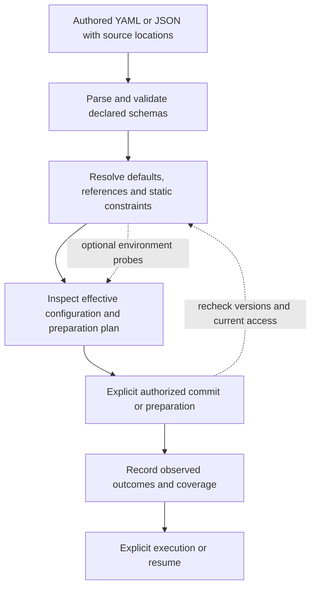

# Configuration languages, contracts and the Conduit object model

2026-10-30. **Research evidence and concrete proposals; this report does not define the schema.**
The five concepts, Profile-owned activation, typed-object semantics, stable object IDs,
default kind/name references with recorded resolved IDs, one local registry with names
unique per kind, and the common `apiVersion`/`kind`/`metadata`/`spec` envelope are accepted in
[DESIGN.md](../DESIGN.md#configuration-language). Detailed fields and algorithms below
remain proposals. Inspection combines `spec` with system-owned `status`; configuration
writes reject `status`, and configuration-only export omits it. Metadata has per-field
ownership, combining editable naming/labels with system-owned identity/version information.
Updates replace complete authored configuration; partial patches are deferred. Expected
ID/version checks are required; the configuration version covers `spec` and editable metadata
but excludes status-only changes. Unchanged submissions retain their version after the
required checks and record an unchanged outcome. Equality compares parsed authored values,
ignoring presentation differences while preserving omission versus an explicit default;
list order follows field contracts, with detailed normalization still open.
Preconditions are separate update-operation inputs; reusable configuration export omits
status and system-owned identity/version values. CLI/editor workflows retain a recoverable
local baseline of original configuration and ID/version; direct API clients supply their checks.
The registry holds active configuration through explicit YAML application/export; input
files are not automatically watched or silently rewritten by CLI/API changes. Submissions
explicitly select create or update intent, rather than deriving it from name matches.
Exact fields and remaining import/export rules are open. This report investigates how to
express the model without turning Conduit into another deployment framework. The research
covers Kubernetes, Docker Compose/Build, schema and configuration languages, and seven papers.

Read alongside [the Pi re-review](PI_CONNECTORS.md) and the
[complete illustrative YAML](five-concepts.proposal.yaml). The YAML has synthetic paths,
accounts and endpoints; it is an authoring example, not executable configuration.

## Recommendation and reading guide

Use **YAML/JSON as an authoring surface over a typed, versioned graph of the five objects**.
Conduit's actual language is the meaning of those objects: references, defaults, composition,
constraints, transitions and effects. YAML alone defines none of that. Keep a small core;
extend Resource and Conduit contracts through explicit plugin schemas. Do not embed a new
general-purpose template, inheritance or programming language in v0.

External generators could later emit the same canonical objects. CUE, Dhall, Nickel or
Jsonnet would then be authoring choices, not alternate authority or runtime paths. The CLI,
MCP surface and frontends should consume the same validated model and expose why each
binding, setting and preparation action was selected.

For collaborator review, read [language qualities](#what-makes-a-good-configuration-language),
[composition](#composition-needs-several-operators), and
[validation and effects](#validation-and-effects-are-separate-contracts), then inspect the
[five-object proposal](#how-the-five-objects-connect). The comparisons and
[papers](#research-papers-and-their-limits) explain the reasoning. Beyond the accepted
envelope and principles, detailed fields, versions and new behaviors remain recommendations.

## What makes a good configuration language

A representative configuration should reveal the system's relationships without making
the reader reconstruct them from scripts or implied defaults. For Conduit, that means
being able to trace Profile → Session → Conduit → Pool → Resource, and Session-to-Session
interaction, without confusing membership, authority and activation.

| Quality | Concrete requirement to consider for Conduit |
| --- | --- |
| Domain fidelity | The five objects retain one meaning each. A Pool collects; a Conduit connects and filters; Profile instructions determine activation. |
| Predictable evaluation | Given the same declared inputs and versions, static resolution produces the same result. Live discovery and authorization observations are recorded separately. |
| Explicit dependencies | References resolve to identifiable objects and versions. Relative paths have a known base; credentials and environment inputs are deliberate. |
| Controlled expressiveness | Reusable objects and selectors cover common cases. Arbitrary conditionals, scripts and inheritance chains need demonstrated use cases before becoming core syntax. |
| Clear composition | Each field declares replacement, set membership or ordered behavior. Permission constraints are not merged like ordinary settings. |
| Useful types | An account reference, byte limit, token budget, duration and operation name are distinct domains, even if some serialize as strings or integers. |
| Inspectability | Show authored value, resolved value, source, applicable limits, unsupported capabilities and the next proposed effects. |
| Helpful errors | Report the object, source location, field path, violated rule and a plausible repair. Preserve multiple independent errors in one report. |
| Evolution | Defaults, interpretation and merge behavior are versioned alongside field shape. Old files do not silently acquire new meaning. |
| Tool parity | Editors, CLI, APIs, agents and frontends use shared schemas and semantic checks. A valid-looking model-generated file has no special trust. |

These are proposed design criteria, not a claim that one notation guarantees them. A short
file can conceal a complicated resolution process; a longer explicit graph can be easier to
inspect. Judge the result by the user's ability to explain and change a Session's effective
configuration, not just line count.

## What to borrow

| Source | Useful mechanism | Proposed Conduit adaptation |
| --- | --- | --- |
| [Kubernetes objects](https://kubernetes.io/docs/concepts/overview/working-with-objects/) | Versioned kinds, metadata, desired `spec`, observed `status`. | One envelope across Profile, Session, Resource, Pool and Conduit. YAML authoring and API/CLI inspection represent the same objects. |
| [API conventions](https://github.com/kubernetes/community/blob/master/contributors/devel/sig-architecture/api-conventions.md) | Stable UID, opaque concurrency version, desired-state generation and status conditions. | Separate durable identity, configuration changes and observed preparation/execution. Never treat a file path as identity. |
| [Labels/selectors](https://kubernetes.io/docs/concepts/overview/working-with-objects/labels/) | Optional metadata and composable set selection; empty-selector behavior is defined by its use. | Pools use refs plus explicit selectors. Conduit filters narrow the resulting candidates; labels do not grant access. |
| [CRD versioning](https://kubernetes.io/docs/tasks/extend-kubernetes/custom-resources/custom-resource-definition-versioning/) | API versions can differ from storage versions, with explicit conversion/migration. | Version public schemas separately from storage, plugin releases and provider protocols. Start with one supported authoring version. |
| [CRD validation](https://kubernetes.io/docs/tasks/extend-kubernetes/custom-resources/custom-resource-definitions/) | Structural schemas and extension subtrees. | Validate core fields strictly; give plugin configuration a named, versioned schema. Prefer a visible typo error to silently pruning unknown configuration. |
| [Gateway API ReferenceGrant](https://gateway-api.sigs.k8s.io/reference/api-types/referencegrant/) | A reference alone does not establish cross-boundary authority; owner approval and runtime reevaluation are separate. | Conduit declarations request relationships; authorized establishment supplies grants. Filters never manufacture permission. No extra top-level Grant concept is necessary to learn this distinction. |
| [Compose include](https://docs.docker.com/reference/compose-file/include/) | Modular files retain a source directory for relative paths. | Explicit configuration roots, source-relative paths and duplicate-identity errors. Avoid discovery determined by the launching terminal's directory. |
| [Compose merge](https://docs.docker.com/reference/compose-file/merge/) | Merge behavior is field-specific, with important sequence exceptions. | Define replacement/addition explicitly; do not inherit a generic YAML deep-merge algorithm for permission lists. |
| [Terraform provider aliases](https://developer.hashicorp.com/terraform/language/block/provider) | Multiple configurations can use the same provider implementation. | Distinct local account/endpoint bindings reuse connector code; avoid implicit provider/account fallback. |
| [Terraform state](https://developer.hashicorp.com/terraform/language/state/purpose) | Configuration addresses and actual object identity need a mapping. | Imported/discovered Resources record native identifiers and management status. Removing a declaration is not permission to delete the external object. |
| [JSON Schema](https://json-schema.org/understanding-json-schema/reference/object) | Required fields, closed objects and extensible structured subtrees. | Publish schemas for editors and validation; cross-object authority/compatibility still requires semantic validation. |

Kubernetes uses controllers to repair desired-state drift, including replacing failed
workloads. Conduit must preserve its explicit-resume rule for stopped executions. Applying
configuration can resolve bindings or show a preparation plan without starting model work.
Likewise, [owner references](https://kubernetes.io/docs/concepts/overview/working-with-objects/owners-dependents/)
have deletion consequences in Kubernetes; they are the wrong representation for Pool membership.

Full server-side field ownership, admission webhooks, Kubernetes namespaces/RBAC, Helm,
Terraform planning engines and a configuration programming language are unnecessary v0
dependencies. Start with explicit objects, validation, resolution and inspection.

## Kubernetes: an API model with configuration semantics

The most useful Kubernetes idea is that configuration is a representation of API objects,
with desired and observed state kept distinct. Its object conventions give identity,
concurrency and change tracking separate roles. A successful write is not proof that a
controller has achieved the requested result. This maps well to a Session whose configuration
is valid while authentication or Resource preparation is still unavailable.
[Objects](https://kubernetes.io/docs/concepts/overview/working-with-objects/) ·
[API conventions](https://github.com/kubernetes/community/blob/master/contributors/devel/sig-architecture/api-conventions.md)

### Schema includes topology, defaults and transitions

Custom-resource structural schemas constrain shape and govern unknown-field pruning;
selected subtrees can preserve unknown data. Kubernetes defaulting and nullable fields
interact, and read-time defaults need not have been stored. CEL validation can compare new
and old values for transition rules; expression cost and collection sizes matter. These
are application semantics beyond YAML parsing. Kubernetes' OpenAPI schema support should
not be treated as interchangeable with every JSON Schema dialect.
[Custom-resource definitions](https://kubernetes.io/docs/tasks/extend-kubernetes/custom-resources/custom-resource-definitions/)

For Conduit, reject unknown core fields rather than pruning a misspelled limit. Reserve
explicit schema-bearing plugin payloads for extension. Validate both a new object and its
proposed transition: an allowed final value does not necessarily make every live transition
safe. Keep conditions requiring current credentials or OS enforcement out of claims made
by an offline schema check.

### Concurrent editing is not ordinary overlay merging

Server-side apply tracks field managers and conflicts. Schema topology distinguishes
atomic collections, sets and maps keyed by selected fields; it also controls granular
versus atomic maps. Changing topology can change update ownership. Omitting a previously
managed field can relinquish or remove it. Field management is an editing mechanism, not
an authorization identity, and other update mechanisms have different conflict behavior.
[Server-side apply](https://kubernetes.io/docs/reference/using-api/server-side-apply/)

Conduit does not need that entire engine for v0. Whole-object revision checks plus explicit
Session overrides are easier to explain. If multiple controllers eventually manage different
parts of an object, adopt field ownership deliberately, with a migration story. Merely naming
list entries does not establish whether updating one entry replaces or merges the list.

Kustomize is a separate configuration transformation layer. Our local probe merged a
built-in Deployment's environment entries by name, but replaced a custom Profile list when
no corresponding schema was supplied. This is evidence about the tested transformations,
not Kubernetes server acceptance or authorization.
[Kustomize](https://kubernetes.io/docs/tasks/manage-kubernetes-objects/kustomization/)

### Versions and dry runs have precise boundaries

Custom-resource served versions, storage versions, conversion and stored-object migration
are separate concerns. Changing the version label alone does not migrate meaning.
Conduit should initially support one authoring version while recording enough identity
and source information to add explicit migrations later.
[Versioning](https://kubernetes.io/docs/tasks/extend-kubernetes/custom-resources/custom-resource-definition-versioning/)

Kubernetes server dry runs execute validation and relevant admission/merge processing
without persisting the result; they require authorization and compatible admission behavior.
They are not an offline parse. Conduit should name its checks by what they actually do,
instead of using one ambiguous “dry run” for parsing, account probes and package installation.
[API dry runs](https://kubernetes.io/docs/reference/using-api/api-concepts/)

## Docker: several languages for different effects

Docker is not one configuration language. A [Dockerfile](https://docs.docker.com/build/concepts/dockerfile/)
describes an image build, including instructions that execute commands. Compose describes
an application model. [Bake](https://docs.docker.com/build/bake/) supplies build targets and
groups using HCL, JSON or Compose input. Their shared ecosystem does not make their
evaluation or effects interchangeable.

This is useful for Conduit: declaring a Resource, preparing its native package and invoking
it are different operations. A Profile can describe preparation without turning ordinary
configuration loading into an implicit build or agent execution.

### Compose is accessible because it provides a domain model

Compose's familiar YAML still has substantial semantics:

| Mechanism | Behavior and implication |
| --- | --- |
| [Merging](https://docs.docker.com/reference/compose-file/merge/) | Mappings combine and many sequences append. Commands have replacement behavior; volumes and ports have distinct uniqueness keys. Explicit reset/override tags change the result. Conduit needs field-specific rules, especially for access and activation. |
| [Interpolation](https://docs.docker.com/reference/compose-file/interpolation/) | Substitution occurs per file before merging. Unset variables can warn and become empty; required forms fail. This makes the input environment part of meaning. Prefer declared inputs over implicit host-environment expansion. |
| [Fragments](https://docs.docker.com/reference/compose-file/fragments/) | YAML anchors offer document-local reuse; they are resolved before interpolation. They do not define stable cross-file object references or package identities. |
| [Extensions](https://docs.docker.com/reference/compose-file/extension/) | The `x-` convention reserves ignored fields. Conduit needs a distinction between inert annotations and executable plugin configuration that requires a known schema. |
| [Version field](https://docs.docker.com/reference/compose-file/version-and-name/) | Compose's old top-level version is now informational/obsolete; it does not pin an older schema interpretation. Conduit's proposed `apiVersion` must have a stronger, explicit contract. |
| [Canonical rendering](https://docs.docker.com/reference/cli/docker/compose/config/) | The CLI exposes a resolved application model. Conduit should likewise make effective configuration inspectable, with sensitive values protected. |
| [Startup order](https://docs.docker.com/compose/how-tos/startup-order/) | Started dependencies are not necessarily ready; health/completion conditions are distinct. Resource declaration, preparation and usability need separate status. |

Build-time `ARG` and image/runtime `ENV` also have different lifetimes; neither is a suitable
secret store. Conduit should keep credential references outside ordinary parameter merging
and label when a value is consumed: at resolution, preparation or execution.
[Build variables](https://docs.docker.com/build/building/variables/)

### A concrete documentation and implementation mismatch

The inspected [Compose include documentation](https://docs.docker.com/reference/compose-file/include/)
says conflicting names are not merged. Installed **Compose 5.1.0** instead merged a root
service override with an included service in our fixture: the root image won and the
included volume survived. Its [dependency declaration](https://github.com/docker/compose/blob/v5.1.0/go.mod)
pins compose-go 2.10.1, whose [include implementation](https://github.com/compose-spec/compose-go/blob/v2.10.1/loader/include.go#L176)
calls the merge routine for that collision. This conclusion is limited to that version and
case; it does not establish all include-conflict behavior across releases.

Synthetic reproduction:

```yaml
# module/compose.yaml
services:
  worker:
    image: fixture.invalid/never-pulled:one
    volumes: [./data:/data]
```

```yaml
# compose.yaml
include: [./module/compose.yaml]
services:
  worker:
    image: fixture.invalid/never-pulled:two
```

Rendering with `docker compose -f compose.yaml config --format json` on the tested version
produced image `:two` and the module-relative volume. No container was started. The lesson
for Conduit is to maintain executable semantic fixtures alongside prose and schemas:
field shape can remain unchanged while merge behavior changes the resulting system.

### Offline observations

Thirteen checks passed against installed **Compose 5.1.0**, **kubectl 1.34.1** and its
**Kustomize 5.7.1**. They used synthetic temporary files, a minimal environment, an empty
Docker configuration directory and an absent kubeconfig. Only local configuration rendering
ran; no daemon operation, image pull, cluster request, login or model call occurred.

| Checks | Observed result |
| --- | --- |
| 1–3: Compose overlays | DNS appended; command replaced; unchanged environment keys survived; volume target collisions replaced sources while distinct published ports coexisted. |
| 4: Explicit tags | `!reset` cleared ports and `!override` replaced DNS. |
| 5–6: Interpolation | Missing value warned and became empty; a required value failed rendering. |
| 7: Cross-file anchor | An alias in another file could not resolve the first file's anchor. |
| 8–9: Include | Module-relative paths were preserved; the root service override merged as described above. |
| 10–11: Validation/version | A misspelled service field was rejected; an `x-` field was accepted and legacy `version` warned. |
| 12–13: Kustomize | Built-in named environment entries merged; a custom list without supplied schema replaced as a whole. |

These fixtures establish local behavior only. Kubernetes documentation was read as current
on 2026-10-30; no matching server was tested. The other languages below were investigated
through their primary documentation, not executed or benchmarked.

## Alternative languages and contract systems

The useful comparison is what each system contributes to authoring, validation and evaluation,
not which has the nicest syntax. None is selected as a dependency by this research.

| System | Mechanism worth understanding | Fit and limitation for Conduit |
| --- | --- | --- |
| [CUE](https://cuelang.org/docs/reference/spec/) | Values and constraints share a model; unification combines constraints, is commutative/associative/idempotent, and detects contradictions. Defaults involve alternatives rather than arbitrary last-writer precedence. | Strong inspiration for narrowing filters and typed validation; possible external authoring/schema tooling. Constraint intersection is not the same operation as Session override or activation sequencing. |
| [Dhall](https://docs.dhall-lang.org/discussions/Safety-guarantees.html) | Typed, total configuration functions and semantic integrity checks for imports. Imports can involve files, environment or network; termination does not guarantee cheap evaluation or successful I/O. | Useful model for reproducibility, typed composition and pinned dependencies. Could generate canonical objects; does not replace live access checks or runtime readiness. |
| [Nickel contracts](https://nickel-lang.org/user-manual/contracts/) and [merging](https://nickel-lang.org/user-manual/merging/) | Composable configurations with runtime contracts, delayed checks and priority-aware merging. Diagnostics can identify the source of a contract violation. The merging guide itself carries a version caveat. | Good lessons for source-aware errors and defaults. Deferred validation means successful construction alone may not check every field; whole-output validation needs an explicit boundary. |
| [Jsonnet](https://jsonnet.org/ref/language.html) | Functional generation and object composition, with lazy evaluation and explicit external inputs. Its documentation recommends top-level arguments over globally coupled external variables for libraries. | Useful optional generator for repeated objects. Functions and inheritance should not become required knowledge for understanding a resolved Conduit Session. |
| [CEL](https://cel.dev/overview/cel-overview) | An expression environment with declared variables/functions and separate parsing, checking and evaluation. | Candidate for bounded predicates if fixed selectors become insufficient. Define types, cost limits and permitted functions first; no expression engine is needed to ship refs and label selectors. |
| [Terraform conditions](https://developer.hashicorp.com/terraform/language/validate) | Input validation, preconditions, postconditions and non-blocking checks serve different stages and consequences. Some facts depend on values only known later. | Distinguish invariants from operational checks and observations. A connection-health warning and an invalid permission request should not share one generic validation outcome. |

### JSON Schema describes data, not the entire contract

JSON Schema's `default`, `readOnly` and `writeOnly` are annotations; the evaluator does not
thereby fill missing values or enforce authorization. Conduit needs explicit resolution and
write permissions, and distinct authoring/observation shapes where appropriate.
[Annotations](https://json-schema.org/understanding-json-schema/reference/annotations)

`allOf` requires every subschema; it is not inheritance with field overrides. `oneOf` requires
exactly one match. Prefer explicit discriminators for Resource configuration and operation
variants so errors can point at the intended branch.
[Combining schemas](https://json-schema.org/understanding-json-schema/reference/combining)

Closed objects help catch typos, but `additionalProperties` considers its local schema;
composition may require `unevaluatedProperties` or a different schema design. Declare a
specific supported dialect and test the chosen validator rather than assuming editor support
means runtime parity. Schema `$ref` references schemas; a Conduit Resource reference points
to an actual object and requires graph resolution.
[Object validation](https://json-schema.org/understanding-json-schema/reference/object)

For Rust, choose one authoritative schema/type definition path and generate the other
representations where practical. Shared fixtures should verify Rust decoding, editor schemas
and plugin validation agree. Do not hand-maintain three competing interpretations of the
same field. The source-of-truth toolchain and crates remain implementation decisions.

## Research papers and their limits

These sources support the design reasoning; none measures Conduit or proves a particular
language will work for agent systems. Findings from large operational systems and formal
contract languages should be transferred as testable design hypotheses.

| Paper | Evidence and useful conclusion | Limit and proposed Conduit response |
| --- | --- | --- |
| Xu and Zhou, **[Systems Approaches to Tackling Configuration Errors: A Survey](https://cseweb.ucsd.edu/~tixu/papers/csur.pdf)**, ACM Computing Surveys, 2015. [DOI](https://doi.org/10.1145/2791577) | Organizes prevention, detection and diagnosis approaches, including the difficulty of systematic configuration testing. | A survey of earlier systems, not a comparison of our candidate syntax. Build a taxonomy of failures spanning parsing, references, compatibility, transitions and environment; schema validity is one layer. |
| Xu et al., **[Hey, You Have Given Me Too Many Knobs!](https://cseweb.ucsd.edu/~tixu/papers/fse15.pdf)**, ESEC/FSE 2015. [DOI](https://doi.org/10.1145/2786805.2786852) | Studies operational configuration use in commercial and open-source systems and identifies over-designed options, inappropriate low-level controls and opportunities to simplify domains. | Observed option use does not prove a universal ideal option count. Keep the five-object core small; add settings for concrete scenarios rather than exposing every runtime implementation choice. |
| Xu, Pandey and Klemmer, **[An HCI View of Configuration Problems](https://arxiv.org/abs/1601.01747)**, 2016 preprint. | Reframes configuration around human interaction and assistance, rather than syntax alone. | Exploratory framing, not a controlled evaluation of Conduit. Show the effective graph and explanations next to errors; do not require users to remember invisible precedence. |
| Xu et al., **[Early Detection of Configuration Errors to Reduce Failure Damage](https://www.usenix.org/conference/osdi16/technical-sessions/presentation/xu)**, OSDI 2016. [Paper](https://www.usenix.org/system/files/conference/osdi16/osdi16-xu.pdf) | PCheck brings checks of later-used configuration forward, reducing the damage of errors discovered only on particular execution paths. | The approach is neither sound nor complete for all configuration failures; valid values can still be wrong for a workload. Separate offline checks from explicit environment probes and retain runtime failure handling. |
| Zhang et al., **[An Evolutionary Study of Configuration Design and Implementation in Cloud Systems](https://arxiv.org/abs/2102.07052)**, 2021 study. [Paper](https://arxiv.org/pdf/2102.07052) | Examines 1,178 commits over 2.5 years in HDFS, HBase, Spark and Cassandra; configuration evolution includes defaults, constraints, dependencies and diagnostic changes. | Four systems and a commit-selection method limit generalization. Treat changes in defaults and interpretation as compatibility changes, and retain migration/conformance examples. |
| Tang et al., **[Interpreted Formalisms for Configurations](https://arxiv.org/abs/1712.04982)**, 2017 preprint. [Paper](https://arxiv.org/pdf/1712.04982) | Uses formal types and constraints in a Hadoop configuration case study to express facts that primitive strings/integers miss. | Narrow prototype, not proof of whole-system correctness; richer environment-dependent cases remain difficult. Give durations, budgets, references and constraints domain meaning without requiring a theorem prover in v0. |
| Freund et al., **[Union and Intersection Contracts Are Hard, Actually](https://arxiv.org/abs/2106.06278)**, DLS 2021; revised preprint 2022. [DOI](https://doi.org/10.1145/3486602.3486767) | Explains subtle tradeoffs in higher-order union/intersection contracts, including effects and blame. | This does not invalidate ordinary JSON Schema Boolean combinations. Avoid embedding arbitrary higher-order contract programs; start with tagged data variants and explicit operation/state-machine semantics. |

For the next discussion, the most useful reading order is **Too Many Knobs → Evolutionary
Study → HCI View**, followed by the formal-contract papers if we consider a richer embedded
language. They argue for careful semantics and diagnostics, not for choosing a notation by
popularity alone.

## Proposed envelope and versions

```yaml
apiVersion: conduit.example/v1alpha1
kind: Pool
metadata:
  name: frontend-toolkit
  labels:
    domain: engineering
spec:
  members:
    refs:
      - kind: Resource
        name: frontend-skills
```

`conduit.example` is a deliberately reserved illustrative group, not a domain to adopt or
an asserted production identifier. Recommend choosing one actual API group and a Kubernetes-
style `v1alpha1 → v1beta1 → v1` progression when the schema is accepted. Use one core group
for the five kinds initially. Namespaced Resource/Conduit contract identifiers can evolve
independently without inventing a new top-level kind for every integration.

Keep these identifiers and versions separate:

| Value | Meaning |
| --- | --- |
| `apiVersion` | How to interpret the authored/exported object. |
| Resource/Conduit `contract` version | The payload/operation contract implemented by a plugin or built-in adapter. |
| `metadata.uid` | Registry-assigned durable identity, stable across an explicit rename. |
| `metadata.resourceVersion` | Illustrative spelling for the configuration-update version; status-only changes do not invalidate it. |
| `metadata.generation` | Which desired configuration the system should evaluate. |
| Recorded source revision/digest | Which skill, document, model catalog or external object was actually used. |
| Provider/MCP version | Wire compatibility negotiated with an external service. |
| Plugin/runtime release | The executable implementation producing behavior. |

The reference distinction between generation, resourceVersion and conditions is useful;
Conduit need not implement Kubernetes' full watch/storage behavior. A stored knowledge
record's immutable content revision is also not automatically the configuration object's
resourceVersion. [API concurrency](https://kubernetes.io/docs/reference/using-api/api-concepts/)

Stable IDs preserved through rename and renewed on delete/recreate are accepted, as are
default kind/name references with the resolved ID recorded. `metadata.uid` remains an
illustrative encoding. V0's single local registry and names unique per kind are accepted;
namespaces and cross-registry references are deferred. Duplicate-definition handling and
recording configuration generation during resolution remain proposals. Established bindings
from explicit references now retain resolved identity across renames; deletion makes the
target unavailable, and replacement requires explicit rebinding. This does not pin content
versions or permissions. Exact rebind operations and live selector behavior remain for review.

Registry authority and explicit configuration updates are accepted; storage technology and
Resource-content updates are separate. Explicit create/update intent is also accepted:
creation conflicts on an existing kind/name; an update requires an existing target and its
expected ID/version. Neither silently becomes the other. Updates replace complete authored
configuration; omitted optional fields follow their omission/default/validation rules rather
than retaining old explicit values. Identity is preserved, system-owned fields remain managed
by Conduit, and partial patches are deferred. Unchanged submissions retain the configuration
version after authorization and ID/version checks, with an unchanged operation outcome;
stale submissions still conflict. Equality compares parsed authored values, ignoring
presentation-only formatting, comments and mapping-key order while distinguishing omission
from an explicit default. Lists follow their field-specific order rules. CLI/editor workflows
retain the original configuration and its ID/version in recoverable local editing state,
separate from reusable YAML; direct API clients supply the required preconditions. Storage/lifecycle,
missing-baseline recovery, normalization, version-transition details, commands, batch handling
and remaining import mechanics are proposals. Exporting a Session snapshot must not make applying
it restart work, clone credentials or create a duplicate execution. Session creation is normally
a CLI/API operation; a YAML file per conversation is optional.

## How the five objects connect

### Profile and Session

A Profile describes bootstrap runtime/model/account preferences, default Conduit references,
activation rules and limits. Account references are local credential registrations, not
secrets or an additional top-level `Account` kind. These bootstrap choices do not grant the
agent access to every Resource associated with an account. Resource content still arrives
through Pools and Conduits; reusable instructions/settings bundles do not bypass that route.

The Session resolves one Profile plus explicit overrides and records the snapshot and
origins. Its runtime can construct a preparation plan before inference. Model/account/runtime
changes during work should establish a recorded execution boundary; behavioral Profile edits
do not silently change current Sessions. Live limits remain authoritative.

Proposed Session desired configuration contains `profileRef`, explicit overrides and selected
Conduit declarations. Observed state contains the resolved Profile generation, configuration
digest, runtime/account identity evidence, independent binding IDs, preparation results,
lifecycle, execution state and capability coverage. Avoid independently editable binding
lists on both Session and Conduit objects.

Recommend making the **Session the authority for its binding instances**. A Conduit object
is a reusable declaration; the Session status contains its actual binding references. Other
objects expose reverse indexes/views, not a second competing source of truth. This fits a
Profile instantiated four times without duplicating the declarations.

### Resource

Use a common envelope with an extensible `spec.contract`, `spec.connector` and plugin-specific
`spec.config`. These illustrative names identify a contract and its implementation; they do
not introduce new core concepts. Unknown plugin payloads can be retained for inspection but
must be reported unavailable for activation until their schema/implementation is available.

Keep generic metadata small. Do not hardcode every possible Resource category into Pool,
Profile or Conduit schemas. Compatibility, operations and native schemas can be declared or
discovered through the Resource's contract; labels remain optional organizational metadata.
The trust/source of discovered capability claims needs recording.

A Resource can represent a provider service or collection rather than one YAML object per
ticket, file or tool. For example, an MCP connection Resource exposes native tool identities
and resource URIs beneath it. Filtering and activation can select those sub-capabilities
through that contract. Stable container identity must not hide replacement of a native tool's
schema, source or auth boundary.

Explicit Resources exist independently of Pools. Prefer top-level declarations initially;
defer inline objects unless their identity/update semantics justify the extra syntax. Discovery
may generate registry entries without requiring the user to hand-author them. Imported folders,
repositories and remote objects retain attachment/management status.

### Pool

Proposed membership is the deduplicated union of explicit references and label-selector
matches within the selected registry. Labels belong on Resources because selection examines
the objects being collected; a Pool's own labels describe the Pool. No labels are required
when explicit references suffice. Defer Pool nesting initially.

Recommend standard `matchLabels` plus `matchExpressions` (`In`, `NotIn`, `Exists`,
`DoesNotExist`), with AND inside one selector and OR between selectors. Missing selector
means no selector-derived members. Reject an empty Pool selector rather than accidentally
collecting everything; an intentional all-members mode should be explicit. Missing refs stay
visible as unresolved members. Membership cannot read private payloads merely to evaluate labels.

**Proposed change policy:** membership matches update live; newly admitted Resources become
available, not automatically activated. Removing membership retracts that path on future
managed use, while independent paths still apply. Profile activation results record which
versions were prepared; replacement requires the defined refresh/reconfigure boundary.
Deleting a Pool removes the grouping/path, not the member Resources or underlying data.

### Conduit

A declaration specifies a versioned interaction contract and endpoints, requested operations
and narrowing filters. Session binding supplies authenticated identity and resolved authority.
For a resource Conduit, the target is a Pool. For a communication Conduit, the target can be
a Session or an explicitly resolved set; fan-out/recipient selection still needs a ruling.

In the example, `source: {session: self}` is a template binding placeholder, not an identity
the caller may assert over the wire. Actual sender identity comes from the authenticated
Session execution. `access.requested` expresses what binding asks to use; authoring that YAML
does not grant it. The binding resolver intersects it with established authority, Profile
limits and exclusions. A local user's explicitly authorized setup may establish those grants
without a confirmation for each permitted call.

Recommended access calculation for each binding:

```text
Pool candidates
  ∩ binding's authorized resources and operations
  ∩ Conduit selection/filter
  ∩ live Profile limits
  − explicit exclusions
= usable capabilities for this binding
```

Combine **usable capabilities**, not loose fields from unrelated bindings. If binding A
permits reading `src/**` and binding B permits writing `docs/**`, their union must not grant
writing `src/**`. Keep Resource, operation and constraint together as a capability tuple.
A filter can narrow one path without globally denying another independent authorized path;
use an explicit exclusion/limit for a global denial. This needs concrete tests before schema
approval because naïve merging would change the meaning of the accepted rules.

Resource identity, operation, native sub-capability and supported path constraints belong
in filters. Activation actions, package installers, prompt budgets and load order stay in
the Profile. Transport choice and backend wiring are not filters either.

## Profile activation proposal

The YAML example uses a named list of structured preparation steps with explicit actions,
selectors and required/optional handling. Free-text guidance can coexist, but cannot stand
in for a successful installation, tool registration or access check. Actions are extensible
through compatible adapters rather than an arbitrary embedded workflow language.

Recommended initial behaviors:

| Operation | Proposed behavior |
| --- | --- |
| Advertise skills | Load permitted metadata; full skill text remains on-demand. |
| Register tools | Prepare permitted connection/native schemas; defer model exposure where supported. Check dispatch separately. |
| Load selected instructions | Read permitted Resource revisions into the context budget; record what was loaded. |
| Prepare a workspace | Attach/mount through the compatible execution adapter without implying deletion authority. |
| Unsupported native extension | Report unsupported; never equate compatible model family with compatible runtime hooks. |

All activation matching is evaluated over the **already permitted inventory**. A selector
here chooses preparation targets; it cannot reach another Pool or change the Conduit's
permissions. When multiple steps conflict, report the conflict or use an explicit preference;
do not choose by filesystem scan order. Distinguish downloaded, registered, advertised,
loaded into context and actually invoked in the observed result.

## Composition needs several operators

“Merge configuration” is too vague for this system. These relationships have different
algebraic properties and should have distinct, documented behavior:

| Relationship | Proposed composition | Example |
| --- | --- | --- |
| Profile defaults and Session overrides | Ordered replacement for explicitly supplied settings. | A selected model replaces the default; order matters. |
| Pool refs and selector matches | Set union, deduplicated by resolved identity. | A Resource selected twice remains one Resource with two membership explanations. |
| Filters and mandatory limits | Intersection/narrowing; repeating a constraint cannot widen access. | A path filter and read-only limit both apply. |
| Independent authorized bindings | Union of complete constrained capabilities. | Read `src/**` plus write `docs/**` does not imply write `src/**`. |
| Profile activation | Explicit sequence/dependencies and conflict rules. | Registering a tool and loading instructions are actions, not unordered set members. |
| Desired state and observation | Compare/record; never merge observation into authored intent. | An unavailable connection does not rewrite the requested Resource configuration. |

The narrowing analogy comes from constraint systems such as CUE; the exact Conduit access
calculus still needs tests. In particular, exclusions and independent grant paths must retain
their accepted meanings. One universal deep-merge function would erase those distinctions.

### Missing, empty, null and reset

Recommended behavior for the **Session override of a default Conduit list**, not a rule for
every field and not settled syntax:

| Authored form | Proposed meaning |
| --- | --- |
| Override absent | Use the default selection determined by the accepted precedence rules. |
| Explicit replacement with `[]` | Select no default Conduit bindings. |
| Explicit replacement with entries | Use exactly the supplied declarations, subject to authority and limits. |
| Explicit add operation | Extend the selection and deduplicate identical declarations. |
| `null` | Reject unless the field explicitly defines a nullable value; do not silently treat it as reset. |
| Reset operation | If introduced, explicitly return to current defaults during reconfiguration; never infer it from YAML emptiness. |

Make similar choices for each public field. Do not give numeric zero an implicit “unlimited”
meaning or interpret an empty filter as unrestricted unless the contract explicitly says so.
When changing defaults, preserve existing Sessions' resolved behavioral configuration; the
same protection must not freeze live access limits.

## Validation and effects are separate contracts

A Resource contract needs more than the JSON shape of its configuration. For example, a
memory update may be structurally valid but based on a stale revision; a tool call may be
accepted while its outcome is unknown. Describe the following layers explicitly:

| Layer | What it can establish | What it cannot establish alone |
| --- | --- | --- |
| Syntax and shape | Supported YAML subset, field types, required/disallowed fields, tagged variants and bounds. | The referenced Pool exists or a credential is usable. |
| Object graph | Unique identity, reference kinds, versions, selector semantics, forbidden dependency cycles and resolution bases. | A live remote service supports the requested operation now. |
| Behavioral contract | Preconditions, valid transitions, operation effects, outcome meanings, retry/cancel behavior and error categories. | Enforcement by an unavailable or incompatible adapter. |
| Environment and authority | Current authenticated identity, effective capabilities, compatibility and available enforcement. | Continued availability or unchanged authority after the check. |
| Execution evidence | What was attempted, accepted, performed, observed or remains unknown. | That every effect outside Conduit's visibility was captured. |

Graph cycles need relationship-specific rules. Mutual communication can be valid, while
a preparation dependency cycle may be impossible to schedule. Do not reject every cycle
merely because the objects form a graph.

### Proposed resolution and effect boundaries



This is a conceptual pipeline, not a requirement for one validation pass or one process.
Schema checks may run again after normalization and resolution. Proposed user-facing
operations should expose their effects:

- **Validate/resolve offline:** read the selected local inputs and cached schemas; no package
  execution, login, network retrieval or model turn. Unresolved live facts remain unknown.
- **Probe explicitly:** inspect declared services or identities using an adapter that states
  its effects. Even a connection check can refresh credentials or start a local MCP process;
  do not automatically label every probe read-only.
- **Prepare/apply:** record the configuration change and perform authorized installations,
  registration or binding changes with separate outcomes. Applying a Session export does
  not implicitly launch a model or resume stopped work.
- **Execute/resume:** start agent work under current permissions through the selected runtime.

A preview is an observation, not a durable permission grant. At commit/dispatch, recheck
relevant generations, current access and environmental assumptions. A local object-batch
commit can be atomic while external preparation cannot; do not promise rollback of an
already completed package install or remote effect.

For inspection, retain both authored and resolved representations. An error should identify
the source field and the reason a capability is absent, with scoped diagnostic detail.
For example: “Profile activation step `load-guide` matched Resource `guide`, but the selected
Conduit permits metadata only; content read is unavailable.” Proposed stable diagnostic
codes would let frontends and agents react without parsing prose.

Record a source digest separately from a normalized configuration digest. The latter should
include semantic version inputs and the resolved behavioral snapshot; neither digest is an
object UID or proof of permission. Live membership, credential freshness and authorization
belong in dated observations, not a claim that a fixed hash makes the running system immutable.
Source locations and comments should survive editing where practical even though they are
not part of semantic equality. Secret values must not leak through resolved exports or hashes
of easily guessable secrets.

## Resolution, updates and YAML semantics

The proposed v0 loader reads explicit local configuration roots, with optional predictable
directory conventions. Directory placement is organization, not identity or implicit grants.
Multiple files and multi-document YAML are sufficient for modularity; a general include,
template or inheritance language can wait. Relative paths resolve against the declaring file
or the native package's own base, with the resolved base recorded. Moving a config file can
therefore change a relative path and should show in the resolution diff.

Use a documented [YAML 1.2](https://yaml.org/spec/1.2.2/) subset that maps cleanly to JSON:
string keys, unique mapping keys, finite numbers and no executable/custom tags. Reject
duplicate keys, unsupported fields and cyclic/unbounded alias expansion. Do not silently
interpret `yes`/`no` as booleans, evaluate shell strings or expand arbitrary environment
variables. Credentials resolve through explicit references, not string interpolation.
Namespaced plugin config is validated by its declared schema.

Recommended precedence:

1. Resolve one Profile's behavioral defaults.
2. Apply explicit Session behavioral overrides; required limits cannot be weakened.
3. Select Conduit declarations. For review, propose a visible replacement mode or explicit
   add mode across Profile defaults and launch-selected Pool defaults; do not silently union
   the two. The existing rule that explicit choices replace Pool defaults still holds.
4. Resolve membership, authority and filters; then prepare Profile activation.
5. Persist the resolved configuration and its sources; show changes before applying an
   explicit reconfiguration. No mandatory extra approval is implied for authorized changes.

Permission/filter lists should not inherit Compose-style sequence appending. Prefer whole-
list replacement for overrides plus a separate explicit add operation. Named activation steps
can support targeted edits later, once their merge semantics are defined. `null`, omission
and `[]` must have distinct documented meanings wherever they are accepted.

Status conditions should separately express validity, reference resolution, authorization,
compatibility, preparation and runtime readiness, with the evaluated generation. A single
`ready: true` cannot say whether a model is entitled, a token is fresh, a tool is available or
an OS restriction is enforced. Preserve unknown states. Avoid copying credentials or full
private prompt content into status exports.

### Version meaning, not just field names

Maintain conformance examples for defaults, missing/null/empty behavior, list composition,
reference resolution, transitions and failure outcomes. A change to any of those may break
an existing configuration without changing its schema shape. Unknown contract versions
should remain explicitly unsupported, not be interpreted as the nearest familiar version.

For each proposed breaking change, show old input, old resolved meaning, migrated input and
new resolved meaning. Avoid automatic migrations that widen access, change the selected
account, start work or lose native configuration. An alpha designation permits iteration;
it does not eliminate the need to identify which interpretation produced a Session.

Do not import Kubernetes' whole controller model or Docker's include/overlay machinery just
to gain familiar syntax. The first implementation can be a Rust resolver and registry behind
a shared API, with explicit operations and adapters. Future richer authoring tools can target
that same contract.

## Failure matrix for the example

| Change/failure | Expected result under the proposal |
| --- | --- |
| Same skill Resource appears in two Pools | One identity, both membership paths; compatible identical activation deduplicates. |
| Resource has no labels but is explicitly referenced | Included normally. |
| Profile activation matches a Resource outside its Conduits | No match; no access expansion. |
| New Resource acquires `domain: application` | Live Pool membership can change; authority/filter still checked, no automatic prompt injection. |
| Permission label or requested operation edited by an unauthorized actor | No new authority merely from configuration content. |
| Explicit Session Conduit list is empty | In explicit replacement mode, no default bindings; bootstrap settings alone do not expose Pool resources. |
| Resource-specific read/write grants arrive through different paths | Union of constrained capabilities, not a resource/operation cross-product. |
| Two skill resources expose the same command name | Visible conflict until a preference/alias is selected. |
| Profile instructions change | New Sessions get them; existing Sessions retain resolved behavior until reconfigured. |
| Live Profile limit is narrowed | Future managed calls obey it immediately; isolated non-revocable access stops execution. |
| A required source revision cannot be fetched | Required preparation fails; no silent substitution. Optional preparation can be skipped visibly. |
| Pool deleted | Bindings lose that access path; underlying Resource content remains. |
| Referenced name deleted and recreated | Different UID; existing binding does not silently follow it. |
| Model account refresh fails | Show auth failure; no API-key or alternate-account fallback. |
| Communication peer offline | Contract-specific pending/unavailable state; not an implicit new Session or model turn. |
| Observation stream falls behind | Refresh snapshot with an explicit gap; do not claim every event was consumed. |
| Tool response lost after possible effect | Preserve operation ID and unknown outcome; reconcile before unsafe retry. |
| Plugin schema missing | Retain inspectable declaration and report unsupported capability. |
| YAML duplicate key / unknown limit field | Reject with source location; do not silently choose or discard a value. |

## Scope of validation

The companion YAML passed structural checks using the installed Psych 3.1.0 parser:
15 objects, 20 resolved object references, four distinct Session/account aliases, overlapping
Pool membership and Profile-only activation. Duplicate mapping keys are checked explicitly;
a deliberately duplicated key was rejected. These are example checks, not YAML 1.2 parser
conformance, validation against an implemented Conduit schema or proof of authorization.
Synthetic source paths and accounts are intentionally unresolved at runtime. The common
envelope is accepted; detailed fields, identifiers and semantics in the example remain proposals.

The Compose/Kustomize checks above add evidence about reference systems; they do not validate
this proposed Conduit language. No CUE/Dhall/Nickel/Jsonnet evaluator, Kubernetes server,
Conduit runtime or live account behavior was tested. Research used official documentation,
versioned source where relevant and the linked papers; current documentation can differ
from installed implementations, as the include fixture demonstrated.

The findings now inform the language-focused rounds in [REVIEW.md](../REVIEW.md): objects
and references; resolution and composition; activation and Session changes; Resource and
adapter contracts; Conduit contracts; validation and evolution. Review the concrete inputs,
effective results and failure cases before selecting Rust types, formal schemas or runtime
implementation details.
