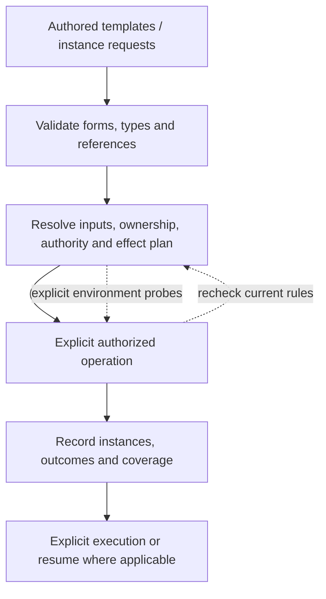

# Configuration languages, templates and instances

2026-10-30. **Research evidence and proposals; this report does not define the schema.**
The accepted model has four families, each with template and instance forms. Resource
instances are created only through, and owned exclusively by, a Pool instance. Conduit
instances are connections. [DESIGN.md](../DESIGN.md#configuration-language) retains the
envelope, family kinds with top-level forms, explicit kind/form/name references, identity and
checked-edit contracts. All four families support template-based creation and direct creation
from complete instance YAML. Direct creation requires an explicit unique name; Resource
creation remains Pool-mediated. Instances are edited directly; no template/input history is
required, and continuing Resource and authority dependencies are explicit.

This report retains Kubernetes/Docker investigations, configuration-language comparisons,
seven papers and source-specific probes. Its proposals express the current model without
requiring a general deployment framework. Read alongside [Pi research](PI_CONNECTORS.md),
[connection scenarios](CONDUITS.md) and the synthetic
[template/instance scenario](templates-instances.scenario.yaml). Fixture fields are candidates,
not accepted API syntax or an executable implementation.

## Recommendation and reading guide

Use **YAML/JSON as an authoring surface over a typed, versioned graph of the four families and their template/instance forms**.
Conduit's actual language is the meaning of those objects: references, defaults, composition,
constraints, transitions and effects. YAML alone defines none of that. Keep a small core;
extend Resource and Conduit contracts through explicit plugin schemas. Do not embed a new
general-purpose template, inheritance or programming language in v0.

External generators could later emit the same canonical objects. CUE, Dhall, Nickel or
Jsonnet would then be authoring choices, not alternate authority or runtime paths. The CLI,
MCP surface and frontends should consume the same validated model and expose why each
binding, setting and preparation action was selected.

For collaborator review, read [language qualities](#what-makes-a-good-configuration-language),
[composition](#composition-needs-several-operators), and
[validation and effects](#validation-and-effects-are-separate-contracts), then inspect the
[template/instance proposal](#proposed-template-and-instance-forms). The comparisons and
[papers](#research-papers-and-their-limits) explain the reasoning. Beyond the accepted
envelope and principles, detailed fields, versions and new behaviors remain recommendations.

## What makes a good configuration language

A representative configuration should reveal the system's relationships without making
the reader reconstruct them from scripts or implied defaults. For Conduit, that means
being able to trace Session template → Session instance → connection → Pool instance → Resource instance, and Session-to-Session
interaction, without confusing ownership, authority and activation.

| Quality | Concrete requirement to consider for Conduit |
| --- | --- |
| Domain fidelity | The four families have template and instance forms. A Pool instance owns/provisions Resources; connections implement interactions; Session-spec instructions determine activation. |
| Predictable evaluation | Given the same declared inputs and versions, static resolution produces the same result. Live discovery and authorization observations are recorded separately. |
| Explicit dependencies | References resolve to identifiable objects and versions. Relative paths have a known base; credentials and environment inputs are deliberate. |
| Controlled expressiveness | Reusable objects and selectors cover common cases. Arbitrary conditionals, scripts and inheritance chains need demonstrated use cases before becoming core syntax. |
| Clear composition | Each field declares replacement, set membership or ordered behavior. Permission constraints are not merged like ordinary settings. |
| Useful types | An account reference, byte limit, token budget, duration and operation name are distinct domains, even if some serialize as strings or integers. |
| Inspectability | Show authored value, resolved value, source, applicable limits, unsupported capabilities and the next proposed effects. |
| Helpful errors | Report the object, source location, field path, violated rule and a plausible repair. Preserve multiple independent errors in one report. |
| Evolution | Defaults, interpretation and merge behavior are versioned alongside field shape. Old files do not silently acquire new meaning. |
| Tool parity | Editors, CLI, APIs, agents and frontends use shared schemas and semantic checks. A valid-looking model-generated file has no special trust. |

These are proposed design criteria, not a claim that one notation guarantees them. A short
file can conceal a complicated resolution process; a longer explicit graph can be easier to
inspect. Judge the result by the user's ability to explain and change a Session's effective
configuration, not just line count.

## What to borrow

| Source | Useful mechanism | Proposed Conduit adaptation |
| --- | --- | --- |
| [Kubernetes objects](https://kubernetes.io/docs/concepts/overview/working-with-objects/) | Versioned kinds, metadata, desired `spec`, observed `status`. | One envelope across Session, Resource, Pool and Conduit templates/instances. YAML authoring and API/CLI inspection represent the same objects. |
| [API conventions](https://github.com/kubernetes/community/blob/master/contributors/devel/sig-architecture/api-conventions.md) | Stable UID, opaque concurrency version, desired-state generation and status conditions. | Separate durable identity, configuration changes and observed preparation/execution. Never treat a file path as identity. |
| [Labels/selectors](https://kubernetes.io/docs/concepts/overview/working-with-objects/labels/) | Optional metadata and composable set selection; empty-selector behavior is defined by its use. | References/selectors may select templates or owned Resource instances. They never adopt foreign instances or grant access; connection filters narrow authorized candidates. |
| [CRD versioning](https://kubernetes.io/docs/tasks/extend-kubernetes/custom-resources/custom-resource-definition-versioning/) | API versions can differ from storage versions, with explicit conversion/migration. | Version public schemas separately from storage, plugin releases and provider protocols. Start with one supported authoring version. |
| [CRD validation](https://kubernetes.io/docs/tasks/extend-kubernetes/custom-resources/custom-resource-definitions/) | Structural schemas and extension subtrees. | Validate core fields strictly; give plugin configuration a named, versioned schema. Prefer a visible typo error to silently pruning unknown configuration. |
| [Gateway API ReferenceGrant](https://gateway-api.sigs.k8s.io/reference/api-types/referencegrant/) | A reference alone does not establish cross-boundary authority; owner approval and runtime reevaluation are separate. | Conduit declarations request relationships; authorized establishment supplies grants. Filters never manufacture permission. No extra top-level Grant concept is necessary to learn this distinction. |
| [Compose include](https://docs.docker.com/reference/compose-file/include/) | Modular files retain a source directory for relative paths. | Explicit configuration roots, source-relative paths and duplicate-identity errors. Avoid discovery determined by the launching terminal's directory. |
| [Compose merge](https://docs.docker.com/reference/compose-file/merge/) | Merge behavior is field-specific, with important sequence exceptions. | Define replacement/addition explicitly; do not inherit a generic YAML deep-merge algorithm for permission lists. |
| [Terraform provider aliases](https://developer.hashicorp.com/terraform/language/block/provider) | Multiple configurations can use the same provider implementation. | Distinct local account/endpoint bindings reuse connector code; avoid implicit provider/account fallback. |
| [Terraform state](https://developer.hashicorp.com/terraform/language/state/purpose) | Configuration addresses and actual object identity need a mapping. | Imported/discovered Resources record native identifiers and management status. Removing a declaration is not permission to delete the external object. |
| [JSON Schema](https://json-schema.org/understanding-json-schema/reference/object) | Required fields, closed objects and extensible structured subtrees. | Publish schemas for editors and validation; cross-object authority/compatibility still requires semantic validation. |

Kubernetes uses controllers to repair desired-state drift, including replacing failed
workloads. Conduit must preserve its explicit-resume rule for stopped executions. Applying
configuration can resolve bindings or show a preparation plan without starting model work.
Likewise, [owner references](https://kubernetes.io/docs/concepts/overview/working-with-objects/owners-dependents/)
distinguish lifecycle ownership from selection. Conduit now has exclusive Pool ownership,
but must define owner retirement and retention explicitly rather than inherit Kubernetes
cascading deletion. Ordinary reference selection still does not assign ownership.

Full server-side field ownership, admission webhooks, Kubernetes namespaces/RBAC, Helm,
Terraform planning engines and a configuration programming language are unnecessary v0
dependencies. Start with explicit objects, validation, resolution and inspection.

## Kubernetes: an API model with configuration semantics

The most useful Kubernetes idea is that configuration is a representation of API objects,
with desired and observed state kept distinct. Its object conventions give identity,
concurrency and change tracking separate roles. A successful write is not proof that a
controller has achieved the requested result. This maps well to a Session whose configuration
is valid while authentication or Resource preparation is still unavailable.
[Objects](https://kubernetes.io/docs/concepts/overview/working-with-objects/) ·
[API conventions](https://github.com/kubernetes/community/blob/master/contributors/devel/sig-architecture/api-conventions.md)

### Schema includes topology, defaults and transitions

Custom-resource structural schemas constrain shape and govern unknown-field pruning;
selected subtrees can preserve unknown data. Kubernetes defaulting and nullable fields
interact, and read-time defaults need not have been stored. CEL validation can compare new
and old values for transition rules; expression cost and collection sizes matter. These
are application semantics beyond YAML parsing. Kubernetes' OpenAPI schema support should
not be treated as interchangeable with every JSON Schema dialect.
[Custom-resource definitions](https://kubernetes.io/docs/tasks/extend-kubernetes/custom-resources/custom-resource-definitions/)

For Conduit, reject unknown core fields rather than pruning a misspelled limit. Reserve
explicit schema-bearing plugin payloads for extension. Validate both a new object and its
proposed transition: an allowed final value does not necessarily make every live transition
safe. Keep conditions requiring current credentials or OS enforcement out of claims made
by an offline schema check.

### Concurrent editing is not ordinary overlay merging

Server-side apply tracks field managers and conflicts. Schema topology distinguishes
atomic collections, sets and maps keyed by selected fields; it also controls granular
versus atomic maps. Changing topology can change update ownership. Omitting a previously
managed field can relinquish or remove it. Field management is an editing mechanism, not
an authorization identity, and other update mechanisms have different conflict behavior.
[Server-side apply](https://kubernetes.io/docs/reference/using-api/server-side-apply/)

Conduit does not need that entire engine for v0. Whole-object revision checks plus explicit
Session overrides are easier to explain. If multiple controllers eventually manage different
parts of an object, adopt field ownership deliberately, with a migration story. Merely naming
list entries does not establish whether updating one entry replaces or merges the list.

Kustomize is a separate configuration transformation layer. Our local probe merged a
built-in Deployment's environment entries by name, but replaced a custom Session template list when
no corresponding schema was supplied. This is evidence about the tested transformations,
not Kubernetes server acceptance or authorization.
[Kustomize](https://kubernetes.io/docs/tasks/manage-kubernetes-objects/kustomization/)

### Versions and dry runs have precise boundaries

Custom-resource served versions, storage versions, conversion and stored-object migration
are separate concerns. Changing the version label alone does not migrate meaning.
Conduit should initially support one authoring version while recording enough identity
and source information to add explicit migrations later.
[Versioning](https://kubernetes.io/docs/tasks/extend-kubernetes/custom-resources/custom-resource-definition-versioning/)

Kubernetes server dry runs execute validation and relevant admission/merge processing
without persisting the result; they require authorization and compatible admission behavior.
They are not an offline parse. Conduit should name its checks by what they actually do,
instead of using one ambiguous “dry run” for parsing, account probes and package installation.
[API dry runs](https://kubernetes.io/docs/reference/using-api/api-concepts/)

## Docker: several languages for different effects

Docker is not one configuration language. A [Dockerfile](https://docs.docker.com/build/concepts/dockerfile/)
describes an image build, including instructions that execute commands. Compose describes
an application model. [Bake](https://docs.docker.com/build/bake/) supplies build targets and
groups using HCL, JSON or Compose input. Their shared ecosystem does not make their
evaluation or effects interchangeable.

This is useful for Conduit: declaring a Resource, preparing its native package and invoking
it are different operations. A Session template can describe preparation without turning ordinary
configuration loading into an implicit build or agent execution.

### Compose is accessible because it provides a domain model

Compose's familiar YAML still has substantial semantics:

| Mechanism | Behavior and implication |
| --- | --- |
| [Merging](https://docs.docker.com/reference/compose-file/merge/) | Mappings combine and many sequences append. Commands have replacement behavior; volumes and ports have distinct uniqueness keys. Explicit reset/override tags change the result. Conduit needs field-specific rules, especially for access and activation. |
| [Interpolation](https://docs.docker.com/reference/compose-file/interpolation/) | Substitution occurs per file before merging. Unset variables can warn and become empty; required forms fail. This makes the input environment part of meaning. Prefer declared inputs over implicit host-environment expansion. |
| [Fragments](https://docs.docker.com/reference/compose-file/fragments/) | YAML anchors offer document-local reuse; they are resolved before interpolation. They do not define stable cross-file object references or package identities. |
| [Extensions](https://docs.docker.com/reference/compose-file/extension/) | The `x-` convention reserves ignored fields. Conduit needs a distinction between inert annotations and executable plugin configuration that requires a known schema. |
| [Version field](https://docs.docker.com/reference/compose-file/version-and-name/) | Compose's old top-level version is now informational/obsolete; it does not pin an older schema interpretation. Conduit's proposed `apiVersion` must have a stronger, explicit contract. |
| [Canonical rendering](https://docs.docker.com/reference/cli/docker/compose/config/) | The CLI exposes a resolved application model. Conduit should likewise make effective configuration inspectable, with sensitive values protected. |
| [Startup order](https://docs.docker.com/compose/how-tos/startup-order/) | Started dependencies are not necessarily ready; health/completion conditions are distinct. Resource declaration, preparation and usability need separate status. |

Build-time `ARG` and image/runtime `ENV` also have different lifetimes; neither is a suitable
secret store. Conduit should keep credential references outside ordinary parameter merging
and label when a value is consumed: at resolution, preparation or execution.
[Build variables](https://docs.docker.com/build/building/variables/)

### A concrete documentation and implementation mismatch

The inspected [Compose include documentation](https://docs.docker.com/reference/compose-file/include/)
says conflicting names are not merged. Installed **Compose 5.1.0** instead merged a root
service override with an included service in our fixture: the root image won and the
included volume survived. Its [dependency declaration](https://github.com/docker/compose/blob/v5.1.0/go.mod)
pins compose-go 2.10.1, whose [include implementation](https://github.com/compose-spec/compose-go/blob/v2.10.1/loader/include.go#L176)
calls the merge routine for that collision. This conclusion is limited to that version and
case; it does not establish all include-conflict behavior across releases.

Synthetic reproduction:

```yaml
# module/compose.yaml
services:
  worker:
    image: fixture.invalid/never-pulled:one
    volumes: [./data:/data]
```

```yaml
# compose.yaml
include: [./module/compose.yaml]
services:
  worker:
    image: fixture.invalid/never-pulled:two
```

Rendering with `docker compose -f compose.yaml config --format json` on the tested version
produced image `:two` and the module-relative volume. No container was started. The lesson
for Conduit is to maintain executable semantic fixtures alongside prose and schemas:
field shape can remain unchanged while merge behavior changes the resulting system.

### Offline observations

Thirteen checks passed against installed **Compose 5.1.0**, **kubectl 1.34.1** and its
**Kustomize 5.7.1**. They used synthetic temporary files, a minimal environment, an empty
Docker configuration directory and an absent kubeconfig. Only local configuration rendering
ran; no daemon operation, image pull, cluster request, login or model call occurred.

| Checks | Observed result |
| --- | --- |
| 1–3: Compose overlays | DNS appended; command replaced; unchanged environment keys survived; volume target collisions replaced sources while distinct published ports coexisted. |
| 4: Explicit tags | `!reset` cleared ports and `!override` replaced DNS. |
| 5–6: Interpolation | Missing value warned and became empty; a required value failed rendering. |
| 7: Cross-file anchor | An alias in another file could not resolve the first file's anchor. |
| 8–9: Include | Module-relative paths were preserved; the root service override merged as described above. |
| 10–11: Validation/version | A misspelled service field was rejected; an `x-` field was accepted and legacy `version` warned. |
| 12–13: Kustomize | Built-in named environment entries merged; a custom list without supplied schema replaced as a whole. |

These fixtures establish local behavior only. Kubernetes documentation was read as current
on 2026-10-30; no matching server was tested. The other languages below were investigated
through their primary documentation, not executed or benchmarked.

## Alternative languages and contract systems

The useful comparison is what each system contributes to authoring, validation and evaluation,
not which has the nicest syntax. None is selected as a dependency by this research.

| System | Mechanism worth understanding | Fit and limitation for Conduit |
| --- | --- | --- |
| [CUE](https://cuelang.org/docs/reference/spec/) | Values and constraints share a model; unification combines constraints, is commutative/associative/idempotent, and detects contradictions. Defaults involve alternatives rather than arbitrary last-writer precedence. | Strong inspiration for narrowing filters and typed validation; possible external authoring/schema tooling. Constraint intersection is not the same operation as Session override or activation sequencing. |
| [Dhall](https://docs.dhall-lang.org/discussions/Safety-guarantees.html) | Typed, total configuration functions and semantic integrity checks for imports. Imports can involve files, environment or network; termination does not guarantee cheap evaluation or successful I/O. | Useful model for reproducibility, typed composition and pinned dependencies. Could generate canonical objects; does not replace live access checks or runtime readiness. |
| [Nickel contracts](https://nickel-lang.org/user-manual/contracts/) and [merging](https://nickel-lang.org/user-manual/merging/) | Composable configurations with runtime contracts, delayed checks and priority-aware merging. Diagnostics can identify the source of a contract violation. The merging guide itself carries a version caveat. | Good lessons for source-aware errors and defaults. Deferred validation means successful construction alone may not check every field; whole-output validation needs an explicit boundary. |
| [Jsonnet](https://jsonnet.org/ref/language.html) | Functional generation and object composition, with lazy evaluation and explicit external inputs. Its documentation recommends top-level arguments over globally coupled external variables for libraries. | Useful optional generator for repeated objects. Functions and inheritance should not become required knowledge for understanding a resolved Conduit Session. |
| [CEL](https://cel.dev/overview/cel-overview) | An expression environment with declared variables/functions and separate parsing, checking and evaluation. | Candidate for bounded predicates if fixed selectors become insufficient. Define types, cost limits and permitted functions first; no expression engine is needed to ship refs and label selectors. |
| [Terraform conditions](https://developer.hashicorp.com/terraform/language/validate) | Input validation, preconditions, postconditions and non-blocking checks serve different stages and consequences. Some facts depend on values only known later. | Distinguish invariants from operational checks and observations. A connection-health warning and an invalid permission request should not share one generic validation outcome. |

### JSON Schema describes data, not the entire contract

JSON Schema's `default`, `readOnly` and `writeOnly` are annotations; the evaluator does not
thereby fill missing values or enforce authorization. Conduit needs explicit resolution and
write permissions, and distinct authoring/observation shapes where appropriate.
[Annotations](https://json-schema.org/understanding-json-schema/reference/annotations)

`allOf` requires every subschema; it is not inheritance with field overrides. `oneOf` requires
exactly one match. Prefer explicit discriminators for Resource configuration and operation
variants so errors can point at the intended branch.
[Combining schemas](https://json-schema.org/understanding-json-schema/reference/combining)

Closed objects help catch typos, but `additionalProperties` considers its local schema;
composition may require `unevaluatedProperties` or a different schema design. Declare a
specific supported dialect and test the chosen validator rather than assuming editor support
means runtime parity. Schema `$ref` references schemas; a Conduit Resource reference points
to an actual object and requires graph resolution.
[Object validation](https://json-schema.org/understanding-json-schema/reference/object)

For Rust, choose one authoritative schema/type definition path and generate the other
representations where practical. Shared fixtures should verify Rust decoding, editor schemas
and plugin validation agree. Do not hand-maintain three competing interpretations of the
same field. The source-of-truth toolchain and crates remain implementation decisions.

## Research papers and their limits

These sources support the design reasoning; none measures Conduit or proves a particular
language will work for agent systems. Findings from large operational systems and formal
contract languages should be transferred as testable design hypotheses.

| Paper | Evidence and useful conclusion | Limit and proposed Conduit response |
| --- | --- | --- |
| Xu and Zhou, **[Systems Approaches to Tackling Configuration Errors: A Survey](https://cseweb.ucsd.edu/~tixu/papers/csur.pdf)**, ACM Computing Surveys, 2015. [DOI](https://doi.org/10.1145/2791577) | Organizes prevention, detection and diagnosis approaches, including the difficulty of systematic configuration testing. | A survey of earlier systems, not a comparison of our candidate syntax. Build a taxonomy of failures spanning parsing, references, compatibility, transitions and environment; schema validity is one layer. |
| Xu et al., **[Hey, You Have Given Me Too Many Knobs!](https://cseweb.ucsd.edu/~tixu/papers/fse15.pdf)**, ESEC/FSE 2015. [DOI](https://doi.org/10.1145/2786805.2786852) | Studies operational configuration use in commercial and open-source systems and identifies over-designed options, inappropriate low-level controls and opportunities to simplify domains. | Observed option use does not prove a universal ideal option count. Keep the four-family core small; add settings for concrete scenarios rather than exposing every runtime implementation choice. |
| Xu, Pandey and Klemmer, **[An HCI View of Configuration Problems](https://arxiv.org/abs/1601.01747)**, 2016 preprint. | Reframes configuration around human interaction and assistance, rather than syntax alone. | Exploratory framing, not a controlled evaluation of Conduit. Show the effective graph and explanations next to errors; do not require users to remember invisible precedence. |
| Xu et al., **[Early Detection of Configuration Errors to Reduce Failure Damage](https://www.usenix.org/conference/osdi16/technical-sessions/presentation/xu)**, OSDI 2016. [Paper](https://www.usenix.org/system/files/conference/osdi16/osdi16-xu.pdf) | PCheck brings checks of later-used configuration forward, reducing the damage of errors discovered only on particular execution paths. | The approach is neither sound nor complete for all configuration failures; valid values can still be wrong for a workload. Separate offline checks from explicit environment probes and retain runtime failure handling. |
| Zhang et al., **[An Evolutionary Study of Configuration Design and Implementation in Cloud Systems](https://arxiv.org/abs/2102.07052)**, 2021 study. [Paper](https://arxiv.org/pdf/2102.07052) | Examines 1,178 commits over 2.5 years in HDFS, HBase, Spark and Cassandra; configuration evolution includes defaults, constraints, dependencies and diagnostic changes. | Four systems and a commit-selection method limit generalization. Treat changes in defaults and interpretation as compatibility changes, and retain migration/conformance examples. |
| Tang et al., **[Interpreted Formalisms for Configurations](https://arxiv.org/abs/1712.04982)**, 2017 preprint. [Paper](https://arxiv.org/pdf/1712.04982) | Uses formal types and constraints in a Hadoop configuration case study to express facts that primitive strings/integers miss. | Narrow prototype, not proof of whole-system correctness; richer environment-dependent cases remain difficult. Give durations, budgets, references and constraints domain meaning without requiring a theorem prover in v0. |
| Freund et al., **[Union and Intersection Contracts Are Hard, Actually](https://arxiv.org/abs/2106.06278)**, DLS 2021; revised preprint 2022. [DOI](https://doi.org/10.1145/3486602.3486767) | Explains subtle tradeoffs in higher-order union/intersection contracts, including effects and blame. | This does not invalidate ordinary JSON Schema Boolean combinations. Avoid embedding arbitrary higher-order contract programs; start with tagged data variants and explicit operation/state-machine semantics. |

For the next discussion, the most useful reading order is **Too Many Knobs → Evolutionary
Study → HCI View**, followed by the formal-contract papers if we consider a richer embedded
language. They argue for careful semantics and diagnostics, not for choosing a notation by
popularity alone.

## Proposed template and instance forms

The accepted representation uses one family `kind` plus a top-level template/instance `form`.
Family and form jointly determine the schema and operations; templates and instances do not
need identical payloads. `form` sits beside `kind`; `spec` contains the configuration for that
family and form. Readable object references include `kind`, `form` and `name`: kind/name
locates the object, while form validates the intended target. A wrong-form target is rejected.

The scenario fixture follows the accepted envelope and readable reference shape. Its payloads
remain illustrative; status shape, command names, operation payloads and instance export are open.
Reusable template registration, instance creation, native provisioning and starting
execution must remain distinguishable even if a frontend offers a combined operation.

Templates and creation choices materialize complete instance specs across all four families;
direct creation from complete instance YAML is also supported under the same validation,
authority and Pool-ownership requirements, with an explicit unique name.
Template expansion produces an instance draft customized through ordinary instance fields.
V0 introduces no separate template-parameter declarations or mappings. YAML/CLI/API edits
can be automated; normal validation and default materialization apply to the complete result.
Instances operate from and edit their own configuration; changes or deletion of the creation
template do not alter it. No historical source snapshots or input/override ledger are required.
Resource and authority dependencies are explicit; configuration does not freeze current access
or backing data. A Pool's explicit Resource-template references for future provisioning remain
ordinary dependencies, distinct from its own creation template.

Instance creation and checked replacement updates materialize declared schema defaults into
saved/exported specs. Instance equality compares these materialized values; templates retain
authored omission distinctions. Missing fields without defaults follow their required/optional
contracts. This is application behavior; a schema's default annotation alone does not supply it.

Keep authoring interpretation, template configuration version, resolved instance configuration,
retained-record revision, source digest, plugin release and native protocol version separate.
A reusable template is configuration for a typed capability; its contract schema defines
what that configuration means. Template inheritance or arbitrary expression evaluation is
not required to obtain reuse.

Stable object identity and expected-ID/configuration-version checks remain accepted. Names
are unique within each family across both forms in the single local registry. A template
uses a reusable concept name; an instance defaults to that name plus a generated unique suffix,
with explicit unique names also allowed. Suffix format remains open. The fixture uses explicit
instance names for readability. Opening twice from a Conduit template intentionally creates
two connections; retrying the same create request must instead follow
the operation-outcome contract. Exact idempotency/identity fields are open.

## How the families connect

### Sessions

Session templates contain runtime/model/account defaults, required limits, connection choices
and activation instructions. Materialize the template and creation choices into the Session
spec, or create from complete instance YAML. Later changes edit that instance. Required limits
and live dependencies are explicit.
Resource-service authentication is separate from model-account selection. A native agent's
login profile is not a Session template or Session history store.

Templates choose how permitted Resources are prepared: advertise skills, register native
MCP configuration, prepare a workspace or load relevant instructions. Operations need ordering,
compatibility, required/optional behavior and cleanup rules. A Resource's presence does not
itself place content in model context.

### Resources and Pools

A Resource template describes supported creation/attachment behavior. Only a Pool creates
its Resource instances; registering a template does not deploy anything. Pool templates can
select Resource templates and defaults, while Pool instances provide the ownership boundary
for actual provisioning. Ownership assignment, partial provisioning, failures and retries need
one explicit contract so an instance cannot be published as usable without an owner.

Reuse templates across Pools, not membership of one Resource instance. Contracts distinguish
new backing data from attachment to existing data. Two local registrations can refer to the
same provider object or directory and therefore share native conflicts and quotas. Native
target identity is not necessarily equal to registry Resource identity.

Reference/selector algebra must name its domain: reusable templates, the Pool's own Resource
instances, or native sub-capabilities exposed by one such instance. Labels cannot silently
transfer ownership. Removing a selector match is not inherently a cleanup instruction.
Content-level record contexts and task-associated workspaces remain meaningful inside the
Resource contract; they do not add another owner to a Resource instance.

Pool deletion can no longer be treated as removal of a collection with unrelated members.
Define owner retirement, possible transfer, active use and incomplete provisioning explicitly.
Preserve backing data on registration deletion; orphan detection alone is not permission to
purge a local checkout, provider data or retained conversation history.

### Conduits and connections

A Conduit template describes a versioned interaction contract, endpoint roles, requested
operations, filters and support requirements. Opening from a template or complete configuration
creates a connection; joining selects
an existing connection. Participants have their own authenticated attachments. Neither join
nor template reuse silently shares credentials, clients or private Session history.

A connection's shared bookkeeping and runtime are distinct from its backing Resources. If it
needs retained conversation storage, it requests provisioning through a selected Pool, which
owns the resulting Resource. Each Resource access follows the owner Pool and current authority;
connections do not introduce a second unscoped provisioning path.

Candidate interaction families remain capability requests, retained exchanges and observations.
They need different success, cancellation, retention and recovery meanings. A communication
protocol can operate across Pool boundaries without pooling ownership of its backing store.
Composition can reuse typed contracts and references, but required dependencies, independent
status and partial effects need explicit semantics.

## Composition needs several operators

| Relationship | Proposed composition | Case to test |
| --- | --- | --- |
| Template expansion and creation edits | Assignments replace whole field values, including objects/lists; nested-child edits preserve siblings. | Assigning `[c]` to `[a, b]` produces `[c]`; no implicit append, parameter mapping or historical delta is required. |
| Pool provisioning selections | Select templates and explicit creation intents; instance identity matters. | Two intentional instances of one template must not be deduplicated as one. |
| Selection within owned instances | Set/filter semantics within the correct ownership boundary. | A Resource matching twice remains one candidate; a foreign Pool's instance is not adopted. |
| Filters and required limits | Intersection/narrowing. | Repeating a constraint never widens access. |
| Independent authorized paths | Union of complete constrained capabilities. | Read `src/**` plus write `docs/**` does not create write access to `src/**`. |
| Session activation and provisioning dependencies | Explicit ordering with distinct effects and failure rules. | Loading a guide, obtaining credentials and creating storage are not interchangeable steps. |
| Intent versus observation | Compare and record, rather than merge. | A failed deployment does not silently rewrite the authored template. |

Default materialization and draft field replacement are settled. Preserving, adding or removing
entries requires deliberate edits; this does not introduce a partial-update registry protocol.
Remaining omission, null, empty-collection, reset, ordering and duplicate-identity details need
per-field rules. A Pool's default access selection applies only when no explicit replacement is
supplied; combination with Session-spec choices remains open. Access-path composition keeps its
separate semantics.

## Validation and effects are separate contracts

| Layer | Establishes | Does not establish alone |
| --- | --- | --- |
| Syntax/schema | Valid family/form payload, units, required/disallowed fields. | A referenced instance exists or is authorized. |
| Object graph | Form-correct references, ownership, creation inputs and explicit dependencies. | Native compatibility or service readiness. |
| Behavioral contract | Valid transitions, operation effects, retry/cancel and outcome meanings. | Enforcement by an unsupported adapter. |
| Environment/authority | Current identity, access, native compatibility and coverage. | Continued availability or frozen permission. |
| Operation evidence | Accepted, completed, failed or unknown effects with attribution. | Effects outside the integration's observation boundary. |



This describes effect boundaries, not an automatic controller or one universal pipeline.
An offline check should not log in, start a package, mutate a provider or spend model tokens.
A probe can have effects, including credential refresh or a local MCP process; declare them.
A local registry transaction cannot roll back an already completed external provisioning step.
Operation IDs and uncertain-effect reconciliation remain necessary.

A connection opening may depend on Pool provisioning and Session activation, but it must not
hide those outcomes. Show missing prerequisites, per-participant authentication, partially
available components and unsupported restrictions. A single `ready` field cannot express all
of these. Ordinary references may become unavailable after deletion; ownership dependencies
need additional lifecycle rules, not accidental cascading behavior.

## Resolution, updates and YAML semantics

Propose explicit local configuration roots, predictable file discovery and source-relative
paths, with native-package bases retained. Reusable templates are typed objects, not text
macros. A general include or inheritance language can wait. Decide how optional inline
configurations acquire identity/provenance and whether they can later be promoted to templates.

A constrained [YAML 1.2](https://yaml.org/spec/1.2.2/) surface should use string keys, reject
duplicate keys, define finite numeric/unit types and bound alias expansion.
Do not silently expand shell/environment strings or interpret unsupported null/empty values.
Plugin configuration needs a named/versioned schema. These parser details remain proposals.

Unknown-field rejection is accepted for templates and instances, except in schema-declared
open maps. Plugin schemas can define their own fields and open maps; map keys/values retain
their declared constraints. Unavailable-schema handling remains distinct from unavailable
runtime support and is still under review.

The complete instance spec is authoritative for configuration. Template-origin information
is optional; it is not required to operate or edit an instance. The representation must still
distinguish Pool ownership, native backing target, explicit live dependencies, requested effects
and observations. Source-template changes do not alter instances; current access still applies.

Keep the accepted checked-write/baseline/export rules in DESIGN.md rather than duplicating
them here. Decide how exporting a template differs from exporting an instance specification,
a resolved configuration or a recovery snapshot. Applying an inspection dump cannot assert
runtime status, clone credentials or launch duplicate work. Configuration-only export remains
portable and does not carry system-owned identity/version values as editable configuration.

### Version meaning, not just field names

Publish examples covering family/form references, defaults, selectors, ownership, provisioning,
transitions and failure outcomes. A change to those meanings can break compatibility while
leaving the YAML shape unchanged. A migration must explain the old and new interpretation,
including what happens to existing instances. Unknown contract versions remain unsupported.
Choose the actual API group and version progression separately from the illustrative fixture.

## Failure matrix for the example

| Change/failure | Outcome or open decision to test |
| --- | --- |
| A template is used by two Pools | Each Pool receives distinct Resource instances; no shared ownership. |
| Two instances attach to one directory/provider object | Shared backing identity/conflicts are visible; separate registration is not isolation. |
| A Pool selects a foreign instance by label | It cannot adopt or own it; access must use an authorized path to the owner. |
| Opening a connection needs a store | Provision through the designated Pool; expose failures and no unowned usable instance. |
| Pool provisioning partly succeeds | Retain known effects and operation identity; do not assume external rollback. |
| A create response is lost | Reconcile/retry using the original operation identity, distinct from deliberate new creation. |
| Template and instance have similar names | Form-qualified resolution must choose the intended object or fail clearly. |
| Creation template changes or disappears | Existing instance configuration remains usable independently; explicit dependencies and current authority still apply. |
| Pool retirement encounters active Resources | Apply the lifecycle chosen in review; never infer orphan purge permission. |
| Model/account refresh fails | Report failure; no alternate-account or API-billing fallback. |
| Communication peer is offline | Report contract-specific pending/unavailable state without an implicit model turn. |
| Tool effect may have occurred but response is missing | Outcome remains unknown until reconciliation; no unsafe automatic repetition. |
| A plugin schema or protocol feature is unsupported | Explain the unavailable capability; do not drop restrictions. |

## Scope of validation

The companion YAML is a synthetic scenario, with reusable template descriptions, explicit
operation requests and expected relations. It is not the configuration language, an API
implementation or a live provisioning plan. Structural checks cover parsing, reference/form
consistency, exclusive ownership and separation of open/join intent; they do not prove adapter
behavior, authorization, native compatibility or a completed deployment.

The Compose/Kustomize probes and papers above remain evidence about reference systems. They
do not validate a Conduit runtime. No provider enrollment, real resource provisioning or model
execution is performed by this documentation rewrite. Source-specific Pi findings remain in
[PI_CONNECTORS.md](PI_CONNECTORS.md) and [PI_RUNTIME.md](PI_RUNTIME.md). The grouped questions
in [REVIEW.md](../REVIEW.md) determine how the proposal becomes an implementable contract.
