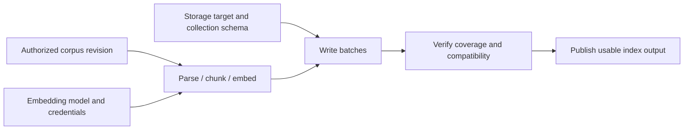

# Establishment, ordering, outputs and recovery

**Current-design reading note:** [SPEC.md](../SPEC.md) and [DESIGN.md](../DESIGN.md#shared-access-and-authentication)
define five template/instance families, Pool-managed shared service authentication and
Conduit-mediated access. Templates supply establishment, runtime and permitted-change contracts;
plugin operations and graphs implement handlers, while instances own ongoing state. Source-system
terminology is retained where it describes those systems; proposed syntax below is not a schema.

Research: 2026-10-31. **Source evidence and lifecycle examples; no live provider work.**
Read [the current construction contract](../DESIGN.md#establishment-contracts-and-instance-state),
then the cases below and the [filesystem comparison](#filesystem-plugins-and-template-examples).
This report extends [configuration research](CONFIGURATION.md) and the
[Pi Durable investigation](PI_RUNTIME.md#pi-durable-in-depth).

## Construction boundary

The examples require ordering, typed outputs, interaction waits and recoverable establishment.
The chosen authoring approach is typed template YAML with an inline or referenced plugin graph.
Plugins implement provider-specific behavior; graph bindings describe composition and order.
A single typed plugin operation can implement a simple handler. Conduit's engine coordinates
progress and recovery, while the instance owns ongoing services from startup.

YAML represents this contract; a different notation would not itself supply identity, safe retries
or readiness. An author can compose existing operations without spelling out OAuth exchanges or
filesystem syscalls. Provider-internal steps remain code unless exposing them is useful to the
public contract. No general workflow language, per-step Resource or extra operation document is
required. Exact branching, handler and continuation schemas remain in review.

For ordinary service access, establishment happens through the owning Pool's capability and
manages its shared authentication. Consumer attachment authorizes use of that capability; it is
not another mandatory provider login. Distinct service identities remain an explicit exception.
Agent model-subscription setup remains a separate account contract. A construction graph finishes;
it does not retain ownership of authentication refresh, transport clients or database processes.

## Evidence from existing systems

The references illustrate separate mechanisms, not interchangeable runtimes or guarantees.

| Source | Evidence | Design implication |
| --- | --- | --- |
| [Compose startup order](https://docs.docker.com/compose/how-tos/startup-order/) | Dependencies distinguish started, healthy and completed-successfully conditions. | A dependency needs a meaningful readiness/completion gate; process existence is insufficient. |
| [Kubernetes init containers](https://kubernetes.io/docs/concepts/workloads/pods/init-containers/) | Regular init containers complete sequentially before application containers start. | Configuration can declare ordered setup while implementations perform the work. This does not supply all of Conduit's human-interaction or output-binding semantics. |
| [Kubernetes Jobs](https://kubernetes.io/docs/concepts/workloads/controllers/job/) | Even a one-completion, one-parallelism Job may start the same program twice. | Scheduling an action once does not establish exactly-once external effects. |
| [Pulumi inputs and outputs](https://www.pulumi.com/docs/iac/concepts/inputs-outputs/) | Output-to-input references track dependencies; explicit dependencies cover relationships without a data value. | Model typed output bindings and prerequisite conditions, not reliance on document order. Pulumi's resource lifecycle is not Conduit's chosen implementation. |
| [Open Workflow specification](https://github.com/open-workflow-specification/specification/blob/main/dsl-reference.md), formerly Serverless Workflow | Its structured DSL defines sequential tasks, retry policies, output schemas and timeouts. | YAML-shaped declarations can express execution semantics; adopting the entire workflow language is a separate decision. |
| [Temporal activities](https://docs.temporal.io/activities) | Activity code performs effects; idempotency is recommended for retries, and smaller activities can improve recovery boundaries. | Provider implementation and orchestration can be separate. Recovery checkpoints should follow meaningful effects, not every function call. |
| [Pi Durable tool task](https://github.com/earendil-works/pi/blob/0441483926f283e42ca44eb7b4a46552e9469d6f/packages/durable/src/harness/tool.ts) | Persists final arguments/replay policy before execution; recovery reruns only when both stored and current policies permit it. | Retain intent/outcomes and conservative replay, while preserving Conduit's current-access checks. This is pinned source evidence, not live provider verification. |

The prior [Docker/Kubernetes and language-paper review](CONFIGURATION.md) remains applicable:
configuration quality depends on visible relationships, explicit meanings and useful errors.
These examples justify a stronger lifecycle contract, not a claim that a notation is inherently
powerful, safe or sufficient without its engine.

## Consequences of the documentation review

| Existing direction | Consequence of these examples |
| --- | --- |
| Templates carry establishment intent | Preserve it; completing a template must not require a second request recipe containing missing setup choices. |
| YAML over typed objects | Preserve the serialization choice provisionally; strengthen the behavioral contract before considering new syntax. A static schema is insufficient. |
| Resource types remain unitary; Pools own instances | Preserve the split between storage, indexing and access. A convenient composed setup does not erase those boundaries. |
| Activation instructions belong in Agent configuration | Separate agent-followed guidance from engine-executed lifecycle declarations. A prompt telling the model to log in is not a reliable authentication state machine. |
| No mandatory template snapshots or override ledger | Preserve that simplification; incomplete effects still need their own minimal continuation inputs and evidence. |
| General durable workflow runtime deferred | Do not interpret this as deferring all multi-stage recovery. A bounded plugin lifecycle protocol is necessary for the requested examples. |
| Instance spec and observed status are separate | Preserve it; neither declared readiness nor successful schema validation proves that authentication/indexing completed. |

These cases support the chosen template/plugin/instance boundary. Their detailed stage names,
policies and payloads remain proposals; no additional object family or scheduler is selected.

## Where the contract belongs

| Concern | Template / typed declaration | Plugin implementation | Conduit engine |
| --- | --- | --- | --- |
| Intended capability | Create/attach choice, target, selected account/method, relevant options. | Interpret supported values and implement provider behavior. | Validate type/form, resolve ownership and enforce current managed authority. |
| Dependencies | Named inputs and Conduit connections; required/optional prerequisites. | Declare compatible input/output contracts and necessary gates. | Detect unsatisfied dependencies and establish allowed ordering. |
| Provider procedure | Select a supported behavior, such as native subscription login. | Commands, HTTP exchanges, pagination, provider-specific branching and parsing. | Dispatch, record progress and report supported/unsupported behavior. |
| Interaction | Whether interactive establishment is allowed; selected identity remains explicit. | Describe a browser/device/unlock challenge and verify its response. | Present the wait through available frontends; correlate completion to the attempt. |
| Results | Select outputs needed by consumers; configuration does not assert success. | Return typed identifiers, handles, readiness evidence and failures. | Validate, retain and deliver results under current permissions. |
| Recovery | Choose supported limits/policies where useful. | Report idempotency/reconciliation capabilities and persistable phase state. | Track attempts, prevent duplicate local dispatch, request reconciliation and reject unsafe retries. |
| Cleanup | Explicit lifecycle intent and permitted retention behavior. | Distinguish client release, compensation and backing-data deletion. | Preserve other consumers and Pool-owned data; report incomplete cleanup. |

The plugin's semantic contract is public even when its implementation is code. An author should
be able to discover prerequisites, outputs, effects, interaction needs and recovery limitations
before choosing a type. Exposing every HTTP call as a configurable stage would weaken that
abstraction; hiding the entire lifecycle behind an unexplained success/failure flag would too.

Complete templates can use explicit references and declared context, including an owning Pool
or relative-path base. They do not embed every external value or secret. Customization continues
through ordinary typed fields; this proposal does not reinstate a generic parameter-mapping DSL.

## Ordering and dependency semantics

Recommend **strict prerequisite order with bounded parallelism for independent work**:

- A dependent action starts only when its named inputs and required conditions are satisfied.
  A folder attachment may require existence; a query surface may require a completed index build.
- Internal stages such as exchange-login-response then verify-identity have strict plugin-owned
  order. Cross-instance dependencies are visible in declarations and engine inspection.
- Input references imply data dependencies. Explicit readiness/completion prerequisites cover
  ordering without a value. Avoid a second hand-maintained order list duplicating the data graph.
- YAML mapping order has no execution meaning. A field defined as an ordered list may have one;
  neither list order nor alphabetical object order silently becomes a global startup schedule.
- Independent components can prepare concurrently within limits. Shared credential refresh,
  provider quotas, collection mutation and shared backing paths may require serialization even
  without a data dependency. Coordinate on actual backing/account identity, not only Resource ID.
- Reject or explain an unsatisfiable **blocking establishment cycle**. A password store whose
  only unlock credential must be fetched through itself needs a bootstrap source. Communication
  cycles among already-established Agents are valid; do not require the whole runtime graph
  to be acyclic.

Successful declaration resolution, completed establishment and continuing readiness are separate.
A login can later expire; an established database can become unreachable. Readiness gates must
specify what they mean and when they are rechecked. Inspection/waiting does not start a model turn.

## Outputs and minimal durable state

Recommend named, typed outputs with defined availability and lifetime. A type contract should
distinguish a stable native ID, a content revision, an expiring credential handle, a process handle
and ordinary data. A socket is not a serializable durable output. A reference to credentials can
be inspectable without returning credential bytes to model context or general diagnostics.

Output bindings need their producing instance, relevant generation/revision, type and access
requirements. A dependency on a generated endpoint does not grant permission to use it. Logical
Resource-to-Resource access continues through Conduits; output wiring cannot bypass the owner
Pool or create a second implicit access mechanism. Exact reference syntax and live-versus-pinned
binding policies remain to be settled alongside Conduit declarations.

Keep recovery state distinct from three other things: the template, the instance's ongoing spec,
and the public status view. A minimal retained attempt needs enough to recover safely:

| State | Why it is necessary |
| --- | --- |
| Attempt identity and effective-input identity | Distinguish retrying the same establishment from intentionally creating another instance; reject reuse against changed inputs. |
| Selected account, backing target and relevant binding IDs | Recovery must not silently target another account, directory or collection. |
| Handler/state version and meaningful phase | Resume compatible implementation state; missing/incompatible handlers report blocked recovery. |
| Confirmed results, native job IDs and progress checkpoints | Reattach or continue without repeating completed external effects. |
| Pending interaction and cancellation/unknown-outcome information | Preserve what is awaiting a person, what may still be running and what needs reconciliation. |

This is engine-managed execution evidence, not the previously rejected mandatory template
snapshot or override-history ledger. Internal continuation state can be opaque to users while
its phase and recovery options remain inspectable. Secret-bearing state needs protected storage;
reusable YAML and ordinary status exports must not become a credential archive.

After completion, retain outcomes/native identities under existing retention rules. Whether
creation-only choices also remain immutable instance configuration is still open. While an
attempt is incomplete, its effective setup inputs must remain recoverable; deleting the source
template must not force Conduit to guess them. Full template history is unnecessary.

## Case 1: a Claude subscription Agent

**Verified native surface:** Claude Code documents browser sign-in, separate account configuration
directories, and credential-source precedence. These directories also contain settings/history;
the documentation notes an exception for separating certain Console sign-ins. The native adapter
therefore has to validate credential reuse separately from Conduit's Agent-private-state rule.
[Authentication](https://code.claude.com/docs/en/authentication)

The CLI documents `claude auth login` and JSON `claude auth status`; Console login selects API
billing rather than a Claude subscription. These are useful adapter entry points, not evidence
that copying native credentials permits subscription use in Conduit's own model runtime.
[CLI reference](https://code.claude.com/docs/en/cli-reference)

Proposed template content: native runtime selection, account reference, subscription authentication
intent, permitted interaction mode, Agent-state policy, selected native config and required
Conduit connections. Provider-specific command flags and browser choreography belong in code.

| Stage | Result or gate | Recovery concern |
| --- | --- | --- |
| Prepare selected native state/environment | Account namespace and Agent-private state are correctly selected. | Do not overwrite another account or inherit an unintended credential source. |
| Inspect current authentication | Evidence of actual identity/method and applicable capability, or login required. | An existing credential is not proof it is the requested identity or supported billing path. |
| Begin native login when required | A correlated interaction challenge; wait for browser completion. | Wait is not a retryable network failure. A callback can expire or become unusable after restart. |
| Reinspect and verify | Selected identity/method confirmed to the extent exposed by the runtime. | Polling exit code alone is insufficient; unknown capability remains unknown. No fallback account. |
| Complete required preparation | Native settings and required connections usable; Agent ready to execute. | Successful login need not repeat when an unrelated connection fails. Starting the model remains explicit. |

If the engine stops after native login succeeds but before recording completion, inspect native
state before launching another login. If the challenge expired, request a new interaction rather
than replaying a stale browser callback. Reuse an account where supported while keeping private
Agent history separate; do not force users through login for every new Agent. Concurrent
refresh/logout must be coordinated by the integration.

**Boundary:** Conduit owns the recoverable establishment attempt and identity checks; native
auth code owns the protocol and token refresh in the native-agent path. An own-runtime provider
needs its independently supported authentication contract. The YAML cannot make an unsupported
subscription integration available.

## Case 2: a vector database over a corpus

This is a composed outcome, not one Resource with unrelated responsibilities. Keep corpus access,
storage, indexing/transformation and query access distinct where separately managed. An index
builder is a candidate unitary Resource for materializing a corpus into a configured vector
representation; its exact group/type is unapproved. An embedding service may itself be a Resource
when it needs an independent identity/lifecycle. Not every chunk, batch or stage needs one.

Qdrant collections configure vector dimensionality and distance metrics; named vectors can use
different dimensions/metrics. That makes embedding compatibility a concrete validation issue.
[Collections](https://qdrant.tech/documentation/manage-data/collections/)
Qdrant point upload supports batching, and uploading the same point ID replaces that point.
Stable IDs can help retries, but do not make an entire ingest pipeline exactly-once or protect
against a stale build overwriting a newer one. [Points](https://qdrant.tech/documentation/concepts/points/)



The arrows show establishment prerequisites. Access between actual Resource instances is
still supplied by Conduits; this diagram is not a replacement endpoint or ownership schema.
Storage preparation and corpus enumeration may proceed independently before joining at writes.

Template content should cover selected sources/Conduits, source-revision policy, destination
create/attach intent, embedding model/configuration, chunking, schema, batching/budgets, and the
completion condition. A compact illustrative **type-specific config fragment**, not an approved
Resource schema, could be:

```yaml
config:
  sourceConsistency: revision-bound
  embedding:
    model: selected-model
    dimensions: 1024
  chunking:
    strategy: selected-chunker
  completion:
    require: all-selected-inputs
```

Source/storage/embedding access bindings belong in Conduit declarations, not hidden unrestricted
SDK connections. Placeholder values above have no provider claim. The plugin handles scanning,
parsing, embedding calls, batching and native API differences under the declared contracts.

Outputs should identify the actual collection/index generation, source coverage/revisions,
embedding/chunking/schema identity, readiness and omissions. An empty collection is not a fully
indexed corpus. Incremental queryability and complete indexing can be different reported states.
Indexing preserves the inputs' access requirements; creating an index is not independent
publication of restricted content. The existing derivation/current-access rules still apply.

Recovery needs stable source/chunk IDs or an equivalent strategy, native job IDs when available,
batch progress and an input fingerprint. Repeating confirmed embedding calls can incur extra
cost even when destination upserts are safe. Changing the source or embedding configuration is
a new build/reconfiguration, not an unnoticed retry. Reject stale writers or isolate generations
where the backend supports it; report weaker guarantees where it does not. Source changes during
ingestion need a declared snapshot/revision or explicitly partial-consistency contract.

If storage creation succeeds but indexing fails, preserve the Pool-owned storage and expose
partial progress. Cancellation stops or requests stopping active work, not deletion of the corpus
or database. Automatic repair, ongoing sync and reindex-on-change are separate lifecycle choices.

## Case 3: access to a password manager through a Conduit

1Password's desktop integration uses accounts added to the app and supports device-unlock
authentication. Service accounts use a different noninteractive credential path; the CLI can
prefer Connect environment configuration over a service-account token. These modes cannot be
treated as interchangeable login scripts. [Desktop integration](https://www.1password.dev/cli/app-integration)
· [Service accounts](https://www.1password.dev/service-accounts/use-with-1password-cli)

The owning Pool contains the password-manager Resource. Its template describes the service,
permitted target and supported modes. It normally manages a shared service binding; a consuming
Agent/Resource declares a Conduit granting restricted use. The provider may require a different
per-consumer mode, which must be explicit. An unlocked shared capability does not grant every
participant permission to read it.

Proposed shared establishment stages: resolve the owned Resource and intended principal → check local integration and
authentication → present unlock/consent if needed → verify selected account/vault access → expose
the permitted capability. The API handshake or native `op` invocation belongs in the adapter.
Where supported, the output is an expiring access/secret handle or credential injection capability,
not an ordinary string copied into every model's context. Fetching a particular secret is a later
authorized operation; successful attachment is not a pretext to fetch the whole vault.

If the shared vault binding locks or expires, its consumers may all lose readiness; revoking one
consumer's authority affects just its path. Do not switch modes or identities implicitly. A waiting unlock can
outlive a frontend; a replacement frontend can present the outstanding challenge if supported.
Cancelling a consumer attachment releases its own state, not shared authentication needed by
others. Cancelling shared establishment needs its own lifecycle operation. A credential-dependent database connection may wait on this capability; it must
not start merely because the password-manager object exists in the registry.

## Recovery rules to make explicit

These extend existing safe-retry and explicit-resume rules; the detailed protocol is proposed.

| Situation | Required distinction and recommended behavior |
| --- | --- |
| Parse/schema failure | No external effects; report fields to repair. |
| Required dependency unavailable | Block dependent work; retain permitted completed preparation. Optional components follow the existing continue/report rule. |
| Browser/unlock required | Structured waiting-for-interaction with challenge correlation and expiry, not a busy retry loop or model wakeup. |
| Effect succeeded; response was lost | Reconcile native identity/job status or reuse provider idempotency before repeating; otherwise retain unknown outcome. |
| Retryable failure before effects | Bounded retry under plugin capability and current authority; template retry settings cannot make unsafe repetition safe. |
| Engine restarts | Inspect durable attempt state and surviving work. Reconnect/resume only where supported and authorized; do not restart stopped agents implicitly. |
| A previous worker completes late | Results must match the current attempt/input generation; stale completion must not overwrite the replacement's state. |
| Plugin implementation/state format changes | Resume through a declared compatible handler/migration, or report blocked recovery. Do not deserialize old continuation into arbitrary new code. |
| Access revoked while waiting | Recheck at resumption and output delivery. Required isolated revocation that cannot be applied live still stops execution under the existing rule. |
| Cancellation requested | Separate the request from observed stopping. Retain effects already performed; cleanup has its own outcome. |
| Partial composition fails | Preserve successful components according to their lifetime/ownership. Compensation is type-specific and authorized, not a fictional distributed rollback. |
| Established backing later disappears | Report degraded/unavailable state. Creation intent alone does not authorize replacement or a continuous reconciliation loop. |

No exactly-once external guarantee follows from a local journal. Destructive compensation needs
explicit semantics and authority. Successful client cleanup does not imply that a deployment,
credential rotation or database write was undone.

## Brainstorming the template surface

These are design probes, not an implementation roadmap or approved new types.

| Outcome a user might want | Necessary declaration | Implementation/state boundary it tests |
| --- | --- | --- |
| Four independent subscription Agents | Runtime/account selection, private state, required connections. | Interactive enrollment, identity verification, refresh coordination. |
| Local checkout or fresh Git worktree | Attach/create, repository/base, destination, cleanup policy. | Native Git effects, existing-target conflict and preserved local work. |
| Database plus schema | Engine/target, create/attach, schema revision and migration policy. | Provisioning outputs, readiness, migration lock and partial failure. |
| Search over a document corpus | Source/data policy, embedding/chunking, destination and completion goal. | Long-running batches, generated outputs, cost and incomplete coverage. |
| Password-manager access | Service/principal/mode, allowed operations and interaction policy. | Human wait, expiring handles and participant-specific credentials. |
| AWS deployment capability | Account/role/region, credential dependency and permitted target. | Credential expiry, asynchronous job IDs, concurrency on one remote target. |
| MCP integration | Native endpoint/process, auth and negotiated capabilities. | Process start versus handshake versus usable authorized tools. |
| Native skills/plugins for an Agent | Selected sources/versions/runtime and activation choices. | Installation/preparation without replacing native package tooling. |
| Private remote workspace | Image/host, mounts, network and resource limits. | Build, boot, health, transport loss and reconnect; no extra runtime inside each Conduit. |
| Database snapshot restore | Snapshot reference, destination and compatibility policy. | Large transfer, verification, collision handling and explicit overwrite authority. |
| Continuous document synchronization | Source/destination, initial synchronization and ongoing policy. | Initial completion versus subscription lifetime, cursors and conflict handling. |
| Agent conversation capability | Delivery/retention/participant contract and backing Resource references. | State persists in a Pool; live Conduit ends with its final logical participant. |
| Event-triggered agent work | Trigger/filter, permitted Agent and bounded execution policy. | Data delivery versus model wakeup; remains a separate future ruling. |
| Private network or SSH tunnel | Endpoints, identity, permitted routes and connection policy. | Connectivity lifetime, host identity and authenticated readiness. |
| Model server or GPU-backed embedding service | Model artifacts, runtime/hardware and readiness criteria. | Download/build/cache, process startup, capacity and compatibility. |
| Evaluation or processing pipeline | Dataset/model revisions, typed stages and result contracts. | Dynamic fan-out may eventually justify a richer composition plugin. |

The dividing test is whether users are selecting the desired capability or programming a novel
algorithm. Provider-specific mechanics belong in plugins. Reusable composition of capabilities
belongs in the language. Novel computation can live in code-backed plugins; it should not force
ordinary directory or login templates to adopt a programming language.

## Filesystem plugins and template examples

All new fields, module layouts and callable action names in this section are sketches. The accepted
filesystem types are local-directory and git-worktree; remote-tree is only a candidate. Examples
omit the undecided common apiVersion, owning-Pool field layout and system metadata. Every Resource
is established through a Pool, and access is mediated by an authorized Conduit. No files, links,
mounts or worktrees were created for this investigation.

### What a plugin actually contains

A plugin is an implementation package, not a skill or Resource instance. A possible Rust source
layout for built-in implementations is:

```text
filesystem-implementation/
  contracts/               template, instance, output and status schemas
  local_directory.rs       attach/create/inspect/recover behavior
  git_worktree.rs          Git-specific establishment and lifecycle
  ssh_tree.rs              optional remote-tree implementation
  projections.rs           supported consumer access preparation
  conformance/             failure, retry and cleanup cases
```

These are illustrative files, not created code or a selected packaging convention. One package
can supply several Resource types; type identity remains independent of installation packaging.
Built-in Rust modules, external processes and other plugin hosts are implementation choices
still open. A plugin need not be a dynamic Rust library or one process per Resource.

Its conceptual interface includes config validation, establishment/continuation, inspection,
supported consumer preparation/release, and explicitly authorized cleanup. A result can report
completion, a dependency/human wait, a resumable phase or an uncertain outcome. These are not fixed
method names. Contracts declare effects, outputs and recovery capabilities; the code implements
them. Agent activation selects the desired projection and path, while a compatible preparer
performs the actual link/mount/tool setup. The exact helper ownership/API is unresolved.

### Existing local directory exposed as a symlink

The Resource template describes the backing directory:

```yaml
kind: Resource
form: template
metadata: {name: euphony-source}
spec:
  type: {group: filesystem, name: local-directory, version: v1alpha1}
  config:
    establish: attach
    path: /work/euphony
```

The Pool creates a Resource registration bound to that existing directory. The plugin validates
that the configured target can be attached under its path/access contract; it does not create a
missing target. The instance records the absolute backing path and actual readiness.

Separately, the Agent receives the Resource through a Conduit and its activation chooses a
Agent-local symlink. In conceptual terms: expose the authorized input `source` as a symlink at
`<session-workspace>/source`. This is Agent preparation, not a new Resource template or a direct
reference that bypasses the Conduit. That preparer establishes the link and records enough to
release its own projection later. Reusing a known projection and encountering an unrelated path
collision are different cases. Do not overwrite an unrelated file/link or remove the target folder
when releasing the projection. Exact symlink-following/canonicalization rules remain open.

A symlink names another path and can dangle; it does not copy a directory or create an independent
filesystem permission boundary. The Linux manual is evidence for that mechanism, not a promise
of identical cross-platform implementation. [symlink(2)](https://www.man7.org/linux/man-pages/man2/symlink.2.html)

The plugin may expose inspectable phases, but an author should not have to write a stat/link/unlink
program to request this normal exposure. A graph becomes useful when extra work must occur before
exposure, not simply because the preparer uses several OS calls.

### Create a new directory

Use the same type with different establishment intent:

```yaml
spec:
  type: {group: filesystem, name: local-directory, version: v1alpha1}
  config:
    establish: create
    path: /work/euphony-scratch
```

Plugin procedure: validate target and parent policy → attempt creation with existing-target
conflict semantics → verify and record the result. A preflight existence check alone cannot make
a racing creation safe; the actual create operation must enforce its conflict rule. Parent-directory
creation/permissions are additional type-contract choices, not implied by this example.

The output is a concrete Pool-owned directory Resource. Agents use the same access preparation
as an attached directory. Stopping an Agent or removing its symlink does not remove the directory.
After an uncertain create, existence alone is insufficient proof that this attempt created the
path; use retained/native evidence where possible or report an unresolved outcome. Cleanup remains
explicit and preserves unrelated work.

A template-authored graph adds value for a different request: create the directory, copy a selected
seed, run a supported initializer, then make the result available. The existing type must not
silently claim all those responsibilities through arbitrary extra config fields.

### Access a remote filesystem

For this example, assume SSH/SFTP rather than NFS, SMB or a synchronized local copy. This choice
must be explicit; those protocols/exposure modes have different capabilities and lifetimes.
OpenSSH describes SFTP as file transfer over SSH, including authentication. Its host-key handling
is configurable. [sftp(1)](https://man.openbsd.org/sftp) ·
[ssh_config(5)](https://man.openbsd.org/ssh_config)

A candidate Resource describes the remote target:

```yaml
spec:
  type: {group: filesystem, name: remote-tree, version: v1alpha1}
  config:
    establish: attach
    endpoint:
      protocol: sftp
      host: files.example.invalid
      port: 22
    root: /srv/euphony
```

This config does not contain a private key or grant access. The Pool-owned remote-filesystem
capability normally resolves its shared credential dependency, perhaps through an authorized
password-manager Resource, and manages the service connection. Consumer Conduits restrict use;
per-consumer identities remain an explicit supported exception. Registration may be possible
offline; usable access requires successful service authentication and root/capability checks.

Plugin establishment stages might be: resolve credentials → establish SSH transport and host identity
→ authenticate → verify remote root/capabilities → return the usable attachment. Authentication
may require interaction. Conduit records waits, outcomes and continued attachment state; it does
not require each template to spell out SSH handshakes.

Agent exposure then chooses a supported mode:

- Remote filesystem tools operate through the authenticated client, without inventing a local path.
- A mount-capable integration can prepare a local mount, then expose that path. Native support,
  mount lifetime, credentials and required privileges must be reported rather than assumed.
- Download/sync creates local backing and conflict/refresh semantics; model that explicitly, not
  as a magic property of a remote path.

A plain local symlink cannot turn an SFTP URL into a mounted filesystem. It can point to an
already prepared local mount path. A persistent/shared mount with an independent lifecycle may
merit its own Pool-owned Resource; an attachment-local helper need not. This is a lifecycle ruling
still open, not a requirement to register every client or projection.

On disconnect, retain logical identity where supported and report degraded access. Reconnect
with the same authorized identity; retries of interrupted writes depend on their actual semantics.
Detaching a consumer releases only its client/mount usage, never remote backing data.

### Create and use a Git worktree

The accepted git-worktree type adds Git-specific behavior to directory access. A conceptual
config is:

```yaml
spec:
  type: {group: filesystem, name: git-worktree, version: v1alpha1}
  config:
    establish: create
    repositoryInput: repository
    path: /work/worktrees/euphony-review
    checkout:
      base: main
      newBranch: review-change
```

`repositoryInput` denotes the authorized repository supplied through a declared Conduit; its
binding syntax is omitted because it remains under review. The base/branch fields are examples,
not approved defaults. Detached checkout and attachment to an existing worktree need explicit
supported variants. Fetch/clone is not implied by choosing a local base.

Plugin procedure: inspect authorized repository → resolve the requested base to a commit →
check destination/branch constraints → use native Git worktree establishment → inspect actual
registration/checkout → return worktree identity, path and resolved revision. A lock or other
coordination may be needed across attempts using the same repository; exact mechanisms are open.

Git documents worktree add/list/remove, a machine-readable listing format, restrictions around
already-checked-out branches and refusal to remove unclean worktrees without force. Linked
worktrees share repository state while retaining worktree-specific state. These support a
dedicated implementation rather than treating a worktree as an arbitrary newly created folder.
[git-worktree](https://git-scm.com/docs/git-worktree)

Use ordinary configured file/Git tooling for ongoing work within permitted access; the lifecycle
handler need not reimplement Git's entire command set. An Agent may receive a local path/symlink
just as for a directory. More Agents can attach to that same worktree explicitly; independent
writers normally use different worktrees. Separate worktrees do not isolate shared branches/refs
or provider quotas. On restart, inspect Git's actual registration and retained effect evidence
before repeating add. Explicit cleanup checks active consumers, local work and the existing
preservation rules; Agent closure does not automatically remove a worktree or its branch.

### What option 2 would add

Suppose the user wants a custom ready-to-use workspace: create a worktree, populate fixtures,
then perform a supported validation. An illustrative graph fragment inside establishment
configuration could compose typed actions:

```yaml
# Conceptual fragment; no chosen graph field layout or expression language.
stages:
  - id: workspace
    uses: {group: filesystem, name: git-worktree, operation: establish}
    with: {configuration: selected-worktree-config}
  - id: seed
    uses: {group: example, name: project-seed, operation: populate}
    with:
      destination: {fromStage: workspace, output: workspace}
      source: selected-authorized-seed
  - id: verify
    uses: {group: example, name: workspace-check, operation: run}
    after: [seed]
    with:
      workspace: {fromStage: workspace, output: workspace}
```

The first stage still delegates Git mechanics to the worktree plugin. Stage outputs are typed
handles with ownership/access semantics, not arbitrary trusted strings. The enclosing Pool and
current authority still govern Resource creation; stage IDs are not new Resources. Exact public
operation/type-version references and Conduit input routing need design before this is executable.
The engine handles dependencies, persistence and retry; each plugin action must support its
claimed continuation behavior.

This adds genuine flexibility: a user can compose a novel supported sequence without writing a
new plugin. It also adds public semantics: what edits do to an interrupted graph, how stage IDs
survive retries, when output handles are valid, which completed work is reused and what cancelling
a composite releases. A fixed linear graph is much smaller than a general language with loops,
arbitrary expressions or shell execution, but these semantics still cannot be skipped.

A useful combined design is **ordinary typed configuration for standard Resource lifecycles,
plus optional typed graphs for custom composition**. A graph should call complete safe operations,
not allow bypassing a worktree type's identity checks or hard-code every SSH protocol exchange.
Whether that composition layer belongs in v0, and whether its authoring home is a Pool template
or another existing family's contract, remains a single connected ruling rather than an assumed
new workflow family. This is the question to resolve from the filesystem examples.

## What the first protocol must settle

Recommend a small lifecycle protocol supporting validation/resolution, establishment, observation,
structured interaction waits, compatible continuation/reconciliation, cancellation and typed
results. These are responsibilities, not selected RPC names or compulsory phases for every type.
Synchronous types may finish immediately. Long-lived services expose continuing health without
remaining an unfinished create attempt forever.

The core should expose a derived dependency/progress view without making authors maintain a
second plan. Plugins must identify meaningful resumable boundaries; the engine must not promise
crash-safe continuation of arbitrary code. Retry state and outputs must survive ordinary restart,
with compatibility/coverage gaps explicit. Template graphs compose typed plugin operations;
provider-internal stages need not become authored nodes. General loops/branches, arbitrary shell
hooks and deterministic code replay are not implied by that composition boundary.
Bound work through declared deadlines, retry/backoff limits and concurrency where supported.
The exact policy fields are open; an interaction wait and an in-flight provider call may need
different timeout behavior, and timing out either does not prove cancellation completed.

Review these connected rulings before choosing more field names:

1. Render the accepted template/plugin/instance split with user-visible progress and recovery,
   including shared authentication that survives consumer detachment.
2. Define dependency inputs, output types/lifetimes and readiness gates together. Preserve
   Conduit-mediated access and distinguish blocking startup cycles from valid communication graphs.
3. Define attempt continuation, interaction waits, failure/retry and cancellation together,
   including who may resume setup and how this differs from restarting a model execution.
4. Decide creation-only field retention and one-off/import behavior using both failed and successful
   establishment. An instance export must not falsely promise a complete reproducible deployment.
5. Use a concrete composition to choose graph/handler fields and necessary branching, without
   reopening the selected typed YAML plus graph approach or imposing a full workflow language.

## Evidence gates before implementation and live experiments

First write contract examples and expected transitions. A later synthetic adapter should exercise:
wrong-account login, expired challenge, crash after auth success, required/optional preparation,
lost database-create response, partial ingest, source/model change mid-build, stale-worker output,
credential expiry before consumption, cancellation after an external write, and missing recovery
handler. Distinguish static schema tests from fault-injection tests and real-provider feasibility.

Documentation checks do not validate these lifecycles. New contract examples must follow the
current model. Live account enrollment remains a separate explicitly initiated experiment.
Four-account support, provider terms/capability, sandbox bridges and native Agent-private-state
behavior are not proven by this report or by finding a documented login command.
