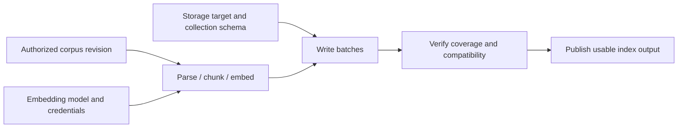

# Establishment, ordering, outputs and recovery

Research: 2026-10-31. **Design investigation and recommendation, not an accepted lifecycle API.**
The four families, template-owned establishment intent, Pool ownership and existing recovery
rules remain accepted. The lifecycle protocol, dependency/output notation and composition boundary
proposed here require review. No accounts were enrolled, services provisioned or model calls made.

Read [the accepted contracts](../DESIGN.md#establishment-contracts-and-instance-state), then the
three worked cases below. This report extends [configuration research](CONFIGURATION.md) and
uses the existing [Pi Durable investigation](PI_RUNTIME.md#pi-durable-in-depth). It does not
introduce a fifth family, a separate operation-document format or a dependency on Pi's runtime.

## Conclusion and proposed boundary

The requested cases need **ordering guarantees, typed outputs and recoverable multi-stage
establishment now**. Treating these as possible future additions understates the design problem.
They do not, by themselves, require authors to write an imperative workflow in every template.

Recommend a declarative template language interpreted through **typed, resumable plugin
lifecycles**. Templates declare the intended result, dependencies, identity selections and
supported policies. Plugins implement provider-specific steps. Conduit's engine coordinates
dependencies, persists necessary progress, handles interaction waits and exposes verified results.
For composition, the language needs references to typed outputs and readiness conditions, not
only references to object names. Exact syntax remains open.

YAML can serialize this contract, including graphs or ordered stages if eventually needed.
The difficult choices concern semantics and execution ownership. Switching to a programming
language would not define idempotency, credential identity, readiness or crash recovery for us.
Conversely, selecting YAML does not excuse leaving these properties implicit in arbitrary plugins.

| Approach | Benefit | Main problem for Conduit |
| --- | --- | --- |
| Static settings plus one opaque plugin callback | Small authoring surface. | Cannot explain an interaction wait, partial progress or safe recovery without an additional lifecycle contract. |
| Templates list arbitrary shell/HTTP steps | Almost any integration is expressible immediately. | Authors inherit token handling, parsing, retries, platform differences and uncertain side effects; unrelated templates duplicate provider mechanics. |
| Typed templates plus recoverable plugin lifecycles, recommended | Portable semantic choices, explicit dependencies/results, implementation freedom. | Requires a real plugin lifecycle protocol and conformance cases; this is more than a schema parser. |
| General workflow language or replayable program as the core | Rich branching, loops, fan-out and custom orchestration. | Adds workflow versioning, expression semantics, replay constraints and authoring complexity before the examples require that much freedom. |

A workflow interpreter could later implement a compatible plugin. It would still respect
Conduit's ownership, output, authority and recovery contracts. No such dependency or workflow
Resource type is selected here. Engine bookkeeping is supporting state of instances/attempts;
each stage does not need its own Resource or user-maintained YAML document.

## Evidence from existing systems

The references illustrate separate mechanisms, not interchangeable runtimes or guarantees.

| Source | Evidence | Design implication |
| --- | --- | --- |
| [Compose startup order](https://docs.docker.com/compose/how-tos/startup-order/) | Dependencies distinguish started, healthy and completed-successfully conditions. | A dependency needs a meaningful readiness/completion gate; process existence is insufficient. |
| [Kubernetes init containers](https://kubernetes.io/docs/concepts/workloads/pods/init-containers/) | Regular init containers complete sequentially before application containers start. | Configuration can declare ordered setup while implementations perform the work. This does not supply all of Conduit's human-interaction or output-binding semantics. |
| [Kubernetes Jobs](https://kubernetes.io/docs/concepts/workloads/controllers/job/) | Even a one-completion, one-parallelism Job may start the same program twice. | Scheduling an action once does not establish exactly-once external effects. |
| [Pulumi inputs and outputs](https://www.pulumi.com/docs/iac/concepts/inputs-outputs/) | Output-to-input references track dependencies; explicit dependencies cover relationships without a data value. | Model typed output bindings and prerequisite conditions, not reliance on document order. Pulumi's resource lifecycle is not Conduit's chosen implementation. |
| [Open Workflow specification](https://github.com/open-workflow-specification/specification/blob/main/dsl-reference.md), formerly Serverless Workflow | Its structured DSL defines sequential tasks, retry policies, output schemas and timeouts. | YAML-shaped declarations can express execution semantics; adopting the entire workflow language is a separate decision. |
| [Temporal activities](https://docs.temporal.io/activities) | Activity code performs effects; idempotency is recommended for retries, and smaller activities can improve recovery boundaries. | Provider implementation and orchestration can be separate. Recovery checkpoints should follow meaningful effects, not every function call. |
| [Pi Durable tool task](https://github.com/earendil-works/pi/blob/0441483926f283e42ca44eb7b4a46552e9469d6f/packages/durable/src/harness/tool.ts) | Persists final arguments/replay policy before execution; recovery reruns only when both stored and current policies permit it. | Retain intent/outcomes and conservative replay, while preserving Conduit's current-access checks. This is pinned source evidence, not live provider verification. |

The prior [Docker/Kubernetes and language-paper review](CONFIGURATION.md) remains applicable:
configuration quality depends on visible relationships, explicit meanings and useful errors.
These examples justify a stronger lifecycle contract, not a claim that a notation is inherently
powerful, safe or sufficient without its engine.

## Consequences of the documentation review

| Existing direction | Consequence of these examples |
| --- | --- |
| Templates carry establishment intent | Preserve it; completing a template must not require a second request recipe containing missing setup choices. |
| YAML over typed objects | Preserve the serialization choice provisionally; strengthen the behavioral contract before considering new syntax. A static schema is insufficient. |
| Resource types remain unitary; Pools own instances | Preserve the split between storage, indexing and access. A convenient composed setup does not erase those boundaries. |
| Activation instructions belong in Session configuration | Separate agent-followed guidance from engine-executed lifecycle declarations. A prompt telling the model to log in is not a reliable authentication state machine. |
| No mandatory template snapshots or override ledger | Preserve that simplification; incomplete effects still need their own minimal continuation inputs and evidence. |
| General durable workflow runtime deferred | Do not interpret this as deferring all multi-stage recovery. A bounded plugin lifecycle protocol is necessary for the requested examples. |
| Instance spec and observed status are separate | Preserve it; neither declared readiness nor successful schema validation proves that authentication/indexing completed. |

The main documents now point to this review, while these new protocol choices remain proposals.
There is no decision here to replace all adapters, add an object family or implement a scheduler.

## Where the contract belongs

| Concern | Template / typed declaration | Plugin implementation | Conduit engine |
| --- | --- | --- | --- |
| Intended capability | Create/attach choice, target, selected account/method, relevant options. | Interpret supported values and implement provider behavior. | Validate type/form, resolve ownership and enforce current managed authority. |
| Dependencies | Named inputs and Conduit connections; required/optional prerequisites. | Declare compatible input/output contracts and necessary gates. | Detect unsatisfied dependencies and establish allowed ordering. |
| Provider procedure | Select a supported behavior, such as native subscription login. | Commands, HTTP exchanges, pagination, provider-specific branching and parsing. | Dispatch, record progress and report supported/unsupported behavior. |
| Interaction | Whether interactive establishment is allowed; selected identity remains explicit. | Describe a browser/device/unlock challenge and verify its response. | Present the wait through available frontends; correlate completion to the attempt. |
| Results | Select outputs needed by consumers; configuration does not assert success. | Return typed identifiers, handles, readiness evidence and failures. | Validate, retain and deliver results under current permissions. |
| Recovery | Choose supported limits/policies where useful. | Report idempotency/reconciliation capabilities and persistable phase state. | Track attempts, prevent duplicate local dispatch, request reconciliation and reject unsafe retries. |
| Cleanup | Explicit lifecycle intent and permitted retention behavior. | Distinguish client release, compensation and backing-data deletion. | Preserve other consumers and Pool-owned data; report incomplete cleanup. |

The plugin's semantic contract is public even when its implementation is code. An author should
be able to discover prerequisites, outputs, effects, interaction needs and recovery limitations
before choosing a type. Exposing every HTTP call as a configurable stage would weaken that
abstraction; hiding the entire lifecycle behind an unexplained success/failure flag would too.

Complete templates can use explicit references and declared context, including an owning Pool
or relative-path base. They do not embed every external value or secret. Customization continues
through ordinary typed fields; this proposal does not reinstate a generic parameter-mapping DSL.

## Ordering and dependency semantics

Recommend **strict prerequisite order with bounded parallelism for independent work**:

- A dependent action starts only when its named inputs and required conditions are satisfied.
  A folder attachment may require existence; a query surface may require a completed index build.
- Internal stages such as exchange-login-response then verify-identity have strict plugin-owned
  order. Cross-instance dependencies are visible in declarations and engine inspection.
- Input references imply data dependencies. Explicit readiness/completion prerequisites cover
  ordering without a value. Avoid a second hand-maintained order list duplicating the data graph.
- YAML mapping order has no execution meaning. A field defined as an ordered list may have one;
  neither list order nor alphabetical object order silently becomes a global startup schedule.
- Independent components can prepare concurrently within limits. Shared credential refresh,
  provider quotas, collection mutation and shared backing paths may require serialization even
  without a data dependency. Coordinate on actual backing/account identity, not only Resource ID.
- Reject or explain an unsatisfiable **blocking establishment cycle**. A password store whose
  only unlock credential must be fetched through itself needs a bootstrap source. Communication
  cycles among already-established Sessions are valid; do not require the whole runtime graph
  to be acyclic.

Successful declaration resolution, completed establishment and continuing readiness are separate.
A login can later expire; an established database can become unreachable. Readiness gates must
specify what they mean and when they are rechecked. Inspection/waiting does not start a model turn.

## Outputs and minimal durable state

Recommend named, typed outputs with defined availability and lifetime. A type contract should
distinguish a stable native ID, a content revision, an expiring credential handle, a process handle
and ordinary data. A socket is not a serializable durable output. A reference to credentials can
be inspectable without returning credential bytes to model context or general diagnostics.

Output bindings need their producing instance, relevant generation/revision, type and access
requirements. A dependency on a generated endpoint does not grant permission to use it. Logical
Resource-to-Resource access continues through Conduits; output wiring cannot bypass the owner
Pool or create a second implicit access mechanism. Exact reference syntax and live-versus-pinned
binding policies remain to be settled alongside Conduit declarations.

Keep recovery state distinct from three other things: the template, the instance's ongoing spec,
and the public status view. A minimal retained attempt needs enough to recover safely:

| State | Why it is necessary |
| --- | --- |
| Attempt identity and effective-input identity | Distinguish retrying the same establishment from intentionally creating another instance; reject reuse against changed inputs. |
| Selected account, backing target and relevant binding IDs | Recovery must not silently target another account, directory or collection. |
| Handler/state version and meaningful phase | Resume compatible implementation state; missing/incompatible handlers report blocked recovery. |
| Confirmed results, native job IDs and progress checkpoints | Reattach or continue without repeating completed external effects. |
| Pending interaction and cancellation/unknown-outcome information | Preserve what is awaiting a person, what may still be running and what needs reconciliation. |

This is engine-managed execution evidence, not the previously rejected mandatory template
snapshot or override-history ledger. Internal continuation state can be opaque to users while
its phase and recovery options remain inspectable. Secret-bearing state needs protected storage;
reusable YAML and ordinary status exports must not become a credential archive.

After completion, retain outcomes/native identities under existing retention rules. Whether
creation-only choices also remain immutable instance configuration is still open. While an
attempt is incomplete, its effective setup inputs must remain recoverable; deleting the source
template must not force Conduit to guess them. Full template history is unnecessary.

## Case 1: a Claude subscription Session

**Verified native surface:** Claude Code documents browser sign-in, separate account configuration
directories, and credential-source precedence. These directories also contain settings/history;
the documentation notes an exception for separating certain Console sign-ins. The native adapter
therefore has to validate credential reuse separately from Conduit's Session-private-state rule.
[Authentication](https://code.claude.com/docs/en/authentication)

The CLI documents `claude auth login` and JSON `claude auth status`; Console login selects API
billing rather than a Claude subscription. These are useful adapter entry points, not evidence
that copying native credentials permits subscription use in Conduit's own model runtime.
[CLI reference](https://code.claude.com/docs/en/cli-reference)

Proposed template content: native runtime selection, account reference, subscription authentication
intent, permitted interaction mode, Session-state policy, selected native config and required
Conduit connections. Provider-specific command flags and browser choreography belong in code.

| Stage | Result or gate | Recovery concern |
| --- | --- | --- |
| Prepare selected native state/environment | Account namespace and Session-private state are correctly selected. | Do not overwrite another account or inherit an unintended credential source. |
| Inspect current authentication | Evidence of actual identity/method and applicable capability, or login required. | An existing credential is not proof it is the requested identity or supported billing path. |
| Begin native login when required | A correlated interaction challenge; wait for browser completion. | Wait is not a retryable network failure. A callback can expire or become unusable after restart. |
| Reinspect and verify | Selected identity/method confirmed to the extent exposed by the runtime. | Polling exit code alone is insufficient; unknown capability remains unknown. No fallback account. |
| Complete required preparation | Native settings and required connections usable; Session ready to execute. | Successful login need not repeat when an unrelated connection fails. Starting the model remains explicit. |

If the engine stops after native login succeeds but before recording completion, inspect native
state before launching another login. If the challenge expired, request a new interaction rather
than replaying a stale browser callback. Reuse an account where supported while keeping private
Session history separate; do not force users through login for every new Session. Concurrent
refresh/logout must be coordinated by the integration.

**Boundary:** Conduit owns the recoverable establishment attempt and identity checks; native
auth code owns the protocol and token refresh in the native-agent path. An own-runtime provider
needs its independently supported authentication contract. The YAML cannot make an unsupported
subscription integration available.

## Case 2: a vector database over a corpus

This is a composed outcome, not one Resource with unrelated responsibilities. Keep corpus access,
storage, indexing/transformation and query access distinct where separately managed. An index
builder is a candidate unitary Resource for materializing a corpus into a configured vector
representation; its exact group/type is unapproved. An embedding service may itself be a Resource
when it needs an independent identity/lifecycle. Not every chunk, batch or stage needs one.

Qdrant collections configure vector dimensionality and distance metrics; named vectors can use
different dimensions/metrics. That makes embedding compatibility a concrete validation issue.
[Collections](https://qdrant.tech/documentation/manage-data/collections/)
Qdrant point upload supports batching, and uploading the same point ID replaces that point.
Stable IDs can help retries, but do not make an entire ingest pipeline exactly-once or protect
against a stale build overwriting a newer one. [Points](https://qdrant.tech/documentation/concepts/points/)



The arrows show establishment prerequisites. Access between actual Resource instances is
still supplied by Conduits; this diagram is not a replacement endpoint or ownership schema.
Storage preparation and corpus enumeration may proceed independently before joining at writes.

Template content should cover selected sources/Conduits, source-revision policy, destination
create/attach intent, embedding model/configuration, chunking, schema, batching/budgets, and the
completion condition. A compact illustrative **type-specific config fragment**, not an approved
Resource schema, could be:

```yaml
config:
  sourceConsistency: revision-bound
  embedding:
    model: selected-model
    dimensions: 1024
  chunking:
    strategy: selected-chunker
  completion:
    require: all-selected-inputs
```

Source/storage/embedding access bindings belong in Conduit declarations, not hidden unrestricted
SDK connections. Placeholder values above have no provider claim. The plugin handles scanning,
parsing, embedding calls, batching and native API differences under the declared contracts.

Outputs should identify the actual collection/index generation, source coverage/revisions,
embedding/chunking/schema identity, readiness and omissions. An empty collection is not a fully
indexed corpus. Incremental queryability and complete indexing can be different reported states.
Indexing preserves the inputs' access requirements; creating an index is not independent
publication of restricted content. The existing derivation/current-access rules still apply.

Recovery needs stable source/chunk IDs or an equivalent strategy, native job IDs when available,
batch progress and an input fingerprint. Repeating confirmed embedding calls can incur extra
cost even when destination upserts are safe. Changing the source or embedding configuration is
a new build/reconfiguration, not an unnoticed retry. Reject stale writers or isolate generations
where the backend supports it; report weaker guarantees where it does not. Source changes during
ingestion need a declared snapshot/revision or explicitly partial-consistency contract.

If storage creation succeeds but indexing fails, preserve the Pool-owned storage and expose
partial progress. Cancellation stops or requests stopping active work, not deletion of the corpus
or database. Automatic repair, ongoing sync and reindex-on-change are separate lifecycle choices.

## Case 3: access to a password manager through a Conduit

1Password's desktop integration uses accounts added to the app and supports device-unlock
authentication. Service accounts use a different noninteractive credential path; the CLI can
prefer Connect environment configuration over a service-account token. These modes cannot be
treated as interchangeable login scripts. [Desktop integration](https://www.1password.dev/cli/app-integration)
· [Service accounts](https://www.1password.dev/service-accounts/use-with-1password-cli)

The owning Pool contains the password-manager Resource. Its template describes the service,
permitted target and supported modes. A consuming Session/Resource declares a Conduit attachment
with a permitted service identity and filters. Authentication state belongs at the appropriate
participant/account boundary; one participant unlocking access need not authenticate every peer.

Proposed stages: resolve the owned Resource and intended principal → check local integration and
authentication → present unlock/consent if needed → verify selected account/vault access → expose
the permitted capability. The API handshake or native `op` invocation belongs in the adapter.
Where supported, the output is an expiring access/secret handle or credential injection capability,
not an ordinary string copied into every model's context. Fetching a particular secret is a later
authorized operation; successful attachment is not a pretext to fetch the whole vault.

If the vault locks, the provider is unreachable or authorization expires, the attachment becomes
unusable or needs interaction. Do not switch modes or identities implicitly. A waiting unlock can
outlive a frontend; a replacement frontend can present the outstanding challenge if supported.
Cancellation releases this participant's clients/waits without deleting the Resource or logging
other users out. A credential-dependent database connection may wait on this capability; it must
not start merely because the password-manager object exists in the registry.

## Recovery rules to make explicit

These extend existing safe-retry and explicit-resume rules; the detailed protocol is proposed.

| Situation | Required distinction and recommended behavior |
| --- | --- |
| Parse/schema failure | No external effects; report fields to repair. |
| Required dependency unavailable | Block dependent work; retain permitted completed preparation. Optional components follow the existing continue/report rule. |
| Browser/unlock required | Structured waiting-for-interaction with challenge correlation and expiry, not a busy retry loop or model wakeup. |
| Effect succeeded; response was lost | Reconcile native identity/job status or reuse provider idempotency before repeating; otherwise retain unknown outcome. |
| Retryable failure before effects | Bounded retry under plugin capability and current authority; template retry settings cannot make unsafe repetition safe. |
| Engine restarts | Inspect durable attempt state and surviving work. Reconnect/resume only where supported and authorized; do not restart stopped agents implicitly. |
| A previous worker completes late | Results must match the current attempt/input generation; stale completion must not overwrite the replacement's state. |
| Plugin implementation/state format changes | Resume through a declared compatible handler/migration, or report blocked recovery. Do not deserialize old continuation into arbitrary new code. |
| Access revoked while waiting | Recheck at resumption and output delivery. Required isolated revocation that cannot be applied live still stops execution under the existing rule. |
| Cancellation requested | Separate the request from observed stopping. Retain effects already performed; cleanup has its own outcome. |
| Partial composition fails | Preserve successful components according to their lifetime/ownership. Compensation is type-specific and authorized, not a fictional distributed rollback. |
| Established backing later disappears | Report degraded/unavailable state. Creation intent alone does not authorize replacement or a continuous reconciliation loop. |

No exactly-once external guarantee follows from a local journal. Destructive compensation needs
explicit semantics and authority. Successful client cleanup does not imply that a deployment,
credential rotation or database write was undone.

## Brainstorming the template surface

These are design probes, not an implementation roadmap or approved new types.

| Outcome a user might want | Necessary declaration | Implementation/state boundary it tests |
| --- | --- | --- |
| Four independent subscription Sessions | Runtime/account selection, private state, required connections. | Interactive enrollment, identity verification, refresh coordination. |
| Local checkout or fresh Git worktree | Attach/create, repository/base, destination, cleanup policy. | Native Git effects, existing-target conflict and preserved local work. |
| Database plus schema | Engine/target, create/attach, schema revision and migration policy. | Provisioning outputs, readiness, migration lock and partial failure. |
| Search over a document corpus | Source/data policy, embedding/chunking, destination and completion goal. | Long-running batches, generated outputs, cost and incomplete coverage. |
| Password-manager access | Service/principal/mode, allowed operations and interaction policy. | Human wait, expiring handles and participant-specific credentials. |
| AWS deployment capability | Account/role/region, credential dependency and permitted target. | Credential expiry, asynchronous job IDs, concurrency on one remote target. |
| MCP integration | Native endpoint/process, auth and negotiated capabilities. | Process start versus handshake versus usable authorized tools. |
| Native skills/plugins for a Session | Selected sources/versions/runtime and activation choices. | Installation/preparation without replacing native package tooling. |
| Private remote workspace | Image/host, mounts, network and resource limits. | Build, boot, health, transport loss and reconnect; no extra runtime inside each Conduit. |
| Database snapshot restore | Snapshot reference, destination and compatibility policy. | Large transfer, verification, collision handling and explicit overwrite authority. |
| Continuous document synchronization | Source/destination, initial synchronization and ongoing policy. | Initial completion versus subscription lifetime, cursors and conflict handling. |
| Agent conversation capability | Delivery/retention/participant contract and backing Resource references. | State persists in a Pool; live Conduit ends with its final logical participant. |
| Event-triggered agent work | Trigger/filter, permitted Session and bounded execution policy. | Data delivery versus model wakeup; remains a separate future ruling. |
| Private network or SSH tunnel | Endpoints, identity, permitted routes and connection policy. | Connectivity lifetime, host identity and authenticated readiness. |
| Model server or GPU-backed embedding service | Model artifacts, runtime/hardware and readiness criteria. | Download/build/cache, process startup, capacity and compatibility. |
| Evaluation or processing pipeline | Dataset/model revisions, typed stages and result contracts. | Dynamic fan-out may eventually justify a richer composition plugin. |

The dividing test is whether users are selecting the desired capability or programming a novel
algorithm. Provider-specific mechanics belong in plugins. Reusable composition of capabilities
belongs in the language. Novel computation can live in code-backed plugins; it should not force
ordinary directory or login templates to adopt a programming language.

## What the first protocol must settle

Recommend a small lifecycle protocol supporting validation/resolution, establishment, observation,
structured interaction waits, compatible continuation/reconciliation, cancellation and typed
results. These are responsibilities, not selected RPC names or compulsory phases for every type.
Synchronous types may finish immediately. Long-lived services expose continuing health without
remaining an unfinished create attempt forever.

The core should expose a derived dependency/progress view without making authors maintain a
second plan. Plugins must identify meaningful resumable boundaries; the engine must not promise
crash-safe continuation of arbitrary code. Retry state and outputs must survive ordinary restart,
with compatibility/coverage gaps explicit. Initially favor plugin-owned stage machines over
authored general loops/branches, arbitrary shell hooks or deterministic code replay.
Bound work through declared deadlines, retry/backoff limits and concurrency where supported.
The exact policy fields are open; an interaction wait and an in-flight provider call may need
different timeout behavior, and timing out either does not prove cancellation completed.

Review these connected rulings before choosing more field names:

1. Accept or revise the proposed template/plugin/engine split, including user-visible stage and
   recovery information. Is a typed plugin lifecycle sufficient for the first three examples?
2. Define dependency inputs, output types/lifetimes and readiness gates together. Preserve
   Conduit-mediated access and distinguish blocking startup cycles from valid communication graphs.
3. Define attempt continuation, interaction waits, failure/retry and cancellation together,
   including who may resume setup and how this differs from restarting a model execution.
4. Decide creation-only field retention and one-off/import behavior using both failed and successful
   establishment. An instance export must not falsely promise a complete reproducible deployment.
5. Identify a concrete composition requiring author-written steps. Only then choose whether
   ordered typed calls, a plugin workflow language or a richer code authoring frontend is needed.

## Evidence gates before implementation and live experiments

First write contract examples and expected transitions. A later synthetic adapter should exercise:
wrong-account login, expired challenge, crash after auth success, required/optional preparation,
lost database-create response, partial ingest, source/model change mid-build, stale-worker output,
credential expiry before consumption, cancellation after an external write, and missing recovery
handler. Distinguish static schema tests from fault-injection tests and real-provider feasibility.

The existing scenario fixture validates structural ownership/references only; it does not test
these lifecycles. Live account enrollment remains a separate explicitly initiated experiment.
Four-account support, provider terms/capability, sandbox bridges and native Session-private-state
behavior are not proven by this report or by finding a documented login command.
