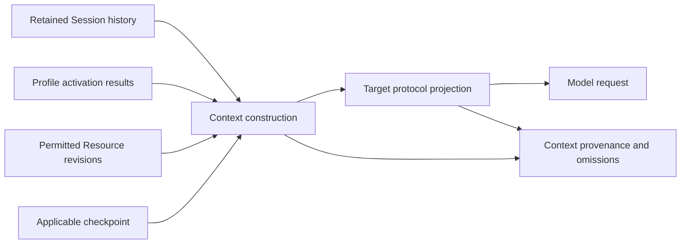

# Pi re-review: connectors, context and communication

Research date: 2026-10-30. **Recommendations for discussion, not new accepted contracts.**
The accepted model remains Profiles, Sessions, Resources, Pools and Conduits. Activation
instructions belong to Profiles. Conduit owns its Rust runtime and a replaceable frontend.

Read this report's recommendation, then [the configuration proposal](CONFIGURATION.md)
and [the connected YAML example](five-concepts.proposal.yaml). The earlier
[Pi investigation](../RESEARCH_PI.md) remains the detailed source for Durable, frontend
coupling, storage and ecosystem comparisons. [REVIEW.md](../REVIEW.md) groups the rulings.

## Recommendation

The five concepts hold up well. They need more precise boundaries rather than more nouns:

| Concept | Refinement proposed from this investigation |
| --- | --- |
| Profile | Keep model/account choices explicit; turn activation instructions into inspectable preparation steps, with agent guidance distinguished from runtime actions. |
| Session | Retain original history and execution evidence; construct a separate, permission-checked context projection for each model request. Record the losses and transformations. |
| Resource | Expose native contracts plus compatibility information. Provider catalogs, actual account access and tested capabilities are different observations. |
| Pool | Collect references without copying, owning, granting or activating them. Make selection deterministic and explainable. |
| Conduit | Give each relationship a typed contract. Resource calls, requests for agent work, retained notifications and observable state need different completion and recovery semantics. |

Build Rust protocol adapters beneath Conduit's runtime, with provider definitions and
catalogs above them. Pi is a source of mappings and test cases; adopting its loop is
unnecessary. Evaluate Rust client libraries below this boundary before porting transports.
A provider-only JavaScript bridge is technically possible, but adds a second deployment
runtime and does not solve account isolation automatically. It should be a deliberate
fallback option, not the default architecture.

Use Kubernetes-shaped objects for configuration and Gateway API's distinction between
reference, authority and observed attachment. Do not import a Kubernetes control plane,
automatic agent restarts, or cascading deletion of Pool members.

Two findings change the emphasis of the next review:

1. **MCP compatibility needs a versioned adapter.** The inspected Pi client implements
   the November 2025 lifecycle; the July 2026 standard substantially changes it. Copying
   Pi's client wholesale would start behind the standard the user selected.
2. **Account and context boundaries must be stronger than Pi's defaults.** Its in-memory
   credential store is keyed by provider, and its history compatibility predicate does
   not include account identity. These are suitable reference mechanisms, not sufficient
   multi-account contracts for Conduit.

## Evidence boundaries

| Evidence | Revision / boundary |
| --- | --- |
| Pi providers, auth, history, MCP, loaders, telemetry and Durable | `0441483926f283e42ca44eb7b4a46552e9469d6f`; source, docs and selected offline probes. |
| Latest fetched Pi main | `26e05e64f0e64f4cbcc1e501fe3da3d4b64a4424`; only Chord changed in the inspected package paths between these revisions. Reference checkout was not switched. |
| Chord follow-up | `26e05e64f0e64f4cbcc1e501fe3da3d4b64a4424`, particularly `src/next/host`, `remote` and `link`; development-layer docs, not an asserted released API. |
| agentwatch | Local `04025a6f8e3887b8c1152ea44930e1c429b75948`; README communication/recovery contract. |
| Standards and provider documentation | Primary pages accessed October 30; web pages can change independently of pinned Pi source. |

No account enrollment, inference requests, real MCP connections, credential reads, package
installation or Conduit implementation occurred. Library README coverage is not conformance
testing. Pi's package version `1.4.0` at this development revision is not evidence that
every inspected feature shipped in that release.

## Provider coverage without importing Pi's runtime

### Four layers, with different responsibilities

Pi separates provider factories from shared API implementations and generated model
catalogs. Its provider abstraction also supports credential-specific catalog filtering
and explicit asynchronous refresh. [Provider interface][provider-interface] ·
[Factories][factories] · [Catalog generation][catalog]

For Conduit, the proposed split is:

| Layer | Contains | Does not establish |
| --- | --- | --- |
| Protocol adapter | Streaming framing, request conversion, tool-call assembly, cancellation, usage extraction, provider-specific context conversion. | Which account is selected or which models it may use. |
| Provider definition | Provider identity, endpoint/deployment rules, authentication methods, protocol dispatch, compatibility corrections. | Successful authentication or entitlement. |
| Model catalog | Model IDs, operation families, modalities, limits, reasoning options, prices when known, source/freshness. | That a live request succeeds or reported pricing equals subscription cost. |
| Account binding | Selected registration, credential resolution/refresh ownership, identity evidence and account-specific availability. | Permission to expose unrelated files, tools or memory to that account. |

These are implementation responsibilities under Profile/Session/Resource contracts,
not additional top-level concepts. An external Codex or Claude Code runtime is a separate
adapter: it owns its loop, native history and supported authentication. A model-provider
adapter supplies inference to Conduit's loop. A frontend supplies neither.

### Complete built-in factory inventory

The pinned registration list contains **42 factories**. Inspection found ten chat API
identifiers, one image API identifier, and four declared classifier API identifiers.
Only three classifier APIs are wired by these factories; `llama-cpp-classify` is also
declared for other integrations. **Nine factories declare OAuth support**, which is more
than the shorter OAuth list in Pi's README. These are source counts, not tested services.
[Registration list][factories] · [API types][api-types]

Abbreviations below: **C** = OpenAI Completions, **R** = OpenAI Responses,
**A** = Anthropic Messages, **G** = Google Generative AI. “Key” includes the factory's
token/API-key path; it does not imply a particular billing arrangement. Factory links
pin the exact evidence. Multiple protocols in a row are selected per model.

| Provider | Chat protocol(s) | Authentication in factory | Additional operations / special handling |
| --- | --- | --- | --- |
| [amazon-bedrock][p-bedrock] | Bedrock Converse Stream | Bearer token / AWS credential configuration | SDK credential chain, region and model routing. |
| [ant-ling][p-ant] | C | Key | Provider endpoint/catalog. |
| [anthropic][p-anthropic] | A | Key, bearer, federation, OAuth | Subscription identity and federation are distinct paths. |
| [azure][p-azure] | Azure Responses, C | Key | Endpoint and deployment-name mapping. |
| [baseten][p-baseten] | C | Key | Provider endpoint/catalog. |
| [cerebras][p-cerebras] | C | Key | Provider endpoint/catalog. |
| [cloudflare-ai-gateway][p-cfg] | A, C, R | Cloudflare auth helper | Gateway-specific endpoint/headers. |
| [cloudflare-workers-ai][p-cfw] | C | Cloudflare auth helper | Cloudflare System One classification. |
| [deepseek][p-deepseek] | C | Key | Family compatibility rules. |
| [fireworks][p-fireworks] | A, C | Key | Multi-protocol dispatch. |
| [github-copilot][p-copilot] | A, C, R | Token, OAuth | Account-derived endpoint and model availability. |
| [google][p-google] | G | Key | Gemini API. |
| [google-vertex][p-vertex] | Google Vertex | Key / ADC / service-account configuration | Project, location and credential-file handling. |
| [groq][p-groq] | C | Key | Provider endpoint/catalog. |
| [huggingface][p-hf] | C | Token | Router endpoint. |
| [kimi-coding][p-kimi] | C | Key, OAuth | Separate from Moonshot endpoints. |
| [meta][p-meta] | R | Key, OAuth | Muse subscription path in source. |
| [minimax][p-minimax] | A | Key | International endpoint. |
| [minimax-cn][p-minimax-cn] | A | Key | China endpoint. |
| [mistral][p-mistral] | Mistral Conversations | Key | Distinct wire implementation. |
| [moonshotai][p-moonshot] | C | Key | International endpoint. |
| [moonshotai-cn][p-moonshot-cn] | C | Key | China endpoint. |
| [nvidia][p-nvidia] | C | Key | NIM catalog. |
| [openai][p-openai] | R | Key, ChatGPT OAuth | Decisions classification excluded for OAuth. |
| [openai-codex][p-codex] | Codex Responses | OAuth | Explicitly labelled legacy by factory. |
| [opencode][p-opencode] | A, C, R, G | Key | TypeSafe classification; Session header. |
| [opencode-go][p-opencode-go] | A, C, R, G | Key | Session header. |
| [openrouter][p-openrouter] | A, C | Key, OAuth | Image generation and TypeSafe classification. |
| [qwen-token-plan][p-qwen] | C | Key | Regional subscription endpoint. |
| [qwen-token-plan-cn][p-qwen-cn] | C | Key | China endpoint. |
| [qwen-token-plan-individual][p-qwen-individual] | C | Key | Separate catalog, shared endpoint/key convention. |
| [radius][p-radius] | Pi Messages | Key, OAuth | Static baseline plus account-specific dynamic catalog. |
| [together][p-together] | C | Key | Provider endpoint/catalog. |
| [typesafe][p-typesafe] | None | Key | Classification-only factory. |
| [vercel-ai-gateway][p-vercel] | A | Key | TypeSafe classification. |
| [xai][p-xai] | R | Key, OAuth | Grok/X subscription path in source. |
| [xiaomi][p-xiaomi] | C | Key | MiMo endpoint. |
| [xiaomi-token-plan-ams][p-xiaomi-ams] | C | Key | Amsterdam endpoint. |
| [xiaomi-token-plan-cn][p-xiaomi-cn] | C | Key | China endpoint. |
| [xiaomi-token-plan-sgp][p-xiaomi-sgp] | C | Key | Singapore endpoint. |
| [zai][p-zai] | C | Key | Coding endpoint. |
| [zai-coding-cn][p-zai-cn] | C | Key | China coding endpoint. |

Twenty-eight factories import Completions, ten import Anthropic Messages and seven import
Responses. These overlap; their sum is not a provider count. Broad coverage therefore
starts with a few protocol families, followed by provider-specific work. “OpenAI-compatible”
alone is insufficient: validate system/developer-message support, tool schema restrictions,
reasoning fields, stream termination, media, limits, error classification and usage.

Pi's catalog builder applies upstream data, per-API defaults, model-family corrections,
then provider finalization. Generated JSON is not committed in this checkout; this research
did not regenerate it or claim a current model count. Radius can replace its public baseline
with an account-specific catalog. A helper for OpenRouter personalization exists, but the
inspected factory does not wire it as its own `refreshModels`; helper existence is not
evidence of automatic refresh. [Catalog][catalog] · [Radius][p-radius] · [OpenRouter][p-openrouter]

**Proposed delivery order:** implement the two experiment providers and their supported
subscription flows first; then Completions-compatible definitions with fixture coverage;
then Google/Vertex/Bedrock/Azure/Mistral and multi-protocol gateways; then optional image,
classifier and Pi Messages adapters. Keep the complete matrix as a coverage target, not a
v0 promise. Retain source provenance and review catalog changes before distribution.
Pi's MIT license permits adaptation subject to its notice requirements; runtime libraries
and catalog inputs still need their own source/license accounting.

**Rust candidates:** [rust-genai](https://github.com/jeremychone/rust-genai) provides native
multi-provider clients and target resolution; [Rig](https://github.com/0xPlaygrounds/rig)
has provider abstractions as well as higher-level agent machinery. Evaluate only the lower
client boundary against our account/context fixtures. Neither README establishes all 42
factory equivalents or subscription parity. Do not select a library by provider-count
marketing or adopt its agent runtime incidentally.

### What implementing the connector coverage entails

The ten chat implementations live in Pi's [API directory][api-directory]. The table
identifies the port/evaluation units and proposed fixture requirements; it does not claim
that those requirements have been tested against services.

| API implementation | Work that remains beyond selecting an endpoint |
| --- | --- |
| `openai-completions` | Provider compatibility options, streamed argument assembly, finish reasons, usage and reasoning-field variants. |
| `openai-responses` | Typed output events, response/tool item identities, signed/opaque continuation, subscription versus API-key request restrictions. |
| `azure-openai-responses` | Responses conversion plus deployment resolution, endpoint/API-version configuration and Azure authentication. |
| `openai-codex-responses` | Legacy subscription-specific transport, WebSocket/SSE recovery and connection-bound continuation. Keep optional rather than conflating it with modern OpenAI Responses. |
| `anthropic-messages` | Content-block streams, tool-use/result boundaries, cache controls, thinking signatures and credential-specific request behavior. |
| `bedrock-converse-stream` | AWS credentials/region, Converse event streams, provider errors and model-specific content/usage conversion. |
| `google-generative-ai` | Parts/function calls, thought signatures, media, safety/finish outcomes and Gemini request configuration. |
| `google-vertex` | Shared Google conversion plus project/location, endpoint selection and explicit Google Cloud credential handling. |
| `mistral-conversations` | Conversation-specific request/events and tool output representation; not merely the Completions path under another hostname. |
| `pi-messages` | Pi's event protocol validation, content indices and partial-state reconstruction; a Radius connector need not import the Pi agent runtime. |

Image generation and classification should have separate operation contracts. A provider
being selectable for classification must not make it appear usable as a conversational
Session model. Add each provider definition with its explicit endpoint/auth/compatibility
fixtures; sharing a wire adapter should reduce duplication without hiding exceptions.

Pi's normalized stream distinguishes text, thinking and tool-call starts/deltas/ends,
then terminal completion or error. Its `partial` object is a live mutable accumulator,
not a historical event snapshot. For Rust, propose immutable persisted events/outcomes
and separate bounded observation snapshots. Never execute partial tool arguments; validate
the completed call against the current admitted tool schema. Preserve stop reason, raw
diagnostics and unknown usage without manufacturing a successful terminal result.
[Stream contract][api-types]

Connector acceptance should include malformed/truncated streams, cancellation before and
after a possible effect, duplicate terminal events, fragmented Unicode/JSON, interleaved
tool calls, schema changes, unsupported options, quota/auth errors and missing usage. Use
recorded or synthetic wire fixtures before live smoke tests. Existing Pi tests are useful
case inventories, but each test must be inspected for network/auth dependencies before
execution. Provider coverage is a matrix of tested operations and modes, not a boolean.

### Authentication is an account contract

Pi's credential-store interface has one entry per provider. Refresh is serialized through
store modification, rechecks expiry after acquiring the lock, and saves rotation before
releasing it. Once refresh starts, caller cancellation stops waiting but does not discard
a rotated credential. Failed stored OAuth does not silently use ambient API credentials.
[Credential store][credential-store] · [Resolution][auth-resolution]

Proposed Conduit adaptation:

- Namespace credentials, refresh locks, catalog caches and logout by **account registration
  and provider**. Preserve provider identity; do not fake different providers just to separate accounts.
- Give every execution an explicit account binding. Reuse credential ownership where supported,
  while keeping native/private Session state separate. Persist no token in exported YAML/history.
- Inject a deliberately constructed environment and credential resolver. Pi's environment
  override falls back to its base context for empty/missing values; an overlay is not isolation.
- Separate provider auth from MCP/resource-service auth. Sharing a Resource definition must
  not accidentally share an OAuth grant, endpoint-derived state or Session root directory.
- Treat callback-port contention during concurrent enrollment, refresh/logout races, re-login,
  provider account verification and stale-worker results as adapter test cases. Four accounts
  can be enrolled sequentially while subsequent executions run concurrently.

There is now positive official evidence for OpenAI's own-runtime path: the documented
Sign in with ChatGPT flow supports eligible Responses requests from open-source/local apps,
with distinct account registrations and host identity. It does not import ChatGPT history.
The account guidance explicitly separates registrations even when email addresses match.
[Overview](https://developers.openai.com/siwc/token-sharing-open-source) ·
[Accounts](https://developers.openai.com/siwc/token-sharing-open-source/profiles-and-sessions)

The documented preview requires client-supplied HTTP history and has tool/parameter
restrictions; subscription Responses and API-key Responses must not be assumed identical.
Use Conduit's own app identity and documented returning-registration flow rather than
copying Pi's defaults. These are feasibility findings, not successful Conduit enrollment.
[Preview limits](https://developers.openai.com/siwc/token-sharing-open-source/preview-limitations) ·
[Pi OAuth implementation][openai-oauth]

Anthropic's current help page says Claude Agent SDK, `claude -p` and third-party usage
continue to draw from subscription limits, while linked Console API-key usage can use
separate plan API credits. That supports testing feasibility, but does not specify all
registration, identity or concurrency details for a new Rust client. Verify the chosen
integration before the four-account acceptance test; never silently change billing paths.
[Claude plan guidance](https://support.claude.com/en/articles/15036540-use-the-claude-agent-sdk-with-your-claude-plan)

## Session history and model context

### What Pi actually preserves

Pi's coding agent stores a branchable history. The current branch, compaction entries and
context edits produce the model-visible projection; other stored entries can remain
available for inspection. The current source retains source-entry associations during
projection. Compaction retains recent context and summary provenance without deleting
the original history. It also accounts for summarization usage.
[Sessions][sessions] · [Projection source][session-manager] · [Compaction][compaction]

The provider transform is deliberately lossy. At the pinned revision:

| Input condition | Observed transformation | Conduit implication |
| --- | --- | --- |
| Different provider, API or model | Drop thinking blocks and provider signatures; retain visible text/tool calls. | Opaque provider state is not a portable checkpoint. |
| Tool IDs invalid for target | Adapter-supplied normalization remaps calls and matching results. | Keep original ID and projection mapping. |
| Tool call without result | Insert a synthetic error result. | This is a protocol repair, not proof that the real effect failed. |
| Error/aborted assistant attempt | Omit it from replay. | Preserve raw attempt for audit and usage; do not erase evidence of effects. |
| Image sent to text-only model | Substitute an explicit placeholder. | Record unavailable modality; do not imply image evidence was examined. |
| System update between call/result | Delay system message until the tool-result boundary. | Context ordering needs protocol-aware handling. |
| Same provider/API/model, different account | Account is not part of the comparison. | Conduit must separately fence account-bound state. |

These findings come from [the transformation implementation][transform], with twelve
offline probes covering its relevant branches. The function returns a projection without
mutating the supplied history in the tested cases. Its synthetic missing-result timestamp
uses current time, so output is not byte-for-byte deterministic without recording such
generated fields. Unmatched tool results are not comprehensively validated by this helper.

### Proposed Conduit context pipeline

Keep four representations distinct:

1. **Retained history/evidence:** actual inputs, attempts, tool intent/outcome, imports and
   configuration changes. Native adapters retain only the evidence they can obtain.
2. **Current context:** the selected history, summaries and Resource content for this turn,
   checked against current access and the target context budget.
3. **Provider continuation state:** response handles, encrypted/signed blocks, caches and
   transport state with explicit compatibility boundaries. It is private runtime state.
4. **Shared knowledge/checkpoints:** explicit Resources with independent access and lifecycle;
   neither a transcript nor a compaction summary becomes shared memory automatically.

Proposed context evidence names input record revisions, the selected history boundary,
summary/model provenance, target account/provider/model/protocol, tool-definition versions,
transformation reasons, omissions and token estimates versus reported usage. Store hashes
or references rather than duplicating sensitive payloads everywhere. Access to this evidence
must obey the same content/provenance rules as the underlying records.

Do not require a complete canonical import of every external agent to launch v0. Conduit's
own runtime can retain richer structured history; native integrations may offer a checkpoint,
transcript or opaque resume handle. Report which path was used. This refines the existing
portable-checkpoint guarantee rather than replacing it with universal full-history fidelity.

Before a model/account switch, close or explicitly classify outstanding tool effects, record
the execution boundary, reconstruct permitted context, then apply target conversion. An
unknown tool outcome stays unknown even if the wire format needs a placeholder. Invalidate
opaque continuation across an account/endpoint change unless the adapter positively proves
compatibility. A new account is not a reason to change the logical Session ID.

Budget before dispatch, including activated prompts/tool descriptions and reserved output.
Prefer preserving recent tool-call/result groups and recording omitted material to blindly
truncating serialized JSON. A smaller target may require compaction; failed compaction must
not erase history or automatically repeat unsafe tool effects. Compaction is a model operation
whose provider/account/usage needs attribution. Exact thresholds remain an experiment choice.

## Profile activation and Pool resources

Pi advertises skill metadata before loading full instructions. Packages can bundle skills,
prompts, themes and executable extensions; package selections narrow what the package
declares. Relative paths use the source's location. Duplicate skill names currently keep
the first discovered definition with a warning. These are useful observations, not Conduit's
selected precedence rules. [Skills][skills] · [Packages][packages]

The proposed preparation sequence is:

1. Resolve the Profile snapshot and explicit Session overrides.
2. Bind default/selected Conduit declarations; resolve Pool membership and current authority.
3. Build the permitted Resource inventory, including source versions and compatibility.
4. Apply **Profile activation rules** to that inventory: advertise skills, register permitted
   tools, mount an authorized workspace, or load selected instruction content within a budget.
5. Record results, skipped resources, conflicts, unsupported capabilities and content provenance.
6. Let the Session start its model turn using that resolved preparation result.

This avoids a circular bootstrap where the model must discover and install the tools needed
to load its own instructions. Structured preparation actions can run before inference;
free-text behavioral instructions remain agent guidance. The Profile can contain both,
distinguished explicitly. A Conduit never becomes an installation script.

Recommended v0 rules: same Resource UID/revision/action activates once; incompatible versions
or duplicate exposed names require an explicit preference or leave the affected activation
unavailable. Required preparation failure prevents that execution from starting; optional
failure leaves it usable with a diagnostic. Other permitted bindings need not fail.
Source updates become available through live access, but do not silently replace executable
extensions or already-loaded prompt content. Show changes and apply them at a defined safe
boundary through explicit reconfiguration. These behavior choices need a ruling.

Native skill text can be portable while hooks are not. A Claude model in Conduit's runtime
does not provide Claude Code's plugin API. A Pi-style terminal does not provide Pi's extension
host. Preserve native package formats and report compatibility by layer: instruction bundle,
helper/tool requirement, runtime hook and UI component. A package's requested tools never
grant additional authority.

## MCP as a Resource and Conduit protocol

Pi separates the transport-neutral client, stdio/HTTP transports, OAuth storage injection,
and model-content conversion. Its current client includes resource listing/templates/reads
as well as tools; the README's supported-surface list is incomplete on resources. Generic
JSON-RPC requests alone are not proof of a complete typed feature implementation.
[Client README][mcp-readme] · [Client source][mcp-client]

Pi's model conversion preserves text/images but reduces some audio, binary/resource-link
content to placeholders. Conduit should retain the original MCP result and expose a target-
specific projection, including `structuredContent`, error status and content-loss evidence.
Preserve raw tool names/schemas alongside stable collision-safe model aliases. Native provider
names cannot always be sent unchanged to every model's tool-name grammar.

**Version correction:** the inspected client advertises `2025-11-25` and older versions.
MCP `2026-07-28` removes protocol sessions/initialization in favor of per-request metadata
and discovery, replaces subscription transport behavior, and removes old SSE resumption.
Tasks become a redesigned optional extension. Conduit Session identity therefore must not
depend on an MCP transport session or JSON-RPC request ID.
[Current changes](https://modelcontextprotocol.io/specification/2026-07-28/changelog)

The [current Tasks extension](https://modelcontextprotocol.io/extensions/tasks/overview)
offers durable handles, polling and cooperative cancellation. It is promising for exposing
Conduit work requests, but a handle's TTL, result retention and lifecycle need mapping to
Conduit's own records. It is not a tracker ticket or an automatic-wake decision.

The [official Rust SDK](https://github.com/modelcontextprotocol/rust-sdk) documents current
and legacy lifecycles, subscriptions and tasks. Prefer evaluating that maintained protocol
implementation over porting Pi's older client. This is a candidate, not a chosen or tested
dependency. Negotiate per endpoint; implement only declared features and report omissions.

Use current access at actual managed dispatch, including Code Mode/nested tool paths.
Cached discovery, list visibility, HTTP routing headers and a native registration file are
not authorization. Recheck cache access even when provider freshness TTL remains valid.
After a lost write response, a new transport request ID must not imply a new business
operation: reconcile the original operation ID before retrying an uncertain effect.

## Communication: lessons for typed Conduits

### Chord supplies useful mechanisms, not the whole product contract

The newer Chord development layers bind typed objects to authenticated principals, carry
caller identity through authorized routes, and expose snapshots followed by state updates.
Slow observers receive bounded/coalesced state. Calls in flight fail on a link loss and
are not automatically resent; references can be held again after reconnect. Authentication
belongs to the entry point, and a child cannot assert an arbitrary principal merely by
putting one in its payload. [Host][chord-host] · [Remote][chord-remote] · [Link][chord-link]

These suggest per-binding identity, typed operations, explicit lifecycle, bounded flow and
snapshot recovery. They do not establish durable agent delivery, semantic acknowledgement,
safe retries or automatic execution. Chord's jobs additionally illustrate intent/effect/finish
boundaries, but unsettled-key deduplication is not permanent operation deduplication.
Conduit must retain its own outcome contract. [Jobs][chord-jobs]

Agentwatch contributes a concrete Rust example of persisted-before-delivered messages,
sequence-based catch-up and independent claims for concurrent consumers. Its repository-based
visibility and room/ticket policy are application decisions. Absorb the mechanics without
bringing back rooms as Conduit's required primitive. Its seven-day expiry also differs from
Conduit's retain-until-purge policy. [agentwatch README][agentwatch]

### Three proposed interaction families

| Family | Example | Success means | Recovery needs |
| --- | --- | --- | --- |
| Capability request | Read memory; call a permitted MCP tool; ask another Session for a review. | A defined result or explicit pending work handle, with effect outcome separately tracked. | Correlation, authority, idempotency/reconciliation, deadlines and cancellation semantics. |
| Retained exchange | Deliver a finding to selected Sessions, including one currently offline. | Durable acceptance for named recipients; processing is a later fact. | Stable event IDs, recipient progress, deduplication, bounded replay and current-access checks. |
| Observation | Follow execution status, presence or the current Resource inventory. | A sufficiently current view, not receipt of every intermediate change. | Snapshot/version, bounded/coalesced deltas, gap reporting and resubscription. |

“Capability request” can share an envelope across Pool resources and Sessions without
pretending that a file read and a model turn cost the same or complete synchronously.
Request handles, events and observations are supporting contracts, not new top-level nouns.
Exact names, fan-out, persistence and wake defaults remain proposals.

| Reference | Best lesson | Boundary to retain |
| --- | --- | --- |
| Chord | Typed references, principal-specific interfaces, snapshot/delta flow and routing. | Reference lifetime and coalesced state do not provide a durable conversation ledger. |
| MCP | Familiar capability invocation, resource access and optional long-running task handles. | Protocol version and negotiated extensions matter; no implied Session lifecycle policy. |
| [A2A task lifecycle](https://a2a-protocol.org/latest/topics/life-of-a-task/) | Separate immediate messages, longer work, artifacts and contextual grouping. | Its `contextId` groups interaction; it is not permission to import private model history. Task IDs need not become Linear issue IDs. |
| [NATS JetStream](https://docs.nats.io/learn/jetstream/pull-consumers) | Pull-based bounded consumption, independent consumers and explicit acknowledgements. | Delivery acknowledgement is not proof an agent completed work. A broker is optional for a local v0. |
| [Zenoh entities](https://spec.zenoh.io/spec/1.0.0/concepts/entities.html) | Separate publication, query/reply, storage and liveliness behind related addressing. | A live subscription is not retained history; native protocol sessions are not Conduit Sessions. |
| agentwatch / Pi ecosystem | Practical catch-up, attachment claims and integration hooks. | Their attention, expiry and topology policies are not inherited. |

### Flows the contract must make unambiguous

**Review request:** Session A addresses B through an authorized binding, with an operation
ID and pinned artifact references. Admission records accepted or rejected. B may remain idle
until permitted execution is triggered. A can inspect progress without launching B. Completion
records a result with provenance. A timeout while waiting does not cancel accepted work unless
the contract explicitly says so; cancellation is a separate request.

**Finding to several recipients:** each recipient has independent eligibility and delivery
progress. Acceptance for B must not imply acceptance for C. On reconnect, C receives only
still-permitted content. Content may be retained while its delivery is withheld. One global
“read” flag cannot describe this relationship.

**Slow observer:** repeated token/progress updates may collapse into a newer snapshot, while
an accepted work request or final outcome remains retrievable. A UI disconnect neither
completes work nor owns cancellation of an independently running Session.

**Permission change:** narrowing the Conduit immediately changes future managed reads and
dispatch. Queued content is checked again on delivery. Content already in native model context
cannot be erased; required isolated revocation follows the existing stop/explicit-restart rule.

**Model/account handoff:** the receiving execution uses the same Session when resuming, with
fresh current authority and a compatible projection. Its binding identity remains attributable;
its provider connection and credential state need not be reused.

**Attention policy:** recommend passive delivery by default, with explicit future hooks for
selected requests to start work. Treat receipt, notification, context inclusion and execution
as separate transitions. This is a proposal for the reopened communication design, not a
reinstatement of the former room ruling. Prevent status/acknowledgement loops from generating
unbounded model turns; bound work, concurrency and repeated triggers.

## Observation and durable execution

Pi telemetry explicitly separates diagnostic spans from durable application state, supports
explicit propagation and links, and includes adapter conformance cases. Adopt that separation:
Session/execution/account/Conduit operation IDs are authoritative; trace IDs are optional
correlation. Forks and cross-Session requests may link traces without falsely making all work
one nested call. [Telemetry][telemetry]

Keep durable usage observations distinct from sampled/exported traces. Include compaction,
failed attempts and child work where reported; retain unknown/overlap flags. Logging every
MCP result need not put full payloads in traces: retain permitted payload evidence separately
and link to it. Export failure must not erase a committed operation result.

Durable's existing research remains applicable: persist intent, perform the effect, record
outcome before claiming completion; use ownership and stale-worker fencing; distinguish input
acceptance from execution; never infer external exactly-once effects from local transactions.
The v0 Rust loop does not need Pi Durable's entire workflow engine, script replay or hot reload.
[Earlier detailed investigation](../RESEARCH_PI.md#pi-durable-in-depth)

## Validation performed and next experiment

The source inventory script enumerated every factory imported by `providers/all.ts`, checked
the protocol imports and OAuth declarations, then the factory bodies were reviewed. Counts:
42 factories, nine OAuth declarations, ten chat protocol identifiers. Provider wire behavior,
catalog refresh and OAuth flows were not exercised live.

Seventeen offline checks passed using Node `v24.22.1` against pinned Pi source, importing only
the transformation/auth helpers and using synthetic in-memory fixtures:

- Twelve history checks: foreign reasoning/signatures, same-model opaque state, call/result
  ID remapping, orphan repair, system-message ordering, aborted/error omission, text-only
  image placeholders, vision retention, input immutability/JSON round trip, missing content,
  error-image separation and the account-blind compatibility predicate.
- Five auth checks: twenty simultaneous resolutions refresh once in one store; failed OAuth
  does not fall through to ambient API auth; separate stores isolate refresh/logout; an empty
  environment overlay falls through; cancellation after refresh starts still saves rotation.

These validate the inspected helper behavior, not cross-process credential locks, native
runtime isolation, live subscriptions or Conduit code. No upstream full test suite ran.
Temporary probe files were kept outside the product repository.

The next experiment should be specified in this order:

1. Resolve the YAML graph offline: independent Sessions, overlapping Pools, narrowing-only
   filters, explicit activation and visible diagnostics. Use the examples and failure matrix
   in [CONFIGURATION.md](CONFIGURATION.md).
2. Verify supported account enrollment/identity and independent refresh/logout for the four
   subscriptions before investing in UI polish. Record declared versus observed support.
3. Exercise a minimal Rust-owned model/tool loop with fake transport fixtures first, then
   authorized live providers. Include partial streams, unknown writes and context conversion.
4. Add one memory Resource and one MCP endpoint using native schemas, with Resource revisions
   and current-access checks. Validate selected MCP version/feature coverage explicitly.
5. Add the agreed communication family: review/result, retained finding and slow observer
   are the smallest useful comparison. Do not make a broker or tracker mandatory to prove it.

For discussion, resolve the grouped choices in [REVIEW.md](../REVIEW.md#next-discussion)
before converting these proposals into requirements or starting implementation.

[factories]: https://github.com/earendil-works/pi/blob/0441483926f283e42ca44eb7b4a46552e9469d6f/packages/ai/src/providers/all.ts
[provider-interface]: https://github.com/earendil-works/pi/blob/0441483926f283e42ca44eb7b4a46552e9469d6f/packages/ai/src/models.ts
[catalog]: https://github.com/earendil-works/pi/blob/0441483926f283e42ca44eb7b4a46552e9469d6f/packages/ai/catalog/README.md
[api-types]: https://github.com/earendil-works/pi/blob/0441483926f283e42ca44eb7b4a46552e9469d6f/packages/ai/src/types.ts
[api-directory]: https://github.com/earendil-works/pi/tree/0441483926f283e42ca44eb7b4a46552e9469d6f/packages/ai/src/api
[credential-store]: https://github.com/earendil-works/pi/blob/0441483926f283e42ca44eb7b4a46552e9469d6f/packages/ai/src/auth/credential-store.ts
[auth-resolution]: https://github.com/earendil-works/pi/blob/0441483926f283e42ca44eb7b4a46552e9469d6f/packages/ai/src/auth/resolve.ts
[openai-oauth]: https://github.com/earendil-works/pi/blob/0441483926f283e42ca44eb7b4a46552e9469d6f/packages/ai/src/auth/oauth/openai-chatgpt.ts
[transform]: https://github.com/earendil-works/pi/blob/0441483926f283e42ca44eb7b4a46552e9469d6f/packages/ai/src/api/transform-messages.ts
[sessions]: https://github.com/earendil-works/pi/blob/0441483926f283e42ca44eb7b4a46552e9469d6f/packages/coding-agent/docs/sessions.md
[session-manager]: https://github.com/earendil-works/pi/blob/0441483926f283e42ca44eb7b4a46552e9469d6f/packages/coding-agent/src/core/session-manager.ts
[compaction]: https://github.com/earendil-works/pi/blob/0441483926f283e42ca44eb7b4a46552e9469d6f/packages/coding-agent/docs/compaction.md
[skills]: https://github.com/earendil-works/pi/blob/0441483926f283e42ca44eb7b4a46552e9469d6f/packages/coding-agent/docs/skills.md
[packages]: https://github.com/earendil-works/pi/blob/0441483926f283e42ca44eb7b4a46552e9469d6f/packages/coding-agent/docs/packages.md
[mcp-readme]: https://github.com/earendil-works/pi/blob/0441483926f283e42ca44eb7b4a46552e9469d6f/packages/mcp/README.md
[mcp-client]: https://github.com/earendil-works/pi/blob/0441483926f283e42ca44eb7b4a46552e9469d6f/packages/mcp/src/client.ts
[telemetry]: https://github.com/earendil-works/pi/blob/0441483926f283e42ca44eb7b4a46552e9469d6f/packages/telemetry/README.md
[chord-host]: https://github.com/earendil-works/pi/blob/26e05e64f0e64f4cbcc1e501fe3da3d4b64a4424/packages/chord/src/next/host/README.md
[chord-remote]: https://github.com/earendil-works/pi/blob/26e05e64f0e64f4cbcc1e501fe3da3d4b64a4424/packages/chord/src/next/remote/README.md
[chord-link]: https://github.com/earendil-works/pi/blob/26e05e64f0e64f4cbcc1e501fe3da3d4b64a4424/packages/chord/src/next/link/README.md
[chord-jobs]: https://github.com/earendil-works/pi/blob/0441483926f283e42ca44eb7b4a46552e9469d6f/packages/chord/src/next/jobs/README.md
[agentwatch]: https://github.com/jxp-software/agentwatch/blob/04025a6f8e3887b8c1152ea44930e1c429b75948/README.md
[p-bedrock]: https://github.com/earendil-works/pi/blob/0441483926f283e42ca44eb7b4a46552e9469d6f/packages/ai/src/providers/amazon-bedrock.ts
[p-ant]: https://github.com/earendil-works/pi/blob/0441483926f283e42ca44eb7b4a46552e9469d6f/packages/ai/src/providers/ant-ling.ts
[p-anthropic]: https://github.com/earendil-works/pi/blob/0441483926f283e42ca44eb7b4a46552e9469d6f/packages/ai/src/providers/anthropic.ts
[p-azure]: https://github.com/earendil-works/pi/blob/0441483926f283e42ca44eb7b4a46552e9469d6f/packages/ai/src/providers/azure.ts
[p-baseten]: https://github.com/earendil-works/pi/blob/0441483926f283e42ca44eb7b4a46552e9469d6f/packages/ai/src/providers/baseten.ts
[p-cerebras]: https://github.com/earendil-works/pi/blob/0441483926f283e42ca44eb7b4a46552e9469d6f/packages/ai/src/providers/cerebras.ts
[p-cfg]: https://github.com/earendil-works/pi/blob/0441483926f283e42ca44eb7b4a46552e9469d6f/packages/ai/src/providers/cloudflare-ai-gateway.ts
[p-cfw]: https://github.com/earendil-works/pi/blob/0441483926f283e42ca44eb7b4a46552e9469d6f/packages/ai/src/providers/cloudflare-workers-ai.ts
[p-deepseek]: https://github.com/earendil-works/pi/blob/0441483926f283e42ca44eb7b4a46552e9469d6f/packages/ai/src/providers/deepseek.ts
[p-fireworks]: https://github.com/earendil-works/pi/blob/0441483926f283e42ca44eb7b4a46552e9469d6f/packages/ai/src/providers/fireworks.ts
[p-copilot]: https://github.com/earendil-works/pi/blob/0441483926f283e42ca44eb7b4a46552e9469d6f/packages/ai/src/providers/github-copilot.ts
[p-google]: https://github.com/earendil-works/pi/blob/0441483926f283e42ca44eb7b4a46552e9469d6f/packages/ai/src/providers/google.ts
[p-vertex]: https://github.com/earendil-works/pi/blob/0441483926f283e42ca44eb7b4a46552e9469d6f/packages/ai/src/providers/google-vertex.ts
[p-groq]: https://github.com/earendil-works/pi/blob/0441483926f283e42ca44eb7b4a46552e9469d6f/packages/ai/src/providers/groq.ts
[p-hf]: https://github.com/earendil-works/pi/blob/0441483926f283e42ca44eb7b4a46552e9469d6f/packages/ai/src/providers/huggingface.ts
[p-kimi]: https://github.com/earendil-works/pi/blob/0441483926f283e42ca44eb7b4a46552e9469d6f/packages/ai/src/providers/kimi-coding.ts
[p-meta]: https://github.com/earendil-works/pi/blob/0441483926f283e42ca44eb7b4a46552e9469d6f/packages/ai/src/providers/meta.ts
[p-minimax]: https://github.com/earendil-works/pi/blob/0441483926f283e42ca44eb7b4a46552e9469d6f/packages/ai/src/providers/minimax.ts
[p-minimax-cn]: https://github.com/earendil-works/pi/blob/0441483926f283e42ca44eb7b4a46552e9469d6f/packages/ai/src/providers/minimax-cn.ts
[p-mistral]: https://github.com/earendil-works/pi/blob/0441483926f283e42ca44eb7b4a46552e9469d6f/packages/ai/src/providers/mistral.ts
[p-moonshot]: https://github.com/earendil-works/pi/blob/0441483926f283e42ca44eb7b4a46552e9469d6f/packages/ai/src/providers/moonshotai.ts
[p-moonshot-cn]: https://github.com/earendil-works/pi/blob/0441483926f283e42ca44eb7b4a46552e9469d6f/packages/ai/src/providers/moonshotai-cn.ts
[p-nvidia]: https://github.com/earendil-works/pi/blob/0441483926f283e42ca44eb7b4a46552e9469d6f/packages/ai/src/providers/nvidia.ts
[p-openai]: https://github.com/earendil-works/pi/blob/0441483926f283e42ca44eb7b4a46552e9469d6f/packages/ai/src/providers/openai.ts
[p-codex]: https://github.com/earendil-works/pi/blob/0441483926f283e42ca44eb7b4a46552e9469d6f/packages/ai/src/providers/openai-codex.ts
[p-opencode]: https://github.com/earendil-works/pi/blob/0441483926f283e42ca44eb7b4a46552e9469d6f/packages/ai/src/providers/opencode.ts
[p-opencode-go]: https://github.com/earendil-works/pi/blob/0441483926f283e42ca44eb7b4a46552e9469d6f/packages/ai/src/providers/opencode-go.ts
[p-openrouter]: https://github.com/earendil-works/pi/blob/0441483926f283e42ca44eb7b4a46552e9469d6f/packages/ai/src/providers/openrouter.ts
[p-qwen]: https://github.com/earendil-works/pi/blob/0441483926f283e42ca44eb7b4a46552e9469d6f/packages/ai/src/providers/qwen-token-plan.ts
[p-qwen-cn]: https://github.com/earendil-works/pi/blob/0441483926f283e42ca44eb7b4a46552e9469d6f/packages/ai/src/providers/qwen-token-plan-cn.ts
[p-qwen-individual]: https://github.com/earendil-works/pi/blob/0441483926f283e42ca44eb7b4a46552e9469d6f/packages/ai/src/providers/qwen-token-plan-individual.ts
[p-radius]: https://github.com/earendil-works/pi/blob/0441483926f283e42ca44eb7b4a46552e9469d6f/packages/ai/src/providers/radius.ts
[p-together]: https://github.com/earendil-works/pi/blob/0441483926f283e42ca44eb7b4a46552e9469d6f/packages/ai/src/providers/together.ts
[p-typesafe]: https://github.com/earendil-works/pi/blob/0441483926f283e42ca44eb7b4a46552e9469d6f/packages/ai/src/providers/typesafe.ts
[p-vercel]: https://github.com/earendil-works/pi/blob/0441483926f283e42ca44eb7b4a46552e9469d6f/packages/ai/src/providers/vercel-ai-gateway.ts
[p-xai]: https://github.com/earendil-works/pi/blob/0441483926f283e42ca44eb7b4a46552e9469d6f/packages/ai/src/providers/xai.ts
[p-xiaomi]: https://github.com/earendil-works/pi/blob/0441483926f283e42ca44eb7b4a46552e9469d6f/packages/ai/src/providers/xiaomi.ts
[p-xiaomi-ams]: https://github.com/earendil-works/pi/blob/0441483926f283e42ca44eb7b4a46552e9469d6f/packages/ai/src/providers/xiaomi-token-plan-ams.ts
[p-xiaomi-cn]: https://github.com/earendil-works/pi/blob/0441483926f283e42ca44eb7b4a46552e9469d6f/packages/ai/src/providers/xiaomi-token-plan-cn.ts
[p-xiaomi-sgp]: https://github.com/earendil-works/pi/blob/0441483926f283e42ca44eb7b4a46552e9469d6f/packages/ai/src/providers/xiaomi-token-plan-sgp.ts
[p-zai]: https://github.com/earendil-works/pi/blob/0441483926f283e42ca44eb7b4a46552e9469d6f/packages/ai/src/providers/zai.ts
[p-zai-cn]: https://github.com/earendil-works/pi/blob/0441483926f283e42ca44eb7b4a46552e9469d6f/packages/ai/src/providers/zai-coding-cn.ts
